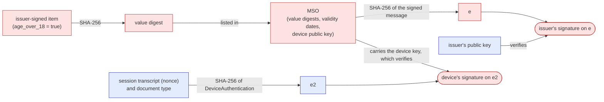
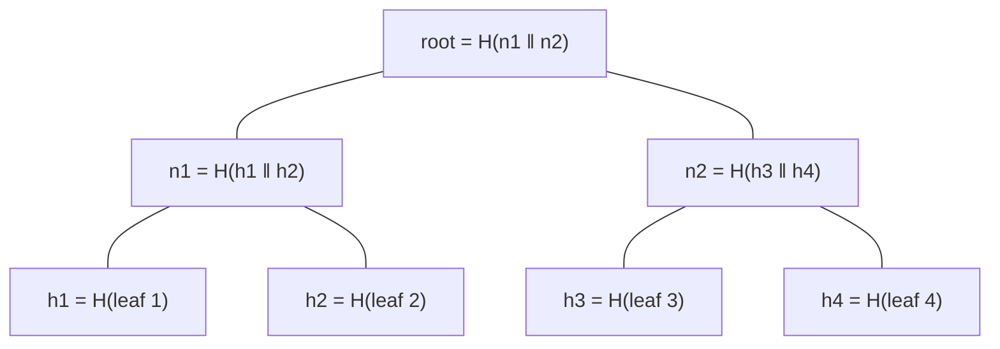
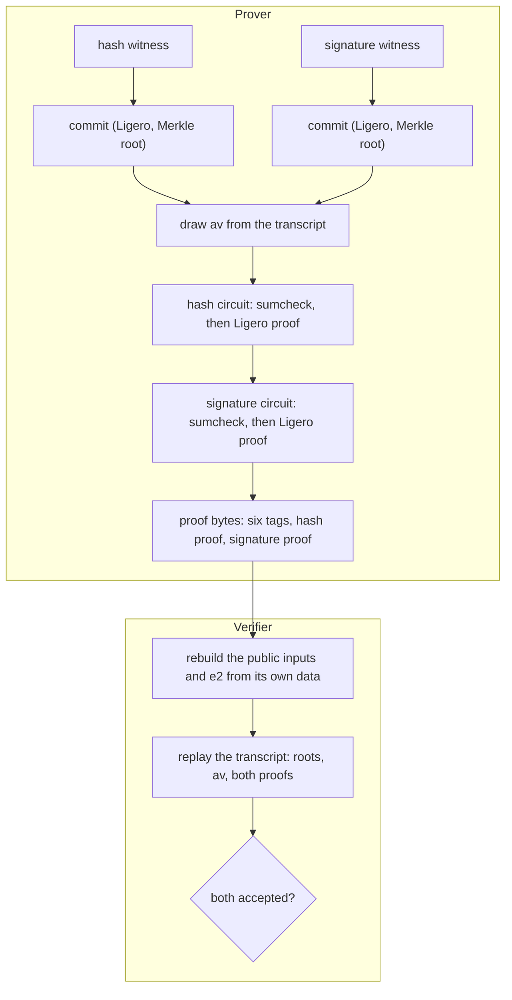

# Primer for the evaluator, part 1: the cryptography

This primer is written for an evaluator in a certification laboratory who knows neither cryptography nor SPARK (ADR 0081). It explains, from first principles, what the system does, what is claimed about it, and the cryptography it rests on. The [second part](00-primer-spark.md) explains SPARK and the evidence. The chapters of the guide apply what the primer explains, and do not repeat it.

**The essential route.** A first reading can be limited to the sections marked below, in this order: [A1](#a1-the-object-certified-and-what-certifying-it-means), [A11](#a11-longfellow-all-together), [A12](#a12-who-attacks-what), then in the second part [B3](00-primer-spark.md#b3-contracts), [B4](00-primer-spark.md#b4-ghost-code-assertion-levels-and-builds), [B6](00-primer-spark.md#b6-what-a-verification-condition-says), [B7](00-primer-spark.md#b7-proved-tested-trusted) and [B10](00-primer-spark.md#b10-a-worked-evaluation). The other sections are reference, read when a section or a chapter cites them.

The specification is draft-irtf-cfrg-longfellow-00 (ADR 0079), cited by section and not reproduced.

## Contents

- [A1. The object certified, and what certifying it means](#a1-the-object-certified-and-what-certifying-it-means) (essential route)
- [A2. Finite fields](#a2-finite-fields)
- [A3. Polynomials and random points](#a3-polynomials-and-random-points)
- [A4. Hashes and Merkle trees](#a4-hashes-and-merkle-trees)
- [A5. Commitments, and the four kinds of randomness](#a5-commitments-and-the-four-kinds-of-randomness)
- [A6. Circuits](#a6-circuits)
- [A7. The sumcheck](#a7-the-sumcheck)
- [A8. Reed-Solomon codes and Ligero](#a8-reed-solomon-codes-and-ligero)
- [A9. Fiat-Shamir](#a9-fiat-shamir)
- [A10. Signatures, CBOR and the mDoc](#a10-signatures-cbor-and-the-mdoc)
- [A11. Longfellow, all together](#a11-longfellow-all-together) (essential route)
- [A12. Who attacks what](#a12-who-attacks-what) (essential route)

## A1. The object certified, and what certifying it means

Before any mathematics: what is certified, and what certifying it means.

### A1.1 The situation

Three parties take part in a proof of age.

- **The issuer**, for example a national authority, gives a person a credential: an mDoc, the mobile document of ISO/IEC 18013-5. It holds data elements, such as a name, a birth date and the attribute `age_over_18`, and the issuer signs them.
- **The holder** keeps the credential on a device: a phone, with a key pair whose private key never leaves it. The issuer's signature also covers the device's public key, so the credential is bound to that device. During each session the device signs, with that private key, a structure that contains the **session transcript**, the record of this exchange between device and relying party defined by ISO/IEC 18013-5, which carries the relying party's fresh nonce: this shows that the credential is being presented now, by the device it was issued to, and not replayed from an earlier session.
- **The relying party**, for example a website that must admit only adults, asks the holder to show that the credential carries `age_over_18` with the value true.

Showing the signed credential would answer the question, but it would reveal everything else in it, and make the holder traceable: the issuer's signature is the same bytes at every presentation, so relying parties comparing what they received would recognise the same person, even without a name.

**A zero-knowledge proof** answers the question without showing the credential. The holder's device, as the **prover**, produces a proof: a string of bytes. The relying party, as the **verifier**, checks it. If the check passes, the relying party learns one fact:

> the prover holds a credential, signed under the issuer's public key the relying party trusts, bound to a device key that has just signed this session, valid at the date the relying party gave, that carries the requested attribute with the requested value.

Precisely: except with negligible probability, such a credential can be recovered from what the prover committed ([A11.4](#a114-how-strong-is-the-guarantee)). The relying party learns nothing else about the credential, apart from one stated exception ([A11.4](#a114-how-strong-is-the-guarantee)); "nothing else" is zero knowledge, which [A1.4](#a14-what-certifying-it-means) places among the claims.

### A1.2 The object certified

The object is a reimplementation in Ada/SPARK (a programming language and its proof tool, [B1](00-primer-spark.md#b1-ada-in-two-pages), [B2](00-primer-spark.md#b2-spark-and-what-it-rules-out)) of Longfellow ZK for this one use: the mDoc proof of age. **Upstream** means the original project: Longfellow ZK, created at Google and maintained since September 2026 by the Post-Quantum Cryptography Alliance, under Linux Foundation Europe (`github.com/longfellow-zk/longfellow-zk`). This project follows upstream's code at one fixed commit, d5e6be7, called **the pin**, and its specification, the IETF draft draft-irtf-cfrg-longfellow-00. Upstream's Lean proofs (checked by Lean, a tool for mathematical proofs, [B8](00-primer-spark.md#b8-lean-and-spark-two-kinds-of-proof)), which develop faster than its code, are read at a later commit, 7bf8a6b ([B8](00-primer-spark.md#b8-lean-and-spark-two-kinds-of-proof)); they model the protocol and the version 7 configuration of the pin. The object's parts are listed below, each with the place where the guide describes it.

**The supported profile.** It names which credentials and which circuits the system accepts. It is a fixed table of two rows, each a row of upstream's own table, held here by the SHA-256 of its files (ADR 0089; chapter 9 Section 6):

| Row | Version | Attributes | What may be claimed |
|---|---|---|---|
| `8d079211…` | 7 | 1 | upstream's Lean certificate of soundness at 116 bits, with the limits of [A11.4](#a114-how-strong-is-the-guarantee) |
| `137e5a75…` | 6 | 1 | the same code and proofs of this project; no security level is claimed |

The two rows run the same code of this project, with the same proofs and tests. What differs is the configuration of the circuits ([A8](#a8-reed-solomon-codes-and-ligero)): version 7 has the nominal rate 1/7 and opens 132 columns, version 6 the rate 1/4 and 128 columns (chapter 9 Section 1.2). Upstream's theorem is stated for the version 7 configuration, and no theorem covers the version 6 one, kept as the second archive upstream ships at the pin. So the difference between the rows is what may be claimed, not how the code is checked.

Anything else is refused before any work.

**The two circuits of a row.** A circuit is a fixed arithmetic description of the check, published as a file ([A6](#a6-circuits)).

- **The hash circuit**, over a field of 2^128 elements ([A2](#a2-finite-fields)), checks the content of the credential: its SHA-256 digests, the attribute and the dates.
- **The signature circuit**, over the base field of the curve P-256 (the integers modulo a fixed prime of 256 bits, in which the coordinates of the curve's points live; [A2](#a2-finite-fields)), checks the two ECDSA signatures ([A10](#a10-signatures-cbor-and-the-mdoc)).

Upstream's generator produces both files, and this project reads them as data. It does not produce them, and today it does not prove what they compute. In the trust model of [A1.4](#a14-what-certifying-it-means) that row is "trusted" ([A1.5](#a15-what-stays-outside)).

**The entry points.** One library entry point per role:

- `Mdoc_Prover.Prove_Profile` for the prover;
- `Mdoc_Verifier.Verify_Profile` for the verifier.

Each begins by checking that the request names a row of the profile and that the identifiers of the circuits it is given are that row's; that the files are the pinned ones is checked by the programs ([A6.4](#a64-the-registered-circuits-are-data)). Two command-line programs use them: `longfellow_prove_mdoc` and `longfellow_verify_mdoc` (chapter 9 Section 3). The prover program can also take upstream's witness files instead of a credential (`--hash-witness`); that path checks the profile and skips the witness builder ([A1.6](#a16-the-honest-prover-and-any-prover)).

**The public inputs**, which come from the relying party: the issuer's public key, the session transcript with its fresh nonce, the requested attribute (its identifier and the value asked for), the date `now` and the document type.

The proof is in fact two proofs, one per circuit, and a cheating prover could take the signature from one credential and the attribute from another. Six short values the proof also carries, the tags ([A11.2](#a112-the-two-circuits-of-the-proof-of-age)), bind the two circuits to the same digest and the same device key without revealing them.

**The secret inputs**, called the **witness**: the signed part of the credential (the mobile security object, MSO, [A10](#a10-signatures-cbor-and-the-mdoc)), the item that holds the attribute, the two signatures, intermediate values such as the steps of each SHA-256, and random pads drawn for this proof ([A5](#a5-commitments-and-the-four-kinds-of-randomness)).

The prover builds the witness from the credential: `longfellow_prove_mdoc --mdoc` (chapter 9 Section 3.7).

**The proof.** One byte string of about 360 kB for the version 7 row, in upstream's format, so that upstream's verifier accepts it and this project's verifier accepts upstream's (chapter 9 Section 1.5).

### A1.3 The three digests

Three SHA-256 digests carry the chain from the credential to the session. A hash function and its digest are explained in [A4](#a4-hashes-and-merkle-trees), and the signatures in [A10](#a10-signatures-cbor-and-the-mdoc). Here they are only named, with the names chapter 9 uses.

In the figure, red boxes are secret, part of the witness; blue boxes are public, known to the verifier.

- **The value digests:** the MSO lists the SHA-256 of every data element. The hash circuit checks that the requested one hashes to a digest that appears in the signed MSO, not where it appears (a condition of [A1.5](#a15-what-stays-outside)).
- **`e`:** the digest of the signed message, which contains the MSO. The hash circuit computes it; the signature circuit checks the issuer's signature on it.
- **`e2`:** the digest of a structure built from the session transcript and the document type. The verifier computes it; the signature circuit checks the device's signature on it, under the device key the MSO carries, which ties the proof to this session and this device.

`e`, the device key and the issuer's signature are secret, since they would identify the credential; the tags of [A11.2](#a112-the-two-circuits-of-the-proof-of-age) bind the two circuits to them without showing them ([A10.3](#a103-the-credential-and-its-three-digests) gives the details).

### A1.4 What certifying it means

An evaluator certifies a claim by following its evidence. This project sorts every claim into four kinds, and the trust model lists each claim under one of them (`docs/guide/trust-model.md`).

- **Proved.** A machine-checked proof shows it for every possible input, not only for the inputs tried. Proofs come in steps of a ladder, each including the one below ([B7](00-primer-spark.md#b7-proved-tested-trusted)).
  - **Silver**, the step every SPARK unit of this project reaches (the command-line programs and the random source are outside SPARK, and the trust model lists them): no run-time error can occur, such as an overflow or an index out of range, for any input that meets the conditions the unit states for its callers, for example that a buffer is long enough.
  - **Gold**, reached where a unit's header says so: the functional contracts the unit declares are proved, usually that it computes what a reference transcribing the specification computes, for example the field arithmetic. What Gold covers is what the contracts state ([B7.1](00-primer-spark.md#b71-the-ladder-of-proof)).

  What such a proof is, and what it is relative to, is the subject of [B3](00-primer-spark.md#b3-contracts), [B6](00-primer-spark.md#b6-what-a-verification-condition-says) and [B7](00-primer-spark.md#b7-proved-tested-trusted).
- **Tested.** It holds on test vectors whose expected answers do not come from the code under test: the specification's examples, values computed by upstream, or recomputation by independent scripts ([B7.2](00-primer-spark.md#b72-tested)). Example: upstream's verifier accepts the proofs this project makes, and this project's prover reproduces upstream's example proofs byte for byte. A test covers the cases it runs, and the evidence says which cases those are.
- **Trusted.** It is assumed, and listed so that nothing is assumed silently. Example: the compiler and the prover tools; the specification; the operating system's random generator; the circuit files. Each trusted item has a row in the trusted base register, with what depends on it and what would discharge it (`docs/guide/trusted-base.md`).
- **Outside the proofs.** Properties that no contract of this project states, with what stands in for a proof. Examples:
  - soundness, the claim that a false statement cannot be proved except with negligible probability;
  - zero knowledge, the claim that the proof reveals nothing beyond the statement;
  - constant time, the claim that the time the code takes does not depend on secrets, which is a coding discipline ([A12.3](#a123-the-observer-of-timing)).

  Soundness and zero knowledge are theorems about the protocol, proved by upstream in Lean for the version 7 row ([B8](00-primer-spark.md#b8-lean-and-spark-two-kinds-of-proof)). This project shows that its code follows the protocol those theorems are about: by proof and by test for its own steps, and by reading for the link to upstream's model ([A11.4](#a114-how-strong-is-the-guarantee)).

The fourth kind is not a separate degree of trust: what stands in for a proof there is itself proved, tested or trusted, and the register lists the trusted part (rows S1 to S4). A claim is certifiable when its kind is stated, its evidence can be re-run, and every trusted item it rests on is listed. [B10](00-primer-spark.md#b10-a-worked-evaluation) follows one claim through all of this.

### A1.5 What stays outside

Some things a proof of age needs are not checked by this repository at all. They are stated here so that no reader takes them for checks.

- **Trust in the issuer's public key.** The verifier takes the key as given. It reads no certificate chain and no trust list: choosing whom to trust is the relying party's.
- **The nonce.** Its freshness, its binding to the session and its single use are the relying party's.
- **The date `now`.** The relying party chooses it; the system reads no clock.
- **Revocation.** Whether the issuer has withdrawn the credential is not part of the proof.
- **What the circuits compute.** That the hash circuit checks the attribute and the dates, and the signature circuit the two signatures, is what upstream's source of the circuits describes. It is trusted until a later milestone of this project, Certified circuits (ADR 0091), proves it.
- **The conditions for certifying the circuit.** The circuits find some fields of the MSO by their content, at positions the prover gives ([A6.3](#a63-helping-the-circuit-what-the-prover-supplies)). The hash circuit, for example, finds the expiry date by looking for the bytes of the key `validUntil` followed by a date. If an MSO held those bytes twice, say once inside the text of another field, a prover could point the circuit at the copy with the later date. So the guarantee holds under conditions on the issuer and the relying party, here that each such pattern appears once. The one that weighs most is about the document type: the hash circuit does not read it, and it enters only through `e2`, so the guarantee rests on the relying party accepting only issuers' keys that sign that document type and no other. Chapter 9 Section 6 lists every condition, each with what breaks if it fails.

### A1.6 The honest prover and any prover

One distinction runs through the whole guide.

This project's prover, working from a credential (`--mdoc`), is **honest**: its witness builder refuses, before any work, a credential the circuits would mishandle, such as a validity date in a form the circuit compares wrongly (chapter 9 Section 3.7). Its reference path from upstream's witness files (`--hash-witness`), for tests and interoperability, skips the builder and its checks.

But a verifier does not know who made a proof. **Any prover** may send one, including a program written to cheat, which skips every check of the honest builder. So those checks protect the holder who uses this project's prover, not a verifier. A verifier is protected only by what the circuits check and what the protocol guarantees; where the circuit does not check something, the guarantee rests on a condition of chapter 9 Section 6.

An evaluator should therefore read every claim with the question: does it hold for any prover, or only for this one?

### Where this is in the code

| What | Where |
|---|---|
| The profile | `Mdoc_Spec`; chapter 9 Section 6; ADR 0089 |
| The entry points | `Mdoc_Prover.Prove_Profile`, `Mdoc_Verifier.Verify_Profile`; chapter 9 Sections 3.2 and 3.3 |
| The circuit files | `tests/vectors/upstream/mdoc/`; chapter 9 Section 1.2 |
| The public inputs, the tags, `e2` | `Mdoc_Inputs`, `Mdoc_Mac`, `Device_Auth`; chapter 9 Sections 1.3 and 1.4 |
| The witness from the credential | `Mdoc_Parse`, `Mdoc_Witness`; chapter 9 Sections 3.6 and 3.7 |
| The four kinds of claim | `docs/guide/trust-model.md`, `docs/guide/trusted-base.md` |
| The conditions for certifying the circuit | chapter 9 Section 6 |

## A2. Finite fields

Every computation of the proof system is arithmetic in a **finite field**. This section says what that is, and describes the two fields Longfellow uses.

### A2.1 What a field is

A field is a set of numbers with an addition and a multiplication that behave as the familiar ones do: both associative and commutative, multiplication distributing over addition, a zero and a one, an opposite for every element, and an inverse for every element except zero, so that division by a non-zero element is always possible.

The rational numbers form a field; the integers do not, since 1/2 is not an integer. A **finite** field has finitely many elements, and its arithmetic never overflows: every result is again one of the elements. The fields used here are large, 2^128 elements or more, because a cheating prover succeeds with a probability of about a degree divided by the size of the field ([A3](#a3-polynomials-and-random-points)).

What makes fields the right setting for proofs is the last rule, division. It is what lets a polynomial have at most as many roots as its degree ([A3](#a3-polynomials-and-random-points)), and every argument of soundness in this guide rests on that fact.

### A2.2 Arithmetic modulo a prime

The simplest finite fields are the integers modulo a prime p: the numbers 0 to p − 1, where every result is replaced by its remainder after division by p.

Modulo 7, for example, 5 + 4 = 9, which is 2, and 3 × 5 = 15, which is 1, so 5 is the inverse of 3. Every non-zero number has an inverse because 7 is prime; modulo 6 it fails, since 2 × 3 = 0.

**The base field of P-256** is of this kind, with the prime

> p = 2^256 − 2^224 + 2^192 + 2^96 − 1,

a number of 256 bits. The coordinates of the points of the curve P-256, used by both signatures ([A10](#a10-signatures-cbor-and-the-mdoc)), are elements of this field, so the signature circuit does its arithmetic here. Chapter 2 explains how such a number is held in four 64-bit words.

The **scalar field** of P-256, the integers modulo the number n of points of the curve, is another prime field. ECDSA needs it for its signature equation ([A10](#a10-signatures-cbor-and-the-mdoc)), and the witness builder computes in it. It is not a field of the circuits.

### A2.3 The field of two elements

The smallest field has two elements, 0 and 1: it is arithmetic modulo 2, called GF(2).

- Addition is the exclusive or of two bits: 1 + 1 = 0.
- Multiplication is their logical and.

So a bit is a field element, and operations on bits are field operations. Every element is its own opposite, a + a = 0, and subtraction is the same as addition. A field where 1 + 1 = 0 is said to have **characteristic 2**.

### A2.4 GF(2^128): polynomials of bits

There is a finite field of 2^k elements for every k, built from GF(2). Longfellow's hash circuit uses the one with 2^128 elements, GF(2^128).

**Its elements** are polynomials of degree below 128 whose coefficients are bits:

> a = a0 + a1·x + a2·x^2 + … + a127·x^127.

Such a polynomial is stored as 128 bits, its coefficients, so an element is two 64-bit words.

**Addition** adds the coefficients one by one in GF(2), which is the exclusive or of the two 128-bit words. It costs one machine instruction per word.

**Multiplication** multiplies the two polynomials and then reduces the result. The product of two polynomials of degree below 128 can reach degree 254. It is brought back below 128 by taking its remainder after division by a fixed polynomial of degree 128, the specification's

> Q(x) = x^128 + x^7 + x^2 + x + 1 (Section 2.2.2).

Q cannot be factored into smaller polynomials, which is to polynomials what being prime is to numbers. That is why every non-zero element has an inverse, and the polynomials modulo Q form a field. The reduction uses the rule x^128 = x^7 + x^2 + x + 1: every power from x^128 up is folded back onto low powers.

**Why this field for the hash circuit.** SHA-256 is made of operations on bits. In GF(2^128) a bit is a field element, an exclusive or is one addition and an and is one multiplication, so the hash circuit writes SHA-256 almost directly ([A11.2](#a112-the-two-circuits-of-the-proof-of-age)).

**A subfield.** Inside GF(2^128) sits a smaller field of 2^16 elements, GF(2^16). Values that fit in it can be sent in two bytes instead of sixteen, which makes the proof shorter (chapter 5). Its basis, sixteen elements fixed by the specification, also anchors the tests of the multiplication ([B10](00-primer-spark.md#b10-a-worked-evaluation)).

### A2.5 Inverses, and why the code avoids most of them

Division is the expensive operation. The code computes an inverse by a fixed chain of multiplications, raising to the power q − 2 in a field of q elements (Fermat's little theorem). That the chain gives the inverse is not proved in SPARK but tested: register row V3, among the properties tested but not proved.

The verifier is arranged so that this does not matter for soundness:

- in the sumcheck it uses three inverses only, constants computed in advance and checked by the test harness (chapter 3 Section 1.4);
- in Ligero it inverts the denominators of its interpolation tables at each proof, 2,746 for the version 7 pair, and checks every inverse by multiplying it back, so a wrong inverse is refused rather than trusted (`Checked_Inv`, chapter 5 Section 3.3).

### A2.6 Two fields, one protocol

The protocol of [A11](#a11-longfellow-all-together) is written once, for "a field", and used twice: over GF(2^128) for the hash circuit, over the base field of P-256 for the signature circuit. The code does the same: the protocol units are **generic** over a field ([B1](00-primer-spark.md#b1-ada-in-two-pages)), instantiated once for each. GNATprove proves each instance separately, so the chapters give two sets of verification conditions, one per field (chapter 3).

### Where this is in the code

| What | Where |
|---|---|
| GF(2^128) | `GF2_128`, `Clmul64`; chapter 1 |
| The base field of P-256 | `P256_Field`; chapter 2 |
| The scalar field of P-256 | `Q256_Field`; chapter 9 Section 3.5 |
| One protocol over two fields | `Field_Signature`, `Field_GF2_128`, `Field_P256`; chapter 3 Section 3 |

## A3. Polynomials and random points

One idea carries every soundness argument of Longfellow: **two different polynomials of low degree almost never agree at a random point.**

### A3.1 Polynomials over a field

A polynomial in one variable over a field ([A2](#a2-finite-fields)) is an expression

> p(x) = c0 + c1·x + c2·x^2 + … + cd·x^d,

with coefficients c0 to cd in the field. Its **degree** is the highest power with a non-zero coefficient, here d. **Evaluating** p at a point r means computing p(r), a field element.

### A3.2 A polynomial is fixed by a few values

A polynomial of degree d is fixed by its values at any d + 1 distinct points. Given those values, the polynomial can be rebuilt; this is **interpolation**, by Lagrange's formula.

So a polynomial can be sent as its values instead of its coefficients:

- each polynomial of degree 2 of the sumcheck ([A7](#a7-the-sumcheck)) is fixed by three values: the prover sends two, and the third follows from the claim;
- Reed-Solomon codes ([A8](#a8-reed-solomon-codes-and-ligero)) work the other way round: a row of data is read as the values of a polynomial at some points, and extended by evaluating that polynomial at more points.

### A3.3 Few roots, so rare agreement

A non-zero polynomial of degree d has at most d **roots**, points where it is zero. This is where division in a field matters ([A2.1](#a21-what-a-field-is)).

Take two different polynomials p and q of degree at most d. Their difference p − q is a non-zero polynomial of degree at most d, so it has at most d roots, and p and q agree on at most d points. If a point r is drawn uniformly at random from a field of size |F|, then

> the probability that p(r) = q(r) is at most d / |F|.

In GF(2^128) with d = 2 that is 2 in 2^128: never, in practice.

**This is how a verifier catches a lie without checking everything.** A prover claims that some polynomial is p. If the claim is false, the true polynomial q differs from p, and the verifier only has to compare the two at one random point r, which the prover could not know in advance. Unless the prover was lucky with probability d / |F|, the comparison fails.

The same holds for polynomials in several variables. Two different ones of total degree d agree at a random point with probability at most d / |F|. This is the **Schwartz-Zippel lemma**, the version the sumcheck uses.

### A3.4 Bits of security

A probability of failure of at most 2^−k is said to give **k bits of security**. The bound of [A11.4](#a114-how-strong-is-the-guarantee), (1 + N + tA) / 2^116, gives about 116 bits, less the logarithm of the number of attempts N + tA. Each step of the protocol contributes a term like d / |F|. The theorem adds them up over every step and every attempt a prover makes, and the field is large enough for the sum to stay negligible.

### A3.5 Tables as polynomials: multilinear extensions

The sumcheck treats a whole layer of a circuit, up to millions of wires, as one polynomial. Number the wires with n bits, so that the layer is a table of 2^n values. There is exactly one polynomial in n variables, of degree at most 1 in each, that equals the table's value at every point made of 0s and 1s, the binary numbers of the wires: the **multilinear extension** of the table. Elsewhere it is a weighted mix of the table's values. The code evaluates it one variable at a time, an operation called **bind**, each step halving the table (chapter 3 Section 1.2).

Two different tables have different extensions, so a claim about a whole layer can be checked at one random point ([A3.3](#a33-few-roots-so-rare-agreement)): one evaluation stands for millions of values. The sumcheck of [A7](#a7-the-sumcheck) reduces "the circuit accepts" to such evaluations, layer by layer, down to the inputs.

### Where this is in the code

| What | Where |
|---|---|
| Polynomials of degree 2 by three values; the Lagrange basis | chapter 3 Section 1.4 |
| Multilinear extensions and bind | chapter 3 Section 1.2; `Sumcheck_Algebra` |
| Interpolation for the Reed-Solomon code | chapter 5 Section 2.3; `Lagrange` |
| The security bound | the Lean correspondence page |

## A4. Hashes and Merkle trees

### A4.1 What a hash function promises

A **hash function** maps an input of any length to a short output of fixed length, its **digest**. SHA-256, the one used throughout, gives 32 bytes. Two properties matter:

- **Preimage resistance.** Given a digest, nobody can find an input that hashes to it.
- **Collision resistance.** Nobody can find two different inputs with the same digest.

So a digest stands for its input. The issuer signs the digest `e` of a structure that contains the MSO ([A10.3](#a103-the-credential-and-its-three-digests)), not the MSO itself: finding another MSO with the same digest would be a collision.

These are assumptions about SHA-256, not theorems. Upstream's proofs go further and model the hash as a **random oracle**, an idealised function that answers every new input with an independent random value: a standard model, and an assumption of the security level ([A11.4](#a114-how-strong-is-the-guarantee)).

### A4.2 A Merkle tree: a commitment to a long vector

A **Merkle tree** gives one short digest, its **root**, for a long list of values, its **leaves**: hash each leaf, then hash the digests in pairs, and those results in pairs, up to a single digest.

Publishing the root fixes every leaf. Changing any leaf changes its digest, and so every digest on the way up to the root, unless there is a collision.

**Opening a leaf.** To show that a value is leaf 2 of the tree, the prover gives the leaf and the digests beside its path: h1 and n2 in the figure. The verifier recomputes h2, then n1, then the root, and compares the result with the published root. The opening has one digest per level, about log2 of the number of leaves, however long the list.

**Opening many leaves at once** shares the digests their paths have in common: a **batch proof** (chapter 5 Section 1.2).

In Longfellow the leaves are the committed columns of the prover's encoded table ([A8](#a8-reed-solomon-codes-and-ligero)). Each column is hashed with a fresh random **leaf nonce**, not to be confused with the relying party's nonce, so that the digest of a column reveals nothing about the column even when the column holds secrets ([A5](#a5-commitments-and-the-four-kinds-of-randomness)). The root is the commitment of [A11.1](#a111-the-idea-in-plain-words), move 2.

### A4.3 SHA-256 in the circuit and outside it

SHA-256 appears in two roles, which should not be confused:

- **Outside the circuits**, in the code: the Merkle tree, the Fiat-Shamir transcript ([A9](#a9-fiat-shamir)), the digest `e2` the verifier computes. The transcript and the verifier hash public data; the prover's Merkle tree hashes secret columns and nonces, most never opened, so there it handles secrets ([A12.3](#a123-the-observer-of-timing)).
- **Inside the hash circuit**, as arithmetic over GF(2^128): the circuit recomputes the digest of the MSO and of the item from the secret bytes in the witness ([A6](#a6-circuits)).

The first is a unit of this project, `Sha256`, proved free of run-time errors (Silver, chapter 4 Section 4.2) and tested against the NIST vectors; that it computes SHA-256 beyond the vectors is register row V1. The second is part of the circuit, whose meaning is trusted today ([A1.5](#a15-what-stays-outside)).

### Where this is in the code

| What | Where |
|---|---|
| SHA-256 | `Sha256`; chapter 4 |
| The Merkle tree and its batch proofs | `Merkle`; chapter 5 Sections 1.2 and 2.1 |
| The nonces of the columns | chapter 5 Section 1.1; chapter 7 |

## A5. Commitments, and the four kinds of randomness

### A5.1 What a commitment is

A **commitment** works like a sealed envelope: the prover puts a value inside and hands it over, and may later prove things about what is inside. It is **binding**, the value cannot be changed afterwards, and **hiding**, the envelope reveals nothing about it. In Longfellow the prover commits to its witness before the verifier's challenges exist, so it cannot fit the witness to them.

### A5.2 How Longfellow commits

The prover's commitment is built in four steps (chapter 5 Section 1.1):

1. **Arrange.** The values to commit, the witness, are laid out in the rows of a table. The **combined witness** is the circuit's private inputs ([A1.2](#a12-the-object-certified)) followed by the sumcheck's pads ([A5.3](#a53-the-four-kinds-of-randomness)).
2. **Blind.** Each row is prefixed with random **blinding values**, and a few rows of pure randomness are added.
3. **Encode.** Each row is extended by a Reed-Solomon code to many more entries ([A8](#a8-reed-solomon-codes-and-ligero)). The extended table is the **tableau**.
4. **Hash.** Each column of the tableau, from a fixed position on, is hashed with its own random **nonce**. The first columns hold the data and the blinding values themselves; they are never hashed or opened. The digests are the leaves of a Merkle tree ([A4.2](#a42-a-merkle-tree-a-commitment-to-a-long-vector)), and its root is the commitment.

**Binding** comes from the Merkle root and the code together. The root fixes the committed columns, unless SHA-256 has a collision. Those columns fix the rest of each row, data included, because a row of the code is fixed by enough of its positions ([A3.2](#a32-a-polynomial-is-fixed-by-a-few-values)); for a prover whose rows are not codewords at all, the tests of [A8](#a8-reed-solomon-codes-and-ligero) take over.

**Hiding** comes from the randomness: the verifier will see only a few columns ([A8](#a8-reed-solomon-codes-and-ligero)), each one a mix of real values and blinding values.

### A5.3 The four kinds of randomness

A proof uses fresh random values in four places. Each hides something different, and none may be reused across proofs ([A12.2](#a122-the-curious-verifier)).

| Kind | Where | What it hides |
|---|---|---|
| **Sumcheck pads** | in the combined witness, one per value the sumcheck would send, plus one per layer for a product ([A7.4](#a74-padding-the-messages-reveal-nothing)) | the sumcheck's messages: each is sent minus a pad, so it looks random ([A7](#a7-the-sumcheck)) |
| **Ligero blinding** | the first entries of each row, and the random rows | the opened columns and the combinations of rows Ligero sends ([A8](#a8-reed-solomon-codes-and-ligero)) |
| **Leaf nonces** | one per committed column, hashed with it | the digests of the columns that are not opened |
| **MAC pads** (`mac_ap`), also called one-time pads | in both witnesses of the proof of age | the three secret values in the six public tags ([A11.2](#a112-the-two-circuits-of-the-proof-of-age)) |

The first three are part of every Longfellow proof. The fourth belongs to the proof of age, which binds two proofs together.

All four are drawn from the program's random source when the proof is made: the operating system's generator, a trusted item ([A1.4](#a14-what-certifying-it-means)), or, with the option `--seed`, a predictable generator meant only for tests (register row C1).

### A5.4 The running example begins

The toy statement of [A11.3](#a113-a-running-example): the prover knows a secret w whose square is the public number y.

- **The circuit** has one layer. Its inputs are the constant 1, the public y and the secret w. Its one output is y − w·w, which the prover claims is zero.
- **The combined witness** is w, followed by the pads the sumcheck of that one layer will use. Section [A7](#a7-the-sumcheck) says how many and what for.
- **The commitment.** The prover lays these values out in a row, blinds and encodes it, hashes the columns with their nonces, and publishes the root.

From now on the prover cannot change w or the pads, and the proof does not show them.

### Where this is in the code

| What | Where |
|---|---|
| The commitment | `Ligero_Prover`; chapter 7 Section 1; chapter 5 Section 1.1 |
| The combined witness and its layout | chapter 3 Sections 1.5 and 1.6 |
| The random source | `Os_Random`, `Cli_Random`; the trusted base register, rows C1 and P4 |
| The MAC pads | `Mdoc_Inputs.Place_Pads`; chapter 9 Section 1.6 |

## A6. Circuits

### A6.1 A check written as arithmetic

A proof system proves that an arithmetic **circuit** accepts some inputs: a fixed recipe of additions and multiplications over a field ([A2](#a2-finite-fields)), drawn as wires in layers numbered from the outputs. Layer 0 holds the outputs; the last layer holds the inputs, in order the constant 1, the public inputs and the private inputs ([A1.2](#a12-the-object-certified)); every other wire is computed from the layer just below it.

**Terms.** A wire of layer j is a sum of **terms**, each a constant coefficient times the product of two wires of layer j + 1, its two **hands**:

> V_j[g] = Σ k · V_{j+1}[l] · V_{j+1}[r].

A hand may be the constant 1, carried from layer to layer like any wire, so a term can also be a plain wire times a coefficient. This is the "quad" form of the specification (Section 6.3).

### A6.2 What "the circuit accepts" means

A circuit **accepts** its inputs when both of the following hold (chapter 3 Section 1.1):

- **every output wire is zero;**
- **every assertion holds.** An assertion is a term with coefficient 0, which states that the product of its two hands is zero. It adds nothing to any wire, so it is checked separately.

A check is written so that it passes exactly when every output is zero. To check that two values a and b are equal, the circuit computes a − b as an output. To check that a value is a bit, it uses an assertion, or an output, for b·b − b, which is zero only for 0 and 1.

There are **no free wires**: every wire is a function of the inputs, computed layer by layer. So "the circuit accepts" is a property of the inputs alone, computed by evaluating the circuit from the inputs up (`Eval_Circuit`, chapter 3).

### A6.3 Helping the circuit: what the prover supplies

A circuit may check more than it computes. Instead of recomputing SHA-256 over many layers, the circuit takes the state after each round of each block as private inputs, supplied by the prover, and checks each step against the next. That is why the witness of [A1.2](#a12-the-object-certified) holds the steps of each SHA-256: checking is cheaper than computing, and a wrong value fails the check of its step.

The same holds for the positions of the fields in the MSO: the prover supplies them, and the circuit checks what is at the position given, not that it is the only such position. That is where the conditions of [A1.5](#a15-what-stays-outside) come from.

### A6.4 The registered circuits are data

The two circuits of the proof of age are files: one per circuit, produced by upstream's generator from a description of the check written in C++, and pinned here by the SHA-256 of their content ([A1.2](#a12-the-object-certified)). The version 7 hash circuit has 17 layers and 7,757,579 terms, the signature circuit 21 layers and 481,833 (counted from the files by `read_lfc2` in `tests/vectors/gen_circuit_vectors.py`).

The generator **optimises**. It shares common values, folds constants, and copies wires from layer to layer. So the gadgets of the description, an adder or a SHA-256 round, cannot be seen in the file. A term in the file is just a term.

This project:

- **reads the files** (`Circuit_Reader`);
- **proves their shape**: the indices in range, the layers consistent (`Well_Formed`);
- **checks the identifier** of each file against the one the profile names: for a pinned file by its SHA-256, recomputing it in full otherwise (ADR 0074).

It does not prove what a circuit computes, which stays trusted today ([A1.5](#a15-what-stays-outside)). A checker for that is planned (ADR 0091).

### A6.5 The running example as a circuit

The toy statement of [A11.3](#a113-a-running-example) has one layer above its inputs (1, y, w), and one output wire:

> V_0[0] = 1 · y · 1 + (−1) · w · w,

two terms. The circuit accepts when y − w·w = 0, that is, when w is a square root of y. Over GF(2^128), where subtraction is addition, the coefficient −1 is simply 1.

### Where this is in the code

| What | Where |
|---|---|
| The quad form and what "accepts" means | chapter 3 Section 1.1; `Eval_Circuit` in `Sumcheck_Algebra` |
| The circuit file, its reader and its shape | chapter 6; `Circuit_Reader` |
| The registered circuits | `tests/vectors/upstream/mdoc/`; chapter 9 Section 1.2 |
| What the circuits compute | the trusted base register, row R2; ADR 0091 |

## A7. The sumcheck

The sumcheck lets the prover convince the verifier that a circuit's outputs are zero, without the verifier evaluating the circuit and without the prover revealing any wire. It goes from the outputs down to the inputs, one layer at a time.

### A7.1 One claim per layer

**Start.** The prover claims that every output is zero. By [A3.5](#a35-tables-as-polynomials-multilinear-extensions), this holds exactly when the multilinear extension of the output layer is the zero polynomial. So the verifier draws a random point g and the claim becomes one field element: the extension of the outputs at g is 0. If some output were not zero, this would fail except with probability about the number of bits of an output wire's number, divided by |F| ([A3.3](#a33-few-roots-so-rare-agreement)).

**The step to the next layer.** By [A6.1](#a61-a-check-written-as-arithmetic), every wire of layer j is a sum of terms over the wires of layer j + 1. Extended to polynomials, the claim about layer j at the point g becomes

> claim = Σ over all pairs (l, r) of  Q(g, l, r) · V(l) · V(r).

Here l and r run over the binary numbers of the wires of layer j + 1, V is the extension of that layer, and Q, the extension of the layer's terms, is public: the verifier can compute it from the circuit. The assertions of [A6.2](#a62-what-the-circuit-accepts-means) are folded in: their terms enter Q with a fresh random coefficient β, so that a violated assertion makes the claim false like a non-zero output (Section 6.3.3).

The sum has as many terms as there are pairs of wires: about 10^12 for a layer of a million wires. The verifier cannot add them. The sumcheck lets it check the sum anyway.

### A7.2 The rounds

Write the bits of l and of r as variables, 2n of them. The sum is over all 0/1 values of those variables. Each round fixes one bit of one hand; Longfellow takes bit 1 of l, then bit 1 of r, then bit 2 of each, and so on (chapter 3 Section 1.3).

**Round 1.** The prover sends the polynomial p1(x), obtained by setting the first variable to x and summing over all the others. It has degree 2 in x, because Q · V(l) · V(r) has degree at most 2 in each variable. It is fixed by its values at three points ([A3.2](#a32-a-polynomial-is-fixed-by-a-few-values)): 0, 1 and a third point, 2 on P-256 and a fixed element β1 on GF(2^128), where 2 is 0.

In the textbook sumcheck the prover sends all three values and the verifier checks p1(0) + p1(1) = claim, which must hold, since summing over the first variable too gives the whole sum. Longfellow saves one value: the prover sends p(0) and the value at the third point, and the verifier **defines** p(1) = claim − p(0). The equation then holds by construction, and nothing is tested in the round. A lie is not caught here; it is carried to the end, where Ligero catches it ([A7.3](#a73-why-a-lie-does-not-survive)).

The verifier then draws a random r1, and the new claim is p1(r1): the same sum with the first variable fixed to r1.

**Rounds 2 to 2n** do the same with the next variable, each fixing one more variable to a fresh random value.

**The end.** After the last round every variable is fixed, and the sum has collapsed to a single term:

> claim = Q(g, rl, rr) · V(rl) · V(rr),

where rl and rr are the random values of the bits of l and of r. The verifier computes Q(g, rl, rr) itself, from the public circuit. The prover sends the two values V(rl) and V(rr), which the verifier cannot compute.

These two values are **claims about layer j + 1** at random points, which the next layer must justify; the protocol combines them into one with another random challenge. **At the input layer**, a claim is a weighted sum of the inputs with weights the verifier can compute. The verifier computes the public part itself; the private part is about committed values ([A5](#a5-commitments-and-the-four-kinds-of-randomness)), so the claim becomes an equation about them.

### A7.3 Why a lie does not survive

Suppose a claim is false. Then the honest polynomial p1 does not satisfy p1(0) + p1(1) = claim. Whatever two values the prover sends, the polynomial p1′ they define with the claim does satisfy it, so p1′ is not p1.

Two different polynomials of degree 2 agree at the random r1 with probability at most 2 / |F| ([A3.3](#a33-few-roots-so-rare-agreement)). So, except with that probability, the next claim p1′(r1) is false too. The lie is pushed into the next round, and the next, and in the end into a claim about the inputs, which the commitment fixes and Ligero checks ([A8](#a8-reed-solomon-codes-and-ligero)).

The cheating prover's only hope is to be lucky at some round, about 2 / |F| each time; upstream's theorem adds these chances up ([A3.4](#a34-bits-of-security), [A11.4](#a114-how-strong-is-the-guarantee)).

### A7.4 Padding: the messages reveal nothing

Sent as they are, the values and the claims would reveal information about the wires, and so about the witness. Longfellow sends each of them **padded**, minus one of the sumcheck pads committed in the combined witness ([A5.3](#a53-the-four-kinds-of-randomness)), so the verifier sees only random-looking numbers. Having no check to do in the round, it carries the protocol out **symbolically**: each true value is "the number received plus an unknown pad", and the claims it computes are expressions in the committed pads.

At the end of a layer it holds:

- **a linear equation** in the committed values: the claim the layer ends with, which the bound term must equal;
- **a quadratic equation** for the product V(rl) · V(rr) of the last step, written with three committed pads c0, c1 and cr: c0 · c1 = cr.

So the verifier's sumcheck ends not in a verdict but in linear and quadratic equations about the committed witness, which Ligero proves ([A8](#a8-reed-solomon-codes-and-ligero)): the bridge from the textbook sumcheck to this implementation (chapter 3 Section 1.5).

### A7.5 The running example

The toy circuit of [A6.5](#a65-the-running-example-as-a-circuit) has one output and three input wires (1, y, w), so a wire number has two bits and the layer has four rounds, two per hand. Each round sends two padded values: eight pads. The two claims about the inputs and their product use three more, c0, c1 and cr: 4 × 2 + 3 = 11 pads, all committed with w in [A5.4](#a54-the-running-example-begins). Each claim is a known weighted sum of 1, y and w; the verifier computes the parts of 1 and y and keeps the part of w. So it ends with equations linear in w and the pads, plus c0 · c1 = cr, which [A8](#a8-reed-solomon-codes-and-ligero) proves.

### Where this is in the code

| What | Where |
|---|---|
| The protocol of one layer | chapter 3 Sections 1.3 and 1.4; `Sumcheck_Verifier`, `Sumcheck_Prover` |
| The padded, symbolic verifier and its equations | chapter 3 Sections 1.5 and 1.6; `Sumcheck_Expression` |
| The pads in the witness | chapter 3 Section 1.6 |
| The prover's side | chapter 7 Section 1 |

## A8. Reed-Solomon codes and Ligero

The sumcheck of [A7](#a7-the-sumcheck) leaves the verifier with linear and quadratic equations about the committed witness. Ligero proves that they hold, while opening only a few random columns of the committed table.

### A8.1 Reed-Solomon codes

A **Reed-Solomon code** turns a row of k values into a longer row of N values: read the k values as the values of a polynomial of degree below k at k fixed points, and evaluate that polynomial at N points. The long row is a **codeword**. In the version 7 hash circuit a row has k = 461 values and is extended to N = 4,151 (455 and 4,096 for the signature circuit).

Two properties make codes useful here:

- **Distance.** Two different polynomials of degree below k agree on fewer than k points ([A3.3](#a33-few-roots-so-rare-agreement)), so two different codewords differ in at least N − k + 1 positions, most of them.
- **Linearity.** A weighted sum of codewords is a codeword, so one weighted sum checks many rows against the code at once.

### A8.2 The tableau and the opened columns

The commitment of [A5.2](#a52-how-longfellow-commits) is a table of rows. Each row holds blinding values, then a piece of the witness, and is extended into a codeword. The first 2k − 1 columns (921 in the hash circuit) are never committed. A product of two rows is a polynomial fixed by 2k − 1 values, and the prover's answers to the linear and quadratic tests are given on those positions (Section 4.2 of the specification; chapter 5 Sections 1.4 and 1.5); the opened columns are drawn after them. The others, 3,230 in the hash circuit and 3,187 in the signature circuit, are hashed into a Merkle tree whose root is the commitment. The configuration's nominal rate, 1/7, is the row's length over this committed part.

At the end of the proof the verifier draws 132 of the committed columns at random. The prover reveals them with a Merkle batch proof ([A4.2](#a42-a-merkle-tree-a-commitment-to-a-long-vector)), and the verifier checks them against the root. Each test below checks agreement at those columns, in the same pattern, and the linear and quadratic tests add their own algebraic condition ([A8.3](#a83-the-three-tests)):

1. the verifier draws random coefficients;
2. the prover sends one short row, a combination of the tableau's rows that the coefficients determine;
3. the verifier extends that row itself, and checks that it agrees, at every opened column, with the same combination of the opened columns.

### A8.3 The three tests

**The low-degree test** checks that the witness rows are codewords, or close to them: the prover sends a random combination of them, which must be a codeword.

**The linear test** checks the linear equations of the sumcheck. The verifier combines them into one, with random weights, whose left side is a weighted sum of witness entries. The prover sends a row from which that sum can be read; the verifier checks the row at the opened columns, and checks that the sum is the right side. A witness that broke one of the equations would break the combined one, except with probability about 1 / |F|.

**The quadratic test** checks the products x · y = z. The tableau holds extra rows with copies of the factors and of the products, tied to the witness by linear equations, which the linear test covers. The products must hold at the witness positions only, since encoding does not preserve products. The prover sends a random combination of the differences z − x · y, a polynomial of larger degree that must be zero at those positions, and the verifier checks it at the opened columns.

### A8.4 Why it is sound, and why it hides

**Sound, in outline.** A cheating prover's rows are either far from every codeword, or close to some. If they are far, a random combination of them is very likely far too, and the low-degree test fails at many of the opened columns. If they are close, the linear and quadratic tests are in effect about the codewords near them: a witness that breaks an equation makes the prover's answer a different codeword from the one it should be, and so differ from it in most positions ([A8.1](#a81-reed-solomon-codes)). The prover must hope that all 132 random columns fall where they agree, and the columns are drawn after its answers are fixed ([A9](#a9-fiat-shamir)). Making this precise needs more care than the outline: there can be several codewords near a row, and a random combination can hide an error. Upstream's theorem handles both and gives the bound ([A11.4](#a114-how-strong-is-the-guarantee)).

**Hiding.** The verifier sees 132 of the committed columns and a few combinations of rows.

- Each row starts with 132 random blinding values, as many as there are opened columns, so the opened columns of the encoded rows look uniformly random.
- Each combination the prover sends includes a row of pure randomness, so it reveals nothing about the witness rows either.

### A8.5 The running example ends

The equations of [A7.5](#a75-the-running-example), linear in w and the eleven pads plus c0 · c1 = cr, are about the twelve values of the committed row of [A5.4](#a54-the-running-example-begins). Ligero opens the random columns against the root and runs its three tests there. The verifier accepts if all pass: the final check of [A11.3](#a113-a-running-example). It never read w from the proof, and it is convinced, except with negligible probability, that w · w = y. (Here y determines w, as every element of GF(2^128) has one square root: the toy shows mechanics, not secrecy.)

### Where this is in the code

| What | Where |
|---|---|
| The code and the interpolation | chapter 5 Sections 1.1 and 2.3; `Lagrange` |
| The tableau, the tests, the opened columns | chapter 5 Sections 1.3 to 1.6; `Ligero_Verifier`, `Ligero_Prover` |
| The geometry: rows, columns, the 132 openings | chapter 5 Section 2.2; `Ligero_Geometry` |
| The version 7 parameters | chapter 9 Section 1.2 |

## A9. Fiat-Shamir

### A9.1 From a conversation to a string

The sumcheck and Ligero are described as a conversation: the prover sends something, the verifier answers with a random challenge. A proof of age must instead be one message the relying party checks alone. The **Fiat-Shamir transform** removes the verifier's turns: every challenge is computed as a hash of everything written so far, the **transcript**, and the verifier recomputes the same challenges from the proof bytes. (It is not the session transcript of [A1.1](#a11-the-situation), which it absorbs first.)

### A9.2 Why the challenges stay unpredictable

A challenge is a hash of everything before it. The security argument treats that hash as a random oracle ([A4.1](#a41-what-a-hash-function-promises)): each new input gets an independent, uniform answer, so the prover cannot predict a challenge before it has fixed everything the challenge depends on.

What the prover can do is try: change something, recompute, look at the new challenge. Each recomputation is an attempt, which the bound of [A11.4](#a114-how-strong-is-the-guarantee) counts.

### A9.3 Everything must go in, and in order

Fiat-Shamir is only as sound as its transcript is complete: a value not hashed before a challenge can be chosen after seeing it. This happened in other systems that forgot to hash the public inputs, under the name **Frozen Heart**.

Longfellow's transcript takes, in a fixed order:

1. the session transcript of the proof of age, so every challenge depends on the relying party's nonce ([A11.1](#a111-the-idea-in-plain-words));
2. the commitments' roots, both of them;
3. the key `av` of the tags, drawn only now, so that the values the tags bind are fixed before it exists ([A11.2](#a112-the-two-circuits-of-the-proof-of-age));
4. for each proof, the statement (the circuit's identifier and its public inputs), then each message of the sumcheck and of Ligero, each followed by the challenges drawn from it.

That every public value is absorbed before the challenges that depend on it is a trusted item (register row S3), resting on reading, since the order was compared with upstream's code, and on interoperability: a transcript that differed from upstream's in one byte would draw other challenges and fail upstream's verifier.

### A9.4 How the transcript makes challenges

The transcript follows Section 3 of the specification:

- **Absorbing.** SHA-256 absorbs every value written to the transcript, each in a frame that records its kind and, for values of variable length, its length, so that two different sequences of values cannot give the same bytes.
- **Drawing.** When a challenge is needed, the digest of everything absorbed so far seeds a generator, AES-256 in counter mode, whose output bytes are turned into field elements.

Over P-256, the conversion of bytes into field elements discards a byte string that is not the code of an element and draws again, so that every element is equally likely (rejection sampling). Over GF(2^128) every 16 bytes are an element, and no element is redrawn. The positions of the opened columns, numbers below a bound, are drawn by rejection in both fields (register row V4).

### Where this is in the code

| What | Where |
|---|---|
| The transcript and its frames | `Transcript`; chapter 4 |
| The replay of a proof's challenges | `Sumcheck_Transcript`; chapter 4 Section 2 |
| The transcript of the proof of age | chapter 9 Section 1.4 |
| Its completeness, trusted | the trusted base register, row S3 |

## A10. Signatures, CBOR and the mDoc

### A10.1 ECDSA on P-256

**The curve and its points.** P-256 is an elliptic curve: a set of points (x, y) with coordinates in the base field of [A2.2](#a22-arithmetic-modulo-a-prime), with an addition of points. Adding a point to itself k times is written k·G.

**The keys.** One point G is fixed by the standard. A private key is a number d between 1 and n − 1, where n is the number of points of the curve. The public key is the point K = d·G, a valid point of the curve. Recovering d from K is believed infeasible.

**A signature** on a digest e is a pair of numbers (r, s) with 1 ≤ r, s < n. To verify it:

1. compute u1 = e / s and u2 = r / s, in the scalar field of [A2.2](#a22-arithmetic-modulo-a-prime);
2. compute the point R = u1·G + u2·K, and refuse if it is the point at infinity, the neutral element of the addition of points;
3. accept if the x-coordinate of R, reduced modulo n, equals r.

The proof of age contains two such verifications, both inside the signature circuit:

- **the issuer's signature** on `e`, under the issuer's public key, which is public;
- **the device's signature** on `e2`, under the device's public key, which is secret: it is in the MSO.

The circuit checks a stricter form without division, as upstream's `verify_circuit.h` states it: e·G + r·K − s·R is the point at infinity, where the x-coordinate of R must equal r itself, below n. A valid signature whose x(R) is n or more fails the circuit; for an honest signature that happens with probability about 2^-130, so no issuer or device will meet it. The prover supplies R and the intermediate points as witness values ([A6.3](#a63-helping-the-circuit-what-the-prover-supplies)); chapter 9 Section 3.5 gives the layout.

### A10.2 CBOR and COSE

**CBOR** (RFC 8949) is a binary encoding of structured data, like JSON in bytes. Every item begins with a **head**: its type (an integer, a byte string, a text string, an array, a map, a tag) and an argument: a length, a value, a tag's number, or a simple value such as `true`; strings, arrays and maps may also have an indefinite length. The mDoc is CBOR throughout.

**COSE** (RFC 9052) is the format of signed CBOR. A signature is computed over a `Sig_structure`: fixed bytes that name the context, followed by the signed content. Both signatures of the proof of age are COSE signatures.

### A10.3 The credential and its three digests

The issuer-signed part of an mDoc has two pieces.

**The issuer-signed items.** There is one item per data element. Each is a small CBOR map with four entries:

- `digestID`, a number;
- `random`, at least 16 random bytes, a salt;
- `elementIdentifier`, the name, such as `age_over_18`;
- `elementValue`, the value.

The salt makes the item's digest reveal nothing about its value, even for a value with only two possibilities.

**The MSO**, the mobile security object, a CBOR map that holds:

- the digest of every item, under `valueDigests`;
- the device's public key, under `deviceKeyInfo`;
- the validity dates, `validFrom` and `validUntil`, under `validityInfo`;
- the document type.

The issuer signs the MSO, as a COSE structure.

The three digests of [A1.3](#a13-the-three-digests), in detail:

- **A value digest** is the SHA-256 of one issuer-signed item, wrapped in a CBOR tag, as the bytes the issuer wrote. The hash circuit recomputes the digest of the requested item and finds it in the MSO.
- **`e`** is the SHA-256 of the `Sig_structure` of the issuer's signature: its fixed header, the head of a byte string, and the MSO wrapped in a CBOR tag. The hash circuit recomputes it from the MSO's bytes, and the signature circuit verifies the issuer's signature on it.
- **`e2`** is the SHA-256 of the `Sig_structure` of the device's signature, built from the session transcript and the document type (ISO/IEC 18013-5, `DeviceAuthentication`). The verifier computes it from public data, and the signature circuit verifies the device's signature on it.

The circuits read the CBOR at the positions the prover gives, and check the bytes found there ([A6.3](#a63-helping-the-circuit-what-the-prover-supplies)). That is the source of the conditions on the issuer of chapter 9 Section 6.

### Where this is in the code

| What | Where |
|---|---|
| The curve and ECDSA | `P256_Curve`, `Ecdsa_Witness`, `Q256_Field`; chapter 9 Section 3.5 |
| The parse of the CBOR | `Cbor_Parse`, `Mdoc_Parse`; chapter 9 Section 3.6 |
| `e2` | `Device_Auth`; chapter 9 Section 1.4 |
| The items, the MSO and the witness | `Mdoc_Witness`; chapter 9 Section 3.7 |

## A11. Longfellow, all together

### A11.1 The idea in plain words

The prover convinces the verifier that a secret, the credential, satisfies a public check, "signed by this issuer, carrying this attribute, valid today", without showing it.

Longfellow does it in four moves.

1. **Write the check as a circuit** ([A6](#a6-circuits)): a public, fixed list of additions and multiplications over a field (a set of numbers with the four operations, [A2](#a2-finite-fields)), whose outputs are zero, and whose internal assertions hold, exactly when the check passes.
2. **Lock the secret in a box.** The prover puts the circuit's private inputs (the secret and helper values such as the steps of each SHA-256) and random padding into a commitment ([A5](#a5-commitments-and-the-four-kinds-of-randomness)), the root of a Merkle tree ([A4](#a4-hashes-and-merkle-trees)). The prover can no longer change what is inside, and the verifier cannot see inside.
3. **Show the circuit accepts, without opening the box.** The prover runs the sumcheck ([A7](#a7-the-sumcheck)) layer by layer, from the outputs down to the inputs. The wires of the layers are computed by the prover and never committed. Every message is padded with random values from the box, so it reveals nothing. At the end the verifier holds no verdict yet, but linear and quadratic equations about the contents of the box.
4. **Show the equations hold, still without opening the box.** Ligero ([A8](#a8-reed-solomon-codes-and-ligero)) proves them. The verifier sees a few random columns of an encoded form of the box: too few to learn anything, enough to catch, with overwhelming probability, contents that violate an equation.

Fiat-Shamir ([A9](#a9-fiat-shamir)) turns this conversation into one string of bytes: every challenge the verifier would choose is replaced by a hash of everything written before it, so the verifier checks the proof without any dialogue. The proof is still good for one session only: the first thing hashed is the session transcript with the relying party's fresh nonce, so every challenge depends on it, and a proof made for one session fails in any other.

### A11.2 The two circuits of the proof of age

The proof of age has two circuits, one per field, because the two halves of the work are cheap in different arithmetic ([A1.2](#a12-the-object-certified), [A2](#a2-finite-fields)). SHA-256 is made of operations on bits, and in GF(2^128) a bit is a field element and the exclusive or of two bits is one addition. ECDSA is arithmetic modulo the prime of the curve P-256, which is exactly the base field of the signature circuit. The one exception is the binding below: the signature circuit computes each tag, a product in GF(2^128), bit by bit over the P-256 field, at the cost of a large share of its wires.

- **The hash circuit** works over GF(2^128). It hashes the MSO and the attribute's item, and compares the dates.
- **The signature circuit** works over the base field of P-256. It verifies the two signatures.

Each circuit gets its own commitment, sumcheck and Ligero proof: the proof of age is two Longfellow proofs.

What makes them one statement is the binding of chapter 9 Section 1.3, with the MAC pads of [A5.3](#a53-the-four-kinds-of-randomness):

1. Both commitments are written first.
2. Then a challenge, called `av`, is drawn from the Fiat-Shamir transcript ([A9](#a9-fiat-shamir)).
3. Each circuit checks six tags, computed from `av`, from one-time pads, and from the three secret values the circuits share: the digest `e` and the two coordinates of the device key ([A1.3](#a13-the-three-digests)). Each value has 256 bits and a field element of GF(2^128) holds 128, so each value is split in two halves, with one tag each: three values, six tags. A message authentication code (MAC) computes each tag as tag = (av + pad) · half, in GF(2^128) (chapter 9 Section 1.3).

The tags are public. A prover that gave the two circuits different values would need the tags to agree by chance. Since `av` is drawn after both commitments, for one pair of different values that chance is at most one in 2^128. The composed bound of [A11.4](#a114-how-strong-is-the-guarantee) accounts for every attempt and for the several witnesses a commitment may be close to.

The transcript takes, in a fixed order, the session transcript, the two roots, `av`, then the two proofs, and the verifier replays that order from the proof bytes.

### A11.3 A running example

Sections [A5](#a5-commitments-and-the-four-kinds-of-randomness) to [A8](#a8-reed-solomon-codes-and-ligero) follow one toy statement from end to end: **the prover knows a secret w whose square is the public number y.** As a circuit ([A6.5](#a65-the-running-example-as-a-circuit)) it has the inputs 1, y and w, and one output, y − w·w, which must be zero. [A5](#a5-commitments-and-the-four-kinds-of-randomness) commits w with the sumcheck's pads; [A7](#a7-the-sumcheck) turns "the output is zero" into linear equations and one quadratic equation about the committed values; [A8](#a8-reed-solomon-codes-and-ligero) proves them.

The final check is the one the verifier of the proof of age also ends with: it accepts if and only if the sumcheck's equations pass Ligero's tests at the opened columns, and those columns agree with the Merkle root.

### A11.4 How strong is the guarantee

**Soundness**, that a false statement is accepted only with negligible probability, is a theorem of upstream, proved in Lean ([B8](00-primer-spark.md#b8-lean-and-spark-two-kinds-of-proof)). A cheating prover cannot choose the challenges, but it can recompute the hashes until one is favourable, each recomputation an attempt ([A9.2](#a92-why-the-challenges-stay-unpredictable)). For the version 7 row, upstream proves that a prover who makes N attempts at the transcript's hash, and tA, a single symbol, attempts at the Merkle tree's hash, gets a false statement accepted with probability at most

> (1 + N + tA) / 2^116.

This is what "116 bits of security" means here: even 2^60 attempts leave a chance of about one in 2^56. It is a statement about a model of the version 7 verifier, under upstream's assumptions, chiefly that the hash functions behave as random oracles ([A4.1](#a41-what-a-hash-function-promises)).

The theorem is stated as **extraction**. Its procedure takes what the prover committed, decodes each committed row to a nearby codeword of the code ([A8.1](#a81-reed-solomon-codes)), reads a witness from those codewords and checks it against the statement; the theorem bounds the probability that a proof is accepted while this fails. That is what the proof of age needs: mere existence would say nothing, since for any key and any message a valid ECDSA signature exists, so "a credential with a device signature on this session exists" is always true. What matters is that the signatures were in the data the prover committed, and the extraction says so. Its limit: upstream proves no bound on the procedure's running time, so the textbook notion of "the prover knows a credential" needs more than the theorem gives.

Four things limit the theorem:

- It does not apply to the version 6 row: no theorem covers its configuration, and this project claims no security level for it ([A1.2](#a12-the-object-certified)).
- It is about a model. The link between upstream's model and this project's code is by reading, row by row, on the Lean correspondence page. It is not a machine-checked link.
- Some of its numerical steps use a Lean feature, `native_decide`, which trusts the compiler of Lean as well as its kernel. [B8](00-primer-spark.md#b8-lean-and-spark-two-kinds-of-proof) explains what that adds to the trusted base.
- It is about the protocol, taking the circuits as given. What the circuits compute is trusted ([A1.5](#a15-what-stays-outside)), and upstream's separate theorems on its ECDSA circuit hold only vacuously at the commit read ([B8.6](00-primer-spark.md#b86-the-rule-on-native_decide-and-upstreams-own-evidence)).

**Zero knowledge**, that the proof reveals nothing beyond the statement, is also a theorem of upstream for the version 7 configuration: with 256-bit leaf nonces, the proof can be imitated by someone who does not know the secret, so that no one making at most 2^115 queries to the Merkle tree's hash can tell the imitation from a real proof, except with probability 2^-127. It carries one stated exception, in upstream's own terms: the imitation is told which of the six tagged halves are zero. A zero half gives a zero tag whatever the pad (chapter 9 Section 1.3). For a real credential no half is zero in practice, but the exception is part of the theorem as stated. The theorem also assumes that the prover's randomness, its pads and blinding values, is fresh, secret and uniform for each proof ([A12.2](#a122-the-curious-verifier)).

**What this project adds** to those theorems is the evidence of [A1.4](#a14-what-certifying-it-means) about its own code: that it follows the protocol (by proof and test, and by reading for the link to upstream's model), that it cannot fail at run time (Silver), that its building blocks compute what their references say (Gold, where stated), and that it interoperates with upstream byte for byte (tested). What it does not add, today, is a proof of what the circuits compute ([A1.5](#a15-what-stays-outside)).

### Where this is in the code

| What | Where |
|---|---|
| The commitment, the sumcheck, Ligero, the transcript | chapters 5, 3 and 4; units `Ligero_*`, `Sumcheck_*`, `Transcript` |
| The prover's side | chapter 7; `Zk_Prover` |
| The verifier's side | chapter 5 Section 1.6; `Zk_Verifier` |
| The two circuits, the tags, `av`, the one transcript | chapter 9 Sections 1.3 and 1.4; `Mdoc_Mac`, `Mdoc_Prover`, `Mdoc_Verifier` |
| The theorems and their scope | the Lean correspondence page |

## A12. Who attacks what

A security claim means something only against a stated adversary. A proof of age has five kinds; a different property defends against each, except the willing helper of the last row, against whom nothing in the system can.

| Adversary | Wants | Defended by | Kind of claim ([A1.4](#a14-what-certifying-it-means)) |
|---|---|---|---|
| A cheating prover | a proof of a false statement | soundness | outside the proofs: upstream's theorem |
| A curious verifier or observer of proofs | to learn more than the statement, or to link two presentations | zero knowledge, fresh pads | outside the proofs: upstream's theorem, and an obligation on randomness |
| An observer of the prover's device | the secrets, from the time the computation takes | the constant-time discipline | outside the proofs: a coding discipline |
| Anyone sending inputs | to crash a program or exhaust it | absence of run-time errors; bounds | proved (Silver), with a stated limit on resources |
| A replayer, a cloner or a willing helper | to reuse a captured proof or a copied credential without the device's private key; or, for the helper, an adult proving for someone else | the session binding and the device's signature on `e2`; nothing, for the helper | outside the proofs: the transcript's binding and the circuit's check of the device's signature (trusted, [A1.5](#a15-what-stays-outside)); the nonce is the relying party's; the helper is outside the system |

### A12.1 The cheating prover

The cheating prover attacks the relying party: with no valid credential, or one without the attribute, it wants the verifier to accept anyway, and it may be any program ([A1.6](#a16-the-honest-prover-and-any-prover)). Soundness and extraction defend against it, with the bound of [A11.4](#a114-how-strong-is-the-guarantee) for the version 7 row. They do not cover what the circuits compute (trusted, [A1.5](#a15-what-stays-outside)), the conditions of chapter 9 Section 6, or a dishonest issuer, whom the relying party chooses to trust.

### A12.2 The curious verifier

The curious verifier attacks the holder: a relying party, or several pooling what they received, that wants more than the statement (the birth date, the name, the device key) or to recognise the same holder at two visits.

Zero knowledge defends against it ([A11.4](#a114-how-strong-is-the-guarantee)): the proof can be imitated from the public statement and the zero pattern of [A11.4](#a114-how-strong-is-the-guarantee), so it does not say which of the issuer's credentials was used, even if the relying parties and the issuer pool what they know. This is what separates a proof of age from a plain presentation of the credential. The statement does include the issuer's public key, so the holder hides among the holders of credentials under that key, not among everyone: a fact of the design, not a defect.

Zero knowledge depends on one condition the protocol cannot check: **the random pads must be fresh, secret and uniform for each proof** ([A5](#a5-commitments-and-the-four-kinds-of-randomness)). With the same MAC pads, two proofs give the secret values away: the sum of the two tags of a half is (av + av′) times that half ([A11.2](#a112-the-two-circuits-of-the-proof-of-age); in GF(2^128) a sum is also a difference, [A2.3](#a23-the-field-of-two-elements)).

So the randomness is part of the security:

- The operating system's random generator is trusted ([A1.4](#a14-what-certifying-it-means)).
- The pads of the MAC are drawn today by the command-line prover, `longfellow_prove_mdoc`, from its random source. A program that calls the library's entry point `Prove_Profile` must supply fresh pads itself: an obligation on the caller, stated in ADR 0089, until the pads are drawn inside the entry point.

Zero knowledge has its stated exception ([A11.4](#a114-how-strong-is-the-guarantee)): a zero half always gives a zero tag, a non-zero half almost never does.

### A12.3 The observer of timing

The observer of timing attacks the holder from close by, measuring how long the proof takes. If the time depended on the secret, for example a loop that stops at the first non-zero byte of a key, it would leak the secret bit by bit.

The defence is a coding discipline, **constant time**: no branch and no memory index depends on a secret, and choices are made with masks. It is not proved: no contract of this project speaks about time; each package header states whether it applies.

The evidence for it is of three kinds, and an evaluator should weigh each:

- **Reading:** each unit follows the discipline its header states.
- **Inspection:** the machine code of the sites that select on a secret was inspected on arm64 and x86-64, and has no branch on a secret.
- **Nothing measured yet:** no timing measurement has been made and no measured claim is made; a measurement of the field kernels and an automatic check of the generated code are planned for a later stage of this project, the certification block.

The discipline also assumes, as upstream does, that the processor's multiplier takes a time independent of its operands.

Its scope is stated, not implied:

- **Only builds without assertions.** Enabled contracts and ghost code branch on secret values, so the guarantee is for the release build ([B4](00-primer-spark.md#b4-ghost-code-assertion-levels-and-builds)). A few contract checks stay on in every build. Each is on a public value except three, all in the decoding of P-256 elements, whose time can reveal at most whether a decoded value is canonical, that is, written in its one standard form, below the modulus: the prover's random draws ([A9.4](#a94-how-the-transcript-makes-challenges)), the private inputs of the reference program `longfellow_prove`, and the signature witness that `longfellow_prove_mdoc` reads on its witness-file path.
- **Declared branches on admission.** Before it makes a proof, the prover checks that the witness satisfies the circuit and that its inputs lie in the right subfield, and the witness builder checks that the signatures are canonical. Each ends with a branch on the result, the decision whether to make a proof at all, which reveals only what the absence of a proof reveals anyway.
- **Not the parse of the credential.** Its time depends on the credential's structure (lengths, positions, number of items) and, through the check of UTF-8, on the bytes of its text strings; the padding of a message into SHA-256 blocks depends on the message's length. Both are declared outside the discipline (ADR 0086). Neither depends on the digests, the signatures or the key, which the parse copies by length; every other operation on an extracted value is constant time.
- **Not the public side.** The transcript, the hashes over public data and the verifier handle only public content, and the discipline does not apply to them.

### A12.4 Anyone sending inputs

A verifier receives proof bytes from strangers, and a prover a credential file. Malformed input must not crash a program, read out of bounds or corrupt memory.

**The proved part.** No run-time error is possible in the SPARK code for any input that meets the conditions its units state (Silver, [A1.4](#a14-what-certifying-it-means)). The programs establish those conditions on any bytes before they call the proved units, so a malformed proof or credential is refused with a status. The programs themselves, which read the files, are outside SPARK and keep the run-time checks of Ada (register row C2). The mDoc programs read files of at most 16 MiB (16,777,216 bytes), and the parse of a credential has fixed bounds: 262,144 bytes of document, a depth of 16, 4,096 elements, 256 items.

**The limit, stated.** Silver is not a claim of availability. The stack and a failed memory allocation are outside the proofs, and an input within the bounds can still ask for much memory and time. This project states its bounds; it does not defend against exhaustion, for which a verifier needs its own limits on rate and size.

### A12.5 The replayer, the cloner and the willing helper

**The replayer** sends again a proof it captured; **the cloner** copied a credential file, but not the device's private key. Both are stopped by the binding to the session ([A11.1](#a111-the-idea-in-plain-words)): every challenge depends on the session transcript and its fresh nonce, so a captured proof fails in any other session, and a new proof needs the device's signature on `e2`, which a copy without the private key cannot produce. The nonce's freshness stays with the relying party ([A1.5](#a15-what-stays-outside)), and the private key with the device.

**The willing helper** is an adult who proves for someone else, with the adult's own device and credential, or by relaying the session. Every check passes, because the statement is true of the helper: no proof system can tell who holds the device. This is outside the system, as for any credential presented remotely.

### Where this is in the code

| What | Where |
|---|---|
| The adversaries and the claims | the trust model, "Outside the proofs, and what covers it" |
| Fresh pads | `Mdoc_Inputs.Place_Pads`; chapter 9 Section 1.6; ADR 0089 |
| Constant time and its exceptions | the headers of `GF2_128`, `P256_Field`, `Mdoc_Parse`; ADR 0006, ADR 0086; chapter 4 Section 3.2 |
| The bounds | the trust model, "What is proved", and chapter 9 Section 3 |
