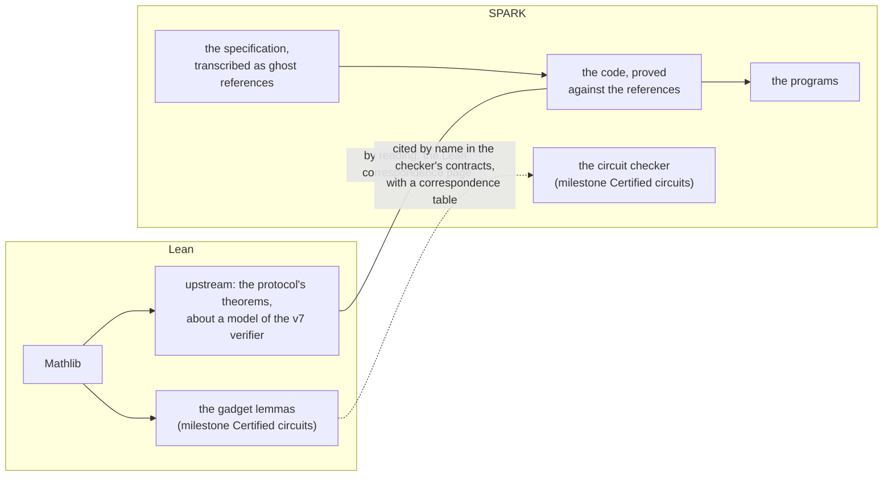

# Primer for the evaluator, part 2: SPARK and the evidence

The second part of the primer, after [part 1, the cryptography](00-primer-cryptography.md). It explains how the code is proved, what a proof says and does not say, how the trusted items are listed, and how an evaluator reproduces the evidence.

**The essential route** of this part is [B3](#b3-contracts), [B4](#b4-ghost-code-assertion-levels-and-builds), [B6](#b6-what-a-verification-condition-says), [B7](#b7-proved-tested-trusted) and [B10](#b10-a-worked-evaluation), read after [A1](00-primer-cryptography.md#a1-the-object-certified-and-what-certifying-it-means), [A11](00-primer-cryptography.md#a11-longfellow-all-together) and [A12](00-primer-cryptography.md#a12-who-attacks-what) of part 1. The other sections are reference.

## Contents

- [B1. Ada in two pages](#b1-ada-in-two-pages)
- [B2. SPARK and what it rules out](#b2-spark-and-what-it-rules-out)
- [B3. Contracts](#b3-contracts) (essential route)
- [B4. Ghost code, assertion levels and builds](#b4-ghost-code-assertion-levels-and-builds) (essential route)
- [B5. Loops, recursion and termination](#b5-loops-recursion-and-termination)
- [B6. What a verification condition says](#b6-what-a-verification-condition-says) (essential route)
- [B7. Proved, tested, trusted](#b7-proved-tested-trusted) (essential route)
- [B8. Lean and SPARK: two kinds of proof](#b8-lean-and-spark-two-kinds-of-proof)
- [B9. Reproducing the evidence](#b9-reproducing-the-evidence)
- [B10. A worked evaluation](#b10-a-worked-evaluation) (essential route)

## B1. Ada in two pages

Ada is a programming language designed for systems where errors are costly: avionics, railways, defence. Its rules make many mistakes impossible to compile, and its syntax is meant to be read. SPARK ([B2](#b2-spark-and-what-it-rules-out)) is a subset of Ada with a proof tool.

### B1.1 Packages: specification and body

The code is organised in **packages**. A package usually has two files:

- **The specification** (`.ads`) declares what the package offers: its types, constants and subprograms, with their contracts. It is what other code may use, and what an evaluator reads first.
- **The body** (`.adb`) implements them.

`src/gf2_128.ads` and `src/gf2_128.adb` are the specification and body of the package `GF2_128`. Some packages need no body, such as a package of declarations only or an instance of a generic ([B1.4](#b14-generics)). A **unit** is one package, its specification and body together. The proof partitions ([B6.5](#b65-partitions-and-the-whole)) are lists of units.

Every specification of a library unit of this project, apart from the one-line instances of generics, begins with a **header**: a comment that states what the unit implements, which records and guide sections it follows, and what is proved, tested and trusted about it ([B7.5](#b75-reading-the-trust-model-and-the-register-together)).

A package uses another with a `with` clause at its top: `with GF2_128;`. It then names its contents with a prefix, `GF2_128.Mul`, or without one after `use GF2_128;`. A **child package** extends its parent and has its name as a prefix: `Field_GF2_128.Laws` is a child of `Field_GF2_128`.

### B1.2 Types

Ada is strongly typed: values of different types do not mix without an explicit conversion. The types an evaluator meets:

- **Modular types**, unsigned integers whose arithmetic wraps around, such as `Unsigned_64`. They hold the 64-bit words of the field elements ([A2](00-primer-cryptography.md#a2-finite-fields)).
- **Ranges**: `subtype Position is Natural range 0 .. Max_Bytes;` (in `src/cbor_parse.ads`) is the natural numbers up to a bound. Assigning a value outside the range is a run-time error, which the proof rules out ([B3.3](#b33-functional-contracts-and-the-absence-of-errors)).
- **Arrays**, indexed by a range: `subtype Bytes_16 is Byte_Array (0 .. 15);` (in `src/bytes.ads`) is sixteen bytes. An array knows its bounds: `A'First`, `A'Last`, `A'Length`.
- **Records**, values with named components:

  ```ada
  type Element is record
     Limbs : Limb_Array;
  end record;
  ```

  in `src/gf2_128.ads`, is an element of GF(2^128), two 64-bit words.
- **Private types**, whose components are hidden from other packages, which may use them only through the package's subprograms.
- **Access types**, the pointers of Ada. SPARK allows them under rules of ownership that exclude aliasing ([B2](#b2-spark-and-what-it-rules-out)).

The quote mark introduces an **attribute**, a property of a type, an array or a subprogram: `'Length`, `'Result` (the result of a function, in its postcondition), `'Old` (the value of a parameter on entry, in a postcondition).

### B1.3 Subprograms

There are two kinds:

- **A function** returns a value. In this project's SPARK it has no other effect (SPARK allows functions with side effects only when declared so, which this project does not use): `function Mul (A, B : Element) return Element`.
- **A procedure** performs an action and returns values through its parameters, whose **modes** say how each is used:
  - `in`, read only;
  - `out`, written by the procedure;
  - `in out`, both.

  `procedure Build (Leaves : Digest_Array; Heap : out Digest_Array)` reads the leaves and writes the heap.

An **expression function** has a body that is one expression, written in the specification. In `src/gf2_128.ads`:

```ada
function To_Bytes (E : Element) return Bytes_16 is
  (Bytes_Of_Limbs (E.Limbs))
```
 The provers see the expression, which makes expression functions the natural way to write ghost references ([B4.1](#b41-ghost-code-the-specification-inside-the-program)).

The **aspects** after `with` attach properties to a declaration: `Global`, `Pre`, `Post`, `Ghost` and others ([B3](#b3-contracts), [B4](#b4-ghost-code-assertion-levels-and-builds)).

### B1.4 Generics

A **generic** is a package with parameters, written once and **instantiated** for each set of parameters. The protocol of this project is written once for "a field" ([A2.6](00-primer-cryptography.md#a26-two-fields-one-protocol)):

- `Field_Signature` is a generic that lists what the protocol needs from a field: the element type, zero and one, the operations, the logical equality `Same`.
- `Field_GF2_128.Sig` and `Field_P256.Sig` are its two instances, one per field.
- Each protocol package takes such an instance as a parameter. `Sumcheck_Algebra` is generic, and the line

  ```ada
  package Sumcheck_Algebra_GF2_128 is new Sumcheck_Algebra (Field_GF2_128.Sig);
  ```

  makes its instance over GF(2^128).

GNATprove proves the instances, not the generics. So each proof is made once per field, and the proof partitions list the instances ([B6.5](#b65-partitions-and-the-whole)).

### B1.5 Reading a line of contract

With these pieces, a declaration from `src/merkle.ads` reads as follows:

```ada
procedure Build (Leaves : Digest_Array; Heap : out Digest_Array) with
  Global => null,
  Pre    =>
    Leaves'Length in Leaf_Count
    and then Heap'First = 0
```

(the first lines of the declaration; [B3.2](#b32-an-example-the-merkle-tree) gives it whole)

- `Build` is a procedure.
- `Leaves` is read and `Heap` written.
- It touches no other state (`Global => null`).
- Its caller must pass a number of leaves within `Leaf_Count`, and a heap numbered from 0.

`and then` evaluates its right side only when the left is true. `for all I in A .. B => P (I)` says that P holds for every I in the range. [B3](#b3-contracts) reads the rest.

### Where this is in the code

| What | Where |
|---|---|
| A package and its header | `src/gf2_128.ads`, `src/gf2_128.adb` |
| A generic and its instances | `src/field_signature.ads`; `src/sumcheck_algebra_gf2_128.ads` |
| A child package | `src/field_gf2_128-laws.ads` |
| The language | the Ada 2022 reference manual; the SPARK user's guide |

## B2. SPARK and what it rules out

### B2.1 A subset with a proof tool

**SPARK** is a subset of Ada together with a tool, **GNATprove**, that analyses the source without running it and proves properties of it. The subset leaves out the constructs whose behaviour is hard to reason about:

- functions with side effects, unless declared as such;
- pointers that may alias, that is, two names for the same memory: SPARK allows pointers only under rules of ownership, where each piece of memory has one owner at a time;
- most uses of exceptions: the proof shows instead that no exception is raised;
- a few others, such as backward `goto` jumps.

A unit declares that it is in SPARK with the aspect `SPARK_Mode`. A body, or a part of one, can opt out with `SPARK_Mode => Off`, and is then outside the proofs. Under `src/` there are two such places, the body of `Same` for each field (`src/field_gf2_128.adb`, `src/field_p256.adb`; [B4.4](#b44-logical-equality-same)). Outside `src/`, the command-line programs of `cli/src/`, the random source among them, are not SPARK.

Each is a row of the trusted base register ([B7.3](#b73-trusted)).

### B2.2 Flow analysis

The first thing GNATprove does is **flow analysis**: it follows how values move through the code.

- **Initialisation.** No variable is read before it is written, on any path.
- **Data dependencies.** A subprogram reads and writes only the state its `Global` aspect declares. `Global => null` means it uses its parameters only.
- **Ineffective code.** A statement that has no effect is reported.

These checks are the step Bronze of the ladder ([B7.1](#b71-the-ladder-of-proof)). They need no solver, and appear in the column *Flow* of the summary ([B6.4](#b64-reading-the-summary-table)).

### B2.3 Run-time errors, and why their absence matters

Ada checks a long list of conditions while the program runs, and raises an exception when one fails:

- an index outside an array's bounds;
- an arithmetic overflow;
- a division by zero;
- a value outside its type's range;
- a variant field read in the wrong variant.

In a verifier, an exception is at best a crash on a malformed proof. At worst, in a build that removes the checks for speed, it is a read or write outside memory, the classic way into a program.

GNATprove turns each such check into a verification condition ([B6.1](#b61-from-a-check-to-a-formula)) and proves it. When all are proved, for every input that meets the preconditions, the program cannot raise one: the step **Silver** ([B7.1](#b71-the-ladder-of-proof)). Every SPARK unit of this project is Silver.

This is what allows the release build to remove the run-time checks from the library ([B4.3](#b43-the-builds-and-what-each-one-checks)): they can never fail, under the preconditions, which the programs establish (rows T7 and C2).

### B2.4 What SPARK does not cover

- **Code outside the subset**, listed in [B2.1](#b21-a-subset-with-a-proof-tool).
- **Memory exhaustion.** A failed allocation raises `Storage_Error`, which the proof does not rule out; nor does it bound the stack ([A12.4](00-primer-cryptography.md#a124-anyone-sending-inputs)).
- **Time.** No contract can speak about how long the code takes ([A12.3](00-primer-cryptography.md#a123-the-observer-of-timing)).
- **The compiler and the tools**, which are trusted (rows T1 to T3).

### Where this is in the code

| What | Where |
|---|---|
| `SPARK_Mode` in a unit | `pragma SPARK_Mode (On);` after the header of almost every file under `src/` |
| Code outside SPARK | `cli/src/`; the bodies of `Same` in `src/field_gf2_128.adb` and `src/field_p256.adb`; the register, Section 2 |
| Ownership of pointers | chapter 6 Section 3 |
| The release build without checks | `cli/longfellow_verify.gpr`; ADR 0068 |

## B3. Contracts

### B3.1 What a contract is

A **contract** is a statement attached to a subprogram, in the specification, which says what the subprogram needs and what it guarantees. It is written in Ada itself, as Boolean expressions over the parameters and the result. Two parts matter most:

- **The precondition**, `Pre`: what must be true when the subprogram is called. It is an obligation on the caller.
- **The postcondition**, `Post`: what is true when the subprogram returns, provided the precondition held. It is the subprogram's promise.

A third part, **`Global`**, says which state outside its parameters the subprogram reads or writes. `Global => null` means none: the result depends on the parameters only.

A contract is not a comment. GNATprove, the proof tool of SPARK ([B6](#b6-what-a-verification-condition-says)), checks that every caller establishes the precondition, and that the body establishes the postcondition for every input that meets it. When both hold, for every possible input, the contract is a theorem about the code.

### B3.2 An example: the Merkle tree

`Merkle.Build`, in `src/merkle.ads`, builds the heap of a Merkle tree from its leaves ([A4](00-primer-cryptography.md#a4-hashes-and-merkle-trees)). The heap is the tree stored in one array: node `I` sits above nodes `2 I` and `2 I + 1`, the leaves fill the second half, and the root is node 1.

```ada
procedure Build (Leaves : Digest_Array; Heap : out Digest_Array) with
  Global => null,
  Pre    =>
    Leaves'Length in Leaf_Count
    and then Heap'First = 0
    and then Heap'Length = 2 * Leaves'Length,
  Post   =>
    (for all I in Leaves'Length .. Heap'Last =>
       Heap (I) = Leaves (Leaves'First + (I - Leaves'Length)))
    and then
      (for all I in 1 .. Leaves'Length - 1 =>
         Heap (I) = Hash_Pair (Heap (2 * I), Heap (2 * I + 1)));
```

Read in words:

The parameter `Heap` is marked `out`: the procedure writes it. `Hash_Pair (X, Y)` is the SHA-256 of the two digests X and Y one after the other, the node function of Section 4.1.2 of the specification.

- **`Pre`.** The caller must pass an allowed number of leaves, and an output array numbered from 0 with twice as many slots as there are leaves. `'Length` and `'First` are the length and the first index of an array. `and then` evaluates its right side only if the left is true.
- **`Post`.** When `Build` returns:
  - the second half of the heap holds the leaves, in order;
  - every node `I` of the first half, from 1 up, is the hash of its two children, nodes `2 I` and `2 I + 1`; node 0 is unused.

  `for all I in ... => ...` is a quantified expression: the property holds for every `I` in the range. That is exactly the definition of the heap in Section 4.1.2 of the specification.

So the postcondition is the specification's definition in Ada, and the proof shows that the body computes it for every input. The precondition makes the body safe: every index it uses lies inside `Heap`.

### B3.3 Functional contracts and the absence of errors

A contract can say little or much.

- **Silver: only the safety of the call.** A unit with no postcondition still has a proof obligation at every operation: no index out of range, no overflow, no division by zero, no read of an uninitialised variable (this last one by flow analysis, [B6.2](#b62-who-proves-the-formulas)). These are the **run-time checks**. Proving all of them for every input that meets the preconditions is the level called Silver ([A1.4](00-primer-cryptography.md#a14-what-certifying-it-means), [B7](#b7-proved-tested-trusted)).
- **Gold: what the result is.** A postcondition that states what the result is, like `Build`'s above, is a **functional contract**. Proving it is the level called Gold. A postcondition can also be partial, for example "the result has the right length", without saying everything. Each package header says which of its contracts are complete.

### B3.4 Lemmas: theorems the provers use

Some facts are needed by many proofs but are hard for the automatic provers to find alone. A **lemma** packages such a fact as a subprogram whose only content is its postcondition:

```ada
procedure Lemma_Mul_Comm (A, B : GF2_128.Element) with
  Ghost  => Proof_Only,
  Global => null,
  Post   => Same (GF2_128.Mul (A, B), GF2_128.Mul (B, A));
```

This is in `src/field_gf2_128.ads`, and states that the product of GF(2^128) is commutative.

- **The proof.** GNATprove proves the lemma once, from its body in `src/field_gf2_128.adb`, which calls the commutativity proved in `GF2_128` against `Mul_Ref`.
- **The use.** Elsewhere, a proof that needs the fact calls `Lemma_Mul_Comm (X, Y)`. The call has no effect when the program runs; it only hands the postcondition, for those `X` and `Y`, to the provers.

`Ghost` says that the lemma exists only for the proof ([B4](#b4-ghost-code-assertion-levels-and-builds)), and `Same` is the logical equality [B4](#b4-ghost-code-assertion-levels-and-builds) explains.

A large proof is a chain of such lemmas. Chapter 3, for example, rests on a handful of field laws, each a lemma like this one.

### B3.5 Other contracts an evaluator meets

- **Type predicates** (`Dynamic_Predicate`): a property every value of a type must have, checked wherever a value is made; for example that a Ligero geometry's numbers are consistent.
- **Variants** (`Subprogram_Variant`, loop variants), which prove termination ([B5](#b5-loops-recursion-and-termination)).

### B3.6 What a contract does not say

A proved contract says exactly what it says, and no more.

- **If the postcondition is weaker than the specification,** the proof says nothing about the rest.
- **If the reference it compares with is wrong,** the proof shows that the code computes the wrong thing faithfully. For example, `Mul` is proved equal to `Mul_Ref`, a simple description of the product. That `Mul_Ref` is the product the specification means is a separate claim, tested with vectors whose answers do not come from the code under test (chapter 1 Section 4). [B10](#b10-a-worked-evaluation) follows this case through.
- **A precondition is an assumption.** The proof covers only calls that meet it. Who establishes it, at the boundary between proved and unproved code, is part of the evidence. Here, the command-line programs establish the library's preconditions in code before each call (trusted base register, row C2).

So an evaluator reads a contract with three questions:

- What does it state?
- Against which reference?
- Under which precondition, and who guarantees it?

### Where this is in the code

| What | Where |
|---|---|
| The example | `Merkle.Build`, `src/merkle.ads`; chapter 5 Section 1.2 |
| The lemma | `Field_GF2_128.Lemma_Mul_Comm`, `src/field_gf2_128.ads`; chapter 3 |
| Silver and Gold, unit by unit | each package header; the trust model, "What is proved" |
| The preconditions at the boundary | the trusted base register, rows T7 and C2 |

## B4. Ghost code, assertion levels and builds

### B4.1 Ghost code: the specification inside the program

A contract often needs words that the program itself does not use. The postcondition of `GF2_128.Mul` says that the result is `Mul_Ref (A, B, 128)`, the product computed in the simplest possible way: one bit of `B` at a time, by Horner's rule (double the running result, then add `A` when the bit is 1). The fast `Mul` never calls `Mul_Ref`. `Mul_Ref` exists only so that the contract can say what `Mul` must compute.

Such code is **ghost code**, marked `Ghost`.

- **Ghost functions** are the vocabulary of the contracts: references like `Mul_Ref`, models like the integer value of a P-256 element, sums like those of chapter 3.
- **Ghost procedures** are the lemmas of [B3.4](#b34-lemmas-theorems-the-provers-use).
- **Ghost variables** record facts along a computation, for a proof to use.

The language rules ensure that ghost code cannot affect the program, so removing it leaves the same program.

This is the pattern of the whole project, the **ghost reference**. Most Gold units have:

- a simple ghost function that transcribes the specification's formula, written for clarity;
- an efficient body;
- a postcondition that says the two agree.

The proof shows the agreement for every input. A test with vectors whose answers do not come from the code under test then shows that the simple function is the formula the specification means ([B3.6](#b36-what-a-contract-does-not-say)).

Most ghost functions are **expression functions**: their body is one expression, written in the specification, `function F (X : T) return T is (...)`. The provers see the expression directly, which makes them the natural way to write a definition.

### B4.2 Assertion levels: which contracts ever run

A contract can be **proved**, and it can also be **executed**: compiled into the program and checked when the program runs. These are separate questions. Executing a contract that names `Mul_Ref` would cost 128 steps at every multiplication, and a contract over a whole circuit would cost the circuit at every call.

So Ada lets each contract part be placed at an **assertion level**, and each build decides which levels it compiles. The project uses three:

- **No level**, the default: compiled in the test build only.
- **`Proof_Only`**, the project's own level (`src/proof_levels.ads`), and its twin `SPARKlib_Full` from SPARK's own library: proved, and never compiled in any build. The costly references live here: the field contracts, the references of the sumcheck and of Ligero.
- **`Runtime`**: compiled in every build, for cheap checks worth keeping always, such as the bounds of the circuit reader. Each is on a public value, with three declared exceptions, all in the decoding of P-256 elements ([A12.3](00-primer-cryptography.md#a123-the-observer-of-timing), the first item of its list).

### B4.3 The builds, and what each one checks

Two builds matter to an evaluator.

- **The test build** (`tests/longfellow_spark_tests.gpr`) compiles with assertions on (`-gnata`), so the harnesses check the executable contracts as well as the outputs.
- **The release build** (`cli/longfellow_verify.gpr`, profile `proved`), which the programs ship in, compiles without assertions except `Runtime`, and the library units of `src/` with `-gnatp`, without the run-time checks of [B3.3](#b33-functional-contracts-and-the-absence-of-errors): the proof stands in for them (ADR 0068). The units of `cli/src/`, outside SPARK, keep theirs.

| Part of the code | Proved by GNATprove | Runs in the test build | Runs in the release build |
|---|---|---|---|
| a contract with no level | yes | yes | no |
| a contract at `Proof_Only` or `SPARKlib_Full` | yes | no | no |
| a contract at `Runtime` | yes | yes | yes |
| the run-time checks of `src/` (indices, overflow) | yes (Silver) | yes | no: suppressed, the proof stands in |
| the run-time checks of `cli/src/` | no: outside SPARK | yes | yes |
| ghost code | used by the proofs | yes, except at `Proof_Only` or `SPARKlib_Full` | no |

Two consequences for an evaluator.

- **A contract at `Proof_Only` is never checked when the program runs.** Row T1 says the compiler translates the source faithfully. Row T8 adds what that means here: these contracts, proved of the source, are never checked by any run, not even in the test build, so their holding of the compiled code rests on T1 alone, reduced by the vectors run on that code.
- **The release build has no run-time checks in the library.** That no error can occur there rests on the proof, and the proof holds only under each unit's preconditions. So the programs must establish those preconditions themselves (rows T7 and C2). The script `scripts/check.sh cli` reads, from the compiler's output for every unit (its ALI file), the switches the unit was actually compiled with, and fails on a wrong one (row T7).

The constant-time guarantee of [A12.3](00-primer-cryptography.md#a123-the-observer-of-timing) is for the release build only, because enabled contracts branch on secrets.

### B4.4 Logical equality: `Same`

One piece of ghost vocabulary appears in almost every Gold contract of the protocol code: `Same (A, B)`, read as "A and B are the same element".

Why not write `A = B`? A field element is a record of words (two of 64 bits for GF(2^128), four for P-256), and for the provers the predefined `=` on records is a function that compares the words. That is correct, but it does not let them **substitute**. Knowing `A = B` and having to prove `F (A) = F (B)`, they must look inside again.

On long chains of algebra, `a·(b + c) = a·b + a·c = …`, this makes the proof time out. Chapter 3 records the case: a link between the circuit's two representations, stated with `=` on the coefficients, left ten checks unproved on GF(2^128), and proved once the coefficients were also stated with `Same` (chapter 3 Sections 3.5 and 4.1).

`Same` is declared with the annotation `Logical_Equal`, which tells the provers to treat it as true equality of terms, so they substitute freely. Its body is the predefined `=`, kept outside SPARK, so the test build executes it as `=`. That the two agree is a trusted item (register row T6), reduced by every contract that runs in the test build.

### Where this is in the code

| What | Where |
|---|---|
| A ghost reference | `GF2_128.Mul_Ref` and the postcondition of `Mul`, `src/gf2_128.ads`; chapter 1 Section 2 |
| The level `Proof_Only` | `src/proof_levels.ads`; ADR 0044 |
| `Runtime` and its two exceptions | chapter 4 Section 3.2; the trusted base register, row S4 |
| The two builds | `tests/longfellow_spark_tests.gpr`, `cli/longfellow_verify.gpr`; ADR 0068 |
| `Same` | `src/field_gf2_128.ads`; chapter 3 Section 4.1 |
| The trusted items | the trusted base register, rows T6, T7, T8 and C2 |

## B5. Loops, recursion and termination

### B5.1 Loop invariants

A loop runs a number of times that the provers cannot unfold one by one: the loop over the 7.8 million terms of a circuit, the 128 steps of a product. So the author states, inside the loop, a **loop invariant** (`pragma Loop_Invariant`), a property that holds at the point where it is written, each time the loop passes it. GNATprove proves it twice:

- **it holds the first time** the loop passes it, from what is known before the loop;
- **it is preserved**: if it held at one pass, it holds at the next.

By induction it then holds at every iteration, however many there are. After the loop it is the main thing the provers know about what the loop changed, so it must say enough to prove what follows, typically the subprogram's postcondition.

A typical invariant says "the first I entries of the result are already what the specification says". When the loop ends, I is the full length, and the invariant becomes the postcondition.

### B5.2 Why a proof can be of fixed size

The proof of a loop does not grow with the number of iterations: it is the same two verification conditions for a loop of ten steps or of ten million. The same holds for a loop over the layers and terms of a circuit.

This is why the verifier is proved for **every** circuit within the bounds its preconditions state (the supported scale, chapter 5 Section 3.5 and chapter 6 Section 3.5), and not only for the circuits that were tried. The size of the circuit is a value like any other, and the invariant is stated for all of them.

### B5.3 Recursion

Many ghost references are recursive ([B4.1](#b41-ghost-code-the-specification-inside-the-program)). `Mul_Ref (A, B, N)` is defined from `Mul_Ref (A, B, N − 1)`, one bit of B at a time, down to `N = 0`. A recursive definition is often the clearest transcription of a formula of the specification. Proofs about it are by induction, written as lemmas that call themselves on a smaller argument.

### B5.4 Termination

A proof of a postcondition assumes the subprogram returns. So GNATprove also proves **termination**:

- **A loop** that is not a plain `for` loop needs a **loop variant** (`pragma Loop_Variant`): a quantity that strictly decreases, or increases towards a bound, at every iteration, so that the loop must stop.
- **A recursive subprogram** needs a `Subprogram_Variant`, a quantity that decreases at every call. For `Mul_Ref` it is `N`.

**One declared exception.** Some subprograms draw random values until one is acceptable, which is **rejection sampling** ([A9.4](00-primer-cryptography.md#a94-how-the-transcript-makes-challenges)). They terminate with probability one, since each draw is rejected with probability at most one half, and far less on P-256. But no bound on the number of draws exists, so termination cannot be proved. These subprograms, and those that call them up to `Zk_Verifier.Verify` and `Zk_Prover.Prove`, declare it with `Always_Terminates => False`, which says that termination is not claimed; the trusted base register lists them (row V4). Every other subprogram is proved to terminate.

### Where this is in the code

| What | Where |
|---|---|
| A loop invariant and its use | `Merkle.Build`, `src/merkle.adb`; chapter 5 Section 3 |
| A recursive reference and its variant | `GF2_128.Mul_Ref`, `src/gf2_128.ads` |
| The samplers and their termination | `Transcript`, `Sampling`; chapter 4 Section 3.4; register row V4 |

## B6. What a verification condition says

### B6.1 From a check to a formula

GNATprove does not run the program. It reads the source and, for every place where something must hold, writes a logical formula: a **verification condition**, or VC. The places are of a few kinds:

- each run-time check: every index, every arithmetic operation that could overflow, every division;
- each postcondition, at the end of the subprogram;
- each precondition, at every call site;
- each loop invariant, once for the first iteration and once for "if it held before an iteration, it holds after". A loop invariant is a property stated inside a loop and proved true each time the loop passes it; afterwards it is the main thing the provers know about what the loop changed;
- each assertion, and each termination argument ([B5](#b5-loops-recursion-and-termination)).

The formula has the shape

> if the program reaches this point, along any path, with everything that is known there (the preconditions, the earlier assertions, the postconditions of the subprograms called, the loop invariants), then the check holds.

It quantifies over every value the variables could take, which is why a proof says more than any number of tests.

### B6.2 Who proves the formulas

The formulas go, through an intermediate tool called Why3, to automatic provers called **SMT solvers**. This project uses three: CVC5, Z3 and Alt-Ergo. Each tries to show that the formula is true, that is, that no assignment of values makes the hypotheses true and the check false.

A VC is **proved** when one solver closes it within the budget fixed for the whole project (ADR 0020; `longfellow_spark.gpr`): 600,000 steps, a measure of work that does not depend on the machine, 120 seconds and 1,000 MB.

When none does, the VC is **unproved**, which does not mean the check is false: the solvers may lack budget or a fact. The author then adds an assertion or a lemma ([B3.4](#b34-lemmas-theorems-the-provers-use)) and proves again. The author may not **assume** the fact: the project uses no `pragma Assume` and no justification, a comment that marks an unproved check as reviewed, so every check is proved: by flow analysis, trivially by GNATprove itself, or by a solver.

Some checks are not VCs at all. **Flow analysis**, the first phase of GNATprove, checks by itself that:

- every variable is initialised before it is read;
- a subprogram reads and writes only what its `Global` says.

Those checks are counted as proved "by flow".

### B6.3 Reading a VC message

For each VC, GNATprove prints one message on its standard output. Two kinds matter. Both are copied as GNATprove 16.1.0 prints them with the project's settings:

```
 info: postcondition proved
--> merkle.adb:49:16

 medium: postcondition might fail
--> local_check.adb:58:15
   58 |         Post  => Mul (Mul (Add (A, D), X), Y)
      |                  ^~~~~~~~~~~~~~~~~~~~~~~~~~~~
   59 |                  = Add (Mul (Mul (A, X), Y), Mul (Mul (D, X), Y))
      |                  ~~~~~~~~~~~~~~~~~~~~~~~~~~~~~~~~~~~~~~~~~~~~~~
      + provers reached time and step limit before completing the proof
```

- `info: ... proved` names the check and its place: file, line and column.
- `... might fail` is an unproved VC, with the source it concerns and the reason the provers gave. Here the solvers reached their limits, which is the usual case. The second message is from the development of a lemma, before it was restated with `Same` ([B4.4](#b44-logical-equality-same)); it is shown because the merged code has none.
- The first word (`low`, `medium`, `high`) is the tool's estimate of how likely the check is to fail. None is a verdict: the author must find out. Whatever the word, an unproved VC blocks the merge.

### B6.4 Reading the summary table

At the end of a run, GNATprove writes a summary in `obj/development/gnatprove/gnatprove.out`. This is the summary of the partition `primitives` (the fields' basic units, the hashes, the transcript, the Merkle tree), as the proving machine (the dedicated machine that checks every change, [B9.3](#b93-the-proving-machine-and-the-gate)) printed it on 12 November 2026 at commit d3bbd32, after 7 minutes 39 seconds of GNATprove on a Google Cloud machine of type c4-standard-24 (12 cores, one thread per core):

```
SPARK Analysis results        Total         Flow                                           Provers   Justified   Unproved
-------------------------------------------------------------------------------------------------------------------------
Data Dependencies               194          194                                                 .           .          .
Flow Dependencies                 1            1                                                 .           .          .
Initialization                   55           55                                                 .           .          .
Non-Aliasing                      1            1                                                 .           .          .
Run-time Checks                 776            .    776 (CVC5 13%, Trivial 2%, Z3 85%, altergo 0%)           .          .
Assertions                      296            .    296 (CVC5 43%, Trivial 2%, Z3 52%, altergo 3%)           .          .
Functional Contracts            545            .    545 (CVC5 27%, Trivial 1%, Z3 71%, altergo 1%)           .          .
LSP Verification                  .            .                                                 .           .          .
Termination                     147          104                             43 (CVC5 19%, Z3 81%)           .          .
Concurrency                       .            .                                                 .           .          .
-------------------------------------------------------------------------------------------------------------------------
Total                          2015    355 (18%)                                        1660 (82%)           .          .

max steps used for successful proof: 463202
```

How to read it:

- **The rows are kinds of check.**
  - *Data Dependencies* and *Initialization*: flow analysis.
  - *Run-time Checks*: the Silver checks of [B3.3](#b33-functional-contracts-and-the-absence-of-errors).
  - *Assertions*: assertions and loop invariants.
  - *Functional Contracts*: pre- and postconditions.
  - *Termination*: termination arguments, part proved by flow and part by the solvers.
  - The other rows (*Flow Dependencies*, *Non-Aliasing*, *LSP Verification*, *Concurrency*) concern constructs this project uses little or not at all.
- **The columns say who proved them.**
  - *Flow*: proved by flow analysis.
  - *Provers*: proved by the solvers, with the share of each; *Trivial* means GNATprove closed the check itself, without a solver.
  - *Justified*: accepted by a reviewer's comment instead of a proof, always empty here.
  - *Unproved*: must be empty.
- **"max steps used for successful proof"** is the hardest VC's cost, against the budget of 600,000. The register follows the hardest proofs closely, since a change of tool could tip them over (register, Section 8).

For comparison, the full run of every partition ends with the line below. It is from commit d8a3f57, because the gate reuses a proof when the proof inputs are equal ([B6.5](#b65-partitions-and-the-whole)), and d3bbd32 has the inputs of d8a3f57:

```
Total                         39245    3651 (9%)                                        35594 (91%)           .          .
```

in 177 minutes of `make check` on the proving machine ([B6.5](#b65-partitions-and-the-whole)).

The counts measure work, not assurance. What matters is that *Unproved* and *Justified* are empty, and what the contracts state ([B3.6](#b36-what-a-contract-does-not-say)).

### B6.5 Partitions, and the whole

The project is proved in **partitions**: groups of units proved in one run of GNATprove (`scripts/prove-partitions.txt`). Every non-generic unit under `src/` belongs to exactly one, and a script checks it.

- `make prove` proves all of them.
- `make prove-partition PARTITION=<name>` proves one.

The figure that matters is the total of the full run, which the gate on the proving machine produces for each change ([B9](#b9-reproducing-the-evidence)). For a commit whose proof inputs are unchanged, the gate reuses the proof of an earlier commit with the same inputs, and says so in its status. That is the case of d3bbd32: it carries no status of its own, and its proof inputs (digest `be44efe9bc9d`) are those of d8a3f57, whose full run is the total above; `scripts/remote-check.sh --digest` shows the digest of any commit and a commit with the same inputs that the gate has passed.

### B6.6 What "proved" means, and what it does not

**When every VC of a unit is proved, the unit is free of run-time errors (Silver) and meets its contracts (Gold, where it has them), for every input that meets its preconditions.**

Relative to:

- the contracts as written ([B3.6](#b36-what-a-contract-does-not-say));
- the tools, rows T2 and T3;
- the compiler, row T1;
- what is outside SPARK ([B4.4](#b44-logical-equality-same)).

It says nothing about time, memory or side channels ([A12](00-primer-cryptography.md#a12-who-attacks-what)), nor about the protocol's soundness ([A11.4](00-primer-cryptography.md#a114-how-strong-is-the-guarantee)).

### Where this is in the code

| What | Where |
|---|---|
| The prover settings | `longfellow_spark.gpr`, package `Prove`; ADR 0020 |
| The partitions | `scripts/prove-partitions.txt`; `make prove-partition` |
| The summary of a run | `obj/development/gnatprove/gnatprove.out` |
| The trusted tools | the trusted base register, rows T1 to T3; Section 8, the fragilities |

## B7. Proved, tested, trusted

### B7.1 The ladder of proof

The SPARK community describes how much a program is proved as steps of a ladder. Each step includes the ones below.

| Step | What is proved | In this project |
|---|---|---|
| Stone and Bronze | the code is in the SPARK subset, so it can be analysed; flow analysis: every variable is initialised before it is read, and each subprogram touches only the state it declares ([B6.2](#b62-who-proves-the-formulas)) | every SPARK unit under `src/` |
| **Silver** | no run-time error, for any input that meets the preconditions ([B3.3](#b33-functional-contracts-and-the-absence-of-errors)) | every SPARK unit under `src/` |
| **Gold** | the functional contracts the unit declares ([B3.3](#b33-functional-contracts-and-the-absence-of-errors)) | where a package header says so |
| Platinum | the full functional correctness of the whole system | not a goal (ADR 0003) |

The words that matter are Silver and Gold, and "Gold" needs care. Gold says that the declared contracts are proved; it says nothing about contracts that were not declared. So every header states what its Gold covers. The chapters and headers use four qualified forms, defined here once:

- **Structural Gold** (chapters 3, 4 and 5, Section 4.1 of each). The code is proved equal, for all inputs, to a ghost reference that transcribes a formula of the specification or of upstream's reference, in a fixed order of operations ([B4.1](#b41-ghost-code-the-specification-inside-the-program)). Algebraic truths about the formula, such as two ways of writing it agreeing, are tested, as is the reference itself ([B3.6](#b36-what-a-contract-does-not-say)).
- **Gold by definition** (chapters 3 and 9). The function is itself the transcription of a formula, written as one expression ([B4.1](#b41-ghost-code-the-specification-inside-the-program)). There is nothing to prove beyond the transcription, which a reader checks against the specification by reading.
- **Gold by composition** (the header of `GF2_128`, `Square`). The unit is a thin wrapper over another that is Gold, and its contract follows from that one's.
- **Silver with proved shape** (chapter 5 Section 4.2, the two verifiers). Silver, with some facts about the result proved as well (its status, its length, where its parts are), not every value; the header says which.

### B7.2 Tested

A tested claim holds on the cases a test runs. Its strength comes from where the expected answers come from, so the project insists that they do not come from the code under test:

- **known-answer vectors**: the examples of the specification's appendices, values computed by upstream's implementations, values recomputed by independent scripts written for the purpose (`tests/vectors/`, one generator per family, each checking itself against an outside anchor before it writes);
- **interoperability**, in two directions that are checked in different places:
  - this project's verifier accepts upstream's example proofs: the `cli` step of `make check`, on GitHub Actions and on the proving machine;
  - upstream's verifier, built at the pin, accepts this project's mDoc proofs: the same step, where a clone of upstream is given (`LONGFELLOW_UPSTREAM`, set on the proving machine; `scripts/cross-check-upstream.sh`); elsewhere the step says it was skipped;
- **byte identity**: from the same inputs and the same random seed, this project's prover writes upstream's example proofs byte for byte (the `cli` step, both places).

Some properties could be contracts in principle, but are tested instead. The main one is **completeness** of the prover: every proof it writes for a true statement is accepted (register row V6). Soundness does not depend on it.

The **harnesses** under `tests/` run the vectors in the test build, where every executable contract also runs ([B4.3](#b43-the-builds-and-what-each-one-checks)). So a test checks the contracts on its cases as well as the outputs.

Two cautions for an evaluator:

- A test says nothing about the cases it does not run.
- An agreement with upstream shows the two implementations agree. It does not show that both are right: a shared misreading of the specification would pass. That is why each chapter says which anchors are independent of upstream.

### B7.3 Trusted

A trusted item is assumed true, and listed. The **trusted base register** (`docs/guide/trusted-base.md`) gives each one a row, with a stable identifier that a certification report can cite. The rows are in families:

| Family | What | Examples |
|---|---|---|
| T, the tools and the builds | the compiler, GNATprove, the solvers and their settings, and what the builds rely on | T1 the compiler; T3 the solvers; T7 the release build without run-time checks; T8 the contracts at `Proof_Only`, never checked by any run ([B4.3](#b43-the-builds-and-what-each-one-checks)) |
| C, code outside SPARK | the command-line programs, the random source | C1 the unit `Os_Random`, which reads `/dev/urandom`; C2 the programs establish the library's preconditions |
| R, inputs and references | the specification, upstream's code where it specifies, the circuit files | R1 the pinned specification; R2 what the circuits compute |
| S, the protocol | soundness and zero knowledge, as upstream's theorems | S1 upstream's Lean proofs of a model of the verifier |
| V, tested not proved | properties tested but not proved | V7 the group law of the curve |
| P, the platform | the processor, the operating system, memory | P1 enough memory, a failed allocation being outside the proofs; P4 that the system provides a secure generator behind `/dev/urandom` |

Each row says what is assumed, what depends on it, where it is stated, and what would discharge or reduce it. A row that no longer applies keeps its identifier and says how it was discharged.

### B7.4 Outside the proofs

Some properties cannot be the contract of any one subprogram. The trust model's last section lists four, each with what stands in for a proof:

- **Soundness and zero knowledge**, which are about every possible prover and verifier, not about one program: upstream's theorems ([A11.4](00-primer-cryptography.md#a114-how-strong-is-the-guarantee); row S1).
- **The completeness of the Fiat-Shamir transcript**: every public value is absorbed before each challenge, or a prover could choose it after seeing the challenge ([A9](00-primer-cryptography.md#a9-fiat-shamir); row S3). It is compared with upstream's code by reading, and tested by the interoperability above.
- **What the relying party checks outside the proof**: trust in the issuer's key, the freshness of the nonce, the date ([A1.5](00-primer-cryptography.md#a15-what-stays-outside)). These lead to the conditions for certifying the circuit, chapter 9 Section 6, which a certifier must accept or refuse.
- **Constant time**, which is about time: a coding discipline ([A12.3](00-primer-cryptography.md#a123-the-observer-of-timing); row S4).

### B7.5 Reading the trust model and the register together

The trust model (`docs/guide/trust-model.md`) is organised by claim, the register by assumption. An evaluator finds a claim in the first, then everything it rests on in the second. Every package header says the same for its own subprograms. The header, beside the code, is the reference: if they disagree, it is checked against the code first, then the documents are corrected.

### Where this is in the code

| What | Where |
|---|---|
| The ladder and the levels | the verification approach; ADR 0003 |
| The Gold of each unit | each package header; the trust model, "What is proved" |
| The vectors and their anchors | `tests/vectors/`; each chapter's Section "What is only tested" |
| The trusted items | `docs/guide/trusted-base.md` |

## B8. Lean and SPARK: two kinds of proof

### B8.1 Two tools, two objects

**SPARK** proves properties of an executable program. Its object is the code that runs: this verifier, this prover. GNATprove turns each check into a formula, and automatic solvers prove the formulas ([B6](#b6-what-a-verification-condition-says)). The author writes contracts and, when the solvers need help, assertions and lemmas. The proof is automatic once those are in place.

SPARK is strong on the facts of code:

- that no index goes out of range;
- that a loop computes what its invariant says;
- that a function equals its reference for every input.

It is weak on deep mathematics. The solvers do not reason well about orders of elements, about polynomials of high degree, or about probabilities.

**Lean** is an interactive theorem prover. Its object is mathematics: numbers, fields, polynomials, probabilities, and models of protocols written as mathematical definitions. A Lean proof is a sequence of steps written by the author, each checked by a small program at the heart of Lean, its **kernel**. **Mathlib**, a large library of mathematics proved in Lean, provides the theory: fields, polynomials, groups, measure.

Lean is strong where SPARK is weak: it can state and prove that a protocol is sound with a given probability. But a Lean theorem is about its definitions. It says nothing about a program written in another language until someone links the two.

This is what "a model" means below. Upstream wrote its verifier a second time, as mathematical definitions in Lean, and its theorems are about that text. In the model, ideal objects stand for the hash and the transcript: a random oracle, uniform coins (register row S2).

### B8.2 What makes a Lean proof trustworthy

The kernel checks every step. What it relies on beyond that is the list of **axioms** a proof uses, which Lean prints on demand with `#print axioms`. Three are standard in mathematics and in Mathlib: `propext`, `Classical.choice` and `Quot.sound`. A proof that uses only those is as sound as the kernel and those axioms.

Two things widen the trust and must be looked for:

- **`sorry`** marks a step left unproved. A theorem whose proof contains it is not proved at all. Lean reports it, and it shows in the axioms.
- **`native_decide`** settles a computational fact, such as "this number is prime", by compiling and running code instead of checking each step in the kernel. It is fast, but it trusts Lean's compiler and the machine as well as the kernel, and it shows in the axioms as an extra one.

### B8.3 One fact in the two syntaxes

A row of the Lean correspondence page, both sides as they are written. The fact: the first input of a circuit is the public constant 1 ([A6.1](00-primer-cryptography.md#a61-a-check-written-as-arithmetic)).

Upstream's Lean, at 7bf8a6b (`formal/lfzk-v1/LfzkV1/ConcreteCircuit.lean`, line 470):

```lean
def OneWire (pub : Fin c.ninp → F) : Prop := ∀ h : 0 < c.ninp, pub ⟨0, h⟩ = 1
```

- `def OneWire ... : Prop` defines a property, a statement that may be true or false, named `OneWire`.
- `pub : Fin c.ninp → F` is the vector of inputs: for each index below the circuit's number of inputs `c.ninp`, a field element.
- `∀ h : 0 < c.ninp, pub ⟨0, h⟩ = 1` reads: if the circuit has at least one input, input 0 is 1. The `h` is the evidence that index 0 exists, which Lean asks for before it lets the vector be read there.

This project's SPARK, in the postcondition of `Zk_Verifier.Verify` (`src/zk_verifier.ads`, lines 317 to 319):

```ada
and then (St = Public_Input_Not_One)
         = (Pub'Length = P.Npublic and then P.Npublic > 0
            and then Pub (0) /= LV.ST.SA.One);
```

- `St` is the verifier's status, and `Public_Input_Not_One` one of its values, a refusal.
- The equality of two Booleans says the refusal is returned **exactly when** the public inputs have the circuit's length, there is at least one, and the first is not One.
- GNATprove proves it for every input ([B6](#b6-what-a-verification-condition-says)).

**How the two relate.** The Lean theorems assume `OneWire`. The SPARK verifier refuses every proof whose public inputs break it, so a proof it accepts satisfies the assumption. The correspondence page records one difference: a circuit with no public input is accepted, as upstream accepts it, and lies outside the Lean model.

That the Lean definition and the SPARK condition state the same fact is checked by a person reading both. It is "by reading", like most rows of the page ([B8.5](#b85-how-the-two-chains-meet)).

### B8.4 Why this project uses both

The two tools do different jobs here, by design.

- **SPARK** proves the library code that runs: the fields, the sumcheck, Ligero, the transcript, the mDoc layer, the reading and writing of proofs and credentials once in memory. The command-line programs around it, which read the files, are outside SPARK (register row C2). In the milestone Certified circuits it will also prove the structure of the registered circuits: the walk over their terms and the checker's theorem (ADR 0091).
- **Lean** proves, upstream, the protocol: soundness and zero knowledge of a model of the version 7 verifier ([A11.4](00-primer-cryptography.md#a114-how-strong-is-the-guarantee)). In the milestone Certified circuits it will prove the algebra of the circuits' gadgets, the facts the solvers cannot reach. An example: the circuit adds 32-bit words by encoding each word as a power of a fixed field element, so that adding words becomes multiplying elements; that this encoding gives the sum modulo 2^32 rests on the order of that element, a fact of algebra.

The rule of ADR 0091 keeps the roles apart:

- Lean proves algebra, never structure.
- The SPARK checker is the only code that reads the registered bytes.

### B8.5 How the two chains meet



The two chains of evidence touch at two points.

**Today: upstream's correspondence, the solid line.** Upstream's theorems are about a model of the verifier. This project's code is proved against the specification. The Lean correspondence page compares the two, row by row: the model's statement, this project's unit, and how they relate. The link is **by reading**: a person compared them, and no tool checks that the model is this code. So upstream's theorems stay in the trusted base (register row S1), reduced by that comparison and by the interoperability with upstream.

**Planned: the gadget lemmas, the dashed line.** In the milestone Certified circuits each Lean lemma will be cited by its name in the SPARK contract that relies on it, with a table that gives the one statement in its two syntaxes. A step of `make check` will build the lemmas and check their axioms. Even then the meeting stays partly by reading: the table says that the Lean statement and the SPARK hypothesis are the same fact, and a person checks that it does.

### B8.6 The rule on `native_decide`, and upstream's own evidence

ADR 0091 sets a rule for this project's Lean lemmas: no `native_decide` counts as evidence. Every lemma must use only the three standard axioms, checked in the gate.

Upstream's evidence does not meet that rule, and the difference must be stated.

- **`native_decide` in upstream's results.** Upstream's audit finds no `sorry` and no extra axiom of its own. But its numerical results, the steps that compute the bound of 116 bits, use `native_decide`. So the security level carries the trust of Lean's compiler, beyond its kernel.
- **The ECDSA theorem.** At the commit read (7bf8a6b), upstream's theorems on its ECDSA circuit hold only vacuously on real keys: a hypothesis compares points in a way no real public key satisfies, so the theorem is true but says nothing. A fix is under review upstream (its issue 224). The Lean correspondence page explains it and will be reread when the fix is merged.

So an evaluator should read upstream's Lean results as strong evidence for the protocol, with two marked weaknesses, and not as evidence that already meets the stricter rule this project sets for itself.

### Where this is in the code

| What | Where |
|---|---|
| Upstream's theorems and their link to the code | the Lean correspondence page; register row S1 |
| The rule for this project's Lean lemmas | ADR 0091 |
| The ECDSA theorem's vacuity | the Lean correspondence page, "The ECDSA row, read with care" |

## B9. Reproducing the evidence

### B9.1 The toolchain

You need [Alire](https://alire.ada.dev), the package manager of Ada. The compiler, the builder and the prover are dependencies of the crate, at the versions pinned in `alire.toml`, so the first `alr build` fetches them:

- the compiler `gnat_native` 16.1.0;
- the builder `gprbuild` 26.0.1;
- GNATprove 16.1.0, with its solvers CVC5, Z3 and Alt-Ergo.

Python 3 is needed to regenerate the test vectors, and by some steps of `make cli`. As the README gives it:

```bash
alr build                                    # the library
alr exec -- gnatprove -P longfellow_spark.gpr
make check                                   # everything, in order
```

### B9.2 The commands

`make check` runs every step, in this order:

| Command | What it does |
|---|---|
| `make build`, `make partitions-check` | build the library, and check that the proof partitions cover the project |
| `make prove` | proves every unit in one run of GNATprove, any unproved check an error; the partitions of [B6.5](#b65-partitions-and-the-whole) split the same units for runs of one partition at a time |
| `make test` | builds the test build and runs the harnesses ([B7.2](#b72-tested)) |
| `make cli` | builds the release programs, checks this project's verifier on upstream's proofs and its prover against them byte for byte, the mDoc round trips, and the proof of age from every test document of upstream |
| `make vectors` | checks that the vector files are those the generators produce |
| `make lint` | checks the tracked files against the rules of the repository |

Two more targets:

- `make prove-partition PARTITION=<name>` proves one partition ([B6.5](#b65-partitions-and-the-whole)).
- `make mdoc-cases` runs, alone, the proof of age from every test document of upstream, which `make cli` includes, except on GitHub Actions, where it would exceed the job's time.

The other direction of interoperability, upstream's verifier accepting this project's proofs, needs upstream's program, built from a clone of upstream named by `LONGFELLOW_UPSTREAM`. The proving machine sets it; elsewhere the step is skipped ([B7.2](#b72-tested)).

The summary of a proof run is written to `obj/development/gnatprove/gnatprove.out` ([B6.4](#b64-reading-the-summary-table)). The messages for each check are on the command's output.

### B9.3 The proving machine and the gate

Every change is checked on a dedicated machine before it is merged: a virtual machine on Google Cloud, of type c4-standard-24 (12 cores, one thread per core). There, `make check` with the full proof took 177 minutes at the commit of [B6.4](#b64-reading-the-summary-table).

A pull request is ready only when two checks are green:

- **`verify`**, on GitHub Actions: the build, the tests, the release programs, the vectors and the lint, without the proof.
- **`prove`**, posted by the proving machine, `make check` in full, the proof included.

When the proof inputs of a change are those of a commit already proved (the sources, the project files, the prover settings), the gate reuses that proof and runs everything else. It says so in its status, naming the commit whose proof it reused. `scripts/remote-check.sh --digest` shows the digest of a commit's proof inputs and a commit with the same inputs that the gate has passed ([B6.5](#b65-partitions-and-the-whole)). A full proof runs from scratch at every release and at the close of each milestone, and ADR 0088 asks for one a week on the main branch.

### B9.4 What an evaluator re-runs

For a first assessment, three steps reproduce the main kinds of evidence:

1. **One partition.** `make prove-partition PARTITION=primitives` proves the fields' basic units in about eight minutes on the proving machine ([B10](#b10-a-worked-evaluation)).
2. **The harnesses.** `make test` runs every known-answer vector.
3. **Interoperability.** `make cli` checks this project's verifier on upstream's proofs, and its prover against them, byte for byte.

For a certification:

1. Take a clean checkout of the commit under evaluation. `scripts/clean-checkout.sh DIR COMMIT` puts a clone at the commit, restoring every tracked file and removing untracked ones (ignored build directories stay), or refuses.
2. Run `make check` there.
3. Compare the result with what the gate recorded. That is the `prove` status of the commit on GitHub (the commit's page, or `gh api repos/cyberverso-net/longfellow-spark/commits/COMMIT/statuses`). Its text says what ran: for a full run, "make check passed on prove-runner in 177 min"; for a reused proof, "proof inputs … as …, proved", naming the commit proved and the digest. A commit with no status of its own, such as a merge, is compared through the commit with the same proof inputs that `scripts/remote-check.sh --digest` names ([B6.5](#b65-partitions-and-the-whole)).

### Where this is in the code

| What | Where |
|---|---|
| The pinned tools | `alire.toml` |
| The commands | `Makefile`, `scripts/check.sh` |
| The gate and the reuse of a proof | `scripts/remote-check.sh`; ADR 0088; `docs/process.md` |
| A clean checkout | `scripts/clean-checkout.sh` |

## B10. A worked evaluation

The claim is small, so that every step fits on a page; the method is the same for every claim.

> **The claim.** For every two elements A and B of GF(2^128), `GF2_128.Mul (A, B)` returns their product in the field of the specification.

### Step 1. Where the claim is made

An evaluator starts from the documents that make the claim:

- **The trust model**, "What is proved", "The two fields": the arithmetic of both fields is proved equal to a simple reference written for clarity, and that the reference is the one the specification means is tested.
- **The header of `src/gf2_128.ads`**, which says, for `Mul`: "Gold, Post proved against the ghost reference Mul_Ref".
- **Chapter 1** of the guide, which explains the field ([A2](00-primer-cryptography.md#a2-finite-fields)) and the implementation.

### Step 2. The contract

In `src/gf2_128.ads`:

```ada
function Mul (A, B : Element) return Element with
  Global => null,
  Inline,
  Post   => (Proof_Only => Mul'Result = Mul_Ref (A, B, 128));
```

Read with [B3](#b3-contracts) and [B4](#b4-ghost-code-assertion-levels-and-builds):

- **No precondition.** The claim is for every A and B.
- **`Global => null`.** The result depends on A and B only.
- **The postcondition.** The result equals `Mul_Ref (A, B, 128)`, the ghost reference of [B4.1](#b41-ghost-code-the-specification-inside-the-program), with the reduction of Section 2.2.2: x^128 = x^7 + x^2 + x + 1.
- **The level `Proof_Only`.** The postcondition is proved for all inputs and never compiled ([B4.2](#b42-assertion-levels-which-contracts-ever-run)).
- **`Inline`** is a hint to the compiler, with no effect on the proof.

### Step 3. What the claim rests on

The contract does not mention the specification. It mentions `Mul_Ref`. So the claim splits in two:

1. **`Mul` equals `Mul_Ref` for every input.** This is a proof (step 4).
2. **`Mul_Ref` is the product the specification means.** This is not proved ([B3.6](#b36-what-a-contract-does-not-say)); it rests on reading and on vectors (step 5).

### Step 4. The proof, re-run

The units of GF(2^128) are in the partition `primitives` (`scripts/prove-partitions.txt`). From a checkout of the repository with the toolchain installed ([B9](#b9-reproducing-the-evidence)):

```bash
make prove-partition PARTITION=primitives 2>&1 | tee prove.log
```

On the proving machine, on 12 November, at commit d3bbd32, GNATprove took 7 minutes 39 seconds. The summary of [B6.4](#b64-reading-the-summary-table) ends with:

```
Total                          2015    355 (18%)                                        1660 (82%)           .          .

max steps used for successful proof: 463202
```

What to look at:

- **The columns** of the summary ([B6.4](#b64-reading-the-summary-table)). *Unproved* and *Justified* are empty: every check of the partition is proved, by flow analysis, trivially or by a solver.
- **The check itself.** The command's output lists every check with its place. The postcondition of `Mul` is at line 187 of `gf2_128.ads`, so one search finds it:

  ```bash
  grep -n -B1 'gf2_128.ads:187:' prove.log
  ```

  ```
   info: postcondition proved
  --> gf2_128.ads:187:31
  ```
- **The subprogram.** `obj/development/gnatprove/gnatprove.out` has one line per subprogram, with its count of checks. For `Mul`:

  ```
    GF2_128.Mul at gf2_128.ads:184 flow analyzed (0 errors, 0 checks, 0 warnings and 0 pragma Assume statements) and proved (1 checks)
  ```

  and, for the unit, `in unit gf2_128, 82 subprograms and packages out of 82 analyzed`.
- **The steps.** The hardest check, not `Mul`, took 463,202 of the 600,000 steps ([B6.4](#b64-reading-the-summary-table)).

What this establishes is part 1: `Mul` equals `Mul_Ref` for every A and B, and cannot fail at run time.

### Step 5. The test, re-run

Part 2, that `Mul_Ref` is the specification's product, rests on two supports.

**Reading.** `Mul_Ref` is short by design: a few lines, in the specification of `GF2_128`, that compute the product one bit of B at a time by Horner's rule (double, then add A when the bit is 1), which is how a product of polynomials is computed. An evaluator reads it against Section 2.2.2.

**Vectors.** The harness runs in the test build ([B4.3](#b43-the-builds-and-what-each-one-checks)):

```bash
alr exec -- gprbuild -P tests/longfellow_spark_tests.gpr -p
tests/bin/gf2_128_kat
```

On the proving machine, at d3bbd32, it printed:

```
GF2_128 known-answer tests: tests/vectors/gf2_128_mul.txt
GF2_128 known-answer tests: tests/vectors/gf2_128_square.txt
GF2_128 known-answer tests: tests/vectors/gf2_128_inv.txt
GF2_128 known-answer tests: tests/vectors/gf2_128_bytes.txt
passed 847, failed 0
```

The four files hold 105 products, 48 squares, 56 inverses and 637 cases of the encodings (25 of the byte encoding, 16 masks and 596 cases of the projection to the subfield). The harness also compares `Mul` with an older, simpler multiplication kept for the purpose, `Mul_Serial`, on random elements, counted as one more check: 846 cases plus 1 make 847.

The harness does not run `Mul_Ref`: its postcondition is at `Proof_Only`, so it is never compiled (the header of `tests/src/gf2_128_kat.adb` says so). What it checks is the compiled `Mul`. The inference is in three steps:

1. The vectors check the compiled `Mul` on the 105 products.
2. Part 1 proves `Mul = Mul_Ref` for every input, so on those cases `Mul_Ref` agrees with the vectors too.
3. A wrong polynomial or a reversed bit order in `Mul_Ref` would therefore have made the proved `Mul` fail the vectors.

Where the expected products come from (chapter 1 Section 4):

- Section A of `gf2_128_mul.txt` holds 22 anchors from outside the code under test;
- twenty of them are built on the sixteen elements of upstream's subfield basis, which this project's generator, written from scratch, recomputes and checks against upstream's Rust constants (all sixteen) and upstream's C++ test (the first), stopping on any mismatch;
- the other two check x times its inverse, which the generator computes from the definition;
- Section B holds 19 structural cases from the definition (the identity, zero, the reduction of x^128, the boundary between the two words, all ones);
- Section C holds 64 random cases, computed by the generator's own reference.

Because the vectors run on the compiled code, they also reduce row T8 (step 6). Reading plus vectors is strong evidence, not a proof.

### Step 6. The trusted items

The register lists what both parts assume. For this claim:

| Row | Item | Why it matters here |
|---|---|---|
| T1 | the compiler translates the source faithfully | the proof is about the source; the program is its translation |
| T2, T3 | GNATprove writes the right formulas; the solvers are sound | part 1 is only as good as the tools |
| T7 | the release build compiles the library without run-time checks | the shipped `Mul` has no checks, and relies on the proof; `Mul` has no precondition, so nothing is left to the caller |
| T8 | the contracts at `Proof_Only`, never checked by any run, hold of the compiled code | `Mul`'s postcondition is never executed; the vectors of step 5 reduce this |
| R1 | the pinned specification describes the intended field | the polynomial of Section 2.2.2 is the specification's |

### Step 7. What may be concluded, and what may not

**May be concluded:** for every two elements, the compiled `GF2_128.Mul` returns the product of the field of draft-irtf-cfrg-longfellow-00, Section 2.2.2, provided that:

- the tools are sound and translate faithfully (rows T1, T2, T3);
- the release build may rely on the proof (row T7), and the never-executed contract agrees with the compiled code (row T8);
- the specification is the intended one (row R1);
- `Mul_Ref` is that field's product, which rests on reading and on 105 products, with 22 anchors from outside the code under test.

The vectors run on the test build; the release build compiles the same source with other switches, so the step from one to the other rests on rows T1 and T7, and on the interoperability checks, which run on the release build ([B7.2](#b72-tested)).

**May not be concluded:**

- that `Mul` takes a time independent of its operands: that is a discipline with its own evidence and its own assumption about the processor ([A12.3](00-primer-cryptography.md#a123-the-observer-of-timing));
- that it is fast, or anything about the protocol built on it.

**What a certification report would cite:**

- the claim, as stated at the top of this section;
- the header of `src/gf2_128.ads`, its line on `Mul`, and the contract at line 184;
- the partition `primitives` at commit d3bbd32, 12 November 2026: 2,015 checks, none unproved;
- the harness `tests/bin/gf2_128_kat`: passed 847, failed 0;
- the vector file `tests/vectors/gf2_128_mul.txt`, Section A;
- the register rows T1, T2, T3, T7, T8 and R1.

### Where this is in the code

| What | Where |
|---|---|
| The contract and the reference | `src/gf2_128.ads`, `Mul` and `Mul_Ref` |
| The proof | partition `primitives`; `make prove-partition` |
| The test | `tests/vectors/gf2_128_mul.txt`, `tests/bin/gf2_128_kat`; chapter 1 Section 4 |
| The trusted items | the trusted base register, rows T1, T2, T3, T7, T8, R1 |
