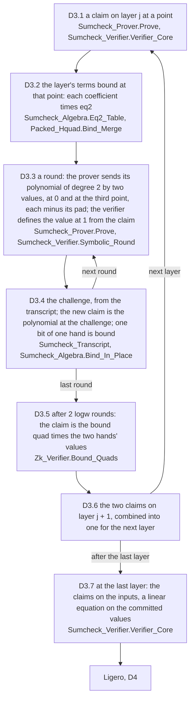

# Chapter 3: the sumcheck algebra and the symbolic verifier core

The generic units of the sumcheck, each instantiated for GF(2^128) and for the base field of P-256:

- `Field_Signature`, what the protocol needs from a field, and its two instances `Field_GF2_128` and `Field_P256`;
- `Sumcheck_Algebra`, the array vocabulary of the sumcheck and the evaluation of a circuit (Sections 6.1 to 6.4 of the specification), with `Ring_Laws`;
- `Sumcheck_Expression`, sparse affine expressions over the witness (Section 6.7);
- `Sumcheck_Verifier`, the symbolic verifier core (Section 6.7);
- `Sumcheck_HQuad` and `Packed_HQuad`, the bound quad of a layer as upstream computes it, from the packed circuit of chapter 6.

Decisions: [ADR 0022](../adr/0022-stage-3-scope-and-challenges-as-input.md) to [ADR 0027](../adr/0027-sumcheck-vectors-and-upstream-instrumentation.md) (scope, the structural Gold, the field signature, the polynomials, the expressions, the vectors), [ADR 0056](../adr/0056-linear-input-constraint.md) (the input constraint), [ADR 0070](../adr/0070-sumcheck-and-ligero-kernels-as-upstream.md) (the kernels in upstream's form and the ring laws), [ADR 0071](../adr/0071-prover-reuses-the-bound-quad.md) and [ADR 0073](../adr/0073-verifier-binds-the-quad-as-upstream.md) (the bound quads), [ADR 0080](../adr/0080-milestone-memory.md) (the packed circuit, the shape, the eq2 table).

Before reading: the sumcheck itself, its rounds, why a lie does not survive and why the messages are padded, in the primer's [A7](00-primer-cryptography.md#a7-the-sumcheck), with its running example; circuits in [A6](00-primer-cryptography.md#a6-circuits); generics in [B1.4](00-primer-spark.md#b14-generics). This chapter gives the exact formulas of the specification and the code that computes them.

## 1. The mathematics

### 1.1 Layered circuits and the quad representation

A circuit has NL layers (Section 6.3.1). Layer j computes the wires V[j] from the wires V[j + 1]; V[0] are the outputs and V[NL] the inputs. The statement "the circuit accepts" means every output wire is 0 and every assertion of the circuit holds (below; [A6.2](00-primer-cryptography.md#a62-what-the-circuit-accepts-means)): an assertion states that a product of two wires is zero and adds nothing to any output, so a violated one can leave every output at 0. Both conditions make the circuit accept; `Eval_Circuit`'s postcondition states the status as both (Section 2.2). Each layer is a *quad* Q[j], a sparse three-dimensional array (Section 6.3.2):

    V[j][g] = SUM_{l, r} Q[j][g, l, r] V[j + 1][l] V[j + 1][r]

so every wire is a quadratic form of the previous layer's wires. The layer also carries *assertions* (Section 6.3.3; upstream calls them Z terms): terms with coefficient 0, which state that a product of two input wires is zero. In the data this is one list of 4-tuples (g, h0, h1, k) per layer, the specification's (g, l, r, v): h0 is the left hand l, h1 the right hand r. k /= 0 is Q[g, h0, h1] = k; k = 0 asserts w[h0] w[h1] = 0. In each round of the sumcheck, hand 0 (h0) is bound before hand 1 (h1), as in upstream's `quad.h` and the specification's `sumcheck_prove_layer`.

Upstream's code and the specification use `NW` differently (ADR 0022): for layer j this chapter writes nw_in (j) for the number of input wires (upstream's `layers[j].nw`, the specification's NW[j + 1]) and nw_out (j) for the number of output wires (nw_in (j - 1), or noutput for j = 0); logw (j) is the number of bits of an input wire index, hence of sumcheck rounds.

### 1.2 Multilinear extensions, bind and the EQ array

Sumcheck arrays are padded with zeroes to infinity (Section 6.1). This is the multilinear extension of a table ([A3.5](00-primer-cryptography.md#a35-tables-as-polynomials-multilinear-extensions)) evaluated one variable at a time. Binding an array to a field element x halves it:

    bind (A, x)[i] = (1 - x) A[2 i] + x A[2 i + 1]

and binding to a vector of challenges X applies bind once per coordinate. The array EQ_n[i, j] is 1 when i = j < n and 0 otherwise (Section 6.2); its binding to X is what lets a verifier evaluate a bound array as a dot product, bindv (V, X) = SUM_j bindv (EQ, X)[j] V[j], which is the shape a commitment scheme with linear constraints can check. Two closed forms are used: `eq (r, x, nbits)`, the product over the bits b of x of r[b] when the bit is 1 and 1 - r[b] otherwise, and `bindeq (c)`, the whole array by the recursive definition b[2 i] = (1 - c0) a[i], b[2 i + 1] = c0 a[i] with a = bindeq (c[1 ..]). That the two agree, bindeq (c)[i] = eq (c, i, n), is a theorem; here it is tested, not proved (Section 5 below).

### 1.3 The sumcheck protocol in one layer



*D3. One layer of the sumcheck. In a round nothing is checked: the prover sends two values of its polynomial, each minus a sumcheck pad, and the verifier defines the third from the claim, so the equation holds by construction ([A7.2](00-primer-cryptography.md#a72-the-rounds)); the verifier's core writes, round by round, equations about the committed pads and values, and Ligero checks them at the end (D4). The prover and the verifier draw the same challenges from the transcript; the prover also runs the verifier's core on its own proof, to get the linear constraints it must prove (PS9). What it simplifies: the protocol holds two points per layer, G0 and G1, combined with the challenge alpha; that is why `Eq2_Table` builds one table of weights for the two points. A second challenge, beta, weighs the assertions. The figure draws one point for readability. Draft-irtf-cfrg-longfellow-00, Sections 6.6 and 6.7.*

Where it is in the code:

| Box | Units | Key subprograms | Assurance | Harnesses and vectors | Draft and records | Upstream |
|---|---|---|---|---|---|---|
| D3.1, D3.3 | [`Sumcheck_Prover`](../../src/sumcheck_prover.ads), [`Sumcheck_Verifier`](../../src/sumcheck_verifier.ads), [`Sumcheck_Expression`](../../src/sumcheck_expression.ads) | `Prove`, `Verifier_Core`, `Symbolic_Round` | Silver; `Symbolic_Round` the specification's formula by definition; `Round_Evals` against a ghost transcription; partitions `prover`, `protocol`, `sumcheck` | `prover_kat`, `sumcheck_kat` | Sections 6.4, 6.6, 6.7; ADR 0022, ADR 0026 | `runtime_sumcheck::prover::prove_core`, `symbolic_sumcheck_verifier_core` |
| D3.2, D3.4 | [`Sumcheck_Algebra`](../../src/sumcheck_algebra.ads), [`Packed_Hquad`](../../src/packed_hquad.ads), [`Sumcheck_Transcript`](../../src/sumcheck_transcript.ads) | `Eq2_Table`, `Bind_Merge`, `Bind_In_Place` | Gold against the ghost references, except that `Bind_Merge` without the eq2 table (Logv above 24) proves the run count only, its coefficients tested; partitions `sumcheck`, `packed_hquad`, `protocol` | `sumcheck_kat`, `circuit_kat` | Sections 6.1, 6.2; ADR 0063 | `runtime_sumcheck::eq`, `bind_quad` |
| D3.5 | [`Zk_Verifier`](../../src/zk_verifier.ads) | `Bound_Quads` | Gold against `BQ_Ref` on the expansion; partition `verifier` | `sumcheck_kat` | Section 6.7; ADR 0073 | inside `symbolic_sumcheck_verifier_core` |
| D3.7 | [`Sumcheck_Verifier`](../../src/sumcheck_verifier.ads) | `Input_Constraint` | Gold against the formula of Section 6.7; partition `protocol` | `sumcheck_kat` | Section 6.7; ADR 0056 | `symbolic_sumcheck_verifier_core` |

At layer j both parties hold two claims, bind (V[j], G0) and bind (V[j], G1), combined with a challenge alpha into one (Section 6.6). The quad of the layer with its outputs bound (`bind_g`, the coefficient of each term becomes k eq2 (g), or beta eq2 (g) for an assertion) turns the claim into a sum over the 2 logw bits of the two input wire indices l and r. Each round binds one bit of one hand with a fresh challenge: the prover sends a degree-two polynomial, the verifier evaluates it at the challenge and that becomes the new claim. After 2 logw rounds the sum has collapsed to a single term: the fully bound quad (`eval_bound_quad`, a field element the verifier computes alone) times the two new claims bind (V[j + 1], G'0) and bind (V[j + 1], G'1), which the prover sends and the next layer inherits.

In the running example of the primer ([A7.5](00-primer-cryptography.md#a75-the-running-example)), the layer has three input wires, so logw is 2 and there are four rounds, two per hand: bit 0 of l, bit 0 of r, then bit 1 of each. The bound quad is Q (g, rl, rr) for the two terms of the example, 1 · y · 1 and (−1) · w · w, and the two claims are about the extension of (1, y, w) at rl and at rr.

### 1.4 Degree-two polynomials by three evaluations; the Lagrange basis

Polynomials are degree two and are kept as evaluations at P0 = 0, P1 = 1 and P2 (Section 6.4): 2 in odd characteristic, inj (2) = beta_1 on GF(2^128) ([ADR 0025](../adr/0025-polynomials-and-lagrange-constants.md)). Since p (0) + p (1) is the claim of the round, the prover sends p (0) and p (P2) and the verifier recovers p (1). The value at a challenge r is p (r) = p (0) l0 (r) + p (1) l1 (r) + p (2) l2 (r) with the Lagrange basis

    l0 = (r - 1)(r - P2) / d0,   l1 = r (r - P2) / d1,   l2 = r (r - 1) / d2

and d0 = (0 - 1)(0 - P2), d1 = (1 - 0)(1 - P2), d2 = (P2 - 0)(P2 - 1). The inverses of the three denominators are per-field constants (on GF(2^128), where subtraction is addition, d0 = P2, d1 = 1 + P2, d2 = P2 (1 + P2); on P-256, 1/2, -1, 1/2), computed by the vector generator and re-checked by the harness with the library's multiplication; `Inv` is never called by the verifier.

### 1.5 From the textbook sumcheck to the symbolic verifier

In the textbook sumcheck the verifier receives the polynomial of each round in the clear and checks an equation. Here it can check nothing in a round, for two reasons, and the second makes the core of this chapter what it is.

- **The value at 1 is defined, not sent.** The prover sends p (0) and p (P2), and the verifier takes p (1) = claim − p (0). The equation p (0) + p (1) = claim then holds by construction ([A7.2](00-primer-cryptography.md#a72-the-rounds)).
- **Every value sent is padded.** p (0), p (P2) and the two claims of each layer are sent minus a sumcheck pad, a random value committed in the witness (Section 6.5, [A7.4](00-primer-cryptography.md#a74-padding-the-messages-reveal-nothing)). The verifier never learns the real values.

So the verifier carries the protocol out on *symbolic* values. Each true value is "the number received plus the pad of that position", an affine expression k + SUM a[i] Var (i) over the witness variables, and every step of the round computes with such expressions: the claim, p (1), the value at the challenge. At the end of a layer the claim must equal the bound quad times the two claims of the next layer. That equation is linear in the pads except for the product of the two claim pads, which gets a third pad variable cr with W[c0] W[c1] = W[cr]. So each layer leaves one linear constraint and one quadratic triple.

The output of the core is therefore not accept or reject but a system of constraints: the matrix A and vector b of the linear constraints, and the quadratic triples (Section 6.7). Ligero proves that the committed witness satisfies them (chapter 5); a lie of the prover in any round makes the system unsatisfiable, except with the probability of [A7.3](00-primer-cryptography.md#a73-why-a-lie-does-not-survive). The challenges come from the transcript of chapter 4; the core takes them as input ([ADR 0022](../adr/0022-stage-3-scope-and-challenges-as-input.md)).

In the running example: eight round pads and c0, c1, cr, eleven pads; the core emits two linear constraints, the layer's and the input layer's, in w and the pads, and the triple (c0, c1, cr).

### 1.6 The combined witness and its layout

Witness variables are numbered from 0: first the ninput - npublic private inputs, then the pads, layer by layer from layer 0, within a layer 4 logw round pads (round r, hand h: the pad of p (0) at 4 r + 2 h and of p (P2) at 4 r + 2 h + 1) followed by c0, c1 and cr (Section 6.5, `LayerPad::generate_indices`). The pad block of layer j starts at Pad_Off (j) = ninput - npublic + SUM_{i < j} (4 logw (i) + 3). The quadratic triple of layer j is (Pad_Off (j) + 4 logw (j), + 1, + 2).

## 2. The algorithms

### 2.1 eq, eq2, bindeq, bind

`eq` is a product over the bits of x, least significant first, starting from One. `eq2 (x, n, g0, g1, alpha) = eq (g0, x, n) + alpha eq (g1, x, n)`. `bindeq` expands in place from the last challenge to the first, doubling the array at each step, highest index first so that nothing is overwritten before it is read. `bind` applies the formula of Section 6.1 with zero padding beyond the end of the array.

### 2.2 eval_quad and eval_circuit, with the assertions

`eval_quad` walks the term list in order: a term with k = 0 checks w[h1] w[h0] = 0; any other term adds k w[h1] w[h0], in that association, to output wire g. `eval_circuit` runs the layers from the input layer to layer 0, keeping every layer's wires, and reports success when every assertion held and every output wire is zero. Nothing is raised: success is a Boolean ([ADR 0022](../adr/0022-stage-3-scope-and-challenges-as-input.md), D6).

### 2.3 bind_g and eval_bound_quad

`bind_g` replaces the coefficient of every term by k eq2 (g) (beta eq2 (g) for an assertion) and sets g to 0: the quad with its outputs bound. `eval_bound_quad` is the value of that bound quad at the two hands' challenges, SUM over terms of bound_k eq (hc0, h0, logw) eq (hc1, h1, logw), in list order.

### 2.4 The symbolic round and verify_layer

A symbolic round (Section 6.7, `symbolic_sumcheck_round`) builds p0 = Var (pad0) + hp0 and p2 = Var (pad1) + hp2 from the padded evaluations and their pad variables, deduces p1 = claim - p0, and returns next = p0 l0 + p1 l1 + p2 l2 with the basis at the round's challenge. `verify_layer` combines the two claims with alpha, runs the 2 logw rounds (round outer, hand inner), computes the bound quad eqq, forms prod = (Var (c0) cl1 + Var (c1) cl0 + Var (cr) + cl0 cl1) eqq from the padded claims cl0, cl1, subtracts it from the claim, emits "claim = 0" as a linear constraint, and hands the next layer the claims Var (c0) + cl0 and Var (c1) + cl1 with the two hands' challenge vectors.

### 2.5 The input constraint and the quadratic triples

After the last layer the two claims are combined with alpha_input and compared with the multilinear extension of the inputs at the final binding: eq2 (i) for every input i, the public inputs folded into the constant term, one variable per private input. The difference is the last linear constraint. The quadratic triples are the (c0, c1, cr) of every layer (`generate_lqc_triples`).

### 2.6 The bound quad from the packed circuit

The verifier computes the bound quad of each layer as upstream's `bind_quad` does (`rust/runtime/sumcheck/src/hquad.rs`), not term by term. It walks the packed layer of chapter 6 Section 3.7, rebuilds each term, binds it with g through the eq2 table, and merges consecutive terms with the same hands into one entry, so that the working array has one entry per run of equal hands, never one per term. Then it binds one hand at a time for each round; the coefficient left at hands (0, 0) after the last round is the bound quad. When the eq tables do not fit (logv or logw above 24) it sums `eval_bound_quad` over the walk instead, with no array. On the mDoc hash circuit the layer with the most terms holds 3,578,789 of them in 439,013 runs; the layer with the most runs is another (Section 3.6).

## 3. The Ada/SPARK implementation

### 3.1 A field as a signature package; the two instantiations

`Field_Signature` is a *signature package*: a generic whose formal part lists what the protocol needs from a field, and whose body is empty:

- the private type `Element`, the constants `Zero`, `One`, `P2`, the operations `"+"`, `"-"`, `"*"`, `Neg`, and the three Lagrange denominator inverses;
- the ghost logical equality `Same` ([B4.4](00-primer-spark.md#b44-logical-equality-same));
- the laws of a commutative ring as ten ghost lemmas stated with `Same` (`Lemma_Mul_Assoc`, `_Comm`, `_One`, `_Distrib`, `_Distrib_Sub`, `Lemma_Add_Assoc`, `_Comm`, `_Zero`, `Lemma_Add_Neg`, `Lemma_Sub_Def`), each proved by the field for its own operations (chapter 1 Section 2.3, chapter 2 Section 3.6);
- the encoding (`Serialized_Size`, `To_Bytes`, `From_Bytes`) and whether the sampler can reject a draw (`Sampling_Rejects`), for the transcript of chapter 4;
- the checked inverse, the Reed-Solomon evaluation points and the subfield encoding, for Ligero (chapter 5).

`Field_GF2_128` and `Field_P256` instantiate it as `Sig`, naming the operations of the two field packages and holding the constants of [ADR 0025](../adr/0025-polynomials-and-lagrange-constants.md). Their child units `Field_GF2_128.Laws` and `Field_P256.Laws` prove that the predefined equality of two elements gives `Same`. Protocol packages take `with package F is new Field_Signature (<>)` as a *formal package parameter*: one parameter stands for the whole bundle. GNATprove analyses the instances, not the generics ([ADR 0024](../adr/0024-field-genericity-by-formal-package.md)), so every proof below is made twice, once per field.

Inside the generic the operations are reached through wrappers `"+"`, `"-"`, `"*"`, `Neg` with `Global => null` and no postcondition. This is deliberate: the contracts of the concrete field never enter a protocol proof, and the verification conditions are the same for both instances. A protocol proof that needs a law of the field calls the lemma of the signature.

The two instances are Silver, and Gold on the contracts they declare: `Checked_Inv` returns `Ok` only when R * D = One, which its body checks at run time ([ADR 0037](../adr/0037-checked-inv-and-public-data-scope.md)), so nothing is assumed of `Inv`, whose result no contract states; the ten ring laws of the signature are proved for each field's operations (ghost lemmas at the level `Proof_Only`, register row T8); and `Same` is taken as given (register row T6).

### 3.2 Circuits as data: Term, Layer, Circuit and their predicates

A `Term` is (K, G, H0, H1) with the wire indices bounded by `Max_Wires`. A `Raw_Circuit (Last_Layer, NT)` is a *discriminated record*: its discriminants size the arrays inside it (`Layers (0 .. Last_Layer)`, `Terms (1 .. NT)`), so a circuit of any size is one object with no pointers. Each `Layer` owns a contiguous range of the flat term list. `Circuit` is a subtype of `Raw_Circuit` with the *type predicate* `Well_Formed`: the layers partition the term list, every term names wires in range (g < nw_out, h < nw_in), nw_in fits in logw bits and the last layer reads exactly the inputs. The predicate lives on a subtype rather than on the record itself because its function takes the record as argument; every subprogram taking a `Circuit` may assume it, and the harness checks it when it builds a circuit from a vector file.

The sizes of the proof, the challenges and the pads depend on the layer table and the three wire counts alone. These form the *shape* of a circuit, `Shape`: the circuit without its terms, with `Shape_Ok`, the conjuncts of `Well_Formed` that name no term, as its predicate. Every subprogram of this chapter that reads no term (`Chal_Off`, `Proof_Off`, `Pad_Off`, `Witness_Count`, `A_Bound`, `Verify_Layer`, `Input_Constraint`, `Verifier_Core`) takes `S : Shape`. `Shape_Of (C)` is the shape of an expanded circuit and `Lemma_Shape_Of` proves that `Well_Formed (C)` makes it a `Shape`. So the verifier never holds the terms of a circuit, only the packed form of chapter 6 ([ADR 0080](../adr/0080-milestone-memory.md)).

### 3.3 Sumcheck_Algebra: the generic and its ghost references

Each Gold kernel has a ghost reference that transcribes the formula with the operations in the order upstream's reference implementation applies them: `Eq_Ref` (the product over bits, from One), `Bindeq_Ref` (the recursive definition read pointwise), `Acc_Ref` and `Z_Ref` (the quad sum per output wire and the conjunction of the assertions over the first N terms), `EBQ_Ref` and `EBQT_Ref` (the bound quad sum, with eq computed bit by bit or read from the bindeq tables). The executable code mirrors the ghost reference step by step and its loop invariant says, after K steps, exactly what the ghost reference computes for K steps, as in chapters 1 and 2.

The bodies of `Bind` and `Bindeq` compute in upstream's form, with fewer products, and reach the same references through the ring laws of `Field_Signature` ([ADR 0070](../adr/0070-sumcheck-and-ligero-kernels-as-upstream.md)):

- `Bind` writes a + x (b - a), one product, for (1 - x) a + x b.
- `Bind_In_Place` writes the same values where they are, entry i from entries 2i and 2i + 1, which are read before they are overwritten since 2i is at least i; the first n entries shrink to (n + 1) / 2, the rest are untouched. Its postcondition is `Bind`'s on the vector as it came (`A'Old`). The prover binds the vectors of its two hands with it, as upstream's `dense::bind` does.
- `Bindeq` writes c t and t - c t, one product per pair. It is `Bindeq_From` started from One.
- `Eq2_Table` fills its one table as upstream's `fill_recursive` (`eq.rs`) does. Entry x of the table is w0 bindeq (G0) (x) + w1 bindeq (G1) (x), with weights One and alpha at the top. The procedure `Fill` splits the table at its high bit: the low half is the same table one bit shorter with the weights multiplied by 1 - G0 (L - 1) and 1 - G1 (L - 1), the high half with the weights multiplied by G0 (L - 1) and G1 (L - 1); a table of one entry is w0 + w1. The weights travel down the recursion, two per level, so no second table is built. The proof is by the same recursion: `Lemma_Peel` shows that `Bindeq_Ref` peeled at its high bit is the reference one bit shorter times the factor of that bit; `Lemma_Fill_Step` joins the two halves entry by entry. `Fill` is a recursion of the executable code, of depth L, at most 24, with a `Subprogram_Variant` (`Decreases => L`) that proves it terminates. The table depends on the challenges only, which are public, and the recursion branches on L alone.
- `Ring_Laws`, a generic instantiated on the hidden wrappers, derives from the laws the identities the kernels use, so that the contracts of the field, `Mul_Ref` or the integer model, stay out of these proofs.

`Eval_Circuit` keeps every layer in one flat buffer (`Wires`, segment j from `Off (C, j)`); its postcondition says the input segment is W, every layer segment is the quad sum of the next one (`Layer_Holds`), and the status is "every assertion held and every output is Zero". The proof needs *frame lemmas*: writing segment j does not disturb the references of the segments above it (`Lemma_Acc_Frame`, `Lemma_Layer_Frame`, `Lemma_From_Frame`, `Lemma_Layer_Intro`, `Lemma_Off_Mono`, `Lemma_Off_Step`). `Eval_Quad`, `Eval_Circuit`, `Bind_G`, `Eval_Bound_Quad` and `Eval_Bound_Quad_T` are not on the path of the two programs: the prover evaluates the packed circuit (`Packed_Eval`, chapter 7) and the verifier binds the quad from it (Section 3.6). They stay proved in the library as the oracles the harnesses compare the program path with.

Two devices keep the provers on track. The bodies of the recursive references and of `Off` carry `Annotate => (GNATprove, Hide_Info, "Expression_Function_Body")` and are unhidden only inside the lemmas that need them (`Unhide_Info`). Powers of two are a ghost `Big_Integer` function `Pow2`, as `Weight` in chapter 2; `Bit_Of` is an ordinary function without postcondition, so `Eq` and `Eq_Ref` agree by congruence and no bit-vector reasoning enters any proof. The verification approach, "Lessons of the proofs", says why.

### 3.4 Expression: a discriminated record under a type predicate

`Expression (Capacity)` holds `Length`, `Known` and a sorted array `Terms (1 .. Capacity)` of (variable, coefficient) pairs; the predicate `Sorted` states that the variables of the first `Length` pairs are strictly increasing, which gives "no duplicate" for free ([ADR 0026](../adr/0026-sparse-expression.md)). `Find (E, V)` returns the position of V or 0, with a postcondition that pins it down: 0 means no pair has V, otherwise exactly that index has V. The ghost model is `Has (E, V) = Find (E, V) /= 0` and `Coef (E, V)`, the stored coefficient or `Zero`.

The postconditions quantify over the *positions* of the stored pairs, never over all variables: "every variable of E is in the result", "every variable of the result is V or a variable of E", "the variable at position I of F has coefficient `Coef (E, ...) + F.Terms (I).C`". The two forms say the same thing to the provers, but only the position-bounded one is executable: with `-gnata` the test build runs every postcondition, and a `for all W in Natural` is a loop over 2^31 values.

Every operation builds its result in a local array and constructs the record once, so that the predicate is checked once, at the end. `Add_Term` and `Sub_Term` share `Combine` (sorted insertion, or an update in place); `Add` and `Sub` fold the pairs of F into E with `Combine`, and their exact lengths are `E.Length + New_Count (E, F, F.Length)`, the number of F's variables absent from E. Zero coefficients are kept (ADR 0026): dropping them would make the postconditions rest on field identities the provers do not have.

Small lemmas carry the reasoning about `Find` out of the large verification conditions: `Lemma_Find_Equiv` (two expressions with the same variables at the same positions have the same `Find`), `Lemma_Find_Insert` (an insertion at Pos shifts the positions above it by one), `Lemma_Coef_Kept` (an untouched variable keeps its coefficient), `Lemma_Has_Below`, `Lemma_Below_Union` and `Lemma_Below_Insert` (variables stay below a bound through the operations). Most have a `null` body or a one-line assertion: the provers prove their postconditions from the postcondition of `Find` alone, and the operations and the verifier call them where the conclusion is needed instead of leaving a chain of `Find` instantiations to a prover facing a large context.

### 3.5 The Challenges record and the symbolic core

`Challenges (Last)` holds the 40 output-binding challenges `G`, every per-layer challenge in one flat array `Layer` (alpha, beta, then one per round and hand, layer after layer, from `Chal_Off (S, J)`) and `Alpha_Input`. `Sumcheck_Proof (Last)` holds the padded evaluations and claims, flat, in the pad order of Section 6.5 (which differs from the serialisation order of Section 7, where the two hands' p (0) precede the two hands' p (P2) within a round). `Claims_State (Capacity)` is a discriminated record whose components are themselves discriminated (`Claim0, Claim1 : Expression (Capacity)`) plus the two challenge vectors of the hands.

`Symbolic_Round` is an *expression function*: its body is the formula of Section 2.4 written with the operations of `Expression`, so it is Gold by definition and a reader checks it against the specification by reading it. `Lemma_Round_Shape` adds what the capacity accounting needs: when the two pad variables are fresh, the result has at most two more variables than the claim and all of them lie below the next pad index (`Below`, every stored variable under a bound). `Verify_Layer` carries the invariant `Below (Claim, pad pointer)`, which is what bounds every claim expression by 4 logw + 5 terms and discharges the preconditions of `Add` and `Sub`. The claim expressions are allocated with `Layer_Capacity = 4 * Max_Logw + 5` pairs (165), on the stack.

`Input_Constraint` does not build an `Expression` ([ADR 0056](../adr/0056-linear-input-constraint.md)). It writes one term per private input straight into the Ligero terms, in input order, with its coefficient `Eq2 (npublic + W)` read from the bindeq tables, then appends the few terms of the claims, built with the operations of `Expression` (`Input_Tail`). The public inputs fold into the constant (`Pub_Binding_Ref`, in input order). Its cost is linear in the inputs and its stack does not grow with them: the mDoc hash circuit has 84,166 private inputs. It is Gold against the formula of Section 6.7.

The Ligero output is `Ligero_Terms (Max)`, the sparse matrix A in coordinate form as three parallel arrays (coefficient, constraint number, variable) with a count, and `B`, the vector of constants. Parallel arrays rather than an array of records keep the frame conditions of `Constrain_To_Be_Zero` cheap for the provers.

**The bound quads** are computed before the core, not inside it ([ADR 0071](../adr/0071-prover-reuses-the-bound-quad.md)):

- `Verifier_Core` takes the bound quad of each layer as an input, as upstream's `aux`, and `Verify_Layer` reads its value from there.
- The verifier computes them with `Zk_Verifier.Bound_Quads` from the packed circuit (Section 3.6). Its postcondition says each one equals the ghost `BQ_Ref (Expand (P), Ch, J)`: the terms of layer J of the expansion, with the hand challenges of the previous layer, or `G` for layer 0, and the round challenges of this layer.
- The prover passes its own, from its sumcheck (chapter 7), whose postcondition proves them equal to `BQ_Ref` too.
- That fact is asserted at the level `Proof_Only` at the two calls of the core, in `Zk_Verifier.Verify` and in `Zk_Prover.Prove`. The core cannot state it, since it holds the shape and not the terms; its own postcondition, the sizes emitted and the pad indices of the triples, does not depend on it.

### 3.6 Sumcheck_HQuad and Packed_HQuad: the bound quad as upstream computes it

`Sumcheck_HQuad` holds upstream's kernels of `hquad.rs` ([ADR 0073](../adr/0073-verifier-binds-the-quad-as-upstream.md)), shared by the prover and the verifier. `Sumcheck_Verifier` instantiates it as `HQ`, and the prover uses that instance.

- `Bind_H` binds one hand for one round on the merged entries. Its ghost package `BQ` holds the invariant of the rounds: for every pair of hands, the sum of the coefficients of the merged terms equals the sum over the terms of the layer of the bound coefficient times the factors of the challenges drawn so far.
- `Bind_G_T`, `Merge_Runs` and `Merge_Terms` do the first step on an expanded layer. They are not on the program path; the harnesses compare the packed path with them.

`Packed_HQuad`, generic over the algebra, `Packed_Circuits` and `Sumcheck_HQuad`, does the first step from the packed layer ([ADR 0080](../adr/0080-milestone-memory.md)):

- `Layer_Runs` walks the layer once and counts the changes of hands, so that the working array is allocated at its size;
- `Bind_Merge` walks it again: each term is bound with g (through the eq2 table when logv fits it, `Bound_K` otherwise) and added to the entry of the current run, or opens the next run. The prover uses it too (chapter 7);
- `Bind_Quad_Packed` is the verifier's bound quad: `Layer_Runs`, the eq2 table, `Bind_Merge`, then the rounds (`Bind_Step`, one round of one hand with the invariant carried over, around `Bind_H`) and the sum of the coefficients left;
- `Eval_Bound_Quad_Packed` is the verifier's form when the eq tables do not fit: the sum of `Eval_Bound_Quad` over the walk, with no array.

The model is the layer of the ghost expansion, `Layer_Of (P, J)`, a slice of `Expand (P)`. Every result is stated on it exactly as the kernels of `Sumcheck_HQuad` state theirs on an expanded layer:

- `Bind_Merge` gives the invariant of the rounds at round 0, as `Merge_Terms` does, when the eq2 table is used (logv at most 24). Without the table its contract gives the run count only, and the merged coefficients are tested, not proved. The prover takes that case on a layer whose logv is above 24 (`Sumcheck_Prover`, with an empty table); no circuit held here has one, and `circuit_kat` tests the case on the small layers of every circuit it loads (register row V5).
- `Bind_Quad_Packed` gives `EBQT_Ref`, and `Eval_Bound_Quad_Packed` gives `EBQ_Ref`.

The proof follows the pattern of chapter 6 Section 3.7. The state of the merge after K terms is one hidden predicate, `Merged`, with a lemma per step (the first term, a term added to its run, a term that opens a run) and one at the end; the loop invariant of `Bind_Merge` is that predicate, with the walk's `Walked` and the walk's index tied to K. Both walks are proved to read `Layer_Of (P, J)` through `Lemma_Walked_Step` of `Packed_Circuits`, which states the coefficient of a term by `Same` as well as by `=`.

On the mDoc hash circuit the largest working array is that of the layer with the most runs, layer 13: 1,429,054 terms in 1,153,333 runs, 36.9 MB. The layer with the most terms, layer 14 (Section 2.6), has fewer runs. Over the whole circuit, 7,757,579 terms and 3,144,054 runs make 100.6 MB of working arrays against 248.2 MB of expanded layers. These sizes are measured by `first_step_bench` in the release build, with the times, on [the performance page](performance.md#memory).

### 3.7 Errors as status

No subprogram of this chapter raises. `Eval_Quad` and `Eval_Circuit` return a Boolean; the core's inputs are checked by preconditions on the sizes of the records (`Chal_Total`, `Proof_Total`, `A_Bound`), which the verifier of chapter 5 establishes from the circuit before building them.

## 4. What the proofs guarantee

### 4.1 Structural Gold, and what it does not say

Gold in this chapter means ([ADR 0023](../adr/0023-gold-perimeter-for-protocol-code.md)): the executable code is proved equal, for all inputs, to a ghost reference that transcribes the formula of the specification or of upstream's reference implementation in a fixed order of operations. The contracts state no law of the field: they say "this code computes that formula". Some bodies reach their references with fewer products through the ring laws of the signature (Section 3.3), each law proved by its field; the contracts do not change. What the contracts do not say, and what is therefore tested, are the algebraic truths about the formulas: that bindeq agrees with eq, that the Lagrange basis interpolates, and that the emitted constraints are satisfied by an honest witness (Section 5).

The equality in these contracts is `Same`, not `=`. GNATprove encodes the predefined equality of a record with an array component, as `GF2_128.Element` is, as a pointwise predicate on the array, not as equality of terms; from `P = Eq_Ref (...)` the provers could not conclude `P * R = Eq_Ref (...) * R`, and no structural proof survives without that congruence. `Same` is annotated `Logical_Equal` in each field wrapper and the provers treat it as equality of terms, which gives congruence under any function. Its body returns the predefined `=` and lies outside SPARK: it executes in the test build, and the provers take it as given: a trusted item (register row T6). What is proved with `Same` implies the predefined equality, so nothing proved is weaker than stated; that `Same` is the equality of each element type is a trusted item (Section 6).

The Expression postconditions are stated with the "absent means Zero" convention made explicit by case splits (`if Has (F, W) then Coef (E, W) + Coef (F, W) else Coef (E, W)`), because `Zero + K` and `K` are different terms; where upstream's formula reads `Zero + K`, the body computes `Zero + K`.

### 4.2 The verification conditions, per instance

The proof of the units of this chapter, from runs of the partitions `primitives`, `p256`, `sumcheck`, `protocol` and `packed_hquad` ([B6.5](00-primer-spark.md#b65-partitions-and-the-whole)) on the proving machine:

- **commit** 4f1e104 (main), proof inputs `be44efe9bc9d` (`scripts/remote-check.sh --digest`);
- **toolchain** GNATprove 16.1.0 with gnat_native 16.1.0 (Alire); the prover configuration of `package Prove` in the project file, CVC5, Z3 and Alt-Ergo with `--steps=600000` and `--timeout=120` ([ADR 0020](../adr/0020-prover-configuration-step-budget.md));
- **command** `make prove-partition PARTITION=<name>` for each of the five;
- **run** 14 November 2026, on the proving machine, each partition from a clean session: proved, not reused from an earlier proof.

| Check | `Field_*` and `.Laws` | `Sumcheck_Algebra_*` | `Sumcheck_Expression_*` | `Sumcheck_Verifier_*` | `Packed_HQuad_*` | Discharged by |
|---|---|---|---|---|---|---|
| Data dependencies (`Global`) | 14 / 14 | 150 / 150 | 27 / 27 | 115 / 115 | 25 / 25 | flow analysis |
| Initialisation | 4 / 4 | 15 / 15 | 1 / 1 | 9 / 9 | 17 / 17 | flow analysis |
| Termination | 2 / 2 | 44 / 44 | 17 / 17 | 49 / 49 | 6 / 6 | flow analysis |
| Range checks | 5 / 0 | 229 / 229 | 9 / 9 | 387 / 387 | 242 / 242 | provers |
| Division checks (`/`, `mod`) | 2 / 0 | 17 / 17 | 0 / 0 | 27 / 27 | 0 / 0 | provers |
| Overflow checks | 1 / 0 | 173 / 173 | 30 / 30 | 500 / 500 | 121 / 121 | provers |
| Index checks | 2 / 0 | 203 / 203 | 193 / 193 | 475 / 475 | 110 / 110 | provers |
| Length checks | 0 / 1 | 5 / 5 | 8 / 8 | 5 / 5 | 0 / 0 | provers |
| Discriminant checks | 0 / 0 | 0 / 0 | 1 / 1 | 8 / 8 | 0 / 0 | provers |
| Null dereferences | 0 / 0 | 24 / 24 | 0 / 0 | 3 / 3 | 20 / 20 | provers |
| Type predicates | 0 / 0 | 63 / 131 | 9 / 78 | 54 / 333 | 0 / 54 | provers |
| Preconditions of the calls | 10 / 10 | 360 / 360 | 29 / 29 | 610 / 610 | 174 / 174 | provers |
| Assertions | 8 / 0 | 53 / 53 | 18 / 18 | 47 / 47 | 24 / 24 | provers |
| Loop invariants (base case and preservation) | 0 / 0 | 58 / 58 | 38 / 38 | 116 / 116 | 30 / 30 | provers |
| Loop variants | 0 / 0 | 0 / 0 | 1 / 1 | 2 / 2 | 0 / 0 | provers |
| Postconditions | 14 / 12 | 111 / 111 | 23 / 23 | 85 / 85 | 19 / 19 | provers |
| Variants of the recursive functions | 0 / 0 | 21 / 21 | 3 / 3 | 49 / 49 | 3 / 3 | provers |
| Memory leaks (an allocation freed) | 0 / 0 | 6 / 6 | 0 / 0 | 1 / 1 | 4 / 4 | provers |
| **Total** | **62 / 43** | **1532 / 1600** | **407 / 476** | **2542 / 2821** | **795 / 849** | all proved: none justified, none unproved, no `pragma Assume` |

Each cell gives the GF(2^128) instance, then the P-256 one. The first column is the two field wrappers with their `Laws` children (`Field_GF2_128` 60 and `.Laws` 2; `Field_P256` 41 and `.Laws` 2). The P-256 instances carry more type predicates: every `Element` carries the canonical-form predicate.

How to read the table: [B6.4](00-primer-spark.md#b64-reading-the-summary-table). The generic units (`Field_Signature`, `Ring_Laws`, `Sumcheck_Algebra`, `Sumcheck_Expression`, `Sumcheck_Verifier`, `Sumcheck_HQuad`, `Packed_HQuad`) have no checks of their own: GNATprove proves their instances, and the table gives the instances. `Sumcheck_HQuad` is proved inside the instances of `Sumcheck_Verifier`, as `HQ`. Which of CVC5 and Z3 is credited with a check varies from run to run.

The flow analysis also prints warnings, which are not checks and are not counted in the tables. Their counts, as `vc-count.py` prints them: `Sumcheck_Verifier` 1 and 1; none in the other units of this chapter. `Packed_Eval`, the other unit of `packed_hquad`, is counted in chapter 7.

In plain terms, for every input, not on samples:

- no run-time error occurs in any unit of this chapter;
- `Eq`, `Bindeq`, `Bind`, `Bind_In_Place`, `Eq2_Table`, `Lagrange_Basis`, `Eval_Quad`, `Eval_Circuit`, `Bind_G`, `Eval_Bound_Quad` and `Eval_Bound_Quad_T` compute their references;
- every `Expression` operation produces exactly the presence and coefficients its postcondition states;
- `Symbolic_Round` is the formula of Section 6.7 and `Input_Constraint` the input constraint of Section 6.7;
- the core emits NL + 1 linear constraints and NL quadratic triples at the pad indices of Section 6.5, within the stated bounds;
- `Bind_Quad_Packed` and `Eval_Bound_Quad_Packed` give the bound quad of the layer of the expansion;
- the ring laws hold for both fields;
- every subprogram terminates.

Reproduce with:

```bash
make prove-partition PARTITION=primitives
python3 -I scripts/vc-count.py --partition primitives field_gf2_128 field_gf2_128-laws
make prove-partition PARTITION=p256
python3 -I scripts/vc-count.py --partition p256 field_p256 field_p256-laws
make prove-partition PARTITION=sumcheck
python3 -I scripts/vc-count.py --partition sumcheck sumcheck_algebra_gf2_128 sumcheck_algebra_p256 sumcheck_expression_gf2_128 sumcheck_expression_p256
make prove-partition PARTITION=protocol
python3 -I scripts/vc-count.py --partition protocol sumcheck_verifier_gf2_128 sumcheck_verifier_p256
make prove-partition PARTITION=packed_hquad
python3 -I scripts/vc-count.py --partition packed_hquad packed_hquad_gf2_128 packed_hquad_p256
```

Each `make` command proves a partition and prints GNATprove's summary. the `python3` command after it checks that the files are those of a run of that partition and that its units add up to the summary, then prints the table from the files GNATprove writes for each unit (`obj/development/gnatprove/<unit>.spark`) and says whether any check is unproved or justified or any unit has a `pragma Assume`. Its line "discharged by the provers" is also the sum of the counts per subprogram of `obj/development/gnatprove/gnatprove.out` for the unit. Each run of a partition replaces the files of the previous one, so each count follows its partition.

## 5. What is only tested

### 5.1 Tier 1: the explicit circuits of Appendix B.3

`gen_sumcheck_vectors.py` carries the two circuits of Appendix B.3 of the specification as term lists copied from the upstream unit tests (`docs/specs/rust/tests/unit_tests.rs`), the s-gonal circuit over P-256 with witness [1, 45, 5, 6] and the quadratic circuit over GF(2^128) with witness [1, n, 5, 6], plus a small circuit with an assertion; each with a passing witness and failing ones, and the expected wires of every layer. The harness `sumcheck_kat` builds each circuit (the predicate `Well_Formed` is checked at that point), runs `Eval_Circuit` and compares status and wires. On every layer it also compares the bound quad by the tables (`Eval_Bound_Quad_T`) with the bound quad term by term (`Eval_Bound_Quad`), and the packed path's (`Packed_HQuad.Bind_Quad_Packed`) with both. 36 checks on each field:

- the five circuits well formed, 5;
- their five statuses, 5;
- the wires of twelve segments, 12;
- two comparisons of the bound quad on each of the seven layers, 14.

### 5.2 Tier 2: the algebra against an independent reference

The same generator computes `eq`, `eq2`, `bindeq`, `bind` and `lagrange_basis` from the specification's definitions (schoolbook GF(2^128) multiplication, plain integers mod p), on structural cases (all-zero and all-one challenges, the three evaluation points, zero padding) and seeded random cases, and checks itself: bindeq (c)[i] = eq (c, i, n) on every case, the Lagrange constants by d inv (d) = 1, the basis at the three points, its sum, and the interpolation of a random degree-two polynomial. The harness re-checks the constants with the library's multiplication and `Bindeq` against `Eq` at run time. 91 checks on each field.

### 5.3 Tier 3: recorded upstream runs with injected challenges

Agreement of `Verifier_Core` with the upstream verifier is checked on runs of upstream's code recorded by `tests/vectors/upstream/record_sumcheck_core.rs`, a test added to the upstream crate at d5e6be7 that rebuilds the B.3 circuits, runs the upstream prover and verifier, replays the core step by step writing out the challenges consumed, the padded proof, the claim after each round and the constraints emitted, and asserts that its replay produces the same A and b as the library's own core ([ADR 0027](../adr/0027-sumcheck-vectors-and-upstream-instrumentation.md), format there). The harness reads every `sumcheck_core_*.txt` present under `tests/vectors/upstream/`, feeds the core the recorded challenges and compares the constraints per constraint as sets of (variable, coefficient) pairs, zero coefficients ignored on both sides, plus b and the quadratic triples: 10 checks on each circuit, 20 on the two. On the same recordings it checks the packed form: `Pack` then the walk gives the terms back, and on each of the two layers `Zk_Verifier.Bound_Quads` on the recorded challenges equals `Eval_Bound_Quad` and `Eval_Bound_Quad_T`; 5 checks on each circuit. The recordings are produced outside this repository from that test; none is synthesised here.

Reproduce with:

```bash
tests/bin/sumcheck_kat
```

With no argument the harness reads the two files of tiers 1 and 2, then every proof file and every recording; a recording needs the proof file of its circuit before it. Its last lines give the checks by section, each file and its parts, then the total:

```text
checks by section:
  tests/vectors/sumcheck_gf2_128.txt: passed 127, failed 0
    tier 2: the algebra: passed 91, failed 0
    tier 1: the explicit circuits: passed 36, failed 0
  tests/vectors/sumcheck_p256.txt: passed 127, failed 0
    tier 2: the algebra: passed 91, failed 0
    tier 1: the explicit circuits: passed 36, failed 0
  tests/vectors/zk_proof_gf2_128_b3_3.txt: passed 0, failed 0
  tests/vectors/zk_proof_p256_b3_2.txt: passed 0, failed 0
  tests/vectors/upstream/sumcheck_core_gf2_128_b3_3_quadratic.txt: passed 68, failed 0
    tier 3: the core: passed 10, failed 0
    tier 3: the packed form: passed 5, failed 0
    tier 3: the reader and the replay: passed 5, failed 0
    tier 3: the steps of the Ligero verifier: passed 32, failed 0
    tier 3: the complete proof and its negative cases: passed 16, failed 0
  tests/vectors/upstream/sumcheck_core_p256_b3_2_sgonal.txt: passed 69, failed 0
    tier 3: the core: passed 10, failed 0
    tier 3: the packed form: passed 5, failed 0
    tier 3: the reader and the replay: passed 6, failed 0
    tier 3: the steps of the Ligero verifier: passed 32, failed 0
    tier 3: the complete proof and its negative cases: passed 16, failed 0
passed 391, failed 0
```

The proof files hold no check of their own: they give the recordings that follow them the proof of their circuit. Per field, GF(2^128) / P-256, and the chapter that describes each part:

| Part | Checks | Chapter |
|---|---|---|
| Tier 1: the explicit circuits | 36 / 36 | this chapter, Section 5.1 |
| Tier 2: the algebra | 91 / 91 | this chapter, Section 5.2 |
| Tier 3: the packed form | 5 / 5 | this chapter, Section 5.3 |
| Tier 3: the core | 10 / 10 | this chapter, Section 5.3 |
| Tier 3: the reader and the replay | 5 / 6 | chapter 4, Section 5.2 |
| Tier 3: the steps of the Ligero verifier | 32 / 32 | chapter 5, Section 5.3 |
| Tier 3: the complete proof and its negative cases | 16 / 16 | chapter 5, Section 5.4 |
| **Total** | **195 / 196** | 391 |

### 5.4 Errata of the specification

Appendix B.3.2 is labelled "P-256 scalar field (Field ID 2)" but prints the base field prime and upstream's code uses it; Table 1 gives p256 the identifier 0x01. B.3.3 is labelled "Field ID 5", which Table 1 assigns to GF(2^16). B.3.3 gives the witness as [1, 84, 5, 6], but the circuit requires (s + 1) m^2 + (s + 1) m + n = 0 in GF(2^128), which with m = 5 and s = 6 gives n = 0x6c; the upstream test computes n in the field exactly so. The vectors follow the code; the errata are recorded in ADR 0027 and reported upstream. All are still in draft-irtf-cfrg-longfellow-00.

## 6. What stays trusted, and the limits

- That `Same` of each field wrapper is the equality of its element type: its body is the predefined `=`, outside SPARK (register row T6).
- That the recordings of tier 3 were taken faithfully from d5e6be7 with the kept patch (R5), and that upstream's code is the protocol of the specification, which is trusted to describe the intended protocol (R1).
- That the Silver units agree with upstream beyond the recorded runs: `Verifier_Core`, whose constraints are tested, and the packed path against the expanded kernels, including the coefficients of `Bind_Merge` without the table (V5).
- That `Bindeq` agrees with `Eq` (V9), that the Lagrange basis interpolates (V10), and that the three denominator inverses of each field are the inverses (V11): tested, not proved (Section 5.2).
- The challenges: the core takes them as input; a challenge record built from a wrong transcript gives a wrong constraint system that proves fine. The transcript of chapter 4 derives them (S3).
- The soundness argument of the protocol, which no contract states (S1).
- The compiler and the builder (T1), GNATprove (T2), the SMT solvers (T3); the release build without run-time checks (T7); the contracts at `Proof_Only`, never compiled (T8).
- Memory: the claim expressions of a layer live on the stack, at most 165 pairs each, and the bindeq and eq2 tables, the working arrays of the bound quads and the Ligero terms on the heap. An exhausted stack or heap is a `Storage_Error`, outside the proofs (P1). `Ceil_Lg2` and the bound `Max_Wires = 2^24` cap the circuits these units accept.
