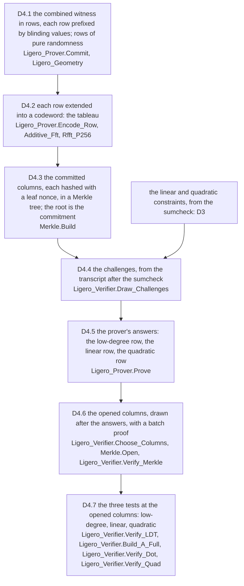

# Chapter 5: Ligero and the complete verifier

The verifier's side of Ligero and the complete verifier:

- `Merkle`, the commitment to the columns;
- `Ligero_Geometry` and `Lagrange`, the geometry and the Reed-Solomon code by Lagrange interpolation;
- `Ligero_Proof`, the Ligero proof and its reader (Section 7.4 of the specification);
- `Ligero_Verifier`, the Ligero verifier of Section 4.5, with `Verifier_Status`;
- `Zk_Verifier`, the complete verifier with the reader of Section 7.5, which composes chapters 3, 4 and this one into a verdict on a proof string.

The prover's side (`Ligero_Prover`, the FFTs) is in chapters 7 and 8. Decisions: [ADR 0035](../adr/0035-stage-5-scope-ligero-and-the-complete-verifier.md) to [ADR 0040](../adr/0040-ligero-vectors-and-upstream-instrumentation.md) (scope, Lagrange interpolation, the checked inverse, the Gold perimeter, sizes and statuses, the vectors), [ADR 0043](../adr/0043-exhausted-status-and-streaming-slice.md), [ADR 0047](../adr/0047-heap-allocation-by-ownership.md) (the working sets on the heap), [ADR 0064](../adr/0064-lean-circuit-premises.md) (`Public_Input_Not_One`), [ADR 0066](../adr/0066-lagrange-tables-by-prefix-and-suffix.md) (the Lagrange tables), [ADR 0071](../adr/0071-prover-reuses-the-bound-quad.md) and [ADR 0080](../adr/0080-milestone-memory.md) (the bound quads), [ADR 0085](../adr/0085-prover-and-verifier-in-two-phases.md) (the two phases).

Before reading: Reed-Solomon codes, the tableau, the three tests and why Ligero is sound and hides, in the primer's [A8](00-primer-cryptography.md#a8-reed-solomon-codes-and-ligero); Merkle trees in [A4.2](00-primer-cryptography.md#a42-a-merkle-tree-a-commitment-to-a-long-vector). This chapter gives the exact rows, indices and byte layout, and the code.

## 1. The mathematics

### 1.1 Commitments to a matrix: Reed-Solomon rows, hashed columns



*D4. Ligero: the commitment and the three tests. The verifier never sees a row; it sees the prover's three answers in full and the opened columns, and checks each answer against the same combination of the opened columns ([A8.3](00-primer-cryptography.md#a83-the-three-tests)). The order is what makes it sound: the root is written before any challenge, the answers before the columns are drawn. What it simplifies: the rows are of three kinds, the witness rows, the copied rows of the quadratic test and the random rows that hide each answer, drawn here as one; the verifier extends each answer by Lagrange interpolation at the opened columns, where the prover encodes by an FFT. Draft-irtf-cfrg-longfellow-00, Sections 4.1 to 4.5.*

Where it is in the code:

| Box | Units | Key subprograms | Assurance | Harnesses and vectors | Draft and records | Upstream |
|---|---|---|---|---|---|---|
| D4.1, D4.2 | [`Ligero_Prover`](../../src/ligero_prover.ads), [`Ligero_Geometry`](../../src/ligero_geometry.ads), [`Additive_Fft`](../../src/additive_fft.ads), [`Rfft_P256`](../../src/rfft_p256.ads) | `Commit`, `Encode_Row`, `Make` | the geometry Gold; each row placed without touching the others; the systematic part proved, the parity by the FFT tested (register row V2); partitions `ligero`, `ligero-prover` | `prover_kat`, `fft_kat` | Sections 2.2, 4.2, 4.3; ADR 0057 | `runtime_ligero::prover::LigeroProver::commit` |
| D4.3, D4.6 | [`Merkle`](../../src/merkle.ads), [`Fisher_Yates`](../../src/fisher_yates.ads) | `Build`, `Open`, `Verify` | `Build` against the heap of the tree; `Verify` accepts only distinct indices and a proof consumed exactly; `Choose` distinct values; partition `primitives` | `ligero_kat` | Sections 4.1, 4.4.3; ADR 0052 | `runtime_merkle::commitment` |
| D4.4, D4.7 | [`Ligero_Verifier`](../../src/ligero_verifier.ads), [`Lagrange`](../../src/lagrange.ads), [`Ligero_Proof`](../../src/ligero_proof.ads) | `Draw_Challenges`, `Verify_LDT`, `Build_A_Full`, `Verify_Dot`, `Verify_Quad` | the three tests against the combinations of Sections 4.4 and 4.5; `Lagrange` against the matrix at the opened columns; partitions `verifier`, `ligero` | `ligero_kat` | Sections 4.4, 4.5; ADR 0036 | `runtime_ligero::verifier::verify` |
| D4.5 | [`Ligero_Prover`](../../src/ligero_prover.ads) | `Prove` | Silver; partition `ligero-prover` | `prover_kat` | Section 4.4.4 | `runtime_ligero::prover::LigeroProver::prove` |

The sumcheck of chapter 3 ends with linear constraints A W + b = 0 and quadratic constraints W[x] W[y] = W[z] on a witness vector W the verifier never sees: the private inputs and the pad variables of every layer. Ligero is the commitment that lets the prover prove those constraints about W without revealing it. The witness is laid out in rows of WR entries, each row prefixed by NREQ random blinding values, and every row of BLOCK = NREQ + WR entries is read as the values of a polynomial of degree below BLOCK at the first BLOCK points of a Reed-Solomon code and extended to NCOL points. The matrix of extended rows is the tableau; its columns from DBLOCK on, where DBLOCK = 2 BLOCK - 1 (Section 4.2), are each hashed with a random nonce and committed in a Merkle tree, and the verifier asks to see NREQ of those columns, chosen after everything else is fixed. The rate 1/RATE_INV and the number of opened columns are the two parameters that buy soundness (Section 5.1 gives NREQ 132 and rate 7 for 128 bits); the blinding prefix is what buys zero knowledge: an opened column reveals one value of each row's polynomial, and NREQ such values of a polynomial with NREQ random coefficients reveal nothing about the other WR.

### 1.2 Merkle trees without padding: the heap layout and batch proofs

Section 4.1 commits n leaves as a heap: an array of 2 n digests with the leaves at n .. 2 n - 1, node i the hash of nodes 2 i and 2 i + 1 for i from n - 1 down to 1, the root at index 1, nothing at 0. No padding to a power of two, and no special case for a leaf without a sibling: the heap of n leaves always has 2 n - 1 nodes. A batch proof for k leaves is the list of the siblings that the paths from those leaves to the root do not themselves compute, in a fixed order (left child before right, i descending), so that the verifier rebuilds every node on the paths and reads a digest from the proof exactly where a child is off the paths. A proof that is one digest too long or too short, an index repeated or out of range, are rejected before the root is compared.

### 1.3 The low-degree test

A row of the tableau is a codeword: BLOCK values extended by the code. Any linear combination of codewords is a codeword. The verifier draws NQW random coefficients u_ldt, one per witness or quadratic row, the prover answers with the combination y_ldt = T[ILDT] + sum u_ldt[i] T[IW + i] restricted to its first BLOCK entries (the random row ILDT is in with coefficient one, so that the answer reveals nothing), and the verifier extends y_ldt by the same code and compares it with the same combination of the opened columns. A prover whose rows are not codewords fails at a random column with probability close to one minus the rate (Section 4.4.1). Rows 1 and 2 are not in the combination: their polynomials have degree below DBLOCK, not BLOCK, because they carry products.

### 1.4 Linear constraints by a random combination; the sum check

A W + b = 0 is many constraints; the verifier reduces them to one with random coefficients alphal, one per constraint: the inner product of (alphal A) with W must equal minus the inner product of alphal with b. The combined coefficient vector a_full (one entry per witness slot) is split by rows, each piece extended by the code as a_ext (NREQ zeros then the WR coefficients, so that the blinding values weigh nothing), and the prover answers with y_dot = T[IDOT] + sum a_evals[i] .* T[IW + i] on DBLOCK entries: the pointwise product of two codewords of degree below BLOCK has degree below DBLOCK. The verifier checks the answer at the opened columns as in the low-degree test, with the extensions of the a_ext rows, and then checks the sum: the inner product is the sum over the WR witness positions of y_dot, which the blinding row IDOT is built to leave untouched, so dot1 (y_dot [NREQ .. NREQ + WR)) + dot (b, alphal) must be zero (Section 4.4.2, `verify_dot`).

### 1.5 Quadratic constraints through copied rows

For the quadratic constraints the tableau has three extra rows per block of WR triples, Qx, Qy, Qz, holding copies of W[x], W[y] and the products W[x] W[y]; linear constraints tie the copies to the witness (Qx[i] - W[x] = 0, likewise y and z), and the remaining fact, that Qz is the pointwise product of Qx and Qy, is tested by a random combination: y_quad = T[IQD] + sum u_quad[i] (Qz[i] - Qx[i] .* Qy[i]) is a codeword of degree below DBLOCK whose middle WR entries are zero when the products hold, so the prover sends only its NREQ low entries and its DBLOCK - BLOCK high ones, and the verifier reconstructs the polynomial with WR zeros in the middle and compares at the opened columns (Section 4.4.2, `verify_quad`). The ties enter a_full with the three alphaq coefficients of each triple.

### 1.6 Composition: from the sumcheck constraints to a verdict

`ZkVerifier::verify` of upstream's reference implementation (Section 5, `zk/verifier.rs`) is the whole verifier: the transcript starts from the label, absorbs the Merkle root and the statement, replays the sumcheck and runs the symbolic core of chapter 3, which emits A, b and the pad indices of the products of every layer as quadratic triples (`generate_lqc_triples`: triple j at the pad offset of layer j plus 4 logw, three consecutive variables); the number of witnesses is the private inputs plus 4 logw + 3 pads per layer; and Ligero is run on the same transcript under a fixed statement hash, `DEFAULT_STATEMENT_HASH` (the four bytes 0xdeadbeef and 28 zeros), because everything statement-specific, root, public inputs, sumcheck transcript, has already been absorbed. The verdict is Ligero's.

## 2. The algorithms

### 2.1 Merkle heap, batch opening and batch verification

Appendix B.1.1 gives five leaves, their root, and the batch proofs for leaves (0, 1) and (1, 3). For n = 5 the heap has nodes 1 .. 9 with the leaves at 5 .. 9; the path of leaf 0 (node 5) goes through nodes 2 and 1, the path of leaf 1 (node 6) through the same, so the batch proof for (0, 1) is the one sibling of node 2, node 3; for (1, 3), nodes 6 and 8, the proof is the sibling 5 of node 6, the sibling 9 of node 8, and nothing more since nodes 2, 3 and 4 are all on the paths (node 4 is the parent of 8 and 9, node 9 is off the paths and is read from the proof). Verification walks i from n - 1 down to 1: when node i is on a path, its two children are taken from the recomputed nodes if on a path and from the proof otherwise, left first, and node i is their hash; the proof must be consumed exactly, and node 1 must equal the root. `gen_ligero_vectors.py` transcribes the three procedures and reproduces B.1.1.

### 2.2 Geometry: from (RATE_INV, NREQ, NCOL) and (NW, NQ) to the rows

BLOCK = (NCOL + 1) / (2 + RATE_INV), DBLOCK = 2 BLOCK - 1, WR = BLOCK - NREQ, NWROW = ceil (NW / WR), NQT = ceil (NQ / WR), NROW = 3 + NWROW + 3 NQT; the constraints of Section 4.2.1 are BLOCK > 0, NCOL >= DBLOCK, NCOL - DBLOCK >= NREQ and BLOCK > NREQ. The rows are 0 the low-degree blinding row, 1 the linear, 2 the quadratic, 3 .. 3 + NWROW - 1 the witness rows, then the NQT rows of Qx, of Qy, of Qz. For Appendix B.3.2, (4, 6, 64) with NW 29 and NQ 2: BLOCK 10, DBLOCK 19, WR 4, NWROW 8, NQT 1, NROW 14, 45 committed columns, as the specification prints and as `LigeroGeometry::new` computes.

### 2.3 Lagrange interpolation at the queried columns

Upstream's code extends a row by `encode_row`, the product of the row with the Lagrange matrix L (i, x), i below BLOCK, x below NCOL, L (i, x) = product over j /= i of (Pt (x) - Pt (j)) times the inverse of the product over j /= i of (Pt (i) - Pt (j)), the identity for x below the dimension (`algebra/interpolation.rs`). The evaluation points Pt (x) are the field's `reed_solomon_eval_point`: the integer x for P-256; for GF(2^128) the injection of the sixteen bits of x through the subfield basis (`Inject`), so that NCOL is bounded by 2^16. The verifier only ever needs L at the opened columns, all at or beyond DBLOCK, for two dimensions, BLOCK (the low-degree test and the a_ext rows) and DBLOCK (the linear and quadratic polynomials): a table of k rows by NREQ columns per dimension, built once per verification with k inverses, replaces the full matrix ([ADR 0036](../adr/0036-lagrange-interpolation-instead-of-additive-fft.md)); the identity block never enters. The verifier does not use the specification's additive FFT: the interpolation is the definition, and the FFT is the prover's way of computing it (chapter 8).

### 2.4 The verifier of Section 4.5, step by step

In upstream's order:

- `write_bytes` of the statement hash;
- the geometry from the configuration, nw and the number of triples;
- the length checks (NROW times NREQ opened elements; polynomials of BLOCK, DBLOCK, NREQ and DBLOCK - BLOCK elements; NREQ nonces);
- the challenges, u_ldt (NQW draws), alphal (one per linear constraint), alphaq (three per triple), u_quad (one per quadratic row), in that order;
- the four polynomials absorbed as element slices;
- `choose (NCOL - DBLOCK, NREQ)` for the column indices;
- then the four tests.

`verify_merkle` hashes, for each opened column, its nonce followed by its NROW elements in the full encoding, and runs the batch verification against the root. `verify_ldt` combines the opened columns of rows 0 and 3 .. NROW - 1 with u_ldt (`axpy`) and compares with the extension of ldt_poly at the chosen columns. `verify_dot` builds a_full from the terms and the triples, extends each row of it, combines the opened witness and quadratic rows with those extensions (`vaxpy`), compares with the extension of linear_poly, and checks the sum. `verify_quad` combines z - x y of the opened quadratic rows with u_quad and compares with the extension of the reconstructed quadratic polynomial.

### 2.5 Reading a Ligero proof: run-length coded columns

Section 7.4 writes the four polynomials and the NREQ nonces with no length prefix (the geometry gives the lengths), then the NROW times NREQ opened elements in runs:

- each run a 4-byte little-endian count and that many elements, in the full encoding or in the subfield encoding of Section 7.2.2 (two bytes on the basis for GF(2^128); P-256's subfield is the field itself, 32 bytes);
- runs alternate, full field first, so a sequence that begins with a subfield element begins with a full-field run of length zero;
- a zero-length run is allowed only there and only once;
- the runs cover exactly the total;
- the specification bounds a run at 2^25 elements;
- then the path, a 4-byte count and that many 32-byte digests.

Appendix B.3.2 begins with the zero-length run, every element of a prime field being in its subfield, then one run of 84; B.3.3 is one full-field run of 84, the quadratic circuit over GF(2^128) having no subfield witness in the opened columns.

### 2.6 The complete proof and the complete verifier

Section 7.5: a proof string is the 32-byte root, the sumcheck part of Section 7.3 and the Ligero part of Section 7.4, with no separators and no trailing bytes; the circuit fixes every length. `Zk_Verifier.Verify` checks the public input count, computes the geometry, reads the three parts, replays the transcript of chapter 4, runs the core of chapter 3 and hands A, b, the triples and nw to the Ligero verifier under the fixed statement hash.

## 3. The Ada/SPARK implementation

### 3.1 Merkle: digests as byte arrays, the heap as one array, the path as a cursor

`Merkle` works on `Digest`, the `Bytes_32` of chapter 4, and on `Digest_Array` indexed by the node index of a heap of at most `Max_Leaves` = 2^16 leaves. `Build` is the heap construction, proved Gold against its recursive definition (node i is `Hash_Pair` of nodes 2 i and 2 i + 1). `Verify` takes the leaf count, the root, the indices, the leaves and the batch proof; it marks the nodes on the paths (`Path_Flags`, executable, with the postcondition `Marks_Paths`), walks i from n - 1 down to 1 and keeps a cursor into the proof. Its Gold is the path discipline: when it accepts, there was at least one index, every index was below n, no index repeated, and the proof was consumed exactly, `Path'Length = Missing_Before (0, N, Path_Flags (N, Indices))`, where `Missing_Before` counts, by a hidden recursion over the nodes, the children off the paths that the walk reads. The node model, that every recomputed node is the hash of its two children with each child either recomputed or read from the proof at the position the discipline assigns (`Child`, `Path_At`), is the loop invariant of the walk, so that the root compared is node 1 of the model ([ADR 0038](../adr/0038-gold-perimeter-for-merkle-and-ligero.md)).

### 3.2 Geometry as a record with a predicate; every index proved in range

`Ligero_Geometry` is pure arithmetic. `Config` is (RATE_INV, NREQ, NCOL) and `Valid` the executable form of Section 4.2.1 on it, with the bounds of [ADR 0039](../adr/0039-sizes-allocation-and-status.md): NCOL at most 2^16 (the range of the GF(2^128) evaluation points), NREQ at most 2^12, witnesses at most 2^25, triples at most 2^20. `Geometry` is the record of `LigeroGeometry::new`, and `Valid_Geometry` the subtype with the predicate `Consistent`: the formulas of the constructor, the inequalities of 4.2.1, and the two ceilings read as inequalities in 64-bit arithmetic (NWROW times WR is below NW + WR, NQT times WR below the triple bound plus WR) so that the slot counts of the verifier are naturals and the predicate itself cannot overflow. `Make` is Gold on its formulas; every unit of this chapter takes a `Valid_Geometry` and has the predicate as a hypothesis, which is how every row index of Section 4.3 (`Ldt_Row`, `Witness_Row_Start`, `Quad_Z_Row_Start`, ...) is proved in range without a precondition of its own. `Lemma_Rows_Cover` turns the first ceiling the other way, NWROW times WR covers NW, for the complete verifier.

### 3.3 Checked_Inv and the Lagrange tables

`Field_Signature` has, for this chapter, `Checked_Inv`, `Eval_Point` with `Max_Eval_Point`, `Subfield_Size` and `From_Subfield_Bytes` (chapter 3 Section 3.1); the wrappers `Field_GF2_128` and `Field_P256` implement them in SPARK, with `Same` alone outside. `Checked_Inv` calls the field's `Inv` and multiplies the result back: `Ok` exactly when the product is `One`, a postcondition proved by definition, so that the verification path does not rely on Fermat's little theorem; a denominator without a checked inverse becomes the status `Matrix_Failed` ([ADR 0037](../adr/0037-checked-inv-and-public-data-scope.md)). The GF(2^128) evaluation point is `GF2_128.Inject`, the injection of sixteen bits through the subfield basis, Gold against its recursive reference; the P-256 one is `Of_Natural`.

`Lagrange` is generic over a field. `Diff_Product (A, I, N)` is the product over j below N, j /= I, of Pt (A) - Pt (j), Gold against the hidden recursive `Diff_Product_Ref`; `Build (K, Cols, T, Inv_D, Ok)` computes the K denominators and their checked inverses, then fills the table column by column (`Fill_Column`, [ADR 0066](../adr/0066-lagrange-tables-by-prefix-and-suffix.md)), Gold: when `Ok`, every inverse times its denominator is `One` and every entry is `Same` as the numerator times the row's inverse. A column costs about 3 K multiplications instead of K²:

- a backward pass leaves in T (i, c) the suffix product, (x - Pt (i + 1)) (... (x - Pt (K - 1)));
- a forward pass carries the prefix product, (x - Pt (0)) ... (x - Pt (i - 1)), and writes prefix times suffix times the row's inverse.

That prefix times suffix is the numerator, a left fold that skips i, rests on one law: the associativity of the product, a formal lemma of `Field_Signature` that each field proves (`Lemma_Split`). `Evaluate` is `encode_row` at one table column, Gold against `Dot_Ref`. The precondition `Cols (C) in K .. Max_Eval_Point` is what keeps the identity block out. The structural contracts of this package are at the project's assertion level `Proof_Only` (`Proof_Levels`, `pragma Assertion_Level (Proof_Only, Depends => [Static])`): proved for all inputs, never compiled, because in the test build a recursive reference in a loop invariant would be recomputed at every iteration. What the test build checks of this package is its output against the vectors; the preconditions stay executable.

### 3.4 The ghost references axpy, vaxpy, dot, dot1 and the four tests

`Ligero_Proof` is the proof record with the sizes as `'Last` discriminants (a discriminant in an index constraint must appear alone, so the record carries `Ldt_Last`, `Col_Last`, ..., and `Shape (P, G)` states them from the geometry), `Fits` and `Opened` for the bound on NROW times NREQ, `Row_Off` and `Col` for the row-major access with the room for a row stated once in 64-bit arithmetic, and the reader `Read`. Its Gold is on the rules of Section 7.4: `Well_Coded (B, Pos, Left, Sub_Run, First)`, a hidden recursive predicate over the runs (the size is there, at most 2^25, at most what remains, zero only for the first run, the elements are there, the rest is well coded with the kinds alternated), and the postcondition "when `Read` accepts, the columns part of the string is `Well_Coded`", proved with an implication chain as the loop invariant (`Well_Coded` from the current position implies `Well_Coded` from the start) and two lemmas that unhide the definition one run at a time. The canonicity of the elements is the field's `From_Bytes`, Silver.

`Ligero_Verifier` is generic over the glue of chapter 4, the proof record and the tables of a field, and every step of Section 4.5 is a visible subprogram, so that the harness can run them in upstream's order and compare each intermediate value with a recording (Section 5.3); `Verify` composes them. `Axpy`, `Vaxpy`, `Dot` and `Dot1` transcribe `algebra/blas.rs` with their formulas as postconditions; `Ldt_Ref`, `Lin_Ref` and `Quad_Ref` are the three combinations at one queried column, recursive over the rows in the order of the loops, hidden, with step lemmas quantified over the columns so that one lemma call per row serves all NREQ columns; `Row_Encoding` is `Evaluate` of `Ext_Row`, the row of a_full extended with NREQ zeros, a plain function so that the reference and the code call the same term. `Verify_LDT`, `Verify_Dot` and `Verify_Quad` are Gold: the column side is `Same` as its reference at every queried column, the polynomial side is the table evaluation (`Dot_Ref` of the Lagrange instance), the sum check is `Dot1` and `Dot`, and the status is the comparison of the two sides. `Build_A_Full`, the accumulation of the terms and the triples into the constraint vector, is Silver; its agreement with the reference is what the recordings test. `Absorb_Polynomials` is Gold on its four slice frames; `Choose_Columns` has the distinct indices below the leaf count; `Verify_Merkle` hashes each opened column into its leaf and calls `Merkle.Verify`.

`Ext_Row` and `Quad_Poly` are loops with pointwise `Same` postconditions rather than concatenations, and the shapes of `out` parameters are stated on their attributes and discriminants; the verification approach, "Lessons of the proofs", says why.

### 3.5 Memory: the working sets on the heap, and the supported scale

The working set of the Ligero verifier is one heap allocation, `Ligero_Verifier.Work`, sized by the geometry and freed on every path, and the working set of the complete verifier is another, `Zk_Verifier.Work` ([ADR 0047](../adr/0047-heap-allocation-by-ownership.md)). They hold the opened columns, the two Lagrange tables, the constraint vector, the per-row encodings of the linear test and the Merkle leaves. In the library nothing on the stack grows with the circuit or the inputs. Chapter 6 Section 3.5 gives the bytes per object and the supported scale: the available memory for one packed circuit and the two working sets. A failed allocation is a `Storage_Error`, outside the proofs (register row P1).

### 3.6 The streaming element slice and the bound of `Choose`

Ligero absorbs polynomials of BLOCK and DBLOCK elements, each as one element slice. The glue of chapter 4 absorbs a slice one element at a time (`Transcript.Begin_Slice`, `Slice_Element`), its frame stated by recursion, `Elements_Frame (Slice_Header (S, Count), Es, Count)`, so no serialised copy exists; `End_Layer` and `Absorb_Polynomials` state their frames in that form. `Choose` bounds n to 2^16, enough for the one `choose` of the verifier, which draws below NCOL - DBLOCK < NCOL <= 2^16 ([ADR 0043](../adr/0043-exhausted-status-and-streaming-slice.md)).

### 3.7 Errors as status: the enumeration and its postconditions

`Verifier_Status` is the one enumeration of the verifier ([ADR 0039](../adr/0039-sizes-allocation-and-status.md), with `Exhausted` added by [ADR 0043](../adr/0043-exhausted-status-and-streaming-slice.md)): `Ok`, `Public_Input_Length`, `Public_Input_Not_One` (added by [ADR 0064](../adr/0064-lean-circuit-premises.md): the circuit has public inputs and the first is not 1, stricter than upstream), `Queried_Columns_Length`, `Polynomial_Lengths`, `Exhausted`, `Merkle_Failed`, `Matrix_Failed`, `LDT_Failed`, `Linear_Failed`, `Linear_Sum_Failed`, `Quadratic_Failed`, `Proof_Encoding`. Nothing raises. The readers return `Proof_Encoding` on a non-canonical element, a run-length violation, a count that does not fit, bytes missing or trailing. `Ligero_Verifier.Verify` checks the lengths at run time as upstream does and returns the two length statuses when the record is not of the geometry's shape, `Exhausted` when the generator ran out during its draws, and otherwise the status of the first test that failed, in order; its postcondition ties `Exhausted` to the generator, a test verdict to live challenges, and the length statuses to a record of another shape. `Zk_Verifier.Verify` reads the string into a record of the right shape, so its postcondition excludes the two length statuses and ties `Public_Input_Length` to the count.

The preconditions of the Ligero verifier on the constraints, every term's witness index below the slots of the constraint vector and every triple likewise, are discharged in `Zk_Verifier` from the postcondition of the core: `Verifier_Core` states that every term it emits has its witness below `Witness_Count (C)`, the private inputs plus the pads of every layer, and its constraint index at most the number of layers (`Verify_Layer` and `Input_Constraint` carry the same on the terms they append, from the `Below` bound of the expression they constrain, through `Lemma_Terms_Below`, which makes once the instantiation from the term index to the expression index that the provers would not make inside the layer's context); `Lemma_Rows_Cover` of the geometry and `Lemma_Vector_Len_Covers` of the verifier give that `Witness_Count` fits the vector. No run-time check and no vacuous status were needed.

## 4. What the proofs guarantee

### 4.1 Structural Gold on Merkle, the geometry, the tables and the tests

For every input:

- `Merkle.Build` is the heap of its recursive definition and `Merkle.Verify` accepts only with at least one index, every index below n, no index repeated and the proof consumed exactly, the root compared being node 1 of the node model;
- `Ligero_Geometry.Make` satisfies the formulas of `LigeroGeometry::new` and the inequalities of Section 4.2.1, and every row index the verifier uses is in range;
- `Lagrange.Build` returns inverses that multiply their denominators to `One` and entries equal to the numerator times the row's inverse, and `Evaluate` is `encode_row` at a queried column, equalities stated with `Same` against hidden recursive references that transcribe upstream's loops;
- `Ligero_Proof.Read` accepts only a columns part that obeys the rules of Section 7.4;
- the three tests of `Ligero_Verifier` compute, at every queried column, the combination of the opened columns their reference defines and the table evaluation of their polynomial, and their status is the comparison;
- the four slices are absorbed as four frames;
- the chosen indices are distinct and below the leaf count;
- the core emits terms and triples below `Witness_Count`.

Structural Gold says nothing about the interpolation property, which the vectors check.

### 4.2 Silver with proved shape on the two verifiers; what soundness is and is not

`Ligero_Verifier.Verify` and `Zk_Verifier.Verify` are Silver, no run-time error and termination except through `Choose` and the P-256 sampler (declared, chapter 4), with the postconditions on their status of Section 3.7. `Zk_Verifier.Verify` is the composition ([ADR 0085](../adr/0085-prover-and-verifier-in-two-phases.md)) of `Receive` (the proof read at an offset of a buffer, its root written to the transcript, the record kept on the heap with the shape it was read under) and `Verify_Received` (the statement, the replay, the bound quads, the core, the Ligero verifier, the record freed), on a fresh transcript; the mDoc verifier of chapter 9 receives two proofs before it verifies either. Soundness, that a prover without a satisfying witness is accepted with probability at most the paper's bound, and zero knowledge are theorems about the protocol, not contracts of a subprogram, and no proof here states them ([ADR 0035](../adr/0035-stage-5-scope-ligero-and-the-complete-verifier.md)); what the proofs give is that the verifier computes, without error, exactly the checks upstream's code computes, and what the vectors give is that it agrees with upstream on the published proofs and on every intermediate value of the recordings.

### 4.3 The verification conditions

The proof of the units of this chapter, from runs of the partitions `primitives`, `ligero` and `verifier` ([B6.5](00-primer-spark.md#b65-partitions-and-the-whole)) on the proving machine:

- **commit** 4f1e104 (main), proof inputs `be44efe9bc9d` (`scripts/remote-check.sh --digest`);
- **toolchain** GNATprove 16.1.0 with gnat_native 16.1.0 (Alire); the prover configuration of `package Prove` in the project file, CVC5, Z3 and Alt-Ergo with `--steps=600000` and `--timeout=120` ([ADR 0020](../adr/0020-prover-configuration-step-budget.md));
- **command** `make prove-partition PARTITION=primitives`, `make prove-partition PARTITION=ligero` and `make prove-partition PARTITION=verifier`;
- **run** 14 November 2026, on the proving machine, each partition from a clean session: proved, not reused from an earlier proof.

| Check | `Merkle` | `Ligero_Geometry` | `Lagrange_*` | `Ligero_Proof_*` | `Verifier_Status` | `Ligero_Verifier_*` | `Zk_Verifier_*` | Discharged by |
|---|---|---|---|---|---|---|---|---|
| Data dependencies (`Global`) | 9 | 2 | 12 / 12 | 5 / 5 | 0 | 30 / 30 | 13 / 13 | flow analysis |
| Initialisation | 6 | 0 | 5 / 5 | 10 / 10 | 0 | 25 / 25 | 24 / 24 | flow analysis |
| Non-aliasing | 0 | 0 | 0 / 0 | 0 / 0 | 0 | 24 / 24 | 15 / 15 | flow analysis |
| Termination | 8 | 13 | 6 / 6 | 9 / 9 | 0 | 21 / 20 | 8 / 8 | flow analysis |
| Range checks | 51 | 5 | 19 / 19 | 44 / 44 | 0 | 165 / 165 | 88 / 88 | provers |
| Division checks (`/`, `mod`) | 0 | 5 | 0 / 0 | 0 / 0 | 0 | 0 / 0 | 0 / 0 | provers |
| Overflow checks | 73 | 29 | 19 / 19 | 86 / 86 | 0 | 131 / 131 | 61 / 61 | provers |
| Index checks | 81 | 0 | 60 / 60 | 7 / 7 | 0 | 128 / 128 | 25 / 25 | provers |
| Length checks | 5 | 0 | 2 / 2 | 11 / 11 | 0 | 28 / 28 | 26 / 26 | provers |
| Discriminant checks | 0 | 0 | 0 / 0 | 1 / 1 | 0 | 2 / 2 | 7 / 7 | provers |
| Null dereferences | 0 | 0 | 0 / 0 | 0 / 0 | 0 | 70 / 70 | 49 / 49 | provers |
| Type predicates | 0 | 1 | 0 / 20 | 9 / 19 | 0 | 0 / 66 | 51 / 80 | provers |
| Preconditions of the calls | 44 | 6 | 79 / 78 | 33 / 33 | 0 | 137 / 137 | 65 / 65 | provers |
| Assertions | 0 | 0 | 0 / 0 | 2 / 2 | 0 | 2 / 2 | 8 / 8 | provers |
| Loop invariants (base case and preservation) | 38 | 0 | 12 / 12 | 16 / 16 | 0 | 46 / 46 | 6 / 6 | provers |
| Loop variants | 0 | 0 | 0 / 0 | 1 / 1 | 0 | 0 / 0 | 0 / 0 | provers |
| Postconditions | 9 | 3 | 12 / 12 | 5 / 5 | 0 | 26 / 26 | 9 / 9 | provers |
| Variants of the recursive functions | 2 | 0 | 6 / 6 | 1 / 1 | 0 | 5 / 5 | 0 / 0 | provers |
| Memory leaks (an allocation freed) | 0 | 0 | 0 / 0 | 0 / 0 | 0 | 8 / 8 | 7 / 7 | provers |
| **Total** | **326** | **64** | **232 / 251** | **240 / 250** | **0** | **848 / 913** | **462 / 491** | all proved: none justified, none unproved, no `pragma Assume` |

In the columns with two counts, the GF(2^128) instance comes first, then the P-256 one. The P-256 instances carry the canonical-form predicate of their elements. `Ligero_Verifier_P256` has one termination check fewer: the procedure that draws the challenges calls the P-256 sampler and is declared possibly non-terminating for that instance (chapter 4, Section 3.4). `Verifier_Status` declares only the list of statuses and has no check.

How to read the table: [B6.4](00-primer-spark.md#b64-reading-the-summary-table). The generic units have no checks of their own; the table gives their instances.

In plain terms, for every input, not on samples:

- no run-time error occurs in any unit of this chapter;
- the Merkle heap and the batch verification are what Section 4.1 defines;
- the geometry is `LigeroGeometry::new` with its constraints;
- the Lagrange tables are upstream's formula at the queried columns with checked inverses;
- the reader accepts only well coded columns;
- the three tests compute upstream's combinations and compare them;
- the chosen columns are distinct and in range;
- the core emits terms the Ligero verifier can index;
- the complete verifier returns one of the listed statuses, the two length statuses excluded, and `Public_Input_Length` exactly when the count is wrong.

Reproduce with:

```bash
make prove-partition PARTITION=primitives
python3 -I scripts/vc-count.py --partition primitives merkle
make prove-partition PARTITION=ligero
python3 -I scripts/vc-count.py --partition ligero
make prove-partition PARTITION=verifier
python3 -I scripts/vc-count.py --partition verifier
```

Each `make` command proves a partition and prints GNATprove's summary. The `python3` command after it checks that the files are those of a run of that partition and that its units add up to the summary, then prints the table from the files GNATprove writes for each unit (`obj/development/gnatprove/<unit>.spark`) and says whether any check is unproved or justified or any unit has a `pragma Assume`; with no unit named, the columns are the units of the partition. Its line "discharged by the provers" is also the sum of the counts per subprogram of `obj/development/gnatprove/gnatprove.out` for the unit. Each run of a partition replaces the files of the previous one, so each count follows its partition. The lessons of these proofs are in the verification approach, "Lessons of the proofs".

## 5. What is only tested

### 5.1 Appendix B.1.1 and the tier 2 Merkle trees

`merkle.txt`: the five leaves, the root and the two batch proofs of Appendix B.1.1, copied from the specification and recomputed by the generator; trees of 1 to 9 leaves with batch openings of every non-empty subset up to five leaves and of the subsets of size 1, 2, 3 and n beyond, generated by the opening procedure of Section 4.1.3 transcribed; eight negative cases on the tree of seven leaves (an altered path digest, a path one digest too long, one too short, a duplicate index, an index at n, no index, an altered leaf, an altered root). 406 cases in `ligero_kat`.

### 5.2 Geometries and tables against an independent reference

`ligero_geometry.txt`: fourteen configurations, the B.3.2 numbers first, five violations of Section 4.2.1 among them, against `LigeroGeometry::new` transcribed. `lagrange_gf2_128.txt` and `lagrange_p256.txt`: tables for dimensions 3, 5 and 10 at two queried columns each, every entry and inverse recomputed, the encoding checked against the interpolating polynomial found independently by solving the Vandermonde system; fifteen cases per field. `ligero_proof.txt`: seventeen reader cases on a small geometry (BLOCK 4, NREQ 2, NROW 9), the runs all full field, subfield then full then subfield, all subfield for GF(2^128), the zero-length first run for P-256, and the rules violated one at a time (a second zero-length run, a zero-length run not first, a run beyond the total, a run beyond 2^25, bytes missing, a path count beyond the tree, a non-canonical element).

### 5.3 The upstream recordings of the three tests

`tests/vectors/upstream/record_ligero_verifier.rs` reproduces the two B.3 circuits, runs the upstream prover and verifier, and replays `LigeroVerifier::verify` step by step over the public API, writing u_ldt, alphal, alphaq, u_quad, the chosen columns, both sides of each test and the two sums of the sum check in the format of [ADR 0040](../adr/0040-ligero-vectors-and-upstream-instrumentation.md) (`ligero_p256_b3_2_sgonal.txt`, `ligero_gf2_128_b3_3_quadratic.txt`); each step asserts what the library's verifier accepted. `sumcheck_kat`, at the end of each tier 3 block, after the replay and the core of chapter 4, reads the Ligero part of the proof, checks its nonces against Appendix B.3.1, and runs the steps of `Ligero_Verifier` in the same order, comparing every value with the recording. On the same tables and challenges it then runs the negative cases of the tests, one polynomial or the constant vector altered after the columns were chosen: `LDT_Failed`, `Linear_Failed`, `Linear_Sum_Failed`, `Quadratic_Failed` (once for each half of the quadratic polynomial). 32 checks on each circuit: the Ligero part read to its last byte, the six nonces, the geometry, the nineteen values and statuses of the steps, the five negative cases.

### 5.4 The two complete proofs of Appendix B.3, accepted; the negative cases

`zk_proof_p256_b3_2.txt` and `zk_proof_gf2_128_b3_3.txt` carry the configuration, the Ligero part (4652 and 2632 bytes from the complete serialisations) and the nonces of B.3.1; the generator reads the Ligero part by a transcription of Section 7.4 and checks the nonces before writing. `sumcheck_kat` concatenates root, sumcheck part and Ligero part and runs `Zk_Verifier.Verify` on the string with the label of the upstream unit test and the all-zero circuit identifier: both proofs are accepted. Then the negative cases built from the same bytes, each with the status it must produce:

- an altered opened column element, an altered nonce, an altered path digest, a path one digest too long and one too short, `Merkle_Failed`;
- an altered element of each of the four response polynomials, also `Merkle_Failed`, because the polynomials are absorbed before the columns are chosen and the queried columns move with them, as in the upstream verifier (ADR 0040 amended: the statuses of the tests are exercised at the step level, Section 5.3);
- a second zero-length run, a zero-length run not first, a run beyond the total, trailing bytes, `Proof_Encoding`;
- a public input too many, `Public_Input_Length`;
- a first public input other than 1, `Public_Input_Not_One`.

16 checks on each field, in every run of the harness. `Matrix_Failed` and `Exhausted` have no negative case: neither is reachable on a correct field within the generator's bound.

Reproduce with:

```bash
tests/bin/ligero_kat
```

Its last lines give the checks by section, then the total:

```text
checks by section:
  tests/vectors/merkle.txt: passed 406, failed 0
    build: passed 10, failed 0
    verify: passed 396, failed 0
  tests/vectors/ligero_geometry.txt: passed 14, failed 0
  tests/vectors/lagrange_gf2_128.txt: passed 15, failed 0
    eval: passed 12, failed 0
    table: passed 3, failed 0
  tests/vectors/lagrange_p256.txt: passed 15, failed 0
    eval: passed 12, failed 0
    table: passed 3, failed 0
  tests/vectors/ligero_proof.txt: passed 17, failed 0
passed 467, failed 0
```

The checks of Sections 5.3 and 5.4 are parts of `sumcheck_kat`'s tier 3; chapter 3, Section 5.3, gives the parts of that harness.

### 5.5 Notes on the specification

No erratum beyond those of chapters 3 and 4. Two notes for the editors: Section 7.4 bounds a run at 2^25 elements and upstream's code does not enforce the bound (this implementation does, as `Proof_Encoding`); and the statuses a reader could expect from altering a response polynomial are not the tests' but the Merkle check's, by the order of Section 4.5, which the text could say.

## 6. What stays trusted, and the limits

- The soundness and zero-knowledge theorems of Ligero and of the composition: fidelity to Sections 4 and 5 and agreement with upstream on the published proofs stand in for them (register row S1); the ideal objects of the argument, the Merkle hash as a random oracle among them (S2).
- That `Sha256` computes SHA-256 beyond the vectors (chapter 4, V1), here also under every Merkle node and leaf.
- The inverse is not trusted on the verification path: every inverse is checked at run time by `Checked_Inv` ([ADR 0037](../adr/0037-checked-inv-and-public-data-scope.md)). A wrong inverse would make the verifier refuse a valid proof with `Matrix_Failed`, not accept a false one; Fermat's little theorem remains behind the test anchors only (V3).
- The fixed statement hash of upstream, `DEFAULT_STATEMENT_HASH`, a convention the vectors depend on ([ADR 0035](../adr/0035-stage-5-scope-ligero-and-the-complete-verifier.md), R6).
- That the recordings of `tests/vectors/upstream/` are faithful to d5e6be7: produced from a pristine checkout with the kept instrumentation tests ([ADR 0040](../adr/0040-ligero-vectors-and-upstream-instrumentation.md), R5).
- That `Build_A_Full`, Silver, builds the constraint vector of the reference beyond the recordings (V5).
- That the Lagrange tables interpolate: `Evaluate` is proved to be the Lagrange matrix at the queried column, and the interpolation property is tested (Section 5.2, V12).
- The constant-time exemption of every unit of this chapter: public data only ([ADR 0037](../adr/0037-checked-inv-and-public-data-scope.md), S4).
- Memory: the working sets are on the heap; a failed allocation is a `Storage_Error`, outside the proofs (P1).
- The compiler and the builder (T1), GNATprove (T2), the SMT solvers (T3); the release build without run-time checks (T7); the contracts at `Proof_Only`, never compiled (T8).

The limits of these units: the configuration (RATE_INV, NREQ, NCOL) is an input of the verifier, given with the circuit by its caller; `Matrix_Failed` and `Exhausted` have no negative case in the vectors, neither being reachable on a correct field within the generator's bound.
