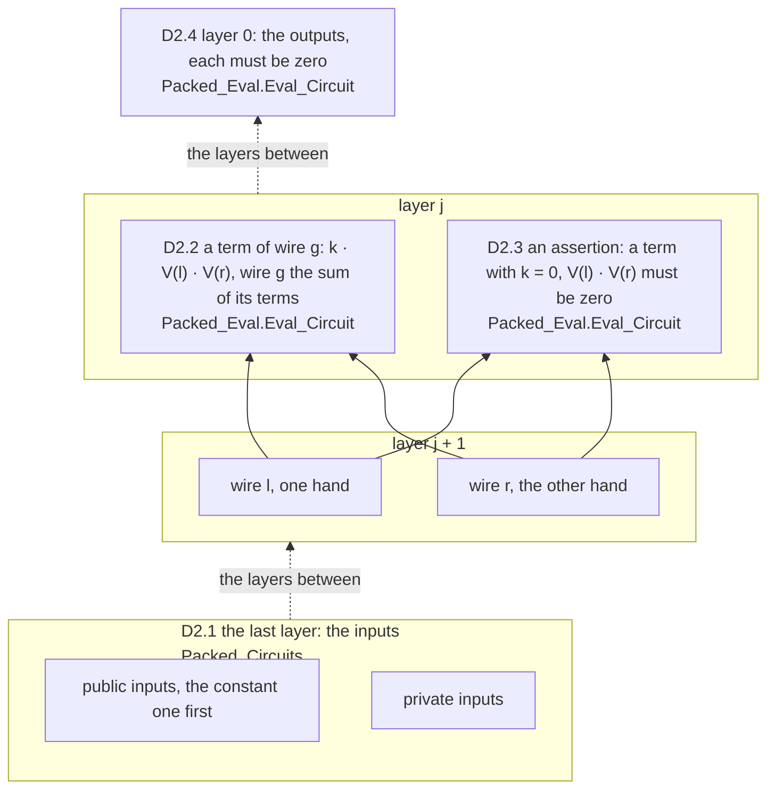

# Chapter 6: the circuit loader, the heap and the interop proofs

The circuit as the verifier and the prover receive it, from a file:

- `Uleb128`, the integers of the file;
- `Circuit_Status`, the outcome of a load;
- `Packed_Circuits`, the circuit kept as its file keeps it, with its ghost expansion;
- `Circuit_Reader`, generic over the sumcheck algebra of a field and instantiated for GF(2^128) and for the P-256 base field: the loaders `Read_Packed`, `Read` and `Read_Pinned`;
- the working sets of `Zk_Verifier` and `Ligero_Verifier` on the heap;
- the release project `cli/`, with the command-line verifier `longfellow_verify` and the interop harness `interop_kat`.

Decisions: [ADR 0011](../adr/0011-circuits-as-data.md) (circuits as data), [ADR 0046](../adr/0046-phase-b-scope-lfc2-loader-and-interop.md) (the scope and the format), [ADR 0047](../adr/0047-heap-allocation-by-ownership.md) (the heap), [ADR 0048](../adr/0048-circuit-vectors-and-interop-proofs.md) (the vectors and the interop proofs), [ADR 0064](../adr/0064-lean-circuit-premises.md) (the premises of upstream's Lean proofs), [ADR 0068](../adr/0068-release-build-without-run-time-checks.md) and [ADR 0072](../adr/0072-predicate-checks-in-the-prover-instances.md) (the release build), [ADR 0074](../adr/0074-circuit-identifier-checked-once.md) (the identifier checked once), [ADR 0080](../adr/0080-milestone-memory.md) (the packed form).

Before reading: circuits as data and what "the circuit accepts" means, in the primer's [A6](00-primer-cryptography.md#a6-circuits); pointers under ownership in [B2.1](00-primer-spark.md#b21-a-subset-with-a-proof-tool). This chapter gives the file format, the loader and what its proof establishes.

The verifier of chapter 5 takes a circuit; this chapter gives it the circuits upstream's compiler produces. The loader proves what the verifier needs of a circuit, the circuit and the working sets live on the heap, and proofs produced by upstream's prover on upstream's circuits are accepted from their files, the exit criterion of [ADR 0011](../adr/0011-circuits-as-data.md).

## 1. The format

### 1.1 What the verifier needs of a circuit



*D2. A circuit as data: each wire of layer j is a sum of terms, each a coefficient times the product of two wires of layer j + 1, its hands; a term with coefficient zero is an assertion, that the product is zero. "The circuit accepts" means that every output is zero and every assertion holds: the status `Eval_Circuit` returns, and states in its postcondition. No wire is free: every wire of a layer is computed from the layer below, and the only values the prover chooses are the private inputs. What it simplifies: one term and one assertion are drawn, where a layer of the hash circuit has hundreds of thousands; the file holds the terms in packed form, runs of terms that repeat, which the programs never expand ([Section 3.7](#37-the-packed-form)). Draft-irtf-cfrg-longfellow-00, Sections 6.3.1 to 6.3.3.*

Where it is in the code:

| Box | Units | Key subprograms | Assurance | Harnesses and vectors | Draft and records | Upstream |
|---|---|---|---|---|---|---|
| D2.1 | [`Packed_Circuits`](../../src/packed_circuits.ads), [`Circuit_Reader`](../../src/circuit_reader.ads) | `Read_Packed`, `Expand` (ghost) | proved on the expansion: well formed, every assertion on wires of its own (`Isolated`, `Dead_End`), the identifier; partition `circuits` | `circuit_kat` | Section 6.3; ADR 0080 | `core_proto` LFC2 reader |
| D2.2, D2.3, D2.4 | [`Packed_Eval`](../../src/packed_eval.ads), [`Sumcheck_Algebra`](../../src/sumcheck_algebra.ads) | `Eval_Circuit` | Gold on the expansion against the references `Layer_Holds` and `Layer_Z`; partitions `packed_hquad`, `sumcheck` | `prover_kat`, `sumcheck_kat` | Sections 6.3.2, 6.3.3; ADR 0072 | `runtime_sumcheck::eval_circuit` |

Chapter 3 defined a circuit as data: layers, each a list of terms (g, h0, h1, k) with k an element, meaning Q[g, h0, h1] = k in the quad representation of Section 6.3.2 of the specification (k = 0 marks a Z assertion, Section 6.3.3), and the counts `noutput`, `ninput`, `npublic`. The verifier needs nothing else of a circuit's meaning, but it needs its shape to be right. `Well_Formed` of `Sumcheck_Algebra` says:

- every term names an output wire below its layer's output width and input wires below its input width;
- `nw <= 2^logw`;
- the last layer reads exactly `ninput` wires;
- `npublic <= ninput`;
- the layers partition the term list in order.

The proofs of chapters 3 and 5 ask it of every circuit, through the predicate of `Circuit` and, on the packed form, of its expansion (Section 3.7). The loader's job is to establish it on arbitrary bytes.

### 1.2 LFC2

The specification does not define a file format for circuits; upstream's implementation does, at d5e6be7, in `rust/core/proto/src/writer/lfc2.rs` and `reader/lfc2.rs` (the production reader, with its bounds and its error cases), with a simplified copy under `docs/specs/rust/src/circuit/lfc2.rs`. ADR 0046 takes the production reader as the definition of the format. A file is:

- the magic `LFC2`;
- seven ULEB128 integers: `field_id` (`FieldID` of `lib/proto/circuit_io.h`: 1 for P-256, 4 for GF(2^128)), `nv` (the output count), `ncopies` (always 1), `npublic_input`, `subfield_boundary` (a prover-side parameter, how many witnesses lie in the subfield), `ninput`, `nl` (the layer count);
- a table of constants: a count, then that many elements in the encoding of Section 7.2.1 (16 bytes little-endian on GF(2^128), 32 bytes little-endian below p on P-256);
- per layer: `logw`, `nw` (the layer's input width), a table of **deltas** (four ULEB128 each: g, h0, h1 zigzag-encoded, an index into the constants), a dictionary of **segments** (each a count then that many delta indices), and a sequence of **tokens** (segment indices);
- 32 bytes of identifier.

ULEB128 is the unsigned little-endian base-128 encoding, seven bits per byte with a continuation bit; the production reader takes at most four bytes, so a value is below 2^28, and a fourth byte with the continuation bit set is an error. Zigzag maps a signed delta d to 2d when d >= 0 and to -2d - 1 otherwise, so that small differences of either sign take one byte.

### 1.3 Expansion by prefix sums

The term list of a layer is the expansion of its tokens: for each token, for each delta index in the named segment, the delta is added to a running (g, h0, h1) that starts at (0, 0, 0) for the layer, and the term (g, h0, h1, constants[k]) is appended. Deltas and segments are dictionaries: the writer deduplicates the differences between consecutive terms and the sequences of them, which is what makes an mDoc circuit a megabyte where the earlier format took a hundred. Any valid encoding denotes the same list, so the reader must accept every one, not only the writer's: the generator writes each test circuit twice, deduplicated as upstream does and plainly, one delta per term in one segment.

### 1.4 The identifier

The last 32 bytes are `compute_id` of `rust/core/proto/src/circuit.rs`: the SHA-256 of a canonical form of the circuit, independent of the encoding chosen. The hash takes, as eight little-endian bytes each:

- a field tag (2 and the bit width for a binary field; 1 and the encoding of -1 for a prime field);
- `noutput`, `logv` = ceil(log2 `noutput`), 1 (`ncopies`), 0 (`logc`), `nl`, `ninput`, `npublic`, `subfield_boundary`;
- then per layer `nw`, `logw` and the term count;
- then per term g, h0, h1 and the constant's bytes.

The identifier is what the transcript binds (`Write_Sumcheck_Statement`, chapter 4), so a verifier that accepted a file whose identifier does not match its content would verify a proof against a statement about another circuit. `Read` and `Read_Packed` recompute it (upstream makes the check optional, for files that predate the identifier).

On an mDoc hash circuit the canonical form is 310 MB; when [ADR 0074](../adr/0074-circuit-identifier-checked-once.md) was decided its hash took about 2.2 s of each proof and of each verification on that circuit. The command line therefore keeps a list of circuit files whose identifier was checked once, `Pinned_Circuits`: the SHA-256 of the file bytes and the identifier. A file in the list is loaded without the hash, the stored identifier compared with the listed one; any other file is loaded with it. `--check-circuit-id` forces the hash. Upstream's mDoc application skips the check altogether and expects its caller to check each circuit once.

### 1.5 Where this project is stricter

The production reader accepts what its allocator can hold: 5 000 000 wires, 20 000 000 terms, 10 000 layers. This project's bounds are those of the proofs of chapter 3: `Max_Wires` 2^24, `Max_Terms` 2^28, `Max_Layers` 64, `Max_Logw` 40 (as upstream). And the production reader does not check what `Well_Formed` demands: a term may name a wire beyond its layer's width, a width may exceed 2^logw. A circuit that upstream would load and then misuse is refused here, with `Bound_Exceeded` or `Not_Well_Formed`. "Accepts everything upstream accepts" is therefore not a property of this loader, as ADR 0046 decided; the two upstream circuits, and every circuit a correct compiler produces, lie inside both sets of rules.

`Read_Packed` (Section 3.7) has bounds of its own, because it keeps what `Read` only passes through. Over the whole circuit, the deltas, the segments, the segment entries and the tokens it keeps (those of non-empty segments) are each at most `Max_Terms`, 2^28; beyond, the status is `Bound_Exceeded`. `Read` bounds the terms only, and upstream's reader bounds each layer: at most 20 000 000 deltas, segments and tokens, and 20 000 000 entries a segment (`reader/mod.rs`). So a file that `Read` accepts can be refused by `Read_Packed`, for instance one whose unused segments hold more than 2^28 entries. Such a file is over 256 MB, since an entry takes at least a byte; the mDoc circuits hold 395 248 entries.

## 2. The algorithms

### 2.1 Reading an integer

`Uleb128.Read` takes the bytes and a position; it reads up to four bytes, accumulating the seven-bit payload of byte i times 128^i, and stops at the first byte without the continuation bit. It fails in two ways, which the loader distinguishes: the bytes end first (`Truncated`), or the fourth byte continues (`Bad_Integer`). `Zigzag` is the decoding of Section 1.2.

### 2.2 Two passes

The loader cannot allocate the circuit before it knows the layer and term counts, and it cannot trust the counts the header declares without reading the layers. So it walks the file twice. The first walk validates and counts:

- every integer well formed;
- every count within the bytes that remain (a count of n entries that each take at least one byte must satisfy n <= remaining bytes, so a hostile header cannot demand an allocation larger than the file);
- every constant an element;
- every index in range at the point it is read;
- `logw` and `nw` within the bounds;
- the term count accumulated with the bound checked before each addition;
- the identifier present, nothing after it.

The second walk allocates the circuit once, with the counts of the first, and fills it: the constants into a table, each layer's deltas into a table, each layer's segments as positions in the file, and the expansion of the tokens into the term array, with the running (g, h0, h1) kept within the wire range at every step.

The two walks are one procedure, `Walk`, with the circuit as a parameter that is null in the first pass. Every write into the circuit in the second pass is guarded by a bound check against the circuit's own discriminants, with the status `Bad_Index` on failure: the guards are unreachable, since the two walks read the same bytes, but they let the proof of the second pass stand on its own, and the two walks' counts are compared at the end.

### 2.3 After the walks

The loaded circuit is checked against `Well_Formed`, at run time, in one linear pass (`Not_Well_Formed`). Then come two premises of upstream's Lean proofs ([ADR 0064](../adr/0064-lean-circuit-premises.md)), also in linear time:

- `Not_Isolated`: an assertion, a term of constant zero, shares its wire with another term.
- `Not_Dead_End`: a term reads an assertion of the layer below.

The upstream reader checks neither. Every circuit upstream ships satisfies both. Then its identifier is recomputed and compared with the stored one (`Id_Mismatch`). Only then is the circuit returned.

## 3. The Ada/SPARK implementation

### 3.1 Access types under ownership

The circuit is on the heap: an mDoc circuit is hundreds of megabytes expanded and megabytes packed, beyond what a stack holds.

An *access type* in Ada is a pointer type: `type Circuit_Access is access Raw_Circuit;` and a value of it designates an object created by an *allocator*, `new Raw_Circuit'(...)`. SPARK admits pointers under *ownership* rules (SPARK Reference Manual 3.10):

- at any time one path owns a designated object;
- assigning an access value moves the ownership;
- passing it as a parameter lends it for the call;
- a procedure that returns with an owning local still non-null is reported as a possible memory leak.

The provers then establish what pointers usually prevent them from establishing: no null dereference, no dangling reference, no aliasing between what one procedure writes and what another reads. Deallocation is `Ada.Unchecked_Deallocation`, instantiated for the type; after a call the access value is null, which the instance's postcondition states.

SPARK rejects an allocator without an initial value unless the type is fully default-initialised (`new Raw_Circuit (Last_Layer => L, NT => N)` is an error, E0019), and the element types of chapters 1 and 2 have no defaults; so every allocation is an *aggregate allocator*, `new Raw_Circuit'(Last_Layer => ..., Terms => [others => ...], ...)`, which names every component ([ADR 0047](../adr/0047-heap-allocation-by-ownership.md)). GNAT builds such an aggregate in place on the heap: the spike of ADR 0047 allocated 2^25 terms, a gigabyte, with no growth of the stack. That construction is observed, not a language guarantee (register row P2).

### 3.2 Circuit_Reader

The generic takes the sumcheck algebra of a field (hence its `Raw_Circuit`, its element and its `From_Bytes`), the field identifier and whether the field is binary. It has three loaders:

- `Read_Packed (B, Pinned, Id, P, H, St)` returns the packed form (Section 3.7). The programs of the command line load every circuit with it, through `Pinned_Circuits.Read_Packed`.
- `Read (B, C, H, St)` returns the expanded circuit as a `Circuit_Access`.
- `Read_Pinned (B, Id, C, H, St)` shares the body of `Read` and differs in one step: it compares the stored identifier with `Id` instead of recomputing it.

`Read` and `Read_Pinned` stay proved as the oracles of `Read_Packed` in the harnesses (Section 5); no program loads the expanded circuit.

Each returns a `Header` (the field identifier, the subfield boundary, the identifier) and a `Circuit_Status.Status`, one of fourteen values, one per cause (`Ok, Bad_Magic, Field_Mismatch, Unsupported_Copies, Bad_Integer, Bound_Exceeded, Bad_Element, Bad_Index, Truncated, Trailing_Bytes, Id_Mismatch, Not_Well_Formed, Not_Isolated, Not_Dead_End`); nothing raises. The postcondition of `Read` is the shape of the result: `St = Ok` exactly when `C /= null`, and then `Well_Formed (C.all)` and `H.Id = Compute_Id (C.all, H.Subfield_Boundary)`; on any other status `C` is null and the header is `Null_Header`. `Read_Pinned` states `H.Id = Id` in place of the equality with `Compute_Id` (ADR 0074).

The temporaries of a walk (the constants, each layer's deltas and segments) are heap arrays too, sized by the counts after the check that they fit the bytes, allocated in the pass that needs them and freed on every exit of the procedure. The deallocation calls go through the `Unchecked_Deallocation` instances directly.

`Compute_Id` transcribes `compute_id` over `Sha256` of chapter 4, with `Ceil_Lg2` as upstream's `ceil_lg2`; the field tag is a constant chosen by the generic formal `Is_Binary`.

### 3.3 Establishing Well_Formed

`Well_Formed` is the type predicate of `Circuit`, the subtype of `Raw_Circuit` that the verifier takes. The loader does not prove it from the walk; it checks it, once, on the finished object, and the postcondition follows from the check. The alternative, a functional specification of the expansion from which the predicate would follow, would prove that the loader expands as the walk defines and would still leave the agreement with upstream to the vectors, which is where it belongs: the Gold of the loader is `Well_Formed` of what it returns and the equality of the identifier, and the expansion is tested (Section 5).

`Pow128`, a function by cases over 0 .. 4, stands for `128 ** I`; bounds are written as differences (`B'Length - Pos <= I`); the deltas' components are a subtype `Signed_Delta` of the range `Zigzag` gives, so that the running sums have bounds. The verification approach, "Lessons of the proofs", says why.

### 3.4 The working sets of Verify on the heap

`Zk_Verifier.Verify` allocates its proof record, challenges, constraint terms and triples in one record `Work`; `Ligero_Verifier.Verify` its challenges, chosen columns, two Lagrange tables, evaluation vectors and constraint vector in another. Each record is discriminated by the sizes the circuit and the geometry fix, allocated with an aggregate allocator after its length checks, passed by reference to the readers and the tests, and freed on every path. Two allocations per verification, one per level (ADR 0047): merging them would have the complete verifier name the Ligero verifier's working set through a dozen discriminants exposed in a spec, for no gain in memory. Ada's rule that a component constraint be static or a bare discriminant (RM 3.8(12)) is why `Work` has a discriminant `B_Last` rather than `Last_Layer + 1`, and the discriminants that bound arrays indexed by `Index` are of type `Index`.

### 3.5 Memory, and the supported scale

Bytes per object, on GF(2^128) and on P-256 (an element is 16 or 32 bytes; a `Natural` 4; a digest 32):

| object | GF(2^128) | P-256 | where |
|--------|-----------|-------|-------|
| a term of the expanded circuit (the oracles of the harnesses) | 32 | 48 | heap |
| a term of the constraint matrix A (`Ligero_Terms`: coefficient, constraint, witness) | 24 | 40 | heap, `Zk_Verifier.Work`; about 165 per layer plus one per private input |
| a witness slot in the constraint vector of the linear test | 16 | 32 | heap, `Ligero_Verifier.Work` |
| a queried column: NROW column elements, BLOCK + DBLOCK table entries, two evaluations, one nonce | 16 (NROW + BLOCK + DBLOCK + 2) + 32 | 32 (NROW + BLOCK + DBLOCK + 2) + 32 | heap, both records |
| the Merkle path, 2 NCOL digests | 64 NCOL | 64 NCOL | heap, `Zk_Verifier.Work` |

The packed form of Section 3.7 is the circuit of every program. In the library, the supported scale is the available memory for one packed circuit and the two working sets (register row P1). A failed allocation is `Storage_Error`, which no SPARK contract can speak of: it is outside the proofs (SPARK User's Guide, "Dealing with Storage_Error"). One stack item remains: the command-line programs read a whole file into a local array before the loader runs (`Read_File` in `cli/src/`), so a circuit or proof file must fit the stack; the mDoc files, at most 1.2 MB, fit the default 8 MiB stack, and a larger file needs `ulimit -s`. The peaks of the verifier and the prover on the mDoc circuits are on the [performance page](performance.md#memory).

### 3.6 The release project and the command-line verifier

`cli/longfellow_verify.gpr` compiles the library with optimisation and, in its default configuration `proved` ([ADR 0068](../adr/0068-release-build-without-run-time-checks.md)):

- without assertions, except the contract parts at the level `Runtime` ([chapter 4 Section 3.2, "Assertion levels"](04-transcript.md#assertion-levels-and-the-checks-kept-in-every-build));
- without run-time checks in the proved units of `src/` (`-gnatp`): the proofs establish that no check can fail there, and the checks cost time in the loops of P-256;
- with the compiler's run-time checks in every unit of `cli/src/`, outside the proof perimeter, which `scripts/check.sh cli` verifies unit by unit from the compiler's switches.

One check is suppressed at the source, in every configuration: the predicate of the circuit, `pragma Suppress (Predicate_Check)` in the prover instances (`Sumcheck_Prover`, `Zk_Prover`), in `Mdoc_Prover` and `Mdoc_Verifier`, and in `Run` of `longfellow_verify` and `longfellow_prove`, because the command line checks the circuit once on entry and the proved bodies would check it again at every call ([ADR 0072](../adr/0072-predicate-checks-in-the-prover-instances.md)). This is the run-time guard of the boundary: what the library asks of its inputs that the proofs do not cover is checked once, in the command-line program, before the proved code runs (register rows T7 and C2). The configurations `o2` and `o3` keep the compiler's checks in the library as well, for comparison, with the same suppression at the source.

`longfellow_verify`:

- takes the field, the circuit file, the proof file, the label, the Ligero configuration and the public inputs;
- loads the circuit in its packed form (Section 3.7);
- checks once the part of what the verifier asks of it that can be executed (the indices of the form, its layers and its shape);
- verifies the proof under the circuit's identifier and prints the status.

Its exit status is 0 on `Ok`, 1 on any other status, 2 on a usage or file error. It is `SPARK_Mode (Off)`: it reads files and writes to the terminal, and everything it calls is the SPARK library. `interop_kat` lives in the same project for the reason of Section 5.3.

### 3.7 The packed form

The expanded circuit keeps every term: 32 bytes on GF(2^128), 48 on P-256. The file itself is much smaller, because it stores the terms as Section 1.3 describes:

- a dictionary of deltas per layer;
- segments, runs of dictionary entries;
- tokens, a sequence of segments.

The terms are the prefix sums of the deltas, met in token order. The verifier and the prover keep the circuit in that form ([ADR 0080](../adr/0080-milestone-memory.md)).

**The units.**

- `Packed_Circuits` holds the form: the constants, the deltas, the segments, the tokens and the layers' term ranges.
- A *walk* reads one layer, one term at a time, and is executable:
  - `Start (P, J)` is the cursor at the beginning of layer J;
  - `Step` moves it by one term, adding the delta it stands on;
  - `Term_Of` is the term at the cursor.
- The meaning of the form is ghost, at level `Proof_Only`, and is never executed:
  - `Cursor_At (P, J, K)` is the cursor of layer J after K terms, defined by recursion from `Start` and `Step`;
  - `Expand (P)` is the expanded circuit, a `Raw_Circuit`, whose term K of layer J is the term at `Cursor_At (P, J, K - 1)`.
- `Read_Packed` reads a file into the form. It proves on `Expand (P)` what `Read` proves on the circuit it returns: `Well_Formed`, `Isolated`, `Dead_End`, and the identifier, recomputed (`Compute_Id_P`, from walks) or the caller's when pinned.
- `Pack (C)` is the packed form of a well-formed expanded circuit, for the circuits the tests build by hand: per layer one segment whose entries are one delta per term, each delta the difference from the term before (from the zero cursor for the first), and one token when the layer has a term; the constants are the coefficients in order. It is Gold: `Valid (Pack (C))` and `Expand (Pack (C)) = C`.

Every walk in the reader proves, at each step, that its cursor is `Cursor_At` of its position. So what the walk reads is the layer of the expansion, and the checks it makes are checks on `Expand (P)`. `Cursor_At` and the token sums are hidden (`Hide_Info`), and the walk carries its state as one hidden predicate, `Walked (P, J, K, C)`, "C is the cursor after K terms", with two small lemmas for one step of the walk; the two marking walks of `Mark_Layer_P` carry their invariants, `Inv_Mark` and `Inv_Seen`, the same way. `Lemma_Term_Of`, `Expand` and `Lemma_Walked_Step` state the coefficient of each term by `Same` as well as by `=`, since the consumers of chapter 3 compute with it (chapter 3, Section 3.6).

The proof of `Pack` is by the walk. A ghost predicate, `Packing`, describes the form the loops of `Pack` build. A lemma per layer shows by induction on K, with `Lemma_Step`, that the cursor after K terms stands on the layer's one token at offset K with the wires of term K as its running sums; so every wire the walks produce is a wire of C (`Wires_Ok`), and, with `Lemma_Term_Of`, every term of the expansion is the term of C. The terms of the layers cover 1 .. NT because the layers of a well-formed circuit partition it, which a last lemma states pairwise from the neighbour-by-neighbour conjunct of `Well_Formed`.

**The verifier on the packed form.**

- The *shape* of a circuit, `Shape` of `Sumcheck_Algebra`, is its header and its layer table without the terms, with `Shape_Ok`, the conjuncts of `Well_Formed` that name no term, as its predicate. Every size the verifier needs comes from it. `Shape_Of (P)` is the shape of a packed circuit, and `Lemma_Shape_Of (P)` proves that it satisfies `Shape_Ok` when the form is valid and its expansion is well formed, which is what `Read_Packed` proves on `Ok`. `Valid` alone would not do: `Layers_Ok` says nothing of the wire counts, nor that the last layer ends at NT.
- `Zk_Verifier.Verify (P)` takes the packed circuit. It asks of it, at level `Proof_Only`, exactly the postcondition of the loader (`Valid (P)`, and `Well_Formed` of the expansion). Then it:
  - takes the shape once;
  - reads the proof and replays the challenges with it;
  - computes the bound quads from the walk (`Bound_Quads`, with the kernels of `Packed_HQuad`, chapter 3 Section 3.6);
  - runs the core on the shape.

  Its postcondition is the one of chapter 5, with `P.Npublic` as the count of public inputs.
- In the walk's preconditions, the check that every index of the form is in range (`Indices_Ok`) is at level `Proof_Only`: it reads the whole circuit, and running it at every step would make the test of the hash circuit quadratic. The reader runs it once, before any walk.

**Memory.** On the mDoc hash circuit the packed form takes 4,366,352 bytes, against 248,242,824 expanded: 57 times less. Both are the sizes of the objects, printed by `circuit_kat` at every run. Most of it is the 395,248 segment entries and the 243,451 tokens, 4 bytes each, and the 53,106 deltas, 32 bytes each: a delta keeps its three fields as 64-bit integers, where 32 bits would hold them. The peaks of the programs are on the [performance page](performance.md#memory).

## 4. What the proofs guarantee

### 4.1 For all inputs

- No run-time error in the loaders on any byte string, including the ownership checks: no null or dangling dereference, every allocation freed on every path that does not return it, no aliasing.
- `Read_Packed`, on `Ok`: the packed form is valid, and its expansion `Expand (P)` satisfies `Well_Formed`, `Isolated` and `Dead_End`, with the identifier recomputed or the caller's (Section 3.7). The walk is proved to produce the terms of `Expand (P)`, each coefficient by the logical equality `Same`.
- `Read` and `Read_Pinned`, on `Ok`: the returned circuit satisfies `Well_Formed`, and its identifier is the one the file stored, recomputed by `Read`, equal to the caller's by `Read_Pinned`.
- `Uleb128.Read` returns the value of the bytes it consumed, one to four of them, and fails exactly when no terminating byte lies within four bytes; `Zigzag` is its definition.
- `Pack`, on a well-formed circuit, has no run-time error; its result is valid and its expansion is the circuit (Section 3.7).
- `Zk_Verifier.Verify` on a valid packed circuit whose expansion is well formed has no run-time error, with the postcondition of chapter 5; its bound quads are, for every layer, `BQ_Ref` of the expansion under the challenges, by `Same` (chapter 3), and the shape it computes satisfies `Shape_Ok`.
- The two verifiers with their working sets on the heap: the same contracts as chapter 5, plus the ownership checks.

What the proofs do not say: that the expansion of deltas, segments and tokens is upstream's, or that `Compute_Id` is upstream's `compute_id`. Both are tested.

### 4.2 The verification conditions

The proof of the units of this chapter, from a run of the partition `circuits` ([B6.5](00-primer-spark.md#b65-partitions-and-the-whole)) on the proving machine; the working sets of the two verifiers are counted with their units in chapter 5:

- **commit** 4f1e104 (main), proof inputs `be44efe9bc9d` (`scripts/remote-check.sh --digest`);
- **toolchain** GNATprove 16.1.0 with gnat_native 16.1.0 (Alire); the prover configuration of `package Prove` in the project file, CVC5, Z3 and Alt-Ergo with `--steps=600000` and `--timeout=120` ([ADR 0020](../adr/0020-prover-configuration-step-budget.md));
- **command** `make prove-partition PARTITION=circuits`;
- **run** 14 November 2026, on the proving machine, from a clean session: proved, not reused from an earlier proof.

| Check | `Uleb128` | `Circuit_Status` | `Packed_Circuits_*` | `Circuit_Reader_*` | Discharged by |
|---|---|---|---|---|---|
| Data dependencies (`Global`) | 4 | 0 | 38 / 38 | 48 / 48 | flow analysis |
| Initialisation | 4 | 0 | 0 / 0 | 93 / 93 | flow analysis |
| Termination | 3 | 0 | 23 / 23 | 15 / 15 | flow analysis |
| Range checks | 10 | 0 | 66 / 66 | 129 / 129 | provers |
| Division checks (`/`, `mod`) | 3 | 0 | 0 / 0 | 11 / 11 | provers |
| Overflow checks | 17 | 0 | 101 / 101 | 94 / 94 | provers |
| Index checks | 6 | 0 | 283 / 283 | 304 / 304 | provers |
| Length checks | 0 | 0 | 11 / 11 | 13 / 13 | provers |
| Discriminant checks | 0 | 0 | 1 / 1 | 4 / 4 | provers |
| Null dereferences | 0 | 0 | 0 / 0 | 88 / 88 | provers |
| Type predicates | 0 | 0 | 0 / 3 | 0 / 7 | provers |
| Preconditions of the calls | 8 | 0 | 245 / 245 | 287 / 287 | provers |
| Assertions | 1 | 0 | 69 / 69 | 38 / 38 | provers |
| Loop invariants (base case and preservation) | 10 | 0 | 52 / 52 | 158 / 158 | provers |
| Postconditions | 3 | 0 | 20 / 20 | 34 / 34 | provers |
| Variants of the recursive functions | 1 | 0 | 3 / 3 | 0 / 0 | provers |
| Memory leaks (an allocation freed) | 0 | 0 | 0 / 0 | 18 / 18 | provers |
| **Total** | **70** | **0** | **912 / 915** | **1334 / 1341** | all proved: none justified, none unproved, no `pragma Assume` |

In the columns with two counts, the GF(2^128) instance comes first, then the P-256 one; the P-256 instances carry the canonical-form predicate of their elements. `Circuit_Status` declares only the list of statuses and has no check.

How to read the table: [B6.4](00-primer-spark.md#b64-reading-the-summary-table). The generic units have no checks of their own; the table gives their instances.

In plain terms, for every input, not on samples:

- no run-time error occurs in any unit of this chapter, on any byte string;
- a circuit the loaders accept is well formed, with the two premises of upstream's Lean proofs, on the packed form through its expansion;
- its identifier is recomputed, or the one the caller pinned;
- `Pack` packs a circuit without changing it;
- every allocation is freed or returned.

Reproduce with:

```bash
make prove-partition PARTITION=circuits
python3 -I scripts/vc-count.py --partition circuits
```

The `make` command proves the partition and prints GNATprove's summary. The `python3` command checks that the files are those of a run of that partition and that its units add up to the summary, then prints the table from the files GNATprove writes for each unit (`obj/development/gnatprove/<unit>.spark`) and says whether any check is unproved or justified or any unit has a `pragma Assume`; with no unit named, the columns are the units of the partition. Its line "discharged by the provers" is also the sum of the counts per subprogram of `obj/development/gnatprove/gnatprove.out` for the unit. The lessons of these proofs are in the verification approach, "Lessons of the proofs".

## 5. What is only tested

### 5.1 Tier 1: the upstream files

`tests/vectors/upstream/circuits/` holds the two circuits upstream ships with inputs and proofs, copied unchanged and pinned by SHA-256 in the README there. `gen_circuit_vectors.py` parses them with its own LFC2 reader, written from the production code, and writes their layer counts, widths, term counts and identifiers to `circuit_summary.txt`, which `circuit_kat` compares with what `Circuit_Reader` loads. The generator computes `compute_id` independently and aborts unless it equals the identifier each upstream file stores: that is what anchors both transcriptions of the hash on upstream. `mdoc_summary.txt`, written by `gen_mdoc_vectors.py` with the same reader, does the same for the four circuits of upstream's two production mDoc archives (versions 7 and 6, one attribute; chapter 9).

### 5.2 Tier 2: an independent reader and writer

The same generator writes the Appendix B.3 circuits and the Z-assertion circuit of chapter 3 in LFC2, in the two encodings of Section 1.3 and a third, `sparse`, with tokens of empty segments at the start, between terms and at the end of each layer, with their identifiers; `circuit_kat` loads them and compares every term with the term lists the vectors of chapter 3 were generated from. One more good file has a layer whose tokens all name an empty segment, so a layer without terms.

Then 30 malformed files, each built from a B.3 circuit with one defect and the status it must give:

- a wrong magic, an empty file, the magic alone, a wrong field (both ways), `ncopies` 2;
- each bound exceeded, a five-byte integer;
- a constant index, a delta index and a token out of range, a negative prefix sum;
- a non-canonical P-256 constant;
- truncations at each section, a trailing byte, a wrong identifier;
- a wire outside its layer, a width above 2^logw, a last layer not reading `ninput`, `npublic` above `ninput`;
- an assertion that shares its wire, a term that reads an assertion (the two premises of Section 2.3).

The Python reader returns the same status enumeration, and the generator aborts if it disagrees with the intended status. Each load is repeated with `Read_Pinned` under the stored identifier (ADR 0074): it gives the status of `Read`, except on the wrong identifier, where it loads; a good file under another identifier is refused. Each load is also repeated with `Read_Packed`, unpinned against `Read` and pinned against `Read_Pinned`, with `Read`'s status and header and, on `Ok`, `Read`'s circuit term for term, read through the walk. `Expand` itself is ghost and does not run, but the proof shows that the walk produces its terms.

Reproduce with:

```bash
tests/bin/circuit_kat
```

Its last lines give the checks by section, tier 1 (`circuit_summary.txt`), tier 2 (`circuit_lfc2.txt`) and the mDoc circuits (`mdoc_summary.txt`), each by kind of line, then the total:

```text
checks by section:
  tests/vectors/circuit_summary.txt: passed 60, failed 0
    file: passed 35, failed 0
    summary: passed 2, failed 0
    layer: passed 23, failed 0
  tests/vectors/circuit_lfc2.txt: passed 287, failed 0
    lfc2: passed 197, failed 0
    summary: passed 9, failed 0
    layer: passed 15, failed 0
    term: passed 66, failed 0
  tests/vectors/mdoc_summary.txt: passed 174, failed 0
    file: passed 96, failed 0
    summary: passed 4, failed 0
    layer: passed 74, failed 0
passed 521, failed 0
```

### 5.3 Tier 3: the two upstream proofs end to end

`interop_kat` loads each upstream circuit from its file in the packed form (`Read_Packed`, Section 3.7), reads the proof file, and runs `Zk_Verifier.Verify` under the circuit's identifier, the label and the configuration of upstream's reference test (`sha256_spec_test`, rate 3, 16 queries, 256 columns; `ecdsa2_spec_test`, rate 4, 16 queries, 256 columns), with no public inputs, since neither circuit has any. Both proofs, valid by upstream's own tests, are accepted. Then three copies of each proof with one byte altered, in the root, in the sumcheck part and in the Ligero part: all six are refused with `Merkle_Failed`, because every byte of the proof is absorbed by the transcript before the columns are chosen, so an altered byte moves the chosen columns and the Merkle check fails first; the statuses are recorded in `interop.txt` and checked, so that a regression that changes a status while still refusing is seen. Last, `interop_kat` checks each entry of `Pinned_Circuits` against its file: the digest, the identifier a full `Read` recomputes, the same circuit from `Read_Pinned`, and a refusal under another identifier (ADR 0074); and, on the packed form, the pinned load equal to the full one, which recomputes the identifier. The command-line verifier accepts the same two proofs and refuses them under a wrong label (`merkle_failed`, exit status 1).

Reproduce with:

```bash
make cli          # interop_kat: expected passed 17, failed 0
```

`interop_kat` prints a line per proof and per altered copy, with its status, and a line per entry of `Pinned_Circuits`; the three entries are the hash circuits of versions 7 and 6 and the signature circuit of version 7 of the mDoc archives.

`interop_kat` runs in the release project, not in the assertion-enabled test build, and this is a limit of coverage to state plainly: on the upstream circuits what is tested is the verdict, on the binary code the project delivers, and the contracts that run in the test build are exercised on the circuits of Appendix B.3 in `sumcheck_kat`. [ADR 0048](../adr/0048-circuit-vectors-and-interop-proofs.md) records the reason: with assertions on, the postconditions of chapter 3 quantify over the positions of the stored pairs and the `Expression` of the input constraint was quadratic in the private inputs, so one run on the 6657 inputs of `sha256` was stopped after thirty-five minutes; moving those postconditions to the proof-only level would have lost their execution on Appendix B.3. The input constraint has been linear since [ADR 0056](../adr/0056-linear-input-constraint.md); no record measures the test build on the upstream circuits since.

## 6. What stays trusted, and the limits

- The LFC2 files as to meaning: the loader proves their shape and checks their identifier, not what they compute (register row R2).
- The list of `Pinned_Circuits`: for the files in it, the command line trusts the identifier checked once by `interop_kat` (R3).
- The production reader as the definition of the format, and the two upstream files as what d5e6be7 ships, pinned by hash (R4).
- `Storage_Error`: a failed allocation raises, and no contract says so; the supported scale is the available memory (P1).
- GNAT's in-place construction of an aggregate allocator, observed in the spike of ADR 0047 at 2^25 terms, not a language guarantee; a compiler that built the aggregate on the stack would show it there (P2).
- The command-line programs, outside SPARK, which establish the preconditions of the library and check the circuit once on entry (C2); the release build without run-time checks in `src/` (T7).
- The compiler and the builder (T1), GNATprove (T2), the SMT solvers (T3); the contracts at `Proof_Only`, never compiled (T8).

The limits of these units:

- a circuit within the bounds of Section 1.5, which are stricter than upstream's in places;
- a circuit or proof file that fits the stack of the program that reads it (Section 3.5).
