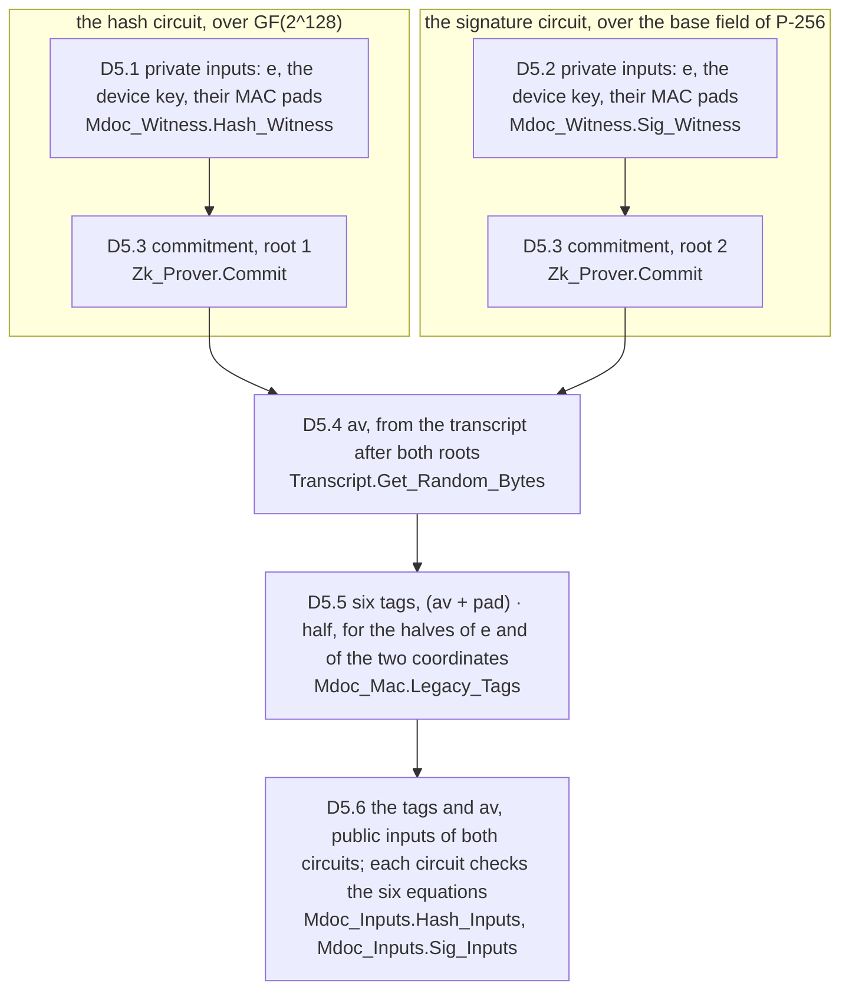

# Chapter 9: the mDoc layer and the proof of age

This chapter covers the layer that turns two Longfellow proofs into one mDoc proof of age, in the format of upstream's `applications/mdoc_zk`:

- the construction: the two circuits, the tags that bind them, the public inputs, the transcript and the proof format (Section 1);
- the prover from the credential itself, its parse, its SHA-256 trace and its two witnesses, and the reference path from upstream's witness files (Sections 1.6 and 3);
- the verifier, which accepts upstream's example proofs, and the prover's proofs, which upstream's verifier accepts (Section 5);
- the supported profile and the conditions for certifying the circuit (Section 6).

The records are [ADR 0055](../adr/0055-phase-d-scope-mdoc-scale.md) (the scope), [ADR 0058](../adr/0058-mdoc-layer.md) (the layer), [ADR 0059](../adr/0059-mdoc-vectors-and-measurement.md) (the vectors), [ADR 0085](../adr/0085-prover-and-verifier-in-two-phases.md) (the two phases), [ADR 0086](../adr/0086-mdoc-witness-bounds-and-constant-time.md) (the witness, its bounds and its constant-time perimeter) and [ADR 0089](../adr/0089-the-supported-mdoc-profile.md) (the profile).

**Before reading:** the primer's account of the credential and what stays outside ([A1.2 to A1.5](00-primer-cryptography.md#a12-the-object-certified)), signatures, CBOR and the mDoc ([A10](00-primer-cryptography.md#a10-signatures-cbor-and-the-mdoc)), the two circuits of the proof of age ([A11.2](00-primer-cryptography.md#a112-the-two-circuits-of-the-proof-of-age)) and the adversaries ([A12](00-primer-cryptography.md#a12-who-attacks-what)); chapter 4 (the transcript), chapter 7 (the prover) and chapter 5 (the verifier).

## 1. The construction

### 1.1 What an mDoc proof of age states

An mDoc is a mobile credential in the format of ISO 18013-5: a document, such as a driving licence, whose data elements are signed by an issuer and bound to a key held by the holder's device. A relying party, a website that must check that its visitor is an adult, asks the holder to show one attribute, `age_over_18`, and nothing else. Showing the signed document would reveal everything in it. A zero-knowledge proof shows only that the document, signed by a known issuer and bound to a key the device just used, carries that attribute with the requested value, and that it is valid at the date the relying party gives.

Upstream proves this with two circuits over two fields, because the two halves of the work live naturally in different arithmetic:

- The **hash circuit**, over GF(2^128), reads the bytes of the signed part of the document (the mobile security object, MSO), computes its SHA-256 digest, checks that the requested attribute, as an issuer-signed item, hashes to one of the digests the MSO lists, checks the validity dates against the date `now`, and reads the device key the MSO carries. Hashing is bit arithmetic, which a binary field expresses cheaply.
- The **signature circuit**, over P-256, verifies two ECDSA signatures on the curve P-256: the issuer's signature on the MSO digest under the issuer's public key, and the device's signature on the session transcript under the device key. Elliptic-curve arithmetic lives in the prime field of the curve.

Each circuit is proved with the prover of chapter 7 and checked with the verifier of chapter 5. What the layer adds is the glue that makes the two proofs one statement about one credential:

- the tags that bind the values the two circuits share (Section 1.3);
- the public inputs of each circuit, built from the relying party's data (Section 1.4);
- one Fiat-Shamir transcript across the two proofs (Section 1.4);
- the proof format (Section 1.5).

The relying party's data, what the verifier knows and the holder does not choose:

- the issuer's public key, as two coordinates;
- the session transcript, the CBOR structure of ISO 18013-5 that carries the relying party's nonce;
- the requested attribute, its identifier and the value asked for;
- the date `now`;
- the document type.

### 1.2 The production circuits

Upstream ships its circuits as archives, one per circuit version and number of attributes, each holding the two circuits and named by a combined identifier, SHA-256 of the signature circuit's identifier followed by the hash circuit's. Its table of specifications (`runtime/src/zk_spec.rs`, `ZK_SPECS` and `CURRENT_ZK_SPECS` at d5e6be7) names, for each archive, the version, the number of attributes and the Ligero configuration of each circuit (the inverse rate, the number of queries, the number of columns):

| Version | Attributes | Archive (first bytes) | Hash circuit | Signature circuit |
|---|---|---|---|---|
| 7 | 1 | `8d079211` | 7, 132, 4151 | 7, 132, 4096 |
| 7 | 2 | `6a581068` | 7, 132, 4265 | 7, 132, 4096 |
| 7 | 3 | `8ee4849a` | 7, 132, 4307 | 7, 132, 4096 |
| 7 | 4 | `5aebdaaa` | 7, 132, 4415 | 7, 132, 4096 |
| 6 | 1 | `137e5a75` | 4, 128, 4096 | 4, 128, 2945 |
| 6 | 2 | `b4bb6f01` | 4, 128, 4025 | 4, 128, 2945 |
| 6 | 3 | `b2211223` | 4, 128, 4121 | 4, 128, 2945 |
| 6 | 4 | `c70b5f44` | 4, 128, 4283 | 4, 128, 2945 |
| 5 | 1 | `f88a39e5` | 4, 128, 4096 | 4, 128, 2945 |
| 5 | 2 | `f51b7248` | 4, 128, 4025 | 4, 128, 2945 |
| 5 | 3 | `c27195e0` | 4, 128, 4121 | 4, 128, 2945 |
| 5 | 4 | `fa5fadfb` | 4, 128, 4283 | 4, 128, 2945 |
| 8 | 1 to 4 | `5a893815`, `ea4c66ad`, `e43e7404`, `c73b6342` | 7, 132, 5255 or 5246 | 7, 132, 4445 |

This project holds the first row and the fifth (ADR 0055, ADR 0059): the version 7 and the version 6 archive with one attribute, whose circuits, example proofs and witness files are pinned under `tests/vectors/upstream/mdoc/`. The signature circuit is the same in both (identifier `2845210a...`); the hash circuits differ. Versions 5 to 7 share the legacy layout of the tags and the public inputs described below; version 8 has another layout and no archive at d5e6be7, so it is not in the project. The table is `Mdoc_Spec` (Section 3.1), two rows.

### 1.3 The tags that bind the two proofs



*D5. The binding of the two proofs. Each circuit holds its own copy of e, of the device key and of the pads, fixed when its commitment is written; `av` is drawn only after both roots are in the transcript; the six tags are public inputs of both. A prover that gave the two circuits different values would need the tags to agree, a chance of at most one in 2^128 for one pair of values (Section 1.3). What it simplifies: the transcript also holds, before the roots, the session transcript, and after the tags the two proofs, in that order; the hash circuit is committed before the signature circuit. The binding is upstream's `applications/mdoc_zk`, not a section of the draft.*

Where it is in the code:

| Box | Units | Key subprograms | Assurance | Harnesses and vectors | Draft and records | Upstream |
|---|---|---|---|---|---|---|
| D5.1, D5.2 | [`Mdoc_Witness`](../../src/mdoc_witness.ads) | `Hash_Witness`, `Sig_Witness` | Gold on the pads at the end of the hash witness; partition `mdoc-parse` | `mdoc_witness_kat` | ADR 0086 | `push_witness_hash`, `push_witness_sig` |
| D5.3 | [`Zk_Prover`](../../src/zk_prover.ads) | `Commit` | Silver, statuses proved; partition `ligero-prover` | `prover_kat` | ADR 0085 | `runtime_zk::prover::ZkProver::commit` |
| D5.4, D5.5, D5.6 | [`Mdoc_Mac`](../../src/mdoc_mac.ads), [`Mdoc_Inputs`](../../src/mdoc_inputs.ads), [`Transcript`](../../src/transcript.ads) | `Legacy_Tags`, `Hash_Inputs`, `Sig_Inputs` | the six products proved; `Hash_Inputs` proved to fill exactly its elements, the tags and av last; `Sig_Inputs` proved for its first four elements, the rest tested; partition `mdoc` | `mdoc_kat` | ADR 0058 | `generate_mac_ap`, `push_macs`, `push_input_hash`, `push_input_sig` |

Three values appear in both circuits: e, the digest the issuer signed ([A1.3](00-primer-cryptography.md#a13-the-three-digests)), and the two coordinates of the device key. The hash circuit computes or reads them from the document; the signature circuit verifies signatures under them. They are secret, parts of the credential, so they cannot be public inputs. Without a link, a dishonest holder could prove the hash circuit on one credential and the signature circuit on another.

The link is a message authentication code, a MAC, of a particular simple kind. For each 256-bit value m, split in two halves m0 and m1 of 128 bits, each read as an element of GF(2^128), the prover computes

    tag0 = (av + ap0) * m0,    tag1 = (av + ap1) * m1

where ap0 and ap1 are MAC pads, each used for one proof only, that the prover draws at random (together, the three pairs are `mac_ap`), and av is a challenge drawn from the transcript after both commitments. The six tags are public inputs of both circuits; each circuit holds its own copy of the value and of the pads in its witness, and checks the equation.

Nothing makes the two copies equal: a dishonest prover may give each circuit its own value and its own pads. What binds them is the order of the protocol. Say the hash circuit holds the half m with the pad ap and the signature circuit the half m' with the pad ap', all four fixed when the two commitments are written, before av is drawn. Both proofs are accepted only if the tags are the same, (av + ap) * m = (av + ap') * m', that is (in GF(2^128) subtraction is addition)

    av * (m + m') = ap * m + ap' * m'.

When m and m' differ, this is an equation of degree one in av: one solution at most, so a challenge drawn after the commitments satisfies it with probability at most 2^-128. When m and m' are the same non-zero value, it holds only if ap = ap'. A prover may try again with other values and pads, paying a new transcript each time; the bound over all its attempts, together with the soundness of each circuit, is the composed bound of upstream's Lean certificate, stated for separate pads in each circuit ([the Lean correspondence](lean-correspondence.md); upstream's audit records that the older argument with one pad shared by both circuits does not hold for separate pads).

And the tag hides m when m is not zero: it is m multiplied by av + ap, a field element the verifier cannot predict since ap is a fresh uniform pad, and the product of a non-zero element by a uniform one is uniform. The construction has one limit, which upstream's has too: a zero half gives a zero tag whatever the pad, so a tag tells a zero half from a non-zero one (and a non-zero half gives a zero tag only when av + ap is zero, with probability 2^-128). The three values are a SHA-256 digest and the two coordinates of a point on P-256; a zero half of any of them does not occur in practice, and the layer does not check for it, as upstream does not.

The order matters. If av were known before the commitments, a prover could pick two different values and two pads that give the same tags: any av solves the equation above for some pads. Since av is drawn from the transcript after both roots are written, the values and the pads are fixed before av exists, and a pair of different values has at most one challenge in 2^128 that makes its tags agree. This is why the two phases of [ADR 0085](../adr/0085-prover-and-verifier-in-two-phases.md) were needed: both commitments before either statement.

This is the legacy form of versions 5 to 7 (`runtime/src/mac.rs`, `push_legacy_macs`). The three values, in order, are e and the x and y coordinates of the device key, each written as 32 little-endian bytes; m0 is bytes 0 to 15 and m1 bytes 16 to 31, with the little-endian convention of `GF2_128.From_Bytes` (chapter 1); av and the pads are field elements by their 128-bit value. The modern form of version 8 is different and not in the project. In Ada this is `Mdoc_Mac.Legacy_Tags`, Gold on the six products (Section 3.1).

### 1.4 The public inputs and the transcript

A circuit takes its inputs as field elements, one per wire, the public ones first. Upstream's builders (`runtime/src/concrete/legacy/public.rs`) push one element per bit for everything that is "bits", least significant bit first, as the element One or Zero; one element per 128-bit value for the tags and av; and field elements as they are for the issuer's key and the digest.

**The hash circuit**, over GF(2^128), for one attribute:

| Piece | Elements | Version 7 | Versions 5 and 6 |
|---|---|---|---|
| the constant one | 1 | the element One (OneWire, [ADR 0064](../adr/0064-lean-circuit-premises.md)) | the same |
| the attribute | 784 or 776 | the CBOR text string of the identifier as bits, zero bits to 32 bytes (256); the CBOR value as bits, zero bits to 64 bytes (512); two lengths of 8 bits, 1 + 17 + 1 + id_len and value_len + 12 + 1, the framing of `elementIdentifier` and `elementValue` in the issuer-signed item | one buffer: the CBOR text of the identifier, the CBOR text `elementValue`, the value, as bits, zero bits to 96 bytes (768); its length, 8 bits |
| the date now | 160 | the 20 bytes of `YYYY-MM-DDThh:mm:ssZ` as bits; a shorter date is padded with the element 2, which no bit can equal | the same |
| the six tags | 6 | one element each | the same |
| av | 1 | one element | the same |

952 elements at version 7, 944 at version 6; with n attributes, 1 + 784 n + 167 and 1 + 776 n + 167. The verifier compares the count with the circuit's (`AttributeNumberMismatch` upstream, `Input_Count` here): a request with the wrong number of attributes for the archive is refused before any work.

**The signature circuit**, over P-256, 900 elements: the constant one; the issuer's public key as two field elements; e2, the digest the device signed, as one field element; the six tags as 128 bits each (768); av as 128 bits.

**e2** is SHA-256 of the COSE `Sig_structure` of the ISO 18013-5 `DeviceAuthentication`, built from the session transcript and the document type with fixed CBOR headers (`circuits/src/cbor/mdoc.rs`, `compute_transcript_hash`); the header of `Device_Auth` lists the bytes. The device signed exactly this structure when it answered the relying party, so the signature circuit's check of the device signature on e2 ties the proof to this session. For versions below 8 the document type reaches the circuit only through e2, as upstream's verifier notes.

**The transcript.** Upstream opens the Fiat-Shamir transcript of chapter 4 from the session transcript bytes (`Transcript::new (transcript)`, here `Transcript.Reset` with those bytes as the label: one byte-string frame, no label of its own), and the two proofs share it. In order, the transcript absorbs the session transcript, the root of the hash commitment, the root of the signature commitment; av is drawn, 16 bytes read as a little-endian 128-bit value; then the statement of the hash proof (its circuit identifier, its shape, its public inputs), its sumcheck and Ligero proof, the statement of the signature proof and its proofs. The verifier replays the same sequence from the proof bytes.

### 1.5 The proof format

One byte string (`runtime/src/proto.rs`, `MdocProof::write`): the six tags, each as its 128-bit value in 16 little-endian bytes (96 bytes); then the proof of the hash circuit, the proof string of draft Section 7.5 that chapter 7's writers produce; then the proof of the signature circuit; nothing after. The length of the hash proof is not written: the reader learns it by reading the proof under the geometry of its circuit, and the signature proof starts there. For the version 7 pair the whole is about 360 kB (161 kB and 199 kB for the two proofs), for the version 6 pair about 325 kB.

### 1.6 The witness

The witness of each circuit is its private inputs:

- for the hash circuit, the bytes of the MSO and of the issuer-signed item with the intermediate values of their SHA-256, the offsets of the fields inside them, the three values the tags bind as bits, and `mac_ap`;
- for the signature circuit, the ECDSA witnesses of the two signatures, and `mac_ap` again.

The prover builds both from the credential (Section 3.7): the CBOR parse of the document, the SHA-256 trace, the attribute positions, the ECDSA witnesses, with `mac_ap` drawn from the randomness source by the program. The layouts, element by element, are in the header of `Mdoc_Witness` and in Section 3.7.

The prover also accepts, as a reference path outside the supported profile, upstream's two witness files per archive (ADR 0059): the circuit's inputs as little-endian field elements, public ones first, 16 bytes each for the hash circuit and 32 for the signature circuit. On that path the layer reads two things from the ends of the hash circuit's private part (`Mdoc_Inputs.Witness_Parts`): the three messages, its first 768 elements as bits, and `mac_ap`, its last six elements, since upstream's builder pushes the messages first and the pads last (`legacy/private.rs`, `push_witness_hash`).

The MAC pads are used for one proof only: two proofs under the same pads with different challenges av and av' give the bound value away, since tag + tag' = (av + av') m. Upstream's example proof of each archive was made under the pads its witness files hold, so a proof made with those same pads would leak the digest and the device key of the test credential. The prover therefore draws fresh pads from its randomness source and places them in both witnesses before committing (`Mdoc_Inputs.Place_Pads`):

- in the hash witness, as its last six elements;
- in the signature witness, at the end, where upstream's builder encodes each 128-bit pad as 64 elements of two bits, the element 2 v - 3 of the pair v (`push_plucked_128_legacy`); `Sig_Pads_Match` first checks that the file's pads are where the layout says.

So a proof made from the files is made from upstream's witnesses with this project's pads, tags and av; a proof made from the credential is this project's throughout, and Section 5.7 shows that its witnesses are upstream's to the element.

## 2. The algorithms

### 2.1 Upstream's prover step by step

`run_mdoc_prover_inner` (`runtime/src/prover.rs` at d5e6be7), for a specification, the archive, the credential, the issuer's key, the session transcript, the attributes, the date and the document type, and what this project does at each step:

| Step | Upstream | This project |
|---|---|---|
| 1 | Checks the version, that the attributes share one namespace, and for version 8 only the CBOR values. | The version is the row's; one attribute per request in the archives held; the layout check of `Mdoc_Inputs.Fits` (Section 3.1). |
| 2 | Parses the key's coordinates as P-256 elements. | `Mdoc_Cli.Coordinate`: hex, below p. |
| 3 | Draws `mac_ap` from the randomness source. | Drawn from the randomness source (`Cli_Random`, `--seed` for a reproducible proof) and placed in both witnesses in place of the file's (Section 1.6). |
| 4 | Opens the transcript from the session transcript. | `Transcript.Reset (Session)`. |
| 5 | Decompresses the archive into the two circuits. | The LFC2 payloads are pinned and loaded in their packed form (chapter 6, [ADR 0074](../adr/0074-circuit-identifier-checked-once.md)); their identifiers are checked against the row and combined (Section 3.3). |
| 6, 7 | Parses the credential and builds the two witnesses. | `Mdoc_Parse.Parse` and `Mdoc_Witness` (Sections 3.6 and 3.7), or the witness files on the reference path (Section 1.6). |
| 8 | Commits the hash circuit: pads, witness vector, tableau, Merkle tree, the root to the transcript. | `Zk_Prover.Commit` of the GF(2^128) chain (ADR 0085). |
| 9 | Commits the signature circuit the same way. | `Zk_Prover.Commit` of the P-256 chain. |
| 10 | Draws av, 16 bytes little-endian. | `Transcript.Get_Random_Bytes`, `GF2_128.From_Bytes`. |
| 11 | The six tags. | `Mdoc_Mac.Legacy_Tags`. |
| 12 | The public inputs of both circuits. | `Mdoc_Inputs.Hash_Inputs`, `Device_Auth.Digest`, `Mdoc_Inputs.Sig_Inputs`. |
| 13 | Proves the hash circuit: the statement, the sumcheck, the Ligero proof. | `Zk_Prover.Prove_Committed`. |
| 14 | Proves the signature circuit. | The same on the P-256 chain. |
| 15 | Writes the proof: the tags, the two proofs. | `Mdoc_Proof.Write_Tags`, the two proofs copied after it. |

The checks that need no transcript come first in `Mdoc_Prover.Prove`: the bound on the session transcript, the attributes against the version's layout, the counts of the public inputs against the circuits'. `Not_Satisfied`, which needs the public inputs, is found in step 13 or 14, as upstream finds it (ADR 0085).

### 2.2 The witness files as inputs

Upstream does not record which credential and which request its artifacts were made from. The public parts of the files, read against the layout of Section 1.4, settle it: the first 952 elements of the version 7 hash witness, the first 944 of the version 6 one, and the first 900 of the signature witnesses. They decode to the attribute `family_name` with the CBOR text value `"Mustermann"` (`6a 4d75737465726d616e6e`), the date `2024-10-01T09:00:00Z`, the document type `org.iso.18013.5.1.mDL`, and, in the signature witness, an issuer key and an e2 that match exactly one family of upstream's test cases (`testcases/src/vectors.rs`, the cases named `..._MDOC_3`, which share a credential, a key and a 143-byte session transcript; `FAMILYNAME_MUSTERMANN_MDOC_3` names the attribute). The six tags in the hash witness equal the first 96 bytes of the example proof of the same archive, and av, re-derived from the two roots of that proof under the test case's transcript, equals the last public element. So the witness files and the example proof of each archive are one run of upstream's prover on that case, and that is this chapter's test case: not the AV profile's example attribute `age_over_18`, which upstream's `TEST_DATA` credential carries but which these files were not made from.

The check is repeated at every run: `gen_mdoc_layer_vectors.py` rebuilds the public parts of all three files from the case's parameters with its own transcription of the builders, recomputes the tags from the ends of the witness, and fails unless everything agrees byte for byte; `mdoc_kat` then rebuilds them in Ada (Section 5). The parameters are in that generator, in `scripts/measure-mdoc.sh` and in `tests/vectors/upstream/README.md`.

### 2.3 The verifier side

`run_mdoc_verifier_inner` (`runtime/src/verifier.rs`), in order:

1. the same checks as the prover's first step;
2. the two circuits and their geometries;
3. the proof read: the tags, then each proof by its geometry, nothing remaining;
4. the transcript opened from the session transcript;
5. both commitments received, that is, both roots written;
6. av drawn;
7. the public inputs of the hash circuit rebuilt from the request and checked for their count;
8. the hash proof verified;
9. the key parsed and e2 computed;
10. the public inputs of the signature circuit rebuilt;
11. the signature proof verified.

`Mdoc_Verifier.Verify` follows it with `Zk_Verifier.Receive` and `Verify_Received` (ADR 0085), with the count checks first.

What the verifier does not do, and the relying party does outside the proof ([A1.5](00-primer-cryptography.md#a15-what-stays-outside)): trust the issuer's key (a trust list), check the freshness of the nonce inside the session transcript, choose `now`. What the circuits compute is trusted (register row R2, Section 6).

## 3. The Ada/SPARK implementation

### 3.1 The units of the layer

Seven packages in `src/` build the layer, each with its header stating what is proved, tested and trusted; the parse, the witness and the curve have their own units (Sections 3.5 to 3.7):

- **`Cbor_Encode`**: the head of a CBOR text or byte string of n bytes, one to five bytes by the cases of the standard. `Head_Len` is the length, `Head` the bytes, Gold: the postcondition states every byte.
- **`Mdoc_Mac`**: the types of the tags (`Pads` is `mac_ap`, three pairs of elements; `Messages` three 32-byte values; `Tags` six elements) and `Legacy_Tags`, Gold on the six products of Section 1.3, stated with the field's `Mul` and `Add` and a function `Half` that names the element of each half. The loop that computes them carries an invariant over the tags done so far, the usual way of proving a loop in SPARK: what holds before each turn and is kept by it holds after the last.
- **`Device_Auth`**: `Digest`, e2 from the session transcript and the document type, Silver. It feeds SHA-256 piece by piece, so no buffer of the whole structure is needed; the header lists the bytes in the order they reach the hash. It also holds the two bounds the layer imposes: `Max_Session_Transcript`, 65,000 bytes, which upstream's pull request 223 proposes for its C++ entry point (not merged at d5e6be7; register row R13), and `Max_Doc_Type`, 65,535 bytes, the longest a CBOR head of three bytes carries, where upstream takes any length: a bound for the proofs of the lengths, far above any document type of ISO 18013-5.
- **`Mdoc_Inputs`**: the request types (an `Attribute` is an identifier of up to 64 bytes and a value of up to 96, each a fixed buffer with its length, since SPARK records cannot hold strings of varying size; `Attribute_List` up to four of them), `Fits` and `All_Fit` (the pieces fit the version's buffers), `Hash_Count` (the closed formula of Section 1.4, Gold by definition), `Hash_Inputs` (Silver, with Gold on the count and on the positions of the constant one, the six tags and av) and `Sig_Inputs` (Silver, with Gold on the positions of the constant one, the key and e2; the positions of the tags and av are tested), and `Witness_Parts`, `Sig_Pads_Match` and `Place_Pads` (Section 1.6; `Place_Pads` is Gold on where it puts the pads). The builders push one element at a time through small procedures (`Push_Bits`, `Push_Bytes`, `Push_Pad`, `Push_Attribute`), each with a postcondition on how far the position moved, so that the proof of the count is a sum of fixed numbers.
- **`Mdoc_Spec`**: the two rows of Section 1.2 (`Specification`: version, attributes, the combined identifier, the two circuit identifiers, the two configurations), `Lookup` by combined identifier, and `Combined_Of`, SHA-256 of the two identifiers.
- **`Mdoc_Proof`**: the fixed part of the format, `Write_Tags` and `Read_Tags` at the front of the proof, Gold on the bytes; the offset `Hash_First`, 96.
- **`Mdoc_Status`**: the layer's 18 statuses, each explained in its header:
  - `Ok`;
  - from the request: `Transcript_Too_Long`, `Attribute_Invalid` (an attribute does not fit the layout), `Input_Count` (the public inputs built are not as many as the circuit has), `E2_Not_In_Field` (the digest is not below p, where upstream's builder panics);
  - from the two provers or verifiers: `Hash_Failed` and `Sig_Failed`, with the status of the failing one beside them, since the layer drives two of each;
  - from the credential (Section 3.7): `Parse_Failed`, with the parser's status and the CBOR reader's beside it, `Attribute_Not_Found`, `Attribute_Too_Long`, `Item_Order_Unsupported`, `Validity_Form_Unsupported`, `Device_Key_Form_Unsupported`, `Random_Form_Unsupported`, `Signature_Not_Canonical`;
  - from the profile (Section 6): `Profile_Unknown`, `Profile_Mismatch`, `Attribute_Count`.

### 3.2 `Mdoc_Prover` and `Mdoc_Verifier`

`Mdoc_Prover` is generic over the two prover chains, one per field, so that the library instance with the test source (`Mdoc_Prover_Lib`, `Simple_Rng`) is proved and the command line instantiates it again with the operating system's source (`Mdoc_Prover_Cli`), exactly as `Zk_Prover` is handled in chapter 7. Its formal packages name their actuals where they can (`Ligero_Verifier_GF2_128`, `Packed_HQuad_GF2_128`), so that the element types of the two chains are known inside the generic to be those of the two fields: the tags are GF(2^128) elements and the signature circuit's inputs P-256 elements, and the compiler checks it. `Mdoc_Verifier` needs no generic: the two verifier chains have no randomness, and the library's instances are the only ones.

`Prove` takes the version, the two circuits with their identifiers, subfield boundaries and configurations (a small record `Circuit_Info`), the two private input arrays, `mac_ap` and the three messages, the issuer's key, the session transcript, the attributes, the date and the document type, and fills a buffer of `Max_Len` bytes, the tags plus the two proofs at their longest. The body is Section 2.1: the three checks, `Transcript.Reset`, two `Commit`, the draw of av, the tags, the public inputs, `Write_Tags`, two `Prove_Committed`. Each `Prove_Committed` writes into a heap buffer of exactly its own `Max_Proof_Len` bytes, which its precondition requires, and the bytes are copied into place; the two `Committed` records are released on every path that does not consume them, which the ownership checks of [ADR 0047](../adr/0047-heap-allocation-by-ownership.md) enforce. The postcondition states the statuses: on `Ok` the proof is at least the tags and one byte of each proof; otherwise the length is zero, and the detail status is set exactly when one prover failed.

`Verify` takes the version, the two circuits with identifiers and configurations, the request and the proof bytes: the three checks, the tags read, `Transcript.Reset`, `Receive` at offset 96 and `Receive` at the offset after the hash proof, the check that the second proof ends where the buffer ends, av, the hash circuit's inputs and `Verify_Received`, e2 and the signature circuit's inputs and `Verify_Received`. Both procedures take the executable part of the loader's postcondition on each circuit as a precondition, as `Zk_Prover.Prove` and `Zk_Verifier.Verify` do ([ADR 0072](../adr/0072-predicate-checks-in-the-prover-instances.md)), and the rest at level `Proof_Only`.

### 3.3 `longfellow_prove_mdoc` and `longfellow_verify_mdoc`

Two programs in `cli/`, outside SPARK like the other two, sharing `Mdoc_Cli`: the command line, the files, the hex, and the loading of the two circuits of a specification. `--spec` names an archive by its combined identifier; the LFC2 payloads are read from `--circuits DIR` (default `tests/vectors/upstream/mdoc/`), loaded in their packed form through `Pinned_Circuits`, and refused with `combined_hash` unless their identifiers are the row's and combine to the archive's name. The request is `--pkx` and `--pky`, `--transcript HEX` or `--transcript-file`, `--now`, `--doc-type`, and `--attr ID:CBORHEX`, repeatable. The prover also takes the credential (`--mdoc FILE`, Section 3.7) or the two witness files, and `--out`, and `--seed` for a reproducible proof (the fresh pads and the prover's own draws then come from `Simple_Rng`); the verifier `--proof`. With the credential the program allocates the two witness buffers on the heap (1.3 MB for the hash circuit), hands them to `Mdoc_Prover.Prove_Mdoc`, and clears them afterwards, since the witnesses are secret; a refusal of the document prints `parse_failed` with the parser's status and the CBOR reader's beside it, or one of the builders' statuses (`attribute_not_found`, `attribute_too_long`, `signature_not_canonical`). The programs check the executable preconditions of the library before each call (the lengths, the circuits, the configurations), and print the layer's status with the inner one beside it: `hash_failed not_satisfied`, say, or `ok`.

The session transcript above 65,000 bytes is refused by the programs with `transcript_too_long` and by the library with the status of the same name.

### 3.4 The witness from the credential

The prover builds the witnesses from the credential in three parts:

- the ECDSA witness of the signature circuit (Section 3.5);
- the parse of the document and the SHA-256 trace (Section 3.6);
- the complete witnesses and the proof from the document alone (Section 3.7).

Their bounds and their constant-time account, the parse declared outside the perimeter with the reason, are [ADR 0086](../adr/0086-mdoc-witness-bounds-and-constant-time.md). What the layer adds to the constant-time discipline of [ADR 0051](../adr/0051-constant-time-in-the-prover.md) (register row S4) is small:

- the tags multiply the secret messages and pads by the field's constant-time product;
- `Witness_Parts`, `Sig_Pads_Match` and `Place_Pads` index on constants and accumulate their layout checks over every element without a short circuit, in masks, for the bits and for the 384 element comparisons of the pads (the limbs xor-ed and or-ed, no record equality), with one branch at the end on the result, as ADR 0051 admits for the prover's own checks;
- `Sig_Witness` checks that the s values of both signatures are canonical before its one branch on the result, one of the decisions whether to make a proof that register row S4 declares by their statuses (ADR 0086, notes of 15 and 16 November 2026);
- the public inputs, av, the tags and the proof are public.

### 3.5 The ECDSA witness

The signature circuit verifies two ECDSA signatures on P-256, the issuer's on the MSO and the device's on the session transcript. Its private inputs for one signature are not the signature alone: the circuit checks a verification that the prover has already carried out, so the witness holds every intermediate value the check needs, 1,034 field elements per signature (`push_legacy_verify_witness_3` of upstream's `legacy/private.rs`, computed by `ecdsa2/concrete.rs`). Three units build them, in SPARK:

- **`Q256_Field`**: the scalar field of the curve, the integers modulo the order q of its group. An ECDSA verification needs s^-1 mod q and the two scalars e s^-1 and r s^-1 mod q, where s is half of the signature and e the digest; the base field of chapter 2 is the integers modulo another prime, p, and cannot compute them. The unit is a sibling of `P256_Field`: the same Montgomery arithmetic on four 64-bit limbs, the same contracts (Gold on `Add`, `Sub`, `Mul` and the conversions against the ghost integer model, Silver on `Inv`), the same proof structure, with the constants of q. One step differs. A Montgomery round adds a multiple of the modulus that clears the low word of the running sum; p is one below a multiple of 2^64, so for p that multiple is the low word itself, while for q the low word must first be multiplied by q' = -q^-1 mod 2^64, and the proof that the word then clears is the unit's own lemma. `Inv` is Fermat's exponent q - 2 by a window chain: a table of the sixteen small powers, then for each of the 64 nibbles of the public exponent four squarings and one multiplication by the table entry; the nibbles are a constant that the vector generator checks against q - 2. The duplication of about 900 lines is recorded in ADR 0086.
- **`P256_Curve`**: points of the curve in projective coordinates (X : Y : Z), the point at infinity (0 : 1 : 0), and the group law in the complete formulas of upstream's `core/algebra/src/ec.rs` (Renes, Costello and Batina, 2016). The formulas matter as much as the law: the witness holds projective points, and two correct formulas give the same point in different coordinates. `Affine` divides by Z. `Scalar_Mul` is double-and-add-always: at every bit the sum is computed and kept or dropped by a masked selection, where upstream's `scalar_mul` branches on the bit; the values are the same. `Select_8` chooses one of eight points by masks built from the index with no branch and no secret index, where upstream indexes its table with the secret bits. The selections are Gold (they return the point the mask or the index names); the arithmetic is Silver, anchored by the RFC 5903 key pairs and by the byte identity below. Nothing is proved against the group law, an algebraic fact out of the reach of the provers (register row V7).
- **`Ecdsa_Witness.Push_Legacy`**: from the key, the digest and the signature, the 1,034 elements at a position of the signature witness, in upstream's order. First the point R = e s^-1 G + r s^-1 Pk, its x taken from r and its y from the point (a verifier accepts when the two x agree; the circuit checks that). Then three inverses in the base field: rx^-1, pkx^-1, and nmsinv, the inverse of -s mod q read as a base-field element, a value of one field reduced into the other and inverted there, as the circuit wants it. Then the four affine sums G + Pk, G + R, Pk + R and G + Pk + R. Then 256 rounds, from bit 255 down to bit 0 of e, r and -s mod q: the digit b = e_i + 2 r_i + 4 nms_i as the element 2 b - 7, and the projective point after the round P <- 2 P + T (4 e_i + 2 r_i + nms_i) over the table of the eight points O, R, Pk, Pk + R, G, G + R, G + Pk, G + Pk + R (the digit weighs e least and the table index most, two encodings of the same bits that upstream uses side by side). The last point is not written. The frame is Gold (nothing outside the 1,034 positions changes); the layout and the values inside them are tested, by the byte identity below. The value s must be below q, as upstream's builder requires (it converts s without reduction and stops otherwise, where e and r are reduced): a precondition of `Push_Legacy`, and a refusal with a status where the witness is built from the document (Section 3.7). The bits are read at positions fixed by the loop counter, the table entry is selected by masks, and the inverses are the fixed chains of the two fields, so the computation has no branch or index on a secret; ADR 0086 allows the inversion of secrets that ADR 0051 had reserved, for this reason.

The check that settles the three units is the byte identity of Section 5.5: the witnesses of the two signatures of upstream's test document equal the signature witness files of both archives element by element.

### 3.6 The parse of the document and the SHA-256 trace

The credential the holder presents is one CBOR item (RFC 8949): a map with `documents`, an array whose first element holds `issuerSigned` (the namespaces of issuer-signed items and `issuerAuth`, a COSE_Sign1 whose payload is the mobile security object, MSO, and whose last element is the issuer's signature) and `deviceSigned` (the device's signature over the session transcript). Upstream reads it with a small recursive parser into a tree (`circuits/src/cbor/parse.rs`) and walks the tree (`parse_mdoc` of `mdoc.rs`). Three units do the same here, in SPARK, without recursion and without the heap.

`Cbor_Parse` walks the bytes once with an explicit stack of at most 16 frames and fills a table of at most 4,096 elements: for each, the kind, the first byte of the head, the first byte after it, the end, the argument of the head (the integer, the length, the tag number), the parent, the first child and the next sibling. Positions are relative to the parsed array, so that the same parser serves the document, the wrapped MSO it contains and each issuer-signed item, each parsed on its own bytes as upstream parses them. It refuses what upstream's parser refuses, with a status: bytes ending inside a head or a string, the additional information 28 to 31 (the indefinite lengths among them), a text that is not UTF-8, bytes after the first complete item; and what the bounds refuse: a depth above 16, more than 4,096 elements, a length above the buffer. An open container keeps the provisional end "the length of the bytes" until it closes, so that at every step of the pass every element lies inside its parent; the proof of the table's invariants rests on it (Section 4). The accessors read the table: the unique entry of a map by a text or an integer key (`map_entry_unique`: a second key with the same text is `Duplicate`), an item of an array, the content of a tag, the equality of a text.

`Mdoc_Parse` is `parse_mdoc` over the table, in upstream's order, so that a malformed document gets the same kind of error at the same place: `documents[0]`, `issuerSigned.issuerAuth` as a COSE_Sign1 array (under tag 18 or not), its third element the wrapped MSO, which must be `d8 18 59` and a two-byte length over a map of at least 256 bytes and at most the SHA-256 capacity of the hash circuit (`validate_mso_layout`: 2,531 bytes of wrapped MSO for version 7, 2,211 for version 6, Section 1.2), its fourth the issuer's signature of 64 bytes; the digest the issuer signed, the SHA-256 of the fixed signing header, the byte-string head and the wrapped MSO; the MSO map on its own bytes, with the device key (`deviceKeyInfo.deviceKey`, the COSE_Key integers -2 and -3) and the positions of the keys `docType`, `validityInfo.validFrom`, `validityInfo.validUntil`, `deviceKeyInfo` and `valueDigests`, which the circuit receives as offsets into the MSO; `deviceSigned.deviceAuth.deviceSignature` and the device's signature, whose digest is e2 (Section 1.4, `Device_Auth.Digest`); then every issuer-signed item of every namespace: the wrapped bytes, the identifier, the value, the locator of its four entries in whatever order the issuer wrote them (the position and length of each, and a permutation that says which slot holds which) and the position in the MSO of its digest under `valueDigests`. The result holds positions in the document and the fixed-size values, never a copy of variable length, and at most 256 items; a document is refused with one of upstream's ten kinds of error (a missing field, a duplicate, an unexpected type, a wrong length, an unsupported MSO encoding, an MSO beyond the capacity, and so on) or with this project's two bounds, on the items and on the document's size, which are statuses and not preconditions, so that a credential of any size gets an answer.

`Sha256.Trace` is the compression function of SHA-256 with its trace: per block, the 48 words of the message schedule the circuit does not recompute, the `e` and the `a` of each of the 64 rounds, and the state after the block, which is what the hash circuit's witness holds for every block of the signed MSO and of each item (Section 1.6). `Pad_Message` pads a message into a fixed number of blocks, the zero blocks after it included, as upstream's `sha256_msg_derived` compresses every block of the circuit's maximum whether the message reaches it or not, so that the work does not depend on the length. It is `Sha256.Compress` with the words written out, the same statements over the same round functions and constants, which the parent declares in its private part for both; the parent's own compression is untouched, so the hashing of the transcript (chapter 4) and of the Merkle tree pays nothing for the trace, and the agreement of the two (the state after the last block against `Sha256.Digest`) is checked on every trace vector. The parse is declared outside the constant-time perimeter by ADR 0086 (Section 3.4): it indexes on the lengths and positions it finds, and the UTF-8 check of every text string reads its bytes, so its timing depends on the structure of the holder's own credential and on its text values, on the holder's device; the padding of a message into its blocks is declared with it, since it copies the message and places the marker and the length where it ends; the compression of every block of the maximum is constant time by construction.

### 3.7 The two witnesses and the proof from the document

`Mdoc_Witness` is upstream's three builders (`legacy/private.rs`: `push_witness_hash`, `push_witness_attrs`, `push_witness_sig`) over the parse, with the four encodings of `builder.rs`, written out so that an evaluator can follow each element to its source.

The hash circuit's witness, GF(2^128) elements, in upstream's order. First the three bound values (the digest the issuer signed, the two coordinates of the device key) as 768 bits, each value as 32 little-endian bytes and each byte least significant bit first (`push_raw_bytes`), the bits as the elements zero and one. Then the signed message (the signing header, the byte-string head and the wrapped MSO, Section 3.6) padded into the circuit's capacity (40 blocks for version 7, 35 for version 6): its block count as 8 bits, then its bytes from the 19th to the end of the capacity, the first 18 being the COSE prefix the circuit holds. Then the SHA-256 trace of every block of the capacity, the zero blocks after the message included (Section 3.6): per block 184 words, the schedule words 16 to 63, the `e` and the `a` of each of the 64 rounds interleaved, and the eight words of the new state, each word in the legacy plucked form (`push_v32_legacy`): eight 4-bit chunks, least significant first, the chunk c as the subfield element whose five bits are (c << 1) xor 15 over the first five elements of the basis (chapter 1, `GF2_128.Inject`). The circuit's lookup reads a chunk back from the element's bits; the xor with 15 and the shift are the circuit's convention, not a property of the field. Then the four offsets of the MSO fields, `validFrom`, `validUntil`, `deviceKeyInfo`, `valueDigests`, as 12 bits each. Then per requested attribute: the issuer-signed item (tag 24 and its head included) padded into two blocks as 1,024 bits, the trace of the two blocks, the position in the MSO of its digest as 12 bits, then four 12-bit positions, `ei_pos`, `ei_len`, `ev_pos`, `ev_len`, which at version 7 are the slot position and the length of the identifier's entry and of the value's entry as the parse found them, and at version 6 are shifted and recomputed from the request (the identifier's length plus the value's length without its CBOR head plus 13, `val_header_len`), since the version 6 circuit frames the entries itself; and, at version 7 only, the slot positions 1 to 3, the four lengths as 12 bits each and the permutation as 8 bits, which tell the circuit in which order the issuer wrote the four entries. Last the six pads `mac_ap`. For version 7 and one attribute the witness has 84,166 elements, for version 6 74,154, the private counts of the two archives (`Hash_Count`, a closed formula, Gold).

The signature circuit's witness, P-256 elements: the three bound values reduced into the field (`Reduce`, upstream's `reduce_nat`: the four words combined by Horner's rule in the field); the ECDSA witness of the issuer's signature on the digest under the issuer's key, then of the device's signature on e2 under the device key, whose coordinates are the parsed values reduced (Section 3.5, 1,034 elements each); then, per bound value, the two pads and the two halves of the value, each 128-bit value as 64 elements of two bits, the element 2 v - 3 of the pair v (`push_plucked_128_legacy`), the layout `Mdoc_Inputs.Place_Pads` writes (Section 1.6). 2,839 elements (`Sig_Count`).

Seven refusals, as statuses rather than preconditions, since they depend on the holder's document:

- an attribute of the request that the document does not hold (`Attribute_Not_Found`, upstream's `AttributeNotFound`);
- an item that does not pad into two SHA-256 blocks, that is above 119 bytes with the tag and its head (`Attribute_Too_Long`; upstream refuses 256 and above with `AttributeTooLong` and stops on 120 to 255, which do not pad either);
- at version 6 only, an item whose `elementValue` entry does not follow its `elementIdentifier` entry (`Item_Order_Unsupported`, the paragraph below);
- at both versions, a validity date or a device key not in the one form the circuits compare (`Validity_Form_Unsupported`, `Device_Key_Form_Unsupported`, the paragraphs below);
- at both versions, a requested item whose `random` is not a byte string of at least 16 bytes (`Random_Form_Unsupported`);
- a signature value s at or above the group order (`Signature_Not_Canonical`), which the ECDSA witness requires below it (Section 3.5) and on which upstream stops.

On a refusal the witness array is zero (a postcondition), so that nothing of the credential stays in a buffer the caller did not expect to hold it. The bound of 119 bytes is one of ADR 0086's; the 38 test documents hold items of 79 to 103 bytes.

**The order of the item's entries, a constraint for issuers at version 6.** An issuer-signed item is a CBOR map of four entries, `digestID`, `random`, `elementIdentifier` and `elementValue`, which an issuer may write in any order. The version 7 circuit reads the order from the witness (the permutation and the four slot positions of Section 3.6) and accepts any. The version 6 circuit does not: its generator (upstream's `lib/circuits/mdoc/mdoc_hash.h` before commit 0d92f80, the revision that introduced the permutation, `assert_attribute` over the item shifted by the identifier's offset; `mdoc_witness.h`, `fill_attribute`) shifts the item's bytes by the witness offset of the identifier's text and compares one span of them with the public framing of the request, the identifier's text with its head, the thirteen bytes of the key `elementValue`, then the value; and the witness builder of the runtime (`push_witness_attrs` for `version < 7`) places that offset at the identifier's text (`slot[ei] + 18`, the key `elementIdentifier` being eighteen bytes) with a span of the identifier, the value and the thirteen bytes between (`id_len + val_len + 13`). The span holds exactly when the key `elementValue` starts where the identifier's text ends, that is when the value's entry is the next entry of the map; in the parse's terms, when the slot of the value is the slot of the identifier plus one. An issuer who wants a document to prove under version 6 must therefore write `elementValue` immediately after `elementIdentifier`; `digestID` and `random` may go anywhere. Upstream's builder builds the witness regardless and its circuit refuses the proof after the commitment; upstream's own test of the prior versions skips every order but the standard one (`is_supported_by_prior_version`), stricter than the circuit, which accepts the identifier first and the value second. `Hash_Witness` refuses the item when it reaches it, with the witness array zeroed and before any commitment, so that the holder learns the cause without the cost of a commitment: a deliberate divergence from upstream's builder, recorded on the Status line of ADR 0086 with the check of the rule against the version 6 generator's code. Of the 38 test documents, eight (one AZ, seven EU age-verification ones) have the value elsewhere and are refused at version 6; the two EU documents with the identifier first and the value second prove. On a synthetic item, the builder accepts all 24 orders of the four entries at version 7 and the six with the value after the identifier at version 6, and refuses the eighteen others (Section 5.7); the synthetic documents carry placeholder digests and signatures, so these are tests of the builder, not proofs.

**The validity dates, a constraint for issuers at both versions.** Both hash circuits compare the MSO's `validFrom` and `validUntil` with the verifier's `now` as 20 raw bytes, lexicographically (upstream's `lib/circuits/mdoc/mdoc_hash.h` at 0d92f80c, lines 202 to 216, and `lib/circuits/logic/memcmp.h`, `Memcmp::leq`; the version 6 generator the same). They check the key, tag 0 and a text head of 20 bytes, and nothing of the date's form. ISO/IEC 18013-5 fixes the upper-case `Z` (9.1.2.4) and is silent on the `T`, which RFC 3339 allows in lower case. The byte-wise comparison stops at the first differing byte, so an issuer writing `t` would give a margin of up to one day: a `validUntil` of `2026-01-01t00:00:00Z` admits a `now` of `2026-01-01T23:59:59Z`, since `T` (16#54#) sorts before `t` (16#74#). A date with fractional seconds or a numeric offset is not a text of 20 bytes, and the circuit refuses it after the commitment. `Hash_Witness` refuses any `validFrom` or `validUntil` that is not tag 0 over exactly `YYYY-MM-DDThh:mm:ssZ`, with digits where the form has digits, before anything is built, with the witness array zero. This closes the margin for the proofs made from the document (`Prove_Mdoc`, `longfellow_prove_mdoc --mdoc`). It does not close it for the proofs made from witness files (`Prove`, `--hash-witness`), which skip the builder and take the witness as given; and a verifier remains exposed to any prover, this project's witness-file path included, that builds a witness for such a date. That is a limit of the circuit (Section 6, "Conditions for certifying the circuit"). It is a second deliberate divergence from upstream's builder, noted on ADR 0086. All 38 test documents carry their dates in that form; the synthetic vectors refuse a lower-case `t` or `z`, fractional seconds, an offset, a letter in place of a digit, a space for the `T`, a date without tag 0 and one under tag 1, in either date and at both versions (Section 5.7).

**The device key, a constraint for issuers at both versions.** Both hash circuits find the device key by comparing 33 bytes with a fixed pattern: `deviceKeyInfo` as a map of one entry, `deviceKey`, a COSE_Key of four entries in the order kty 2 (EC2), crv 1 (P-256), x and y, each coordinate a byte string of 32 bytes (upstream's `lib/circuits/mdoc/mdoc_hash.h` at 0d92f80c, 218 to 227 and 526 to 532; the version 6 generator the same). ISO/IEC 18013-5 lets a COSE_Key carry a kid or an alg and does not fix the order of its entries, and `deviceKeyInfo` may also hold `keyAuthorizations` and `keyInfo`. The parse reads the coordinates under -2 and -3 whatever the map holds, as upstream's does, so a document in another form would parse and then fail in the circuit after the commitment. `Hash_Witness` refuses it first, with `Device_Key_Form_Unsupported` and the witness array zero. All 38 test documents carry their device key in that form; the synthetic vectors refuse a kid after y, an alg before kty, crv before kty, y before x, an x of 31 bytes and a `deviceKeyInfo` with a second entry, at both versions.

**The random of an item, a constraint for issuers at both versions.** ISO/IEC 18013-5 makes `random` a byte string of at least 16 bytes (9.1.2.5). The circuits read its head only for the length of its entry (upstream's `lib/circuits/mdoc/mdoc_hash.h` at 0d92f80c, `check_cbor_length`, 351 to 388, for 428 to 437) and do not assert its major type, so a text string of the same length keeps the layout and passes them; the parse, like upstream's, does not check it either. `Hash_Witness` refuses a requested item whose `random` is not a byte string of at least 16 bytes, with `Random_Form_Unsupported` and the witness array zero. The `digestID` is already refused by the parse when it is not an unsigned integer. The 172 items of the 38 test documents carry byte strings of 16, 20 or 32 bytes; the synthetic vectors accept byte strings of 16 and 24 bytes and refuse a text of 16 bytes, a byte string of 15 and an integer, at both versions.

`Mdoc_Prover.Prove_Mdoc` is the proof from the document: the session transcript's bound, the parse (`Mdoc_Parse.Parse`, with the version's capacity), the two witnesses into the caller's buffers, then `Prove` of Section 3.2 on them, with the three messages read from the parse. Its statuses are `Prove`'s, plus `Parse_Failed` with the parser's status and the CBOR reader's beside it, and the seven refusals above. The witnesses stay in the caller's buffers, which the program clears. Constant time (ADR 0086): the encodings are fixed loops over fixed widths; the trace covers every block of the capacity; the arithmetic is the fields' and the curve's; the lookup of the requested attribute compares the identifiers with the request byte by byte, part of the parse's time; the parse and the padding are declared outside the perimeter, as Section 3.6 says; the seven refusals are decisions whether to make a proof, declared by their statuses in register row S4.

## 4. What the proofs guarantee

### 4.1 The properties

The units of the chapter are proved in three partitions:

- `mdoc`: `Cbor_Encode`, `Mdoc_Mac`, `Device_Auth`, `Mdoc_Inputs`, `Mdoc_Spec`, `Mdoc_Proof`, `Mdoc_Status`, `Mdoc_Verifier`, `Mdoc_Prover_Lib`;
- `ecdsa`: `Q256_Field`, `P256_Curve`, `Ecdsa_Witness`;
- `mdoc-parse`: `Cbor_Parse`, `Mdoc_Parse`, `Mdoc_Witness`; and `Sha256.Trace`, proved since block 1 of the certified circuits milestone in the partition `relation`, with the ghost compression function its new contracts are stated against ([chapter 10 Section 3](10-certified-circuits.md#3-what-the-proofs-guarantee)). The tables of Section 4.2 are of the run before it moved.

For every input that meets the preconditions, GNATprove proves:

- No run-time error in any unit of the three partitions: no overflow, no index out of range, no read of an uninitialised value, and the [ownership checks](glossary.md#ownership-checks), SPARK's rules for memory on the heap, on the two commitments, the two proofs received and the proof buffers (no null dereference, the use of a pointer that points nowhere; no dangling or double free; and no memory leak, every allocation freed on every path that does not return it).
- `Cbor_Encode.Head` returns the bytes the standard prescribes, for every length (Gold).
- `Mdoc_Mac.Legacy_Tags` returns the six products of Section 1.3 (Gold).
- `Mdoc_Inputs.Hash_Inputs` fills exactly `Hash_Count` elements, the constant one first, the six tags and av last at their positions; `Sig_Inputs` fills 900 with the constant one, the key and e2 first (Gold on the counts and positions). `Witness_Parts`, when it accepts, returns the last six elements as the pads; `Place_Pads` leaves the pads where `Witness_Parts` and `Sig_Pads_Match` read them (Gold).
- `Mdoc_Proof.Write_Tags` and `Read_Tags` write and read each tag at 16 I (Gold).
- `Mdoc_Spec.Lookup` returns a row whose combined identifier is the one asked for.
- The statuses of `Mdoc_Prover.Prove` and `Mdoc_Verifier.Verify` are as stated: a detail status exactly when one of the two provers or verifiers failed, a non-empty proof exactly on `Ok`; `Prove_Mdoc` the same, and `Parse_Failed` exactly when the parser's status is not `Ok`.
- The selections of `P256_Curve` return the point the mask or the index names, and `Ecdsa_Witness.Push_Legacy` changes nothing outside its 1,034 positions (Gold); `Q256_Field` is Gold on `Add`, `Sub`, `Mul` and the conversions against the ghost integer model (Section 3.5).
- `Cbor_Parse` keeps the invariants of its table at every step of its pass: every element lies inside its parent, a child's parent is the element, a sibling starts where the previous one ended, and what an accessor returns is a child of what it was asked about (Section 3.6).
- `Mdoc_Witness.Hash_Witness` and `Sig_Witness` write every element of their arrays; their three encoders write bit K, chunk K and pair K of their value at position K of the piece (`Put_Bits`, `Put_V32_Legacy`, `Put_Plucked_128`, Gold); and when `Hash_Witness` accepts the hash witness ends with the six pads where `Witness_Parts` reads them (Gold on the count and the encodings, and on the pads under `Result = Ok`; on a refusal the array is zero). What the proofs do not say is that the pieces come in upstream's order with upstream's values: Section 5.7 tests it against the files.

What the proofs do not say: that the bits pushed are upstream's (Section 5), that e2 is upstream's digest, that the rows of the table are upstream's, that the curve arithmetic computes the group law (register row V7), that the parse extracts what upstream's does (R12). Those are tested.

### 4.2 The verification conditions

The proof of the units of this chapter, from a run of each of the three partitions ([B6.5](00-primer-spark.md#b65-partitions-and-the-whole)) on the proving machine:

- **commit** 7221059 (main), proof inputs `be44efe9bc9d` (`scripts/remote-check.sh --digest`);
- **toolchain** GNATprove 16.1.0 with gnat_native 16.1.0 (Alire); the prover configuration of `package Prove` in the project file, CVC5, Z3 and Alt-Ergo with `--steps=600000` and `--timeout=120` ([ADR 0020](../adr/0020-prover-configuration-step-budget.md));
- **command** `make prove-partition PARTITION=<name>` for each of the three;
- **run** 15 November 2026, on the proving machine, one partition at a time from a clean session: proved, not reused from an earlier proof.

How to read the tables: [B6.4](00-primer-spark.md#b64-reading-the-summary-table).

**The partition `mdoc`.**

| Check | `Mdoc_Status` | `Cbor_Encode` | `Mdoc_Mac` | `Mdoc_Proof` | `Device_Auth` | `Mdoc_Spec` | `Mdoc_Inputs` | `Mdoc_Verifier` | `Mdoc_Prover_Lib` | Discharged by |
|---|---|---|---|---|---|---|---|---|---|---|
| Data dependencies (`Global`) | 0 | 2 | 2 | 2 | 1 | 4 | 13 | 5 | 8 | flow analysis |
| Initialisation | 0 | 0 | 0 | 2 | 0 | 5 | 5 | 17 | 47 | flow analysis |
| Termination | 0 | 2 | 2 | 1 | 1 | 2 | 9 | 2 | 6 | flow analysis |
| Range checks | 0 | 17 | 1 | 6 | 6 | 0 | 26 | 7 | 39 | provers |
| Division checks (`/`, `mod`) | 0 | 16 | 0 | 0 | 0 | 0 | 2 | 0 | 0 | provers |
| Overflow checks | 0 | 0 | 3 | 6 | 6 | 0 | 83 | 0 | 12 | provers |
| Index checks | 0 | 11 | 6 | 4 | 0 | 0 | 95 | 0 | 21 | provers |
| Length checks | 0 | 0 | 1 | 6 | 0 | 0 | 2 | 0 | 17 | provers |
| Null dereferences | 0 | 0 | 0 | 0 | 0 | 0 | 0 | 0 | 4 | provers |
| Type predicates | 0 | 0 | 0 | 0 | 0 | 0 | 9 | 0 | 3 | provers |
| Preconditions of the calls | 0 | 0 | 0 | 0 | 3 | 0 | 78 | 14 | 43 | provers |
| Assertions | 0 | 0 | 0 | 0 | 0 | 0 | 0 | 0 | 9 | provers |
| Loop invariants (base case and preservation) | 0 | 0 | 2 | 4 | 0 | 0 | 72 | 0 | 0 | provers |
| Postconditions | 0 | 2 | 1 | 2 | 0 | 3 | 12 | 2 | 4 | provers |
| Memory leaks (an allocation freed) | 0 | 0 | 0 | 0 | 0 | 0 | 0 | 4 | 10 | provers |
| **Total** | **0** | **50** | **18** | **33** | **17** | **14** | **406** | **51** | **223** | all proved: none justified, none unproved, no `pragma Assume` |

`Mdoc_Status` declares only the list of statuses and has no check. `Mdoc_Prover_Lib` is the instance of the generic `Mdoc_Prover` over the provers of chapter 7 for both fields, with the test source of randomness: GNATprove proves the generic through this instance, and the command-line prover instantiates it again with the operating system's source.

**The partition `ecdsa`.**

| Check | `Q256_Field` | `P256_Curve` | `Ecdsa_Witness` | Discharged by |
|---|---|---|---|---|
| Data dependencies (`Global`) | 94 | 13 | 7 | flow analysis |
| Initialisation | 30 | 3 | 2 | flow analysis |
| Termination | 34 | 13 | 6 | flow analysis |
| Range checks | 22 | 0 | 3 | provers |
| Division checks (`/`, `mod`) | 92 | 2 | 2 | provers |
| Overflow checks | 33 | 0 | 21 | provers |
| Index checks | 46 | 0 | 22 | provers |
| Length checks | 2 | 0 | 0 | provers |
| Type predicates | 1828 | 85 | 20 | provers |
| Preconditions of the calls | 661 | 5 | 9 | provers |
| Assertions | 238 | 1 | 0 | provers |
| Loop invariants (base case and preservation) | 16 | 2 | 2 | provers |
| Postconditions | 81 | 4 | 4 | provers |
| Variants of the recursive functions | 3 | 0 | 0 | provers |
| **Total** | **3180** | **128** | **98** | all proved: none justified, none unproved, no `pragma Assume` |

The type predicates of `Q256_Field` are the canonical form of its elements, below n, checked at every value of the type.

**The partition `mdoc-parse`.**

| Check | `Cbor_Parse` | `Mdoc_Parse` | `Sha256.Trace` | `Mdoc_Witness` | Discharged by |
|---|---|---|---|---|---|
| Data dependencies (`Global`) | 14 | 20 | 4 | 22 | flow analysis |
| Initialisation | 37 | 68 | 14 | 27 | flow analysis |
| Non-aliasing | 0 | 2 | 0 | 0 | flow analysis |
| Termination | 13 | 9 | 2 | 16 | flow analysis |
| Range checks | 40 | 85 | 14 | 56 | provers |
| Division checks (`/`, `mod`) | 0 | 4 | 1 | 7 | provers |
| Overflow checks | 28 | 56 | 20 | 110 | provers |
| Index checks | 136 | 78 | 23 | 50 | provers |
| Length checks | 0 | 1 | 1 | 6 | provers |
| Type predicates | 0 | 0 | 0 | 9 | provers |
| Preconditions of the calls | 7 | 61 | 2 | 57 | provers |
| Assertions | 12 | 21 | 0 | 2 | provers |
| Loop invariants (base case and preservation) | 56 | 34 | 14 | 38 | provers |
| Loop variants | 6 | 5 | 0 | 0 | provers |
| Postconditions | 10 | 11 | 1 | 8 | provers |
| **Total** | **359** | **455** | **96** | **408** | all proved: none justified, none unproved, no `pragma Assume` |

In all, 812 checks in `mdoc`, 3,406 in `ecdsa` and 1,318 in `mdoc-parse`. The flow analysis also prints warnings, which are not checks and are not counted in the tables: an output of a call not read afterwards, and a statement with no effect. Their counts, as `vc-count.py` prints them: `Mdoc_Proof` 1, `Mdoc_Inputs` 1, `Mdoc_Verifier` 13, `Mdoc_Prover_Lib` 11 in `mdoc`; `Mdoc_Parse` 3, `Mdoc_Witness` 1 in `mdoc-parse`; none in `ecdsa`.

In plain terms, for every input, not on samples:

- no run-time error occurs in any unit of this chapter, on any document, any proof received and any byte string;
- the parse keeps its table consistent, so every element it returns lies where it says;
- the witnesses are written in full, with the encodings at their positions and the pads where the prover reads them;
- every allocation is freed or returned.

Reproduce with:

```bash
make prove-partition PARTITION=mdoc
python3 -I scripts/vc-count.py --partition mdoc
make prove-partition PARTITION=ecdsa
python3 -I scripts/vc-count.py --partition ecdsa
make prove-partition PARTITION=mdoc-parse
python3 -I scripts/vc-count.py --partition mdoc-parse
```

Each `make` command proves one partition and prints GNATprove's summary; run the `python3` command after it, before the next `make` cleans the files. The `python3` command checks that the files are those of a run of that partition and that its units add up to the summary, then prints the table from the files GNATprove writes for each unit (`obj/development/gnatprove/<unit>.spark`) and says whether any check is unproved or justified or any unit has a `pragma Assume`. The lessons of these proofs are in the verification approach, "Lessons of the proofs".

## 5. What is only tested

### 5.1 The proof accepted by upstream's verifier

A proof made by `longfellow_prove_mdoc` is accepted by upstream's `run_mdoc_verifier` (register row V6 for the completeness this shows). `tests/vectors/upstream/verify_mdoc.rs` is a driver for upstream's runtime crate at d5e6be7, built as an example, which reads a proof file and calls `run_mdoc_verifier_inner` under the parameters of a test case, for the version 7 or the version 6 archive; it exits with status 0 only when upstream accepts, with status 3 and upstream's error on a refusal.

It runs in the `cli` step of `make check` on the proving machine, which holds cargo and a clone of upstream (`scripts/cross-check-upstream.sh`, [ADR 0087](../adr/0087-cross-check-with-upstream-at-every-gate.md)). On a working copy of upstream at the pin, the example is built and run on the proofs the step has just written under `cli/out/`:

- the two proofs from the witness files, at both versions;
- the two proofs from the Mustermann document, at both versions;
- the proof from upstream's `TEST_DATA` document, at version 7;
- the copy of the version 6 proof with one tag altered.

The first five must be accepted, and the altered copy refused with exactly status 3; a crash of the example is a failure of the step, not a refusal. Where the machine has no clone of upstream, as on the hosted `verify` workflow, the step says so and is skipped, so that the gate's log names the machine that ran the check.

### 5.2 Upstream's example proofs, and the proof from every test document

`longfellow_verify_mdoc` accepts upstream's example proof of each archive (`<id>.bin` under `tests/vectors/upstream/mdoc/`) under the parameters of Section 2.2, in the `cli` step of `make check` (`scripts/measure-mdoc.sh mdoc`, with the default 8 MB stack). The same step:

- makes a proof from the witness files on each archive with `--seed 1`, verifies it, and checks five refusals: a wrong date, a wrong attribute value, a wrong document type (refused through e2 by the signature circuit), a tag altered by one bit (refused by the hash circuit, whose public inputs hold the tags), the proof cut short by one byte (`Proof_Encoding`);
- makes the proof from the credential itself (`--mdoc`): the Mustermann document at both versions under the same request, and upstream's `TEST_DATA` document at version 7 with `age_over_18` true, each verified;
- checks the refusals of the document path: an attribute the document does not hold, a file that is not CBOR, one above the parser's bound, a value the document contradicts (upstream's negative case `fail-not_over_18`, refused by the circuit as `hash_failed not_satisfied`), the case's document with the `T` of its `validUntil` in lower case (`validity_form_unsupported`), the same with its device key's crv changed to 2 (`device_key_form_unsupported`), and both input forms at once.

`scripts/mdoc-cases.sh` (`make mdoc-cases`, the last part of the `cli` step on the proving machine, skipped on GitHub Actions) proves and verifies every one of upstream's 38 test documents at both versions with upstream's own requests (`runtime/tests/all/current_zk.rs`: a positive case requests the document's attributes with their own values, a negative case one value changed), one attribute per proof since the archives hold one:

- at version 7, the 32 positive cases proved and verified, the 6 negative ones (`FAIL_*`) refused by the circuit;
- at version 6, the two documents whose MSO exceeds the capacity refused at the parse (`parse_failed too_big`); the eight whose item does not hold the value entry right after the identifier entry (one AZ document, seven EU age-verification ones) refused by the builder (`item_order_unsupported`, Section 3.7); the two EU documents whose identifier comes first and value second, which upstream's own test skips, proved.

### 5.3 Times and memory

The proof of age from the credential takes about 1.1 times upstream's time and the verification about 1.6 times, with peaks of heap within 1.3 times upstream's, the same flow on both sides; the tables, the sessions and the method are on [the performance page](performance.md), "The mDoc proof of age" and "The proof of age from the credential". The parse and the two witnesses cost nothing measurable beside the proof: the proof from the Mustermann document takes the time of the proof from its witness files, and under the same seed the two proofs are byte for byte the same file.

### 5.4 The vectors of the layer

`gen_mdoc_layer_vectors.py` writes `mdoc_layer.txt`:

- the CBOR heads at the boundaries of the standard;
- the tags on random inputs, and on the real pads and messages of each witness file, where the expected tags are the file's;
- e2 on the test case and on synthetic inputs (an empty transcript, a document type of 30 bytes and one of 300, a transcript above 255 bytes, the three lengths of the CBOR head);
- the public inputs of the hash circuit for both versions, one and two attributes, a short date, a long identifier, no attribute, as the digest of the elements' bytes, and the real cases as the digest of the files' public parts;
- the public inputs of the signature circuit, random and real;
- the ends of each witness file, with the pads at the end of the signature witness;
- the two rows of the table.

`mdoc_kat` checks every unit against it and places fresh pads in both witnesses and reads them back. Without vectors, it checks the limits of the two layouts, a witness without the layout, the tags through the front of the proof and an unknown specification; and the profile: each row accepted with its own circuits and one attribute, and refused for an unknown name, the other row's hash circuit, an altered signature circuit and zero, two, three and four attributes; the prover's entry point on the version 7 circuits refusing each buffer one element short, the proof buffer not starting at zero, and a value of 65 bytes after the witnesses are built, each with every buffer zero. The real cases are the check of Section 2.2: the generator fails unless its transcription rebuilds the files, and the harness fails unless the Ada units rebuild them.

```bash
tests/bin/mdoc_kat
```

Its last lines give the checks by section, then the total:

```text
checks by section:
  tests/vectors/mdoc_layer.txt: passed 67, failed 0
    head: passed 22, failed 0
    spec: passed 6, failed 0
    hash_inputs: passed 18, failed 0
    sig_inputs: passed 4, failed 0
    witness: passed 6, failed 0
    mac: passed 6, failed 0
    e2: passed 5, failed 0
  the checks without a vector file: passed 25, failed 0
  the buffers of the supported profile: passed 5, failed 0
mdoc_kat: 97 passed, 0 failed
```

### 5.5 The curve and the ECDSA witness

`gen_q256_vectors.py` writes `q256_field.txt`: the ring operations, the inverse by Fermat and by Euclid, the encodings at the boundary q, after checking that q G is the point at infinity, that the Montgomery constants of the unit are what the arithmetic says, and that the window chain of `Inv` reads q - 2; `q256_kat` runs them.

`gen_ecdsa_witness_vectors.py` writes `ecdsa_witness.txt`:

- the complete formulas on G, on the RFC 5903 Section 8.1 points and on random non-normalised projective points, the point at infinity on either side;
- `Scalar_Mul` on the RFC 5903 key pairs and shared secret;
- the witness of six random valid signatures, as a digest;
- four witnesses with e and r at or above q (reduced for the scalars, read raw for the digits, as upstream does);
- three signature values s at or above q, which the precondition of `Push_Legacy` refuses;
- the two signatures of upstream's test document `FAMILYNAME_MUSTERMANN_MDOC_3` (the issuer's on the MSO, the device's on the session transcript), which the generator reads off the document with a minimal CBOR reader and verifies before it writes them.

`ecdsa_kat` checks every case against the three units and, for the two real signatures, compares the 1,034 elements with the signature witness file of each archive at elements 903 and 1,937, where upstream's builder put them after the 900 public inputs and the three reduced values. Both witnesses equal both files element by element. The Python transcription is independent of the Ada units and agrees with upstream's files; the Ada units agree with both.

```bash
tests/bin/q256_kat
tests/bin/ecdsa_kat
```

Their last lines:

```text
checks by section:
  tests/vectors/q256_field.txt: passed 324, failed 0
    add: passed 76, failed 0
    sub: passed 69, failed 0
    neg: passed 5, failed 0
    mul: passed 72, failed 0
    square: passed 5, failed 0
    inv: passed 38, failed 0
    frombytes: passed 59, failed 0
passed 324, failed 0
```

```text
checks by section:
  tests/vectors/ecdsa_witness.txt: passed 91, failed 0
    add: passed 28, failed 0
    double: passed 19, failed 0
    affine: passed 7, failed 0
    scalar: passed 18, failed 0
    witness: passed 12, failed 0
    witness_reject: passed 3, failed 0
    witness_file: passed 4, failed 0
passed 91, failed 0
```

The disassembly of the release build of `P256_Curve` and `Ecdsa_Witness` on arm64 (the inspection of register row S4):

- `Mask_Of_Zero`, `Select_Element` and `Select_Point` compile to bit operations with no branch and no conditional select;
- `Select_8` and `Scalar_Mul` have one conditional branch each, on their loop counters, and `Scalar_Mul` twelve conditional selects, the compiler's form of the masked selection on the bit, which has no data-dependent control flow;
- `Push_Legacy` branches on the loop counter and on `I < 255`;
- `Q256_Field.Mont_Mul` has no conditional branch, the same carry idioms as `P256_Field.Mont_Mul`.

The x86-64 inspection is recorded in the pull request that added the units.

### 5.6 The parse and the trace

`gen_mdoc_parse_vectors.py` is an independent Python transcription of upstream's parser, of `parse_mdoc` and of the SHA-256 trace. Before it writes anything it checks itself against upstream's hash witness files of both archives: the first 768 elements of the private part are the bits of the three bound values (e and the two coordinates of the device key), the next eight the block count of the signed MSO, and at the position after the padded MSO and the traces of its blocks lie the four 12-bit offsets; all must equal what the transcription reads off `FAMILYNAME_MUSTERMANN_MDOC_3`, and the script fails otherwise. It then writes `mdoc_parse.txt`:

- 23 CBOR items whose table of elements is digested, and 18 refused with their status (a cut head, an indefinite length, a surrogate in a text, a depth of 17, an array of 4,097 items);
- 8 SHA-256 traces over fixed numbers of blocks;
- the 38 test documents of upstream under `tests/vectors/upstream/mdoc/testcases/` parsed at version 7, and the Mustermann one at version 6 too, with the seven values, the MSO range, the five offsets and the items digested;
- the items of the Mustermann document in clear;
- 9 synthetic documents accepted (a COSE_Sign1 under tag 18, items whose entries come in another order, an MSO of 2,300 bytes at version 7) and 30 refused (the same MSO at version 6, a map of 255 bytes, a signature of 63 bytes, a second `documents`, an item of five entries, a negative `digestID`, trailing bytes in the item's map, 257 items, and others), each with upstream's status; a coordinate of 33 bytes is accepted with its last 32, as upstream's `from_bytes_be` reads it, and a document of 256 items is accepted.

`mdoc_parse_kat` runs them against the three units; for the two archives it compares the front of the hash witness file with the Ada parse; for every accepted document it checks that the signed message `Signed_Message` builds hashes to the digest the parse streamed and that `Find_Item` finds each item by its identifier. Without a vector, a document of 262,145 bytes is refused for its size and one of 262,144 for its content. The six `FAIL_*` documents of upstream parse like the others; they fail at the proof, not at the parse.

```bash
tests/bin/mdoc_parse_kat
```

Its last lines:

```text
checks by section:
  the checks without a vector file: passed 2, failed 0
  tests/vectors/mdoc_parse.txt: passed 205, failed 0
    cbor: passed 23, failed 0
    cbor_reject: passed 18, failed 0
    trace: passed 16, failed 0
    parse: passed 78, failed 0
    item: passed 15, failed 0
    witness_front: passed 4, failed 0
    parse_hex: passed 18, failed 0
    find_hex: passed 3, failed 0
    parse_reject: passed 30, failed 0
passed 207, failed 0
```

### 5.7 The two witnesses

`gen_mdoc_witness_vectors.py` is an independent Python transcription of the three builders and the four encodings of Section 3.7, over the parse and the trace of `gen_mdoc_parse_vectors.py`, the ECDSA witness of `gen_ecdsa_witness_vectors.py` and the subfield basis of `gen_gf2_128_vectors.py`. Before it writes anything it builds both witnesses of the Mustermann document under the pads the archive's hash witness file holds and compares them with the private parts of the four witness files of the two archives, element by element; it fails on the first difference. It then writes `mdoc_witness.txt`, whose kinds of line are:

- `witness_file`: the comparison with the four witness files, repeated in Ada;
- `witness`: the 38 test documents at version 7 and, at version 6, the 28 that fit its bounds and are not refused, under fixed pads, with one or two attributes each, the full four on the Mustermann case and three on another, as the digests of both witnesses;
- `witness_reject`: the refusals on test documents, an identifier the document does not hold (alone and after one it holds), and the eight documents refused at version 6 for the order of their item's entries;
- `witness_hex`: synthetic documents accepted, with their digests: an item of 119 bytes, the 24 orders of the four entries of an item at version 7 and the six at version 6 with the value after the identifier, dates and device keys in the circuits' form, items whose `random` is a byte string of 16 or 24 bytes;
- `reject_hex`: synthetic documents refused: an item of 120 bytes; a signature value s equal to the group order, the issuer's and the device's; the eighteen other orders of the item at version 6; at both versions, eight forms of date (a lower-case `t`, a lower-case `z`, fractional seconds, an offset, a letter for a digit, a space for the `T`, a date without tag 0, one under tag 1) in `validFrom` and in `validUntil`, six device keys (a kid after y, an alg before kty, crv before kty, y before x, an x of 31 bytes, a `deviceKeyInfo` with a second entry), and three items for their `random` (a text of 16 bytes, a byte string of 15, an integer).

Each refusal is two checks: the status, and the witness array zero. `mdoc_witness_kat` runs them against `Mdoc_Witness`, plus the three counts without a vector. The two archives are the anchor: the Ada units and the transcription both reproduce upstream's files, and agree with each other on the other documents, 37 at version 7 and 27 at version 6, which upstream never published witnesses for.

```bash
tests/bin/mdoc_witness_kat
```

Its last lines:

```text
checks by section:
  the checks without a vector file: passed 3, failed 0
  tests/vectors/mdoc_witness.txt: passed 277, failed 0
    witness_file: passed 12, failed 0
    witness: passed 66, failed 0
    witness_reject: passed 20, failed 0
    witness_hex: passed 37, failed 0
    reject_hex: passed 142, failed 0
passed 280, failed 0
```

## 6. What stays trusted, and the limits

**The supported profile** (ADR 0089, register row S1) is what the claims of this chapter are about: a record of invariants, the same for every row, and two rows, what varies.

The invariants:

- upstream's `applications/mdoc_zk` at d5e6be7, in its legacy form;
- two Longfellow proofs, the hash circuit over GF(2^128) and the signature circuit over the base field of P-256, on one transcript opened with the session transcript;
- the six legacy tags, with MAC pads used for one proof only and av drawn after both commitments (Section 1.3);
- upstream's layouts of the public inputs and e2's headers (Section 1.4);
- upstream's proof format (Section 1.5);
- the witness from the credential, with the bounds of ADR 0086 and, at version 6, the order constraint of Section 3.7;
- the circuit files of the pinned list, each held by its hash and its identifier (register row R3).

The rows, each a row of upstream's `zk_spec.rs` at the pin held here by hash, which is what "registered" means for this project until the scheme owner of the age-verification profile publishes its list of accepted circuits, which then becomes a second source:

| Name | Version | Attributes | Hash circuit (rate inverse, queries, columns) | Signature circuit | What may be claimed |
|---|---|---|---|---|---|
| `8d079211…` | 7 | 1 | 7, 132, 4,151 | 7, 132, 4,096 | Upstream's Lean results: soundness of the pair at 115 bits (`v7P256Sha1_zk_circuit_tsec_sepMac`, in `LfzkV1.CompiledZkProfileRows` at 7bf8a6b), proved under hypotheses whose joint satisfiability is not established; the 116-bit endpoints of the same commit are no evidence, under the register's R2, S1, S2 and R8 to R12, the model's correspondence with this code by reading ([the Lean correspondence](lean-correspondence.md)). |
| `137e5a75…` | 6 | 1 | 4, 128, 4,096 | 4, 128, 2,945 | The same code and proofs of this project and the protocol's theorem by reading; no Lean certificate exists for this geometry, so no security level is claimed; and the issuer must write `elementValue` right after `elementIdentifier` (Section 3.7). |

One library entry point per role enforces the profile, and the claims are scoped to it: `Mdoc_Prover.Prove_Profile` and `Mdoc_Verifier.Verify_Profile`. `longfellow_verify_mdoc` and `longfellow_prove_mdoc --mdoc` call them; the reference path from upstream's witness files checks the profile the same way. The generic entry points stay for reference work, outside the claims. What each part of the profile rests on, guarantee or obligation:

| What | Kind | Where it is enforced |
|---|---|---|
| The profile's name is a row, the circuits given are the row's, and the request holds the row's number of attributes | guarantee | the entry points, by `Mdoc_Spec.Select_Profile`; `profile_unknown`, `profile_mismatch`, `attribute_count` otherwise; then the flows of Section 3 run with the row's version and configurations |
| Two to four attributes are refused until an archive with more than one is pinned | guarantee | the entry points (`attribute_count`); the layouts exist in `Mdoc_Inputs` and `Mdoc_Witness`, but no such proof is made or tested here |
| On every refusal, the two witnesses and the proof buffer are zero, wherever the refusal comes from | guarantee | the prover's entry point |
| On success, the witnesses hold the credential's secrets and are wiped once the proof is written | obligation of the caller | no contract; `longfellow_prove_mdoc` clears them before it frees them |
| The bounds of the request: at most four attributes, a date of at most 20 bytes, a document type of at most 65,535 bytes, and for the verifier a proof buffer that starts at zero | obligation of the caller | the preconditions of the entry points |
| The loader's validity of the two circuits | obligation of the caller | the preconditions, from `Circuit_Reader.Read_Packed`'s postcondition |
| The circuits given are the ones their identifiers name | obligation of the caller | the entry points compare the identifiers with the row's; the binding of an identifier to a circuit is the loader's, by the identifier it computes or, on the command line, by the SHA-256 of the pinned file (ADR 0074, the register's row C2) |
| The one-time pads of the MAC are fresh for each proof, secret and uniform | obligation of the prover's caller, which the contracts cannot state | `longfellow_prove_mdoc` draws them for each proof. The tags hide the digest and the device key only under such pads, and pads used under two challenges reveal them (Section 1.3; [A12.2](00-primer-cryptography.md#a122-the-curious-verifier)), so the privacy of the bound values claimed here is conditional on them. Drawing them inside the entry point needs a random source in the library, a later phase's (ADR 0089) |

**What stays with the relying party** ([A1.5](00-primer-cryptography.md#a15-what-stays-outside)), by design and stated here so that no reader takes it for a check of this repository:

- the issuer's key: the verifier takes it as given; it reads no certificate chain of the issuer and no trust list;
- the nonce inside the session transcript: its freshness, its binding to the session and its single use;
- the date `now`;
- revocation.

A trust anchor and an expected nonce belong to the product built on this library, not to this repository.

**The curve formulas and the ECDSA witness layout as upstream's code specifies them** (register row R11): the projective representation, the eight-point table and the two encodings of the three bits are facts of the circuit's witness, which upstream does not document outside its code. One of them deserves its own sentence: the element `nmsinv` of the ECDSA witness is -s modulo the group order n, a value of the scalar field, reduced into the base field of p and inverted there, as the circuit's arithmetic wants it; the two moduli are distinct, so the value has no meaning in either field alone, and both the Ada unit and the Python transcription compute it as upstream does. The group law of `P256_Curve` is tested, not proved (row V7).

**The construction as upstream's code specifies it.** No document of the pinned draft covers the mDoc layer: the tags, the layouts of the public inputs, e2's fixed headers and the table of specifications are specified by upstream's code and tested against it. The trusted base register lists them (rows R8 to R10), with the test case the witness files were recovered from.

**What the circuits compute** (register row R2) is trusted until the certified circuits milestone: the layer puts the right values on the right wires, and that the hash circuit checks the attribute and the dates, and the signature circuit the two signatures, is what the circuit files say they do.

**The four conditions of section A.8** of Annex A of the EU Age Verification technical specification ("AV Profile", docs.ageverification.dev, `annex-A-av-profile.md` of the repository `eu-digital-identity-wallet/av-doc-technical-specification` at commit 014dc2f, 1 September 2026; the document carries no version number, the last named release that touched it is 1.0.9), and what the layer covers of each. For each condition: what the layer does, what the circuit enforces (R2, trusted), and what the relying party checks outside the proof.

| A.8 condition | What the layer does | What the circuit enforces (R2) | Outside the proof |
|---|---|---|---|
| 1. The attestation's signature verifies under the attestation provider's key. | Puts the issuer's key in the signature circuit's public inputs; binds the digest the issuer signed across the two circuits with the first pair of tags, av drawn after both commitments. | The hash circuit computes SHA-256 of the MSO and checks the tag of the digest; the signature circuit verifies the issuer's ECDSA signature on that digest under the key and checks the same tag. | That the key is the attestation provider's: the relying party's trust list. The layer takes the key as given. |
| 2. The attestation includes the requested attribute with value true. | Puts the attribute's identifier and its CBOR value in the hash circuit's public inputs, in upstream's framing. The layer passes the requested value as given (`F5` for `age_over_18`) and does not require it to be true: the relying party chooses what it requests, the circuit checks the presence of that value, and the same holds for `age_over_NN`. The test case of Section 2.2 requests `family_name` with the value `"Mustermann"` (Section 2.2). | The hash circuit checks that an issuer-signed item with that identifier and value hashes to a digest the MSO lists, at an offset the prover chooses (the matching by content of the conditions below). The namespace is not checked by the version 7 circuit. | Nothing: this is the heart of the proof. |
| 3. The app instance can sign the nonce with the device key included in the attestation. | Computes e2 from the session transcript and the document type and puts it in the signature circuit's public inputs; binds the device key's coordinates across the circuits with the second and third pairs of tags. | The hash circuit checks the device key in the MSO against the tags; the signature circuit verifies the device's ECDSA signature on e2 under that key and checks the tags. | The relying party supplies the session transcript with its nonce and checks their freshness. The document type reaches the circuit only through e2 at version 7. |
| 4. The attestation is within its validity period. | Puts `now` in the hash circuit's public inputs, 20 bytes as bits. | The hash circuit compares the MSO's validity dates with `now`. | The relying party chooses `now`; the layer does not read a clock. |

So the layer covers the binding and the public side of all four conditions: every public input they rest on, the tags that make the two circuits speak of one credential, and the one transcript that makes the proof non-interactive and binds av to both commitments; and the witness from the credential (Sections 3.5 to 3.7 and 5.5 to 5.7). Not covered:

- what the circuits compute (R2, until the certified circuits milestone, [ADR 0091](../adr/0091-certified-circuits-milestone.md));
- the relying party's trust in the issuer's key, the freshness of the nonce, revocation;
- a security level for the version 6 row, which has no Lean certificate (the profile's table above).

**Conditions for certifying the circuit.** The guarantee of the version 7 pair, the hash circuit and the signature circuit, holds under the conditions below. One row, the order of an item's entries, is a condition of the version 6 circuit, and says so. Each condition is an assumption on the issuer, on the relying party, on the device or on the circuit itself, stated with what breaks if it fails, so that an evaluator can accept it or refuse it.

Where they come from. A reading of the generator of the registered circuits: upstream's C++ `circuit_maker` at commit 0d92f80c (12 January 2026), which regenerates the registered files byte for byte (the feasibility study behind [ADR 0091](../adr/0091-certified-circuits-milestone.md)). The generator's lines are of `lib/circuits/mdoc/mdoc_hash.h` at 0d92f80c unless another file is named. The clauses are those of ISO/IEC 18013-5:2021. "NEXT" names the newer circuits of upstream's Longfellow v2 (branch `v2`, not merged at the pin), where a commit turns the assumption into a constraint: 0eae9202 ("Reject mdoc reads into SHA padding and partial docType matches") and dc7df1b5 ("Check the requested namespace in v2 mdoc presentations"), as read on 15 November 2026 (the branch was rewritten; the same changes were earlier 41defd58 and 4ef6fd38). Both commits are on upstream's main since its pull request 229 (19 November 2026). They are in NEXT version 13 of the Rust circuits, which upstream has not frozen: there is no frozen v2 circuit.

How to read the columns:

- **Kind.** *Soundness*: if the condition fails, a proof can be accepted for a statement that is false of the credential; the cost falls on the relying party, which accepts a false claim. *Completeness*: if it fails, an honest holder cannot prove a true statement; the cost falls on the holder, refused, and nothing false is accepted.
- **Binds.** Who must make the condition hold.
- **How it is checked.** Every condition on the issuer that a document shows is checked by the builder of the document path, except those marked "The circuits refuse the proof". What the builder does not see, a second occurrence of a pattern, is the object of a lint for issuers. The namespace is the scheme's.

[Chapter 10](10-certified-circuits.md#the-conditions-and-their-names-in-the-specification) gives each row of the hash circuit its name in the specification of the relation: a soundness row is a named hypothesis, a completeness row a constraint inside a clause. The rows `H_Sha256`, `H_Digest_Preimage`, "SHA-256 for the value digests" and "identifiers below 24 characters at version 7" come from writing that specification, and were accepted at the author's review of 24 November 2026 (chapter 10 Section 1.10).

The symbols: p is the prime of the base field of P-256, in which the signature circuit computes; n is the order of the group of P-256, the modulus of the scalars r and s of a signature, slightly below p; x(R) is the x-coordinate of the point R that a signature's r comes from ([A10.1](00-primer-cryptography.md#a101-ecdsa-on-p-256)); e is the digest the issuer signed and e2 the device authentication digest (Section 1.4); G is the generator of the group.

| Condition | Kind | Binds | What breaks if it fails | How it is checked | Reference |
|---|---|---|---|---|---|
| **Matching by content.** The MSO holds each pattern the circuit searches for (`validFrom` and `validUntil` with their tag 0 and head, `deviceKeyInfo` with its COSE_Key, `valueDigests`, a 32-byte byte string for the attribute's digest) only where its structure puts it. | Soundness | Issuer | The prover picks the occurrence: a second `validUntil`, another key's bytes, a digest outside `valueDigests`, among them a head `58 20` in the MSO's last 33 bytes, whose 32 bytes run into the SHA-256 padding (16#80# first): an issuer that ends its MSO with such bytes can make the circuit accept an item it did not list, found by trial ([chapter 10 Section 1.8](10-certified-circuits.md#18-why-the-hypotheses-exist-three-worked-examples)). | A lint for issuers, to come: a program that reports a second occurrence of a pattern in an MSO. The MSO is chosen and signed by the issuer, not random, so the risk is an issuer's mistake or malice, not an attacker's. The last part, no head `58 20` in the MSO's last 33 bytes, is sufficient, not necessary: it is the one part an honest issuer can fail by chance. When the MSO ends with its value digests, its last 32 bytes are a SHA-256 output, and the pair `58 20` starts in them with a probability of 31 in 65,536, about one document in 2,100; when they hold the end of the device key, as in the AV profile's example and in one of the 38 test documents, about one in 8,200; when they are the text of dates, a docType or an algorithm name, as in the other 37, never. Such a document is not open to attack: the 32 bytes after the stray head are the MSO's and the padding's, fixed when the issuer signs, and an item with that digest is a preimage of SHA-256 (`H_Digest_Preimage`). It is excluded from the statement of the meaning only. | 198 to 234, 258 to 263; upstream's own estimate, "at least 96 bits of static security", 500 to 506, without its analysis |
| **The SHA-256 padding.** The padding and the zero blocks after the signed message hold no pattern the circuit searches for. | Soundness | Circuit | A field read past the end of the message would match bytes the issuer did not write. Only a field's start is checked, and loosely: the index, counted from byte 25 of the signed message, is compared with the length of the whole message (`check_index`), so a start may lie up to 25 bytes past the end; the end is not checked. | On paper: those bytes are 16#80#, zeros and the length in bits, at most 20,408 for the largest message the circuit takes (40 blocks), and cannot form `58 20` (22,560) or a key. | 316 to 320; `lib/circuits/sha/flatsha256_circuit.h` 267 to 295; NEXT: 0eae9202 checks every field's end against the length |
| **The wrapper lengths.** The payload's two-byte length and the tag-24 head of the MSO are skipped, not compared. | Soundness | Circuit | Nothing beyond the padding condition. Every byte the circuit reads lies in the padded preimage of `e`, which the issuer signed, or in the blocks after it, which the circuit forces to zero, so a wrong length cannot move a read outside them. | On paper. This project's parser accepts only tag 24 over a byte string with a two-byte length (`Invalid_Value`, `Unexpected_Type` or `Unsupported_Encoding` otherwise, Section 3.6). | 198 to 200; NEXT: 0eae9202 checks the Signature1 and tag-24 lengths |
| **H_Sha256.** No one can find blocks other than the issuer's padded MSO whose chain from SHA-256's initial value gives e, nor two blocks other than an item the issuer hashed whose chain gives one of its value digests. | Soundness | SHA-256 | A prover could show an MSO or an item the issuer never signed: the circuit checks the chain of the compression function over blocks the prover supplies, not that they are a padded message. | Trusted: second-preimage resistance of SHA-256 (register row S5). | `mdoc_hash.h` 258 to 275; `lib/circuits/sha/flatsha256_circuit.h` 192 to 211 |
| **H_Digest_Preimage.** The value digest the circuit compares is a value digest the issuer computed. | Soundness | SHA-256, P-256 | The circuit takes any `58 20` and 32 bytes of the signed message as the digest. The device key's coordinates have that head and were chosen by the holder before issuance: using one needs two blocks whose chain is that coordinate (a preimage of SHA-256) or a key whose coordinate is a chosen digest and whose private key is known (a discrete logarithm on P-256). Other strings of the issuer's are the row "matching by content", which names "a digest outside valueDigests". | Trusted: preimage resistance of SHA-256; the discrete logarithm on P-256, on which the device signature already rests (register row S6). | `mdoc_hash.h` 258 to 275 |
| **The types in an item.** `digestID` is an unsigned integer and `random` a byte string. | Soundness | Issuer | The circuit does not assert the major types. A wrong type usually displaces the next entry, whose key check then fails, but not always: a text string of the same length as the byte string it replaces keeps the layout (a 16-byte `random` under 16#70# instead of 16#50#), and the circuit accepts the item. What it accepts is still an item the issuer signed, with its identifier and value compared, so the attribute is unchanged; the condition is that issuers write well-typed items. | `digestID`: this project's parse refuses any other type (`Unexpected_Type`, `Invalid_Value`). `random`: the builder refuses anything but a byte string of at least 16 bytes (`Random_Form_Unsupported`, Section 3.7; 9.1.2.5). Both on the proofs from the document. | 351 to 388, 428 to 437; NEXT: 0eae9202 requires an unsigned `digestID` and a byte-string `random` |
| **The namespace.** An issuer uses an identifier with one meaning in every namespace of the same MSO. | Soundness | Issuer | The namespace is not bound: the `valueDigests` check stops at its key, and the attribute's digest may be any 32-byte byte string of the MSO. An item with the requested identifier and value under another namespace would prove the attribute. | By the scheme. True by construction for the AV profile, which has one namespace (`eu.europa.ec.av.1`; 7.1, Annex A.4.2 of the profile). True for an mDL for the standardised identifiers: `age_over_NN` has the meaning of 7.2.5 everywhere. It can fail only with a domestic namespace (7.2.8) reusing a standardised name with another meaning, which the standard does not forbid. The relying party enforces it by its choice of issuers. | 229 to 283; NEXT: dc7df1b5 checks that the requested namespace occurs in the MSO, not that the digest lies under it |
| **The separators of the dates.** The dates are compared byte for byte, so their form decides. | Soundness | Circuit (a known limit) | An issuer writing a lower-case `t` gives a margin of up to one day after `validUntil` (Section 3.7). | The builder's status (`Validity_Form_Unsupported`, Section 3.7) closes it for the proofs this project makes from the document (`--mdoc`). The path with witness files (`--hash-witness`) and any other prover stay uncovered, and so does a verifier facing them. | 202 to 216; `lib/circuits/logic/memcmp.h` 48 to 54; 9.1.2.4; RFC 3339; NEXT: dc7df1b5 compares the digits only |
| **The form of now.** The 20 bytes of `now` are the relying party's current time in the form `YYYY-MM-DDThh:mm:ssZ`, upper-case T and Z. | Soundness | Relying party | The dates are compared with `now` byte for byte, and the comparison reads as one of times only when both sides have that form. A `now` in another form makes the circuit compare bytes that are not the time the relying party means: with a space for the T (16#20#, below 16#54#), a `now` of 10:00 compares below a `validUntil` of 08:00 the same day, and an expired credential is accepted. The same form on the issuer's side is the row of the separators. | The relying party's: this project's encoder takes `now` as given and does not check its form; `longfellow_verify_mdoc` passes it as the caller gives it. | 202 to 216; `lib/circuits/logic/memcmp.h` 48 to 54; RFC 3339 |
| **The docType.** The relying party accepts only issuer keys that sign the requested docType and no other. | Soundness | Relying party | The hash circuit reads no docType from the MSO. The device's signature over e2 binds the docType the relying party requested, not the issuer's. If one key signs credentials of two types, a holder can present a credential of one type for the other, so a trust anchor indexed by docType is not enough unless each key issues one type. | For the AV profile, a condition on the trusted list: the keys registered in it sign only `eu.europa.ec.av.1` attestations. In the product built on this library, an obligation: keys exclusive to a type, so that the trust anchor gives, for the requested docType, only keys that sign it, and any other key is refused before the proof is verified. This is where the version 7 circuit leans on the infrastructure. | 180 to 284 (no docType read); e2, Section 1.4; NEXT: the v2 hash circuit reads the docType, and 0eae9202 checks its exact encoding |
| **ES256 on P-256 only.** The protected header of the issuer's signature is exactly {1: -7}. | Completeness | Issuer | A document signed otherwise, or with another protected parameter, cannot be proved. The standard also admits brainpoolP256r1, ES384, ES512 and EdDSA. | The circuits refuse the proof: the signed message begins with a fixed prefix (`kCose1Prefix`). This project's builder does not read the protected header; it rebuilds the signed message with the same fixed header (`Mdoc_Parse.Signed_Message`). | 9.1.2.4; `lib/circuits/mdoc/mdoc_constants.h` 32 to 34 |
| **The COSE_Key in one form.** The device key is a COSE_Key of exactly kty 2, crv 1, x, y in that order, with no kid or alg, alone in `deviceKeyInfo`. | Completeness | Issuer | A document in another form cannot be proved. | The builder refuses it (`Device_Key_Form_Unsupported`, Section 3.7). | 218 to 227, 526 to 532; Section 3.7 |
| **SHA-256 for the value digests.** The MSO's `digestAlgorithm` is `SHA-256`. | Completeness | Issuer | A document whose value digests are SHA-384 or SHA-512 cannot be proved: the circuit reads the attribute's digest as a 32-byte byte string (`58 20`) and compares it with the SHA-256 of the item. ISO/IEC 18013-5 admits all three (9.1.2.5); the AV profile requires every entity to support SHA-256 (A.7) and does not forbid the others. | The circuits refuse the proof. Neither this project's parse nor its builder reads `digestAlgorithm`, and neither does upstream's; #195 is to refuse it in the builder before any work. | 258 to 275 (`kTag32`, `lib/circuits/mdoc/mdoc_constants.h` 50); 9.1.2.5 |
| **Identifiers below 24 characters at version 7.** The requested data element's identifier is at most 23 characters. | Completeness | Issuer and scheme | A request for an identifier of 24 to 30 characters cannot be proved: the public length the encoder passes assumes a one-byte CBOR head (`1 + 17 + 1 + id_len`), and from 24 characters the head is two bytes, so the item's entry is one byte longer than the length the circuit compares. Among the data elements of ISO/IEC 18013-5 it excludes `family_name_national_character`, `given_name_national_character` and the biometric templates whose name has five letters or more; of the EU PID, `personal_administrative_number`. Above 30 characters the encoder refuses the request. Not a soundness matter: the last character not compared is the first of the next slot, which the circuit checks. | The circuits refuse the proof: tested on the registered circuit with documents of 23, 24 and 30 characters ([chapter 10 Section 4](10-certified-circuits.md#4-what-is-only-tested)). #195 is to refuse it in the builder before any work. | `lib/circuits/mdoc/mdoc_witness.h` 501 (the public length) and 813 (the witness's, with the two-byte head); 18013-5 Table 5 and 7.2.6 |
| **The issuer's digest below the order n.** | Completeness | Issuer | The signature circuit checks the MAC'd values below n, so a document whose SHA-256 digest is n or above, about one in 2^32, cannot be proved. For one credential that is negligible; for a scheme that issues credentials in batches to a population it is not: at ten thousand million credentials, two or three cannot be proved. | The circuits refuse the proof. An issuer can compute the digest at issuance and, if it is n or above, issue the credential again (a fresh `random` in an item changes the digest); the lint for issuers planned for the matching by content is the place for this check. | `lib/circuits/mac/mac_circuit.h` 117 to 122 |
| **x(R) below n.** In each of the two signatures, the x-coordinate of the point R is below the order n. | Completeness | Issuer (its signature); device (its signature, made at each session) | The signature circuit requires r = x(R) as integers, with r below n, rather than x(R) mod n = r: a valid signature whose x(R) lies between n and p, about one in 2^130, cannot be proved. | The circuits refuse the proof; a device can sign again. | `lib/circuits/ecdsa/verify_circuit.h` 220 to 237; primer [A10.1](00-primer-cryptography.md#a101-ecdsa-on-p-256) |
| **The device key's coordinates below n.** | Completeness | Device (its key, made once) | The signature circuit checks the MAC'd values below n, the device key's x and y among them, though a coordinate lies in [0, p): a key with a coordinate between n and p, about one in 2^130 per coordinate, cannot be proved. | The circuits refuse the proof; the device needs a new key, and the issuer a new credential for it. | `lib/circuits/mac/mac_circuit.h` 117 to 122; `lib/circuits/mdoc/mdoc_signature.h` 98 to 100 |
| **The order of an item's entries at version 6.** | Completeness | Issuer | At version 6, an item whose `elementValue` does not follow `elementIdentifier` cannot be proved. The standard does not fix the order (8.1). | The builder refuses it (`Item_Order_Unsupported`, Section 3.7). | Section 3.7 |
| **e2 below p.** The device authentication digest the relying party computes is below the prime p of P-256. | Completeness | Relying party | e2 is a public input of the signature circuit, an element of the base field. A digest of p or above, about one session in 2^32, is not one: this project's prover and verifier refuse it (`E2_Not_In_Field`), the prover after the two commitments, the verifier before the signature circuit; upstream's Rust prover and verifier at d5e6be7 stop with a panic, since the conversion refuses a value at or above p and its result is unwrapped. The proof cannot be made for that session; nothing is accepted that should not be. About one session in 2^32 holds for a relying party that draws its nonce at random; a party that chooses the session transcript can find one whose digest is p or above with about 2^32 hashes. For this project that gives a refused session and nothing else; for upstream's Rust code, a panic that the other party can cause. Upstream's C++ prover and verifier reduce the digest modulo p instead, and the circuit accepts the witness, whose bits are those of the digest itself: the condition is of this project's code and upstream's Rust, not of the circuit. | The relying party's software treats `E2_Not_In_Field`, or upstream's failure, as a failed session, not a refused credential, and starts a new session with a fresh nonce, whose digest is below p but for one in 2^32. | `Mdoc_Prover.Prove`, `Mdoc_Verifier.Verify` (Section 3.2); upstream's `rust/applications/mdoc_zk/runtime/src/concrete/builder.rs` 224 to 229 and `rust/runtime/algebra/src/fp_generic.rs` 449 to 467; for the C++ code, `lib/circuits/mdoc/mdoc_zk.cc` 200 to 201, `lib/circuits/mdoc/mdoc_witness.h` 652 to 662 and `lib/algebra/fp_generic.h` 278 to 282 at d5e6be7 |
| **e2 not 0 modulo n.** The device authentication digest the relying party computes is neither 0 nor n. | Soundness | Relying party (on SHA-256) | The circuit checks the bits of e2 against e2 in the base field and not below n, so with e2 = 0 or e2 = n (n G is the point at infinity) the device-signature equation `identity = g*e2 + pk*r + R*(-s)` is satisfiable without the device's key. | An assumption on SHA-256, not a guarantee: e2 is the SHA-256 output of the DeviceAuthentication bytes the relying party builds (`Device_Auth.Digest`, Section 1.4), and an input whose digest is 0 or n is a preimage of one of two values, infeasible to find (about 2^-255 for a given input). This project's verifier checks that e2 is below p, not that it is neither 0 nor n. The issuer's digest `e` is checked below n by the signature circuit, so for it only 0 matters, on the same assumption. The circuit binds e2 only modulo p, so its bits may be those of e2 or of e2 + p when that is below 2^256, and a device signature on the digest e2 + p would verify for a session whose digest is e2; that is negligible, since it needs two SHA-256 outputs that differ by exactly p. | `lib/circuits/ecdsa/verify_circuit.h` 77 to 90, 221; `lib/circuits/mac/mac_circuit.h` 117 to 122 |
| **The issuer's key.** The key comes from a trust anchor that gives, for the requested docType, keys that sign that type only (the docType row), and is a valid point of P-256. | Soundness | Relying party | The signature circuit checks the key on the curve with x not zero, so a key off the curve is refused; a key not from an issuer authorised for the docType makes the proof say nothing about a credential. | The relying party's. This project's verifier takes the key as given; in the product built on this library, a key not authorised for the requested docType, or not a valid point, is refused before the proof is verified. | `lib/circuits/ecdsa/verify_circuit.h` 99 to 100, 225, 233; ADR 0089 |

One fact of the signature circuit needs no row. ECDSA signatures are malleable, `(r, s)` and `(r, n - s)` both verify, and the circuit checks only that s is not zero and below n: neither soundness nor privacy is affected, since both are the issuer's signature on the same digest and the signature stays in the witness.

**The transcript bound** of 65,000 bytes follows upstream's pull request 223, not merged at d5e6be7 (register row R13).

**Memory.** Both commitments are alive together between the second `Commit` and the first `Prove_Committed`; the structure is upstream's and cannot be otherwise, since av, which the public inputs need, exists only after both. Section 5.3 measures the peak.
