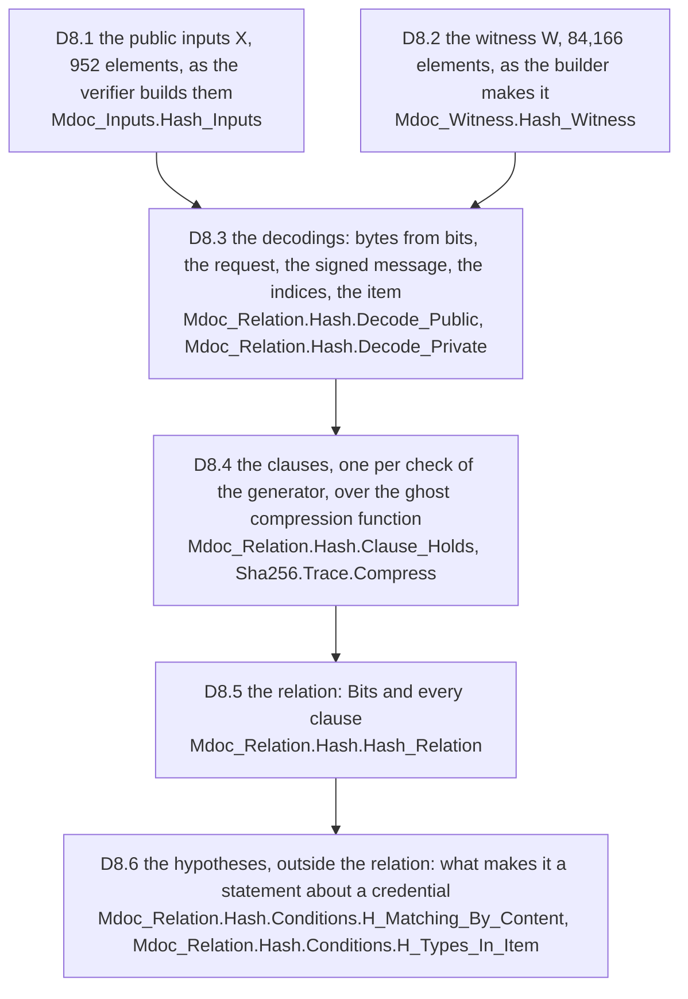

# Chapter 10: certified circuits

The milestone Certified circuits ([ADR 0091](../adr/0091-certified-circuits-milestone.md)) replaces the trust in the registered circuit files (register row R2) with a proof. A checker, written and proved in SPARK, will read a circuit file with a certificate from upstream's generator and accept it only if the circuit implies a relation stated here. This chapter states the relations and their conditions. Later blocks add the checker and its proofs.

What the chapter holds today, block 1 (#168):

- the conditions for certifying the circuit and their names in the specification (the opening section);
- the relation of the version 7 hash circuit, clause by clause, its public interface, the hypotheses that give it its meaning, and what the circuit does not read (Section 1);
- what the proofs guarantee about the specification itself (Section 2);
- the test of the relation against the registered circuit, case by case (Section 3);
- what stays trusted (Section 4).

The relation is in `src/mdoc_relation.ads`, `src/mdoc_relation-hash.ads` and `src/mdoc_relation-hash-conditions.ads`, with the ghost compression function of `src/sha256-trace.ads`. All of it is ghost: it is never compiled into the library.

**Before reading:** the primer's account of what a circuit and a witness are ([A6](00-primer-cryptography.md#a6-circuits)), of SHA-256 and the credential ([A4](00-primer-cryptography.md#a4-hashes-and-merkle-trees), [A10](00-primer-cryptography.md#a10-signatures-cbor-and-the-mdoc)) and of the two circuits of the proof of age ([A11.2](00-primer-cryptography.md#a112-the-two-circuits-of-the-proof-of-age)); ghost code and contracts ([B3](00-primer-spark.md#b3-contracts), [B4](00-primer-spark.md#b4-ghost-code-assertion-levels-and-builds)); chapter 9 Sections 1.4, 1.6 and 6.

## The conditions and their names in the specification

The conditions for certifying the circuit are the table of [chapter 9 Section 6](09-mdoc.md#6-what-stays-trusted-and-the-limits). Each row has a kind, and the kind decides where the row goes in the specification:

- **A soundness row** is a named hypothesis, kept outside the relation. If it fails, a proof can be accepted for a statement that is false of the credential, so the circuit cannot be blamed for it and the relation cannot contain it.
- **A completeness row** is a constraint inside a clause of the relation, written as the circuit checks it. It narrows what is accepted, so it cannot make a false statement true.

The prefix of a name says what kind of thing it is:

- `H_`, a hypothesis on the issuer, the relying party or SHA-256, which neither the circuit nor this project can establish;
- `Fact_`, a fact about the circuit, proved here or later by the checker;
- `Limit_`, a known limit of the circuit, stated, not assumed.

The rows of the hash circuit:

| Row of chapter 9 Section 6 | Kind | Name in the specification | Where it is |
|---|---|---|---|
| Matching by content | Soundness | `H_Matching_By_Content` | a predicate, `Mdoc_Relation.Hash.Conditions`, executed by the harness |
| The SHA-256 padding | Soundness | `Fact_Padding` | a lemma, proved, under `H_Sha256` |
| The wrapper lengths | Soundness | `Fact_Wrapper_Lengths` | stated on paper (the row's argument); every byte read lies in the padded preimage of e or in the zero blocks |
| The types in an item | Soundness | `H_Types_In_Item` | a predicate, executed by the harness |
| The namespace | Soundness | `H_Namespace` | block 5: the parse's outputs do not record an item's namespace |
| The separators of the dates | Soundness | `Limit_Date_Separators` | stated as text, the issuer's side of the form |
| The form of now | Soundness | `H_Now_Form` | stated as text, the relying party's side of the form |
| H_Sha256 | Soundness | `H_Sha256` | stated as text |
| H_Digest_Preimage | Soundness | `H_Digest_Preimage` | stated as text |
| ES256 on P-256 only | Completeness | the constant `Prefix` | part of the decoding: the circuit builds the preimage with it |
| The COSE_Key in one form | Completeness | the clause `Device_Key` | its 33 bytes, then x, `22 58 20`, y |
| SHA-256 for the value digests | Completeness | the clause `Value_Digest` | its head `58 20` |
| Identifiers below 24 characters at version 7 | Completeness | the clause `Item` | the slot's length against the public length |
| The docType | Soundness | none in block 1 | the hash circuit reads no docType; the signature circuit's block |

The rows of the signature circuit (the issuer's digest, x(R) and the device key's coordinates below n, e2 below p, e2 not 0 modulo n, the issuer's key) belong to its own relation, block 6. The row of the version 6 order is out of the milestone's scope.

## 1. The relation of the version 7 hash circuit

### 1.1 What a relation is, and the direction of the theorem

A circuit is a list of arithmetic checks over its inputs: the public inputs X, which the verifier knows, and the private inputs W, the witness, which only the prover knows ([A6](00-primer-cryptography.md#a6-circuits)). The verifier is convinced that some W exists for which every check holds. What that means depends entirely on what the checks are. The circuit file is the only description of them, and it is millions of gates.

The **relation** is a short statement of the same checks, readable and written in SPARK: a function `Hash_Relation (X, W)` that is true or false. The checker of the later blocks will prove one direction, for the registered circuit: if the circuit accepts X and W, then `Hash_Relation (X, W)` holds. The other direction, that every honest credential gives a witness the circuit accepts, is completeness. It stays tested (register row V6).

Two consequences for how the relation is written:

- **It must not claim more than the circuit checks.** No checker could prove such a relation. The test of Section 3 is the early warning: the relation must hold on every witness the circuit accepts.
- **It must not claim less than the guarantee drawn from it.** The same test shows that each clause fails on a witness made to violate it, so that no clause is vacuous.

The relation is a transcription of the generator of the registered circuit, not of a description of it: upstream's `lib/circuits/mdoc/mdoc_hash.h`, `assert_valid_hash_mdoc`, at longfellow-zk/longfellow-zk 0d92f80c, which regenerates the registered file byte for byte, and the three MAC checks of `mdoc_generate_circuit.cc` 166 to 169. Every clause cites its lines.



*D8. The relation of the version 7 hash circuit. The inputs are decoded as the circuit reads them; the clauses are stated over the decoded parts; the relation is their conjunction. The checker of the later blocks proves that an accepting evaluation of the registered circuit implies the relation; the hypotheses are what an evaluator adds to read it as a statement about a credential. What it simplifies: `H_Sha256`, `H_Digest_Preimage` and `H_Now_Form` are stated as text, not as predicates, and the root package `Mdoc_Relation` holds no declaration of its own.*

Where it is in the code:

| Box | Units | Key subprograms | Assurance | Harnesses and vectors | Draft and records | Upstream |
|---|---|---|---|---|---|---|
| D8.1, D8.2 | [`Mdoc_Inputs`](../../src/mdoc_inputs.ads), [`Mdoc_Witness`](../../src/mdoc_witness.ads) | `Hash_Inputs`, `Hash_Witness` | chapter 9 Section 4; partitions `mdoc` and `mdoc-parse` | `mdoc_kat`, `mdoc_witness_kat`, `relation_cases` | ADR 0058, ADR 0086 | `push_input_hash`, `push_witness_hash` |
| D8.3, D8.4, D8.5 | [`Mdoc_Relation`](../../src/mdoc_relation.ads), [`Mdoc_Relation.Hash`](../../src/mdoc_relation-hash.ads), [`Sha256.Trace`](../../src/sha256-trace.ads) | `Decode_Public`, `Decode_Private`, `Clause_Holds`, `Hash_Relation`, `Compress` | Silver; the lemmas and `Compress` Gold; partition `relation` | `relation_cases` | ADR 0091 | `assert_valid_hash_mdoc` (`mdoc_hash.h` at 0d92f80c) |
| D8.6 | [`Mdoc_Relation.Hash.Conditions`](../../src/mdoc_relation-hash-conditions.ads) | `H_Matching_By_Content`, `H_Types_In_Item`, `Fact_Padding` | Silver; `Fact_Padding` Gold; partition `relation` | `relation_cases` | ADR 0091 | none: the conditions table of chapter 9 Section 6 |

### 1.2 The decoding

The relation reads the inputs as the circuit reads them, through two decodings.

`Decode_Public (X)` reads the 952 public elements, in the order of the circuit file and of `Mdoc_Inputs.Hash_Inputs` (register row R8):

- the constant one;
- the requested identifier, 32 bytes, and its value, 64 bytes;
- the two lengths the clause `Item` compares over: the identifier's entry and the value's entry;
- `now`, 20 bytes;
- the six tags and av.

`Decode_Private (W)` reads the 84,166 private elements in the order of register row R14:

- e, the digest the issuer signed, and the device key's x and y, 256 bits each;
- the signed message after its 18-byte prefix, and the number of SHA-256 blocks it takes;
- the five indices into the MSO the prover chooses;
- the issuer-signed item, 128 bytes, with its layout: three offsets, four lengths and the order of its four entries;
- the six MAC pads.

The 40 block traces and the item's two are not read by the relation: they are how the circuit computes SHA-256, and the checker will relate them to the compression function.

A byte is read from eight elements, least significant bit first, an element counting as 1 when it equals one. That reading is faithful only if every such element is 0 or 1, which is the first clause, `Bits`. The circuit asserts it of every bit input it creates, public ones included (`lib/circuits/logic/logic.h` 976 to 980), so no hypothesis is needed on the verifier's public inputs being bits.

`Lemma_Byte_At` proves that the decoding of a byte is faithful: eight elements laid out as the bits of a byte V, each One or Zero, read as V.

### 1.3 The clauses

One expression function each, over the decoded parts. "The signed message" is the 18 constant bytes of the COSE `Sig_structure` up to the payload's head, then the message of the witness.

| Clause | What it states | Generator, `mdoc_hash.h` unless named |
|---|---|---|
| `Bits` | every element the circuit takes as a bit is 0 or 1 | `logic.h` 976 to 980 |
| `Chain` | the SHA-256 compression, iterated from the initial value over the first nb blocks of the signed message, gives e | 187, 188; `flatsha256_circuit.h` 192 to 262 |
| `Zero_Tail` | every block from nb on is zero | `flatsha256_circuit.h` 267 to 278 |
| `Length` | the length read from the last 8 bytes of block nb is whole bytes, below 4,096 | 191, 299 to 312 |
| `Valid_From`, `Valid_Until` | at their index, below the length: the key, tag 0 and its text head, then 20 bytes, compared byte for byte with `now` | 202 to 216 |
| `Device_Key` | at its index: the 33 bytes of `deviceKeyInfo` up to x's head, x, `22 58 20`, y, equal to the device key | 218 to 227, 492 to 498 |
| `Value_Digests` | at its index: the key `valueDigests` | 229 to 234 |
| `Value_Digest` | at its index: `58 20` and 32 bytes equal to the SHA-256 of the item's two blocks | 258 to 275 |
| `Item` | the item is `D8 18 58`, a length byte, `A4`, then four contiguous entries: `digestID` and `random`, each with its key and a length that agrees with its CBOR head, and `elementIdentifier` and `elementValue` followed by the public identifier and value over the public lengths | 278 to 282, 392 to 476 |
| `Tags` | for e, x and y, each split in two 128-bit halves, tag = (av + pad) · half in GF(2^128) | `mac_circuit.h` 164 to 186 |

`Hash_Relation (X, W)` is `Bits` and every other clause. It names no public value outside `Decode_Public`. The constant one is a precondition, not a clause: it is the evaluator's and the verifier's convention.

The ghost function `Sha256.Trace.Compress` is the compression function of FIPS 180-4, stated over a recursive specification of its message schedule and rounds (`Compress_Spec`), and proved equal to it. `Compress_Traced`, the procedure the witness builder uses, is proved to end in the same state.

### 1.4 The clause `Item` without its arithmetic modulo 4,096

The circuit computes the item's offsets modulo 4,096, its 12-bit index, and compares the identifier's and the value's lengths modulo 256, a byte. As written, the clause would leave an evaluator to check that no choice of lengths wraps around. `Lemma_Item_No_Wrap` removes the "modulo". Its premises:

1. the clause `Item`;
2. the public lengths between 1 and 128, which the encoder gives (19 to 50 and 13 to 77);
3. the item's length at most 128 bytes.

Its conclusion: the four entries are in four different slots; the starts increase from 5, below 128; every sum is exact; and the identifier's and the value's lengths are exactly the public lengths.

The argument. Each entry starts with its key, whose first byte is not zero, and a byte at 128 or beyond reads as zero, so every entry starts inside the item, and in its own slot since the keys differ. The lengths of `digestID` and `random` are exact, at most 14 and 264. An entry in one of the first three slots ends where the next starts, below 128.

**The third premise is not given by the clauses.** The last slot ends at the length read from the item's last eight bytes, which the circuit bounds only by 4,096. Without the premise, an entry in the last slot has its public length modulo 256 and no more; the bytes past 128 read as zero, so nothing more is compared, but the statement is weaker. `H_Sha256` gives the premise: the item's two blocks are then the issuer's padded item, at most 119 bytes. The item is always two blocks: the smallest item the clause admits is 56 bytes, 72 with the 16 bytes of `random` that ISO/IEC 18013-5 requires (9.1.2.5).

`Lemma_Count_In_Range` proves another fact the circuit leaves implicit: nb is between 1 and 40 whenever the relation holds. The circuit computes the comparison nb ≤ 40 and discards it (`mdoc_hash.h` 186). A count outside gives a signed length of zero, and the clause `Value_Digests` needs an index below it.

### 1.5 The public interface

Every clause reads the public part through `Decode_Public`. The claim the relation makes is therefore about an X that the verifier built with `Mdoc_Inputs.Hash_Inputs`, the same code as upstream's encoder. A verifier that passed other lengths would change what is compared: an identifier's length of 18 would make the clause `Item` compare the key `elementIdentifier` alone.

That `Decode_Public` of the encoder's output is the request it encoded is **tested** (Section 3), not proved: its proof needs the encoder's contract to state the layout it writes, and belongs with the emitter's block (block 4).

The same holds of `now`, under `H_Now_Form`: its 20 bytes are the relying party's current time in the form `YYYY-MM-DDThh:mm:ssZ`, upper-case T and Z. The clauses compare bytes, and their reading as times holds for that form on both sides. `Limit_Date_Separators` is the same form on the issuer's side.

### 1.6 The hypotheses

The checker's theorem needs no hypothesis: an evaluation of the circuit that accepts implies `Hash_Relation`. The relation speaks of bytes at offsets the prover chose, inside the bytes the issuer signed. The circuit does not parse the MSO: it looks for fixed byte patterns at those offsets, the **matching by content**. To read the relation as a statement about a credential ("the issuer signed a credential, valid now, bound to this device key, with this attribute"), an evaluator adds the hypotheses.

| Hypothesis | Binds | What it says |
|---|---|---|
| `H_Sha256` | SHA-256 | No one can find blocks other than the issuer's padded MSO whose chain from SHA-256's initial value gives e, nor two blocks other than an item the issuer hashed whose chain gives one of its value digests. Second-preimage resistance of the iterated compression. |
| `H_Digest_Preimage` | SHA-256 and P-256 | The value digest the circuit compares is one the issuer computed. The clause `Value_Digest` takes any `58 20` and its 32 bytes in the signed message. The device key's x and y have that head, and the holder chose the key before issuance: using one as a digest needs two blocks whose chain is that coordinate, a preimage of SHA-256, or a key whose coordinate is a chosen digest and whose private key is known, a discrete logarithm on P-256. Other strings the issuer wrote are `H_Matching_By_Content`'s. |
| `H_Matching_By_Content` | Issuer | Each pattern the clauses search for occurs in the MSO only where its structure puts it: the keys of `validFrom` and `validUntil` with their tag and head, `deviceKeyInfo` with its COSE_Key, `valueDigests`, and `58 20` with the requested item's digest only at that item's entry. With the relation, it makes every index of the witness the parse's offset. |
| `H_Types_In_Item` | Issuer | In the item, `digestID` is an unsigned integer and `random` a byte string: the major types of their heads, which the circuit does not read. |
| `H_Namespace` | Issuer, scheme | An identifier has one meaning in every namespace of the MSO (block 5). |
| `H_Now_Form` | Relying party | `now` is the current time in the canonical form. |

**The model the hypotheses are written over.** No proved model of the MSO's CBOR structure exists. The parse (`Mdoc_Parse`, over the table of `Cbor_Parse`) is proved safe and in bounds; what it extracts, and where, is trusted as upstream's code specifies it (register row R12). The hypotheses are predicates over the parse's outputs, the offsets of `Parsed_Mdoc` and the item's locator: those outputs are the model, by name. So the meaning of a hypothesis rests on R12. A second theorem, that the relation and the hypotheses imply a claim on the parsed MSO, would rest on it too; whether to prove one is decided at block 5.

The hypotheses that are predicates are executable: the harness of Section 3 evaluates them on every test document, and the lint for issuers of block 5 will be a program around them.

### 1.7 What the circuit does not read

The clauses note, one by one, what the circuit leaves out. Gathered here, each with what covers it:

| Not read | The clause that would read it | What covers it |
|---|---|---|
| The padding of the signed message: 16#80#, the zeros, and whether the length is the message's | `Chain`, `Length` | `H_Sha256`; `Fact_Padding` for the patterns |
| The padding of the item, and its length beyond "whole bytes below 4,096" | `Value_Digest`, `Item` | `H_Sha256`; the third premise of `Lemma_Item_No_Wrap` |
| The two bytes of the payload's length and the five of the MSO's tag-24 head, skipped | the windows into the MSO | `Fact_Wrapper_Lengths` |
| The comparison nb ≤ 40, computed and discarded | `Zero_Tail` | `Lemma_Count_In_Range` |
| Byte 3 of the item, the length of its byte string | `Item` | `H_Sha256`: the item is then the issuer's |
| The size of the map after `valueDigests` | `Value_Digests` | nothing needed: the clause uses only the key |
| The link between the digest's index and the map of `valueDigests` | `Value_Digest` | `H_Matching_By_Content` (the issuer's own bytes) and `H_Digest_Preimage` (the device key's coordinates) |
| The namespace of the digest | `Value_Digest` | `H_Namespace` |
| `digestID`'s value against the key of its entry in `valueDigests` | `Value_Digest`, `Item` | `H_Matching_By_Content` |
| The major types of the heads of `digestID` and `random` | `Item` | `H_Types_In_Item` |
| `digestAlgorithm` | `Value_Digest` | the row "SHA-256 for the value digests" (completeness) |
| The docType | none | the docType row (the signature circuit's block) |
| The positions `attr_ei_` and `attr_ev_` at version 7 | none | nothing: the version 7 circuit does not use them |
| The constant one | none, a precondition | the evaluator's and the verifier's convention |
| The protected header and the external data | none: constants of the preimage | the row "ES256 on P-256 only" (completeness) |

### 1.8 Why the hypotheses exist: two worked examples

Two witnesses made by the harness of Section 3 from the reference test case (FAMILYNAME_MUSTERMANN_MDOC_3). In both, the circuit accepts and the relation holds: they agree, as they must. Yet both prove something false of the credential. Only a hypothesis, evaluated on the same witness, says so.

**A second `validUntil`.** The MSO holds the value digests of the other items, 32 bytes each, which the issuer computed. Suppose one of them happened to read as the key of `validUntil` followed by a date in 9999; the chance is negligible, and the harness writes those bytes in to make the case. The prover sets the witness's index of `validUntil` to that place and the relying party's `now` to 2099, past the credential's real `validUntil`. The circuit accepts: every pattern it searches for is where the index says. The relation holds: it states what the circuit checks. The statement "the credential is valid in 2099" is false. `H_Matching_By_Content` is false on this witness, since the key of `validUntil` occurs twice in the MSO, and it is the hypothesis that excludes the case.

**`random` as a text string.** In the requested item, the head of `random` is changed from a byte string of 16 bytes (16#50#) to a text string of the same length (16#70#), and the item's digest recomputed. The layout is unchanged, so every key the circuit checks is where it was, and the circuit accepts. The attribute is still the one compared, so what is proved is not wrong in itself. What fails is that the item is not one a conforming issuer writes. `H_Types_In_Item` is false on this witness: the circuit does not read the major type, and the hypothesis is the condition that issuers write well-typed items.

### 1.9 The witness builder and the relation

The relation says what the circuit accepts. The witness builder decides what this project's prover will try. They agree in one direction: every witness the builder builds satisfies the relation, tested on every document (Section 3). The converse does not hold, on purpose: the builder refuses at least everything no witness satisfies, and some documents the relation admits.

| The builder's status | The relation | Agreement |
|---|---|---|
| `Attribute_Not_Found` | no item with the identifier and value: no witness exists | the same |
| `Attribute_Too_Long` | the item must fit two SHA-256 blocks, 119 bytes at most | the same limit |
| `Validity_Form_Unsupported` | the dates compared byte for byte; a lower-case `t` satisfies it | the builder is narrower: it closes `Limit_Date_Separators` for this project's prover |
| `Device_Key_Form_Unsupported` | the clause `Device_Key`, its exact bytes | the same |
| `Random_Form_Unsupported` | the clause `Item` does not read the type of `random` | the builder is narrower: `H_Types_In_Item` stays a hypothesis on the issuer |

Two completeness rows are refused only by the circuit today: `digestAlgorithm` other than SHA-256, and an identifier of 24 to 30 characters. Issue #195 is to refuse both in the builder, before any work.

### 1.10 The author's review

The clauses are the generator's checks by reading. The author reviewed the six clauses that read the MSO and the item (`Valid_From`, `Valid_Until`, `Device_Key`, `Value_Digests`, `Value_Digest`, `Item`) against the generator at 0d92f80c, ISO/IEC 18013-5:2021 (first edition, September 2021) and Annex A of the EU Age Verification technical specification at commit 014dc2f (the AV profile, as chapter 9 Section 6 cites it), and the four rows the block adds to the conditions table: `H_Sha256`, `H_Digest_Preimage`, "SHA-256 for the value digests" and "identifiers below 24 characters at version 7".

The review was made on 24 November 2026, on the sources of block 1 (#168) before their commit. Its outcome: the six clauses and the four rows accepted as stated here and in chapter 9 Section 6.

## 2. What the proofs guarantee

The specification is proved in the partition `relation`: `Mdoc_Relation`, `Mdoc_Relation.Hash`, `Mdoc_Relation.Hash.Conditions` and `Sha256.Trace`. For every input that meets the preconditions, GNATprove proves:

- **Silver for the whole specification:** no run-time error in the decoding, the clauses and the predicates, for any X and W of the right lengths; every recursive function terminates.
- **`Sha256.Trace`:** `Compress` equals `Compress_Spec`, the recursive specification of FIPS 180-4's schedule and rounds; `Compress_Traced` ends in the state `Compress` gives (Gold).
- **The lemmas** (Gold): `Lemma_Byte_At` (Section 1.2), `Lemma_Count_In_Range` and `Lemma_Item_No_Wrap` (Section 1.4), and `Fact_Padding`: when the preimage from the message's end on is SHA-256's padding, a pattern of the clauses (the four keys and the key of y in the device key) can match only inside the message. The digest's `58 20` and 32 bytes are not among them: the digest may hold any byte, and a window reaching into the padding holds bytes no one chose, a preimage (`H_Digest_Preimage`).
- **`Counts_Agree`:** the shape the relation reads is the count of `Mdoc_Inputs` and `Mdoc_Witness`.

What the proofs do not say: that the clauses are the generator's (by reading, Section 1.10, until the checker proves the circuit implies them); that the hypotheses hold (they are hypotheses); that `Decode_Public` inverts the encoder (tested, Section 3).

The verification conditions of the partition, from a run on the proving machine:

- **sources** the block's final sources, run as a working tree before the commit; the gate of the pull request proves them again from scratch;
- **toolchain** GNATprove 16.1.0 with gnat_native 16.1.0 (Alire); the prover configuration of `package Prove` in the project file, CVC5, Z3 and Alt-Ergo with `--steps=600000` and `--timeout=120` ([ADR 0020](../adr/0020-prover-configuration-step-budget.md)), unchanged by the block;
- **command** `make prove-partition PARTITION=relation`, then `python3 -I scripts/vc-count.py --partition relation`;
- **run** 24 November 2026, on the proving machine, from a clean session: proved, not reused from an earlier proof.

How to read the table: [B6.4](00-primer-spark.md#b64-reading-the-summary-table).

| Check | `Mdoc_Relation` | `Mdoc_Relation.Hash` | `Mdoc_Relation.Hash.Conditions` | `Sha256.Trace` | Discharged by |
|---|---|---|---|---|---|
| Data dependencies (`Global`) | 0 | 59 | 14 | 10 | flow analysis |
| Initialisation | 0 | 0 | 0 | 24 | flow analysis |
| Termination | 0 | 56 | 10 | 8 | flow analysis |
| Range checks | 0 | 25 | 28 | 23 | provers |
| Division checks (`/`, `mod`) | 0 | 15 | 15 | 1 | provers |
| Overflow checks | 0 | 59 | 11 | 29 | provers |
| Index checks | 0 | 46 | 11 | 31 | provers |
| Length checks | 0 | 0 | 0 | 3 | provers |
| Preconditions of the calls | 0 | 59 | 31 | 27 | provers |
| Assertions | 0 | 53 | 11 | 13 | provers |
| Loop invariants (base case and preservation) | 0 | 0 | 0 | 26 | provers |
| Postconditions | 0 | 4 | 4 | 3 | provers |
| Variants of the recursive functions | 0 | 1 | 0 | 5 | provers |
| **Total** | **0** | **377** | **135** | **203** | all proved: none justified, none unproved, no `pragma Assume` |

In all, 715 checks, 534 discharged by the provers; the highest step count of a successful proof is 97,753, within the budget. `Mdoc_Relation` is the parent package, ghost, with no check. The flow analysis prints no warning for the partition.

## 3. What is only tested

`tests/relation/relation_cases.adb` evaluates the registered circuit `8d079211…_hash.lfc2` on a witness and evaluates the relation on the same witness, case by case. The relation is ghost code, compiled and executed in this harness with assertions on. The harness has its own project file (`tests/relation/relation_cases.gpr`): the test project's flags make one evaluation of the circuit take about 21 minutes, these about 0.7 seconds. It is not the constant-time build. The cases are in `tests/vectors/relation_cases.txt`, and the `cli` step of `make check` runs them on the proving machine (skipped on GitHub Actions, as the proofs of age from every test document are).

The cases:

- **Honest:** every test document of upstream at version 7, with the request of `scripts/mdoc-cases.sh`, and the witness this project's builder makes.
- **Mutations:** thirteen on each of three documents (the reference test case, a short MSO and the longest), each aimed at one clause. After each, the harness recomputes the SHA-256 traces, e and the tags, so the circuit's verdict depends on the clause aimed at alone.
- **Neutral:** changes to what the circuit does not read (the positions `attr_ei_` and `attr_ev_`, the pads and av together with the tags, byte 3 of the item, the map's size after `valueDigests`): both must accept.
- **Synthetic:** the two cases of Section 1.8, and the documents rewritten under a new identifier of 23, 24 and 30 characters (below).

A case fails if the circuit accepts and the relation is false, or if the verdict is not the one expected. On the honest positive cases, the harness also evaluates `H_Matching_By_Content` and `H_Types_In_Item`, runs the lemmas, `Fact_Padding` at every index from 0 to 4,095 and `Lemma_Byte_At` on the identifier's 32 bytes, with their preconditions and assertions checked, and checks that `Decode_Public` of the public inputs is the request they encode.

The result, run on the proving machine on 20 November 2026: **87 cases, none failed; none where the circuit accepts and the relation is false; none where the circuit refuses and the relation holds.**

| Cases | Number | Verdict |
|---|---|---|
| Honest, positive (32 documents and the identifier of 23 characters) | 33 | circuit accepts, relation holds; the hypotheses hold; the lemmas run |
| Honest, negative (the six `FAIL_` documents, the identifiers of 24 and 30 characters) | 8 | circuit refuses, relation false at `Item` |
| Mutations | 39 | circuit refuses, relation false at the clause aimed at |
| Neutral | 5 | circuit accepts, relation holds |
| Synthetic, Section 1.8 | 2 | circuit accepts, relation holds, the hypothesis false |

**The identifiers of 24 characters or more.** At version 7 the public length of the identifier's entry is `1 + 17 + 1 + id_len`, as upstream's encoder pushes it (`mdoc_witness.h` 501 at 0d92f80c): it assumes the identifier's CBOR head is one byte. From 24 characters the head is two bytes, the entry is one byte longer than the length compared, and the clause `Item` fails on the honest witness. The harness rewrites the requested item of the reference test case under a new identifier, with its value digest in the MSO replaced; the issuer's signature no longer verifies, which the hash circuit does not read. With `family_name_national_ch` (23 characters) the circuit accepts; with `family_name_national_cha` (24) and `family_name_national_character` (30) it refuses, and the relation is false at `Item`. `Decode_Public` is the request in all three. Above 30 characters the encoder refuses the request (`Mdoc_Inputs.Fits`).

The data elements of ISO/IEC 18013-5:2021 the limit excludes (Table 5 and 7.2.6): `family_name_national_character` (30 characters), `given_name_national_character` (29), and the biometric templates `biometric_template_xx` whose name has five letters or more, from `biometric_template_voice` (24); `face` and `iris` give 23. Every other identifier of Table 5 is at most 22 characters. Of the EU PID, `personal_administrative_number` (30). The AV profile's `age_over_NN` is 11.

To reproduce, after `make cli` or alone:

```
alr exec -- gprbuild -P tests/relation/relation_cases.gpr -p
tests/relation/bin/relation_cases tests/vectors/upstream/mdoc/8d079211715200ff06c5109639245502bfe94aa869908d31176aae4016182121_hash.lfc2 tests/vectors/relation_cases.txt tests/vectors/upstream/mdoc/testcases
```

## 4. What stays trusted

- **That the clauses are the generator's checks** (register row R2): by reading, until the checker of the later blocks proves that the registered circuit implies the relation.
- **That `Compress_Spec` is the compression function of FIPS 180-4**: by reading, and by the NIST vectors (register row V1). `Compress` is proved equal to it, and `Compress_Traced` to end in the state `Compress` gives. `Compress_Traced` is tested equal to `Sha256`, which the NIST vectors test, on the trace vectors of `mdoc_parse_kat`; and `Compress`, executed by `relation_cases`, gives on every honest test document the digest e that `Sha256` computes (the clause `Chain`).
- **`H_Sha256` and `H_Digest_Preimage`** (register rows S5 and S6): properties of SHA-256 and of P-256 that no proof here reaches.
- **The other hypotheses**, on the issuer and the relying party: the conditions table of chapter 9 Section 6 says who must make each hold and how it is checked.
- **What the parse extracts** (register row R12): the model the hypotheses are written over.
- **The layouts** of the public inputs and of the hash witness as upstream's code specifies them (rows R8 and R14): the decodings follow them; that the encoder's output decodes to the request is tested.
