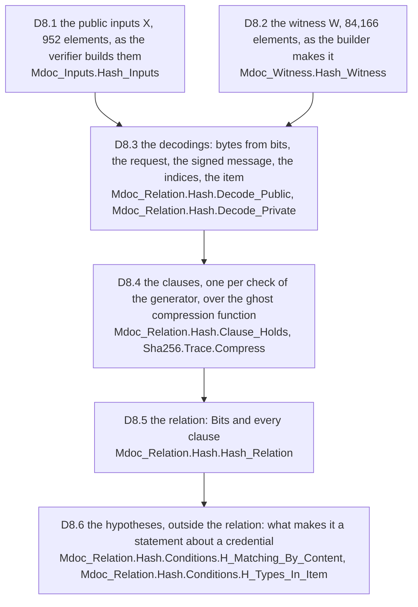
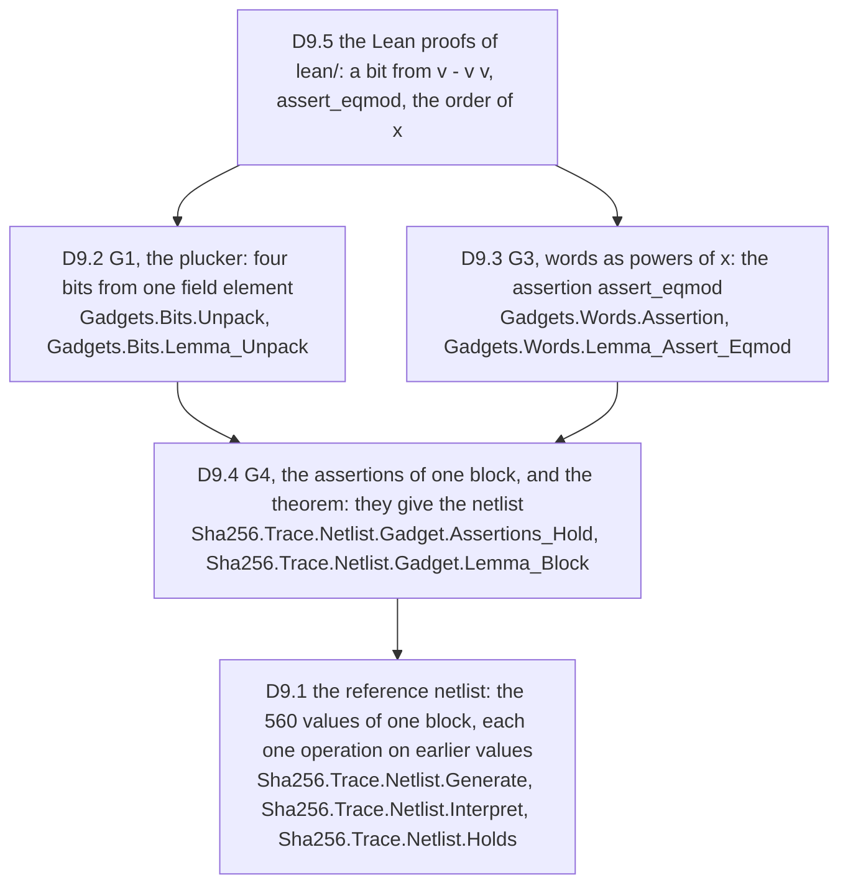
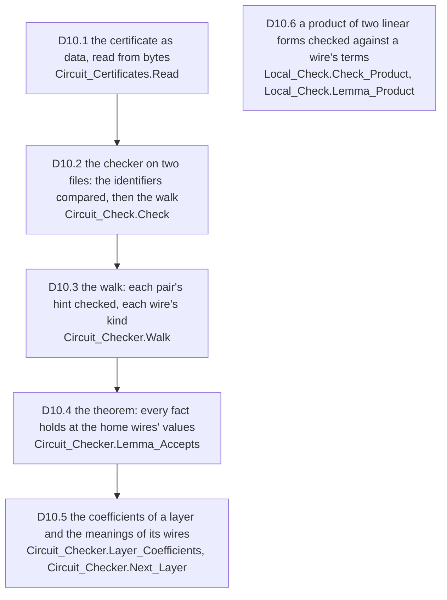

# Chapter 10: certified circuits

The milestone Certified circuits ([ADR 0091](../adr/0091-certified-circuits-milestone.md)) replaces the trust in the registered circuit files (register row R2) with a proof. A checker, written and proved in SPARK, will read a circuit file with a certificate from upstream's generator and accept it only if the circuit implies a relation stated here. This chapter states the relations and their conditions, and the checker as the blocks add it.

What the chapter holds today, blocks 1 (#168) to 3 (#170):

- the conditions for certifying the circuit and their names in the specification (the opening section);
- the relation of the version 7 hash circuit, clause by clause, its public interface, the hypotheses that give it its meaning, and what the circuit does not read (Section 1);
- block 2 (#169): the compression of one block as the circuit computes it, the reference netlist and the three gadgets, with the two facts proved in Lean (Section 2);
- block 3 (#170): the circuit checker's core, the certificate, the walk and its theorem (Section 3);
- what the proofs guarantee (Section 4);
- the test of the relation against the registered circuit, case by case, and the checker's harness (Section 5);
- what stays trusted (Section 6).

The relation is in `src/mdoc_relation.ads`, `src/mdoc_relation-hash.ads` and `src/mdoc_relation-hash-conditions.ads`, with the ghost compression function of `src/sha256-trace.ads`. All of it is ghost: it is never compiled into the library.

**Before reading:** the primer's account of what a circuit and a witness are ([A6](00-primer-cryptography.md#a6-circuits)), of SHA-256 and the credential ([A4](00-primer-cryptography.md#a4-hashes-and-merkle-trees), [A10](00-primer-cryptography.md#a10-signatures-cbor-and-the-mdoc)) and of the two circuits of the proof of age ([A11.2](00-primer-cryptography.md#a112-the-two-circuits-of-the-proof-of-age)); ghost code and contracts ([B3](00-primer-spark.md#b3-contracts), [B4](00-primer-spark.md#b4-ghost-code-assertion-levels-and-builds)); chapter 9 Sections 1.4, 1.6 and 6.

## The conditions and their names in the specification

The conditions for certifying the circuit are the table of [chapter 9 Section 6](09-mdoc.md#6-what-stays-trusted-and-the-limits). Each row has a kind, and the kind decides where the row goes in the specification:

- **A soundness row** is a named hypothesis, kept outside the relation. If it fails, a proof can be accepted for a statement that is false of the credential, so the circuit cannot be blamed for it and the relation cannot contain it.
- **A completeness row** is a constraint inside a clause of the relation, written as the circuit checks it. It narrows what is accepted, so it cannot make a false statement true.

The prefix of a name says what kind of thing it is:

- `H_`, a hypothesis on the issuer, the relying party or SHA-256, which neither the circuit nor this project can establish;
- `Fact_`, a fact about the circuit, proved here or later by the checker;
- `Limit_`, a known limit of the circuit, stated, not assumed.

The rows of the hash circuit:

| Row of chapter 9 Section 6 | Kind | Name in the specification | Where it is |
|---|---|---|---|
| Matching by content | Soundness | `H_Matching_By_Content` | a predicate, `Mdoc_Relation.Hash.Conditions`, executed by the harness |
| The SHA-256 padding | Soundness | `Fact_Padding` | a lemma, proved, under `H_Sha256` |
| The wrapper lengths | Soundness | `Fact_Wrapper_Lengths` | stated on paper (the row's argument); every byte read lies in the padded preimage of e or in the zero blocks |
| The types in an item | Soundness | `H_Types_In_Item` | a predicate, executed by the harness |
| The namespace | Soundness | `H_Namespace` | block 5: the parse's outputs do not record an item's namespace |
| The separators of the dates | Soundness | `Limit_Date_Separators` | stated as text, the issuer's side of the form |
| The form of now | Soundness | `H_Now_Form` | stated as text, the relying party's side of the form |
| H_Sha256 | Soundness | `H_Sha256` | stated as text |
| H_Digest_Preimage | Soundness | `H_Digest_Preimage` | stated as text |
| ES256 on P-256 only | Completeness | the constant `Prefix` | part of the decoding: the circuit builds the preimage with it |
| The COSE_Key in one form | Completeness | the clause `Device_Key` | its 33 bytes, then x, `22 58 20`, y |
| SHA-256 for the value digests | Completeness | the clause `Value_Digest` | its head `58 20` |
| Identifiers below 24 characters at version 7 | Completeness | the clause `Item` | the slot's length against the public length |
| The docType | Soundness | none in block 1 | the hash circuit reads no docType; the signature circuit's block |

The rows of the signature circuit (the issuer's digest, x(R) and the device key's coordinates below n, e2 below p, e2 not 0 modulo n, the issuer's key) belong to its own relation, block 6. The row of the version 6 order is out of the milestone's scope.

## 1. The relation of the version 7 hash circuit

### 1.1 What a relation is, and the direction of the theorem

A circuit is a list of arithmetic checks over its inputs: the public inputs X, which the verifier knows, and the private inputs W, the witness, which only the prover knows ([A6](00-primer-cryptography.md#a6-circuits)). The verifier is convinced that some W exists for which every check holds. What that means depends entirely on what the checks are. The circuit file is the only description of them, and it is millions of gates.

The **relation** is a short statement of the same checks, readable and written in SPARK: a function `Hash_Relation (X, W)` that is true or false. The checker of the later blocks will prove one direction, for the registered circuit: if the circuit accepts X and W, then `Hash_Relation (X, W)` holds. The other direction, that every honest credential gives a witness the circuit accepts, is completeness. It stays tested (register row V6).

Two consequences for how the relation is written:

- **It must not claim more than the circuit checks.** No checker could prove such a relation. The test of Section 5 is the early warning: the relation must hold on every witness the circuit accepts.
- **It must not claim less than the guarantee drawn from it.** The same test shows that each clause fails on a witness made to violate it, so that no clause is vacuous.

The relation is a transcription of the generator of the registered circuit, not of a description of it: upstream's `lib/circuits/mdoc/mdoc_hash.h`, `assert_valid_hash_mdoc`, at longfellow-zk/longfellow-zk 0d92f80c, which regenerates the registered file byte for byte, and the three MAC checks of `mdoc_generate_circuit.cc` 166 to 169. Every clause cites its lines.



*D8. The relation of the version 7 hash circuit. The inputs are decoded as the circuit reads them; the clauses are stated over the decoded parts; the relation is their conjunction. The checker of the later blocks proves that an accepting evaluation of the registered circuit implies the relation; the hypotheses are what an evaluator adds to read it as a statement about a credential. What it simplifies: `H_Sha256`, `H_Digest_Preimage` and `H_Now_Form` are stated as text, not as predicates, and the root package `Mdoc_Relation` holds no declaration of its own.*

Where it is in the code:

| Box | Units | Key subprograms | Assurance | Harnesses and vectors | Draft and records | Upstream |
|---|---|---|---|---|---|---|
| D8.1, D8.2 | [`Mdoc_Inputs`](../../src/mdoc_inputs.ads), [`Mdoc_Witness`](../../src/mdoc_witness.ads) | `Hash_Inputs`, `Hash_Witness` | chapter 9 Section 4; partitions `mdoc` and `mdoc-parse` | `mdoc_kat`, `mdoc_witness_kat`, `relation_cases` | ADR 0058, ADR 0086 | `push_input_hash`, `push_witness_hash` |
| D8.3, D8.4, D8.5 | [`Mdoc_Relation`](../../src/mdoc_relation.ads), [`Mdoc_Relation.Hash`](../../src/mdoc_relation-hash.ads), [`Sha256.Trace`](../../src/sha256-trace.ads) | `Decode_Public`, `Decode_Private`, `Clause_Holds`, `Hash_Relation`, `Compress` | Silver; the lemmas and `Compress` Gold; partition `relation` | `relation_cases` | ADR 0091 | `assert_valid_hash_mdoc` (`mdoc_hash.h` at 0d92f80c) |
| D8.6 | [`Mdoc_Relation.Hash.Conditions`](../../src/mdoc_relation-hash-conditions.ads) | `H_Matching_By_Content`, `H_Types_In_Item`, `Fact_Padding` | Silver; `Fact_Padding` Gold; partition `relation` | `relation_cases` | ADR 0091 | none: the conditions table of chapter 9 Section 6 |

### 1.2 The decoding

The relation reads the inputs as the circuit reads them, through two decodings.

`Decode_Public (X)` reads the 952 public elements, in the order of the circuit file and of `Mdoc_Inputs.Hash_Inputs` (register row R8):

- the constant one;
- the requested identifier, 32 bytes, and its value, 64 bytes;
- the two lengths the clause `Item` compares over: the identifier's entry and the value's entry;
- `now`, 20 bytes;
- the six tags and av.

`Decode_Private (W)` reads the 84,166 private elements in the order of register row R14:

- e, the digest the issuer signed, and the device key's x and y, 256 bits each;
- the signed message after its 18-byte prefix, and the number of SHA-256 blocks it takes;
- the five indices into the MSO the prover chooses;
- the issuer-signed item, 128 bytes, with its layout: three offsets, four lengths and the order of its four entries;
- the six MAC pads.

The 40 block traces and the item's two are not read by the relation: they are how the circuit computes SHA-256, and the checker will relate them to the compression function.

A byte is read from eight elements, least significant bit first, an element counting as 1 when it equals one. That reading is faithful only if every such element is 0 or 1, which is the first clause, `Bits`. The circuit asserts it of every bit input it creates, public ones included (`lib/circuits/logic/logic.h` 976 to 980), so no hypothesis is needed on the verifier's public inputs being bits.

`Lemma_Byte_At` proves that the decoding of a byte is faithful: eight elements laid out as the bits of a byte V, each One or Zero, read as V.

### 1.3 The clauses

One expression function each, over the decoded parts. "The signed message" is the 18 constant bytes of the COSE `Sig_structure` up to the payload's head, then the message of the witness.

| Clause | What it states | Generator, `mdoc_hash.h` unless named |
|---|---|---|
| `Bits` | every element the circuit takes as a bit is 0 or 1 | `logic.h` 976 to 980 |
| `Chain` | the SHA-256 compression, iterated from the initial value over the first nb blocks of the signed message, gives e | 187, 188; `flatsha256_circuit.h` 192 to 262 |
| `Zero_Tail` | every block from nb on is zero | `flatsha256_circuit.h` 267 to 278 |
| `Length` | the length read from the last 8 bytes of block nb is whole bytes, below 4,096 | 191, 299 to 312 |
| `Valid_From`, `Valid_Until` | at their index, below the length: the key, tag 0 and its text head, then 20 bytes, compared byte for byte with `now` | 202 to 216 |
| `Device_Key` | at its index: the 33 bytes of `deviceKeyInfo` up to x's head, x, `22 58 20`, y, equal to the device key | 218 to 227, 492 to 498 |
| `Value_Digests` | at its index: the key `valueDigests` | 229 to 234 |
| `Value_Digest` | at its index: `58 20` and 32 bytes equal to the SHA-256 of the item's two blocks | 258 to 275 |
| `Item` | the item is `D8 18 58`, a length byte, `A4`, then four contiguous entries: `digestID` and `random`, each with its key and a length that agrees with its CBOR head, and `elementIdentifier` and `elementValue` followed by the public identifier and value over the public lengths | 278 to 282, 392 to 476 |
| `Tags` | for e, x and y, each split in two 128-bit halves, tag = (av + pad) · half in GF(2^128) | `mac_circuit.h` 164 to 186 |

`Hash_Relation (X, W)` is `Bits` and every other clause. It names no public value outside `Decode_Public`. The constant one is a precondition, not a clause: it is the evaluator's and the verifier's convention.

The ghost function `Sha256.Trace.Compress` is the compression function of FIPS 180-4, stated over a recursive specification of its message schedule and rounds (`Compress_Spec`), and proved equal to it. `Compress_Traced`, the procedure the witness builder uses, is proved to end in the same state.

### 1.4 The clause `Item` without its arithmetic modulo 4,096

The circuit computes the item's offsets modulo 4,096, its 12-bit index, and compares the identifier's and the value's lengths modulo 256, a byte. As written, the clause would leave an evaluator to check that no choice of lengths wraps around. `Lemma_Item_No_Wrap` removes the "modulo". Its premises:

1. the clause `Item`;
2. the public lengths between 1 and 128, which the encoder gives (19 to 50 and 13 to 77);
3. the item's length at most 128 bytes.

Its conclusion: the four entries are in four different slots; the starts increase from 5, below 128; every sum is exact; and the identifier's and the value's lengths are exactly the public lengths.

The argument. Each entry starts with its key, whose first byte is not zero, and a byte at 128 or beyond reads as zero, so every entry starts inside the item, and in its own slot since the keys differ. The lengths of `digestID` and `random` are exact, at most 14 and 264. An entry in one of the first three slots ends where the next starts, below 128.

**The third premise is not given by the clauses.** The last slot ends at the length read from the item's last eight bytes, which the circuit bounds only by 4,096. Without the premise, an entry in the last slot has its public length modulo 256 and no more; the bytes past 128 read as zero, so nothing more is compared, but the statement is weaker. `H_Sha256` gives the premise: the item's two blocks are then the issuer's padded item, at most 119 bytes. The item is always two blocks: the smallest item the clause admits is 56 bytes, 72 with the 16 bytes of `random` that ISO/IEC 18013-5 requires (9.1.2.5).

`Lemma_Count_In_Range` proves another fact the circuit leaves implicit: nb is between 1 and 40 whenever the relation holds. The circuit computes the comparison nb ≤ 40 and discards it (`mdoc_hash.h` 186). A count outside gives a signed length of zero, and the clause `Value_Digests` needs an index below it.

The circuit does not need that comparison either. For a count outside 1 to 40, no selector of the mux in `assert_hash` is one, so the packed value it unpacks is 0 (`flatsha256_circuit.h` 236 to 262). The plucker then refuses it: its four polynomials give, at 0, their constant terms, and none of the four is 0 or 1, so the assertion that each output is a bit fails (`BitPlucker`, Section 2). The relation's `Signed_Digest` states a zero digest there, which no witness the circuit accepts reaches. The registered circuit, on the reference test case with only the count changed (`relation_cases`, the option `count`):

| nb | Circuit | Relation | The assertions that fail |
|---|---|---|---|
| 0 | refuses | false | 256 bit assertions of the plucker, 256 comparisons of `assert_hash` with e, 5 of `check_index`, 1,756 of `assert_zero_padding` |
| 41 | refuses | false | 256 of the plucker, 256 of `assert_hash`, 5 of `check_index` |
| 255 | refuses | false | as for 41 |

nb is eight bits the circuit asserts, so no other value is possible. The 256 failures of the plucker alone refuse every such witness, whatever its other wires hold.

### 1.5 The public interface

Every clause reads the public part through `Decode_Public`. The claim the relation makes is therefore about an X that the verifier built with `Mdoc_Inputs.Hash_Inputs`, the same code as upstream's encoder. A verifier that passed other lengths would change what is compared: an identifier's length of 18 would make the clause `Item` compare the key `elementIdentifier` alone.

That `Decode_Public` of the encoder's output is the request it encoded is **tested** (Section 5), not proved: its proof needs the encoder's contract to state the layout it writes, and belongs with the emitter's block (block 4).

The same holds of `now`, under `H_Now_Form`: its 20 bytes are the relying party's current time in the form `YYYY-MM-DDThh:mm:ssZ`, upper-case T and Z. The clauses compare bytes, and their reading as times holds for that form on both sides. `Limit_Date_Separators` is the same form on the issuer's side.

### 1.6 The hypotheses

The checker's theorem needs no hypothesis: an evaluation of the circuit that accepts implies `Hash_Relation`. The relation speaks of bytes at offsets the prover chose, inside the bytes the issuer signed. The circuit does not parse the MSO: it looks for fixed byte patterns at those offsets, the **matching by content**. To read the relation as a statement about a credential ("the issuer signed a credential, valid now, bound to this device key, with this attribute"), an evaluator adds the hypotheses.

| Hypothesis | Binds | What it says |
|---|---|---|
| `H_Sha256` | SHA-256 | No one can find blocks other than the issuer's padded MSO whose chain from SHA-256's initial value gives e, nor two blocks other than an item the issuer hashed whose chain gives one of its value digests. Second-preimage resistance of the iterated compression. |
| `H_Digest_Preimage` | SHA-256 and P-256 | The value digest the circuit compares is one the issuer computed. The clause `Value_Digest` takes any `58 20` and its 32 bytes in the signed message. The device key's x and y have that head, and the holder chose the key before issuance: using one as a digest needs two blocks whose chain is that coordinate, a preimage of SHA-256, or a key whose coordinate is a chosen digest and whose private key is known, a discrete logarithm on P-256. Other strings the issuer wrote are `H_Matching_By_Content`'s. |
| `H_Matching_By_Content` | Issuer | Each pattern the clauses search for occurs in the MSO only where its structure puts it: the keys of `validFrom` and `validUntil` with their tag and head, `deviceKeyInfo` with its COSE_Key, `valueDigests`, and `58 20` with the requested item's digest only at that item's entry; and no head `58 20` in the MSO's last 33 bytes, whose 32 bytes would run into the SHA-256 padding. With the relation, it makes every index of the witness the parse's offset. |
| `H_Types_In_Item` | Issuer | In the item, `digestID` is an unsigned integer and `random` a byte string: the major types of their heads, which the circuit does not read. |
| `H_Namespace` | Issuer, scheme | An identifier has one meaning in every namespace of the MSO (block 5). |
| `H_Now_Form` | Relying party | `now` is the current time in the canonical form. |

**The model the hypotheses are written over.** No proved model of the MSO's CBOR structure exists. The parse (`Mdoc_Parse`, over the table of `Cbor_Parse`) is proved safe and in bounds; what it extracts, and where, is trusted as upstream's code specifies it (register row R12). The hypotheses are predicates over the parse's outputs, the offsets of `Parsed_Mdoc` and the item's locator: those outputs are the model, by name. So the meaning of a hypothesis rests on R12. A second theorem, that the relation and the hypotheses imply a claim on the parsed MSO, would rest on it too; whether to prove one is decided at block 5.

The hypotheses that are predicates are executable: the harness of Section 5 evaluates them on every test document, and the lint for issuers of block 5 will be a program around them.

### 1.7 What the circuit does not read

The clauses note, one by one, what the circuit leaves out. Gathered here, each with what covers it:

| Not read | The clause that would read it | What covers it |
|---|---|---|
| The padding of the signed message: 16#80#, the zeros, and whether the length is the message's | `Chain`, `Length` | `H_Sha256`; `Fact_Padding` for the patterns |
| The padding of the item, and its length beyond "whole bytes below 4,096" | `Value_Digest`, `Item` | `H_Sha256`; the third premise of `Lemma_Item_No_Wrap` |
| The two bytes of the payload's length and the five of the MSO's tag-24 head, skipped | the windows into the MSO | `Fact_Wrapper_Lengths` |
| The comparison nb ≤ 40, computed and discarded | `Zero_Tail` | `Lemma_Count_In_Range`; in the circuit, the plucker of `assert_hash` refuses such a count (Section 1.4) |
| Byte 3 of the item, the length of its byte string | `Item` | `H_Sha256`: the item is then the issuer's |
| The size of the map after `valueDigests` | `Value_Digests` | nothing needed: the clause uses only the key |
| The link between the digest's index and the map of `valueDigests` | `Value_Digest` | `H_Matching_By_Content` (the issuer's own bytes) and `H_Digest_Preimage` (the device key's coordinates) |
| The namespace of the digest | `Value_Digest` | `H_Namespace` |
| `digestID`'s value against the key of its entry in `valueDigests` | `Value_Digest`, `Item` | `H_Matching_By_Content` |
| The major types of the heads of `digestID` and `random` | `Item` | `H_Types_In_Item` |
| `digestAlgorithm` | `Value_Digest` | the row "SHA-256 for the value digests" (completeness) |
| The docType | none | the docType row (the signature circuit's block) |
| The positions `attr_ei_` and `attr_ev_` at version 7 | none | nothing: the version 7 circuit does not use them |
| The constant one | none, a precondition | the evaluator's and the verifier's convention |
| The protected header and the external data | none: constants of the preimage | the row "ES256 on P-256 only" (completeness) |

### 1.8 Why the hypotheses exist: three worked examples

Three witnesses made by the harness of Section 5, the first two from the reference test case (FAMILYNAME_MUSTERMANN_MDOC_3). In each, the circuit accepts and the relation holds: they agree, as they must. Yet each proves something false of the credential, or of an item the issuer did not list. Only a hypothesis, evaluated on the same witness, says so.

**A second `validUntil`.** The MSO holds the value digests of the other items, 32 bytes each, which the issuer computed. Suppose one of them happened to read as the key of `validUntil` followed by a date in 9999; the chance is negligible, and the harness writes those bytes in to make the case. The prover sets the witness's index of `validUntil` to that place and the relying party's `now` to 2099, past the credential's real `validUntil`. The circuit accepts: every pattern it searches for is where the index says. The relation holds: it states what the circuit checks. The statement "the credential is valid in 2099" is false. `H_Matching_By_Content` is false on this witness, since the key of `validUntil` occurs twice in the MSO, and it is the hypothesis that excludes the case.

**`random` as a text string.** In the requested item, the head of `random` is changed from a byte string of 16 bytes (16#50#) to a text string of the same length (16#70#), and the item's digest recomputed. The layout is unchanged, so every key the circuit checks is where it was, and the circuit accepts. The attribute is still the one compared, so what is proved is not wrong in itself. What fails is that the item is not one a conforming issuer writes. `H_Types_In_Item` is false on this witness: the circuit does not read the major type, and the hypothesis is the condition that issuers write well-typed items.

**A digest that runs into the padding.** The signed message ends with the MSO, and SHA-256's padding follows it, starting with the byte 16#80#. Suppose the MSO ends with a byte string the issuer chose whose last 33 bytes are `58 20` and 31 bytes. The clause `Value_Digest` reads 32 bytes after `58 20`, so its last byte is the padding's 16#80#. An issuer that wants to sign an item without listing it in `valueDigests` finds, by trial, a version of the item whose digest ends with 16#80# (one try in 256 succeeds on average) and writes the first 31 bytes of that digest at the MSO's end. The harness builds the case on MT_PROD_AGE_OVER_18_MDOC_12, whose MSO ends with `expectedUpdate`, a field the circuit does not read: it varies two bytes of the item's `random` until the digest ends with 16#80#, writes `58 20` and the digest's first 31 bytes over the MSO's last 33 bytes, and points the witness's digest index there. The circuit accepts and the relation holds. This needs no preimage and no discrete logarithm, only the issuer's bytes: `H_Matching_By_Content` excludes it with its last part (no head `58 20` in the MSO's last 33 bytes) and is false on this witness. `Fact_Padding` cannot exclude it, since a digest may end with the padding's bytes; it excludes the keys only.

The last part of `H_Matching_By_Content` is a sufficient condition, not a necessary one. It also excludes an honest MSO in whose last 33 bytes the pair `58 20` happens to occur, for example inside its last value digest (about one document in 2,100 when the MSO ends with `valueDigests`; none of the 38 test documents does). That document is not attackable: the issuer chose the bytes after the pair before anyone could fit an item to them, so a matching item is a preimage of SHA-256. The meaning stated by the relation leaves it out all the same; whether a tighter condition is worth its cost is a question of the second theorem's design.

### 1.9 The witness builder and the relation

The relation says what the circuit accepts. The witness builder decides what this project's prover will try. They agree in one direction, on the requests the document holds: when the document holds the requested attribute with the requested value, in the forms the builder admits, the witness it builds satisfies the relation, tested on every positive case of Section 3. The builder is not a check of the request: it locates the item by its identifier and does not compare the value, so for a value the document does not hold (the `FAIL_` documents) it builds a witness, and the relation is false on it; the prover then finds the circuit not satisfied (`Not_Satisfied`) and makes no proof. The same holds for the two completeness rows the builder does not yet refuse, below. On the other side, the builder refuses some documents the relation admits, on purpose.

| The builder's status | The relation | Agreement |
|---|---|---|
| `Attribute_Not_Found` | no item with the identifier: no witness exists | the same; a value the item does not hold is not refused here, but by the prover's `Not_Satisfied` |
| `Attribute_Too_Long` | the item must fit two SHA-256 blocks, 119 bytes at most | the same limit |
| `Validity_Form_Unsupported` | the dates compared byte for byte; a lower-case `t` satisfies it | the builder is narrower: it closes `Limit_Date_Separators` for this project's prover |
| `Device_Key_Form_Unsupported` | the clause `Device_Key`, its exact bytes | the same |
| `Random_Form_Unsupported` | the clause `Item` does not read the type of `random` | the builder is narrower: `H_Types_In_Item` stays a hypothesis on the issuer |

Two completeness rows are refused only by the circuit today: `digestAlgorithm` other than SHA-256, and an identifier of 24 to 30 characters. For both, the builder builds a witness on which the relation is false (tested for the identifiers, Section 3). Issue #195 is to refuse both in the builder, before any work.

### 1.10 The author's review

The clauses are the generator's checks by reading. The author reviewed the six clauses that read the MSO and the item (`Valid_From`, `Valid_Until`, `Device_Key`, `Value_Digests`, `Value_Digest`, `Item`) against the generator at 0d92f80c, ISO/IEC 18013-5:2021 (first edition, September 2021) and Annex A of the EU Age Verification technical specification at commit 014dc2f (the AV profile, as chapter 9 Section 6 cites it), and the four rows the block adds to the conditions table: `H_Sha256`, `H_Digest_Preimage`, "SHA-256 for the value digests" and "identifiers below 24 characters at version 7".

The review was made on 24 November 2026, on the sources of block 1 (#168) before their commit. Its outcome: the six clauses and the four rows accepted as stated here and in chapter 9 Section 6.

## 2. The compression in the circuit: the netlist and the gadgets

The relation of Section 1 says that the chain of SHA-256 compressions over the signed message gives the signed digest (`Chain`, over `Sha256.Trace.Compress`). The circuit does not compute SHA-256 the way the library does. It holds every word of the computation as field elements and asserts, one equation at a time, that the words fit together. This section states what those equations are, in SPARK, and proves that when they all hold the words are those of FIPS 180-4's compression. It is the second piece of the milestone ([ADR 0091](../adr/0091-certified-circuits-milestone.md)): the checker of the later blocks matches the registered circuit against the statements here.

The units: [`Sha256.Trace.Netlist`](../../src/sha256-trace-netlist.ads), [`Gadgets`](../../src/gadgets.ads), [`Gadgets.Bits`](../../src/gadgets-bits.ads), [`Gadgets.Words`](../../src/gadgets-words.ads) and [`Sha256.Trace.Netlist.Gadget`](../../src/sha256-trace-netlist-gadget.ads), all in the proof partition `netlist`, and the Lean development of [`lean/`](../../lean/). None is named by a unit of the library: they are linked into the library's archive with every unit of `src/`, and no program links them unless it names them.



*D9. The compression of one block in the circuit. The gadget's assertions (D9.4), with the outputs of the plucker bits (D9.2) and each sum a G3 assertion (D9.3), give the values of the netlist (D9.1), whose state after the block is FIPS 180-4's. The two facts of the product of GF(2^128) come from Lean (D9.5), through bridges.*

Where it is in the code:

| Box | Units | Key subprograms | Assurance | Harnesses and vectors | Draft and records | Upstream |
|---|---|---|---|---|---|---|
| D9.1 | [`Sha256.Trace.Netlist`](../../src/sha256-trace-netlist.ads) | `Generate`, `Interpret`, `Holds`, `Lemma_Holds_Unique` | Gold; partition `netlist` | `gadgets_kat`, `relation_cases` | ADR 0091 | `flatsha256_circuit.h` 91 to 150 |
| D9.2 | [`Gadgets`](../../src/gadgets.ads), [`Gadgets.Bits`](../../src/gadgets-bits.ads) | `Value`, `Bits_Of`, `Unpack`, `Decode`, `Lemma_Output_Is_Bit`, `Lemma_Unpack`, `Interpolate` | Gold over Lean lemmas; `Interpolate` Silver; partition `netlist` | `gadgets_kat`, `relation_cases` | ADR 0091; register rows L3, V14 | `bit_plucker.h` 125 to 168 |
| D9.3 | [`Gadgets.Words`](../../src/gadgets-words.ads) | `Encode`, `Assertion`, `Lemma_Assert_Eqmod` | Gold over Lean lemmas; partition `netlist` | `gadgets_kat`, `lean_gf2_128.txt` | ADR 0091; register row L4 | `bit_adder.h` 83 to 147 |
| D9.4 | [`Sha256.Trace.Netlist.Gadget`](../../src/sha256-trace-netlist-gadget.ads) | `Assertions_Hold`, `Decoded`, `Lemma_Block` | Gold over Lean lemmas; partition `netlist` | `gadgets_kat`, `relation_cases` | ADR 0091 | `assert_transform_block` |

D9.5 is the Lean development of `lean/`: `LongfellowSpark.Model.output_is_bit` and `LongfellowSpark.Model.assert_eqmod`, the two theorems the bridges state, and `LongfellowSpark.GF128.alpha_order`, the order of x, over the declarations ported from upstream's `formal/lfzk-v2/LfzkV2/Current/GeneratorChecks.lean` at 6ef3c750 into `lean/Upstream/` (register rows L1 to L4).

### 2.1 What the circuit computes for one block

SHA-256 compresses a block of 64 bytes into a state of eight words of 32 bits (FIPS 180-4 Section 6.2.2). It extends the block's sixteen words into a schedule of 64 words, then runs 64 rounds over eight working variables a to h, each round adding words modulo 2^32 and mixing them with six bit functions: Ch, Maj, Sigma_0, Sigma_1 and the two small sigmas ([A4](00-primer-cryptography.md#a4-hashes-and-merkle-trees)). The library computes this with machine words (`Sha256`, chapter 4).

The circuit cannot add machine words: its wires are elements of GF(2^128). Upstream's generator writes the compression as a gadget, `FlatSHA256Circuit::assert_transform_block`, in three layers:

- **Bits.** Each word is 32 field elements, its bits, each 0 or 1. The bit functions are polynomials of the field that agree with them on 0 and 1: xor is the field's addition (in characteristic 2, 1 + 1 = 0), not x is 1 + x, and is the product. So Ch (x, y, z) = x y + (1 + x) z and Maj (x, y, z) = x y + (x + y) z. A rotation or a shift only chooses which wires to read.
- **Sums.** A sum of words modulo 2^32 is not a polynomial of their bits of low degree. The generator turns it into a product: G3 below.
- **The witness.** The prover supplies, per block, the schedule words 16 to 63, the e and the a after each round and the state after the block, 184 words. The circuit does not compute them; it asserts that they fit. Each sum of the compression is one assertion: a schedule word is the sum of four words, the new e of six (h, Sigma_1 (e), Ch (e, f, g), the round constant K_t, the schedule word w_t and d), the new a of seven (the five of T1, Sigma_0 (a), Maj (a, b, c)), and a word of the new state of two. The other working variables are renamings: b is the a of the round before, and so on.

The witness holds the 184 words in a packed form, 8 field elements per word (G1 below), which this project's witness builder writes (`Mdoc_Witness`, chapter 9).

### 2.2 The reference netlist

`Sha256.Trace.Netlist` writes the compression of one block in the gadget's grouping, as a list of 560 named values, each defined by one operation on earlier values: the eight words of the state before the block (H0), the sixteen words of the block, then three values per schedule word (small sigma 0, small sigma 1, the word), six per round (Sigma_1, Ch, Sigma_0, Maj, the new e, the new a) and the eight words of the new state. A value is an input, a bit function of earlier values, or a sum modulo 2^32 of up to six earlier values and a constant. `Def (I)` gives the definition of value I; `Generate` returns the list.

Two readings of the list:

- **`Interpret`** evaluates it in order, as code. It is what the tests run.
- **`Holds (V, H0, Block)`** says of 560 given words that each equals its definition over the words before it. It is the form the checker will meet: an accepting circuit gives words, not an evaluation.

The theorems, proved by GNATprove (Gold):

- `Interpret`'s values are the words FIPS 180-4 names: the schedule words, the e and the a after each round, and, as the last eight, `Compress_Spec (H0, Block)`, the state after the block. `Compress_Spec` is the specification of `Sha256.Trace` that `Compress` is proved equal to (Section 3).
- **Uniqueness** (`Lemma_Holds_Unique`): any 560 words that satisfy `Holds` are `Interpret`'s. Each definition reads only earlier values, so the words are forced one by one.

The netlist is a child of `Sha256.Trace` so that its private part sees the round functions and constants of `Sha256`, which are private there: it uses the functions the library computes with, not copies.

The executable compression of the library, `Sha256`, is tied to `Compress_Spec` by test, not by proof (register row V1): the NIST vectors, and `Compress_Traced` against `Sha256` on every block of the test documents.

### 2.3 G1: four bits from one field element

A word of the witness is 8 field elements, each carrying 4 bits. The generator's plucker reads an element e through four polynomials p_0 to p_3 of degree 15: bit k of e is p_k (e). It asserts, for each output v, that v - v v = 0. The polynomials are those with p_k (P_i) = bit k of i at the 16 points P_i of the subfield basis (`(2 i) xor 15`, as `Mdoc_Witness` packs a nibble). `Gadgets.Bits` states the model:

- `Pluck (C, K, E)`, p_K (E) as the sum of C (K, J) E^J, for any coefficients C;
- `Unpack (C, P)`, the 32 outputs of a packed word, bit 4 i + k the output k of element i;
- `Decode (C, P)`, the value of the 32 outputs. It is defined for every element, and it is the one decoding of the packed words in this project: the relation of Section 1 decodes the signed message, not the traces.

**What soundness needs.** Whatever element the witness holds, the outputs are bits: in any field, v - v v = 0 only for v = 0 and v = 1, since v (1 - v) = 0 and a field has no divisors of zero. That is `Lemma_Output_Is_Bit`, proved in Lean (Section 2.6), and `Lemma_Unpack` for a whole word. The coefficients play no part: they are a parameter of every statement, so the theorem holds for the circuit's own coefficients, whatever they are.

**What completeness needs.** That an honest witness decodes to the word it was packed from: p_k (P_i) is bit k of i. `Interpolate` computes the coefficients by Lagrange interpolation at the 16 points; that they interpolate is **tested** at the 64 pairs of point and bit (`gadgets_kat`; register row V14). The solvers do not evaluate a polynomial of degree 15 over GF(2^128) symbolically, and soundness does not rest on it.

**A fact of the coefficients.** The constant term of each of the four polynomials is neither 0 nor 1. Its consequence is the answer of Section 1.4: the element 0 decodes to no bits, so a count of blocks outside 1 to 40, for which the mux of `assert_hash` gives 0, is refused by the plucker. It is tested two ways: on `Interpolate`'s coefficients (`gadgets_kat`), and on the registered circuit, whose plucker gives on the element 0 the four constant terms, 64 times each, in the 256 failing assertions of the counts 0, 41 and 255 (`relation_cases`, the option `count`, Section 4).

### 2.4 G3: a sum of words as a product

In the multiplicative group of the field, a word of value n can be written as x^n, where x is the polynomial x, the element 2 of `GF2_128`. Then adding words is multiplying their elements: x^a x^b = x^(a + b). The generator builds x^n from the bits b_i of the word without computing n:

  x^n = the product over i of (1 + b_i (x^(2^i) + 1)),

since each factor is x^(2^i) when the bit is 1 and 1 when it is 0 (`as_field_element`; `Gadgets.Words.Encode`). The constants x^(2^i) are x squared i times.

The assertion `assert_eqmod (a, b, k)` says that b, the product of the elements of k words, is x^(value of a) up to a whole number of turns of 2^32: it asserts that the product over i < k of (b - x^(i 2^32) x^a) is zero. A product in a field is zero only when one factor is, so the assertion holds when b = x^(a + i 2^32) for some i < k. The sum of k words of 32 bits is below k 2^32, so this says exactly that the sum, modulo 2^32, is a, provided that the powers x^m for m below k 2^32 are all different, that is, x^m is not 1 for 0 < m < k 2^32. The generator assumes it (`bit_adder.h` 97, "assume that X is a root of unity of order large enough"); the largest k it uses is 7.

`Gadgets.Words.Lemma_Assert_Eqmod` states it for 1 to 7 words whose bits are 0 or 1 and a word a whose bits are 0 or 1: the assertion is zero exactly when the sum of the words modulo 2^32 is the value of a. It is the Lean theorem `LongfellowSpark.Model.assert_eqmod`, with the order of x, below, as its foundation.

### 2.5 The order of x, from first principles

The **order** of an element g of a finite group is the smallest m > 0 with g^m = 1. The nonzero elements of GF(2^128) form a group of 2^128 - 1 elements under multiplication, so every element's order divides 2^128 - 1 (Lagrange's theorem). G3 needs the order of x to be at least 7 2^32. The specification says more: x generates the group, so its order is 2^128 - 1 (draft-irtf-cfrg-longfellow-00, Section 2.2.2).

How to check it. If the order of x were a proper divisor d of 2^128 - 1, then d would divide (2^128 - 1) / q for some prime q of 2^128 - 1, and x^((2^128 - 1) / q) would be 1. So x has order 2^128 - 1 exactly when x^(2^128 - 1) = 1 and x^((2^128 - 1) / q) is not 1 for each prime q. The primes are nine:

  2^128 - 1 = 3 · 5 · 17 · 257 · 641 · 65537 · 274177 · 6700417 · 67280421310721.

The check is ten exponentiations in the field, about 1,700 products, and nine proofs of primality.

How Lean checks it. `lean/LongfellowSpark/GF128.lean` defines the field's product on numbers below 2^128 (the carry-less product of the two polynomials, then reduction by x^128 = x^7 + x^2 + x + 1) and the power by square-and-multiply. Each of the ten facts is proved by `decide +kernel`: Lean's kernel, the small trusted core that checks every proof, evaluates the computation itself and confirms the answer. No compiled code is trusted (`native_decide` is not used). The whole check takes about ten seconds of kernel time. The primality of the nine and the step from "the ten facts" to "the order is 2^128 - 1" in any field of 2^128 elements are upstream's (`orderFactors_prime` and `primitive_order_of_check`, ported with their provenance into `lean/Upstream/`). The file then proves that its model of numbers is the field Mathlib builds, `AdjoinRoot` of the polynomial over GF(2): an injective map that respects the sum and the product, from which the polynomial is irreducible and the quotient a field (`isField_R`), and x has order 2^128 - 1 there (`alpha_order`).

### 2.6 How a Lean lemma enters a SPARK proof

GNATprove cannot use a Lean theorem directly. A theorem enters through a **bridge**: a ghost procedure whose contract states it, with a null body outside SPARK (`SPARK_Mode => Off`). GNATprove proves the callers using the contract and does not look at the body, so the contract is taken as given, as for `Same` (register row T6). There is no `pragma Assume`: the statement is in the declaration, named, with the name of the Lean theorem.

A bridge is an assumption by construction. Three things check it:

- **the Lean proof**, run with its axioms checked in the step `lean` of `make check`: each cited theorem depends only on Lean's three standard axioms (`lean/scripts/Axioms.lean`);
- **a reading**, kept short: the Lean theorems are stated over a model of the field in the same bit-level terms as `GF2_128` (an element is a number below 2^128, the sum is xor, the product the carry-less product reduced), and every hypothesis of the theorem is a precondition of the bridge. The tables of the [correspondence page](lean-correspondence.md#this-projects-own-lean-proofs) give the reading, one row per definition. The step from the model to Mathlib's field is Lean's own;
- **tests**: the vectors of the Lean model (`tests/vectors/lean_gf2_128.txt`) agree with `GF2_128.Mul`, and `gadgets_kat` evaluates each bridged statement, premise and conclusion, on random and adversarial inputs.

The two bridges are `Gadgets.Bits.Lemma_Output_Is_Bit` and `Gadgets.Words.Lemma_Assert_Eqmod` (register rows L3 and L4). A lint of `make check` lists every body of `src/` outside SPARK and fails on one without a register row (`scripts/check-spark-off.py`).

A unit proved with a bridge is **Gold over Lean lemmas** ([glossary](glossary.md#gold-over-lean-lemmas)): GNATprove proves its contracts given the named lemmas, each proved in Lean and bridged by reading.

### 2.7 G4: the assertions of one block give the compression

`Sha256.Trace.Netlist.Gadget` writes the assertions of one block as the generator lists them (`flatsha256_circuit.h` 101 to 149), over words of bits: the bit forms of the six functions, and one G3 assertion per sum, with the words in the generator's order. The model takes each product of elements in a row, one factor at a time. The generator computes T1 first and multiplies it in, which is the same element by the laws of the product; relating the two groupings is the checker's.

**The theorem** (`Lemma_Block`, Gold over Lean lemmas). Suppose that the words of the state before the block and of the block are given as bits, that every word of the witness is bits, and that every assertion of the block holds. Then the words the witness decodes to satisfy every definition of the netlist (`Holds`), so by uniqueness they are `Interpret`'s, and the state after the block is `Compress_Spec (H0, Block)`.

The proof, value by value:

- the bit forms over bits give the bits of the word functions: each bit of Sigma_1, Ch or Maj is a sum or product of three bits, and the sum and the product of 0 and 1 in the field are their xor and their and;
- each sum is the G3 bridge with its k, which gives the definition of the value modulo 2^32;
- the inputs decode to themselves.

The outputs of the packed words are bits by G1; the theorem takes "every word of the witness is bits" as its hypothesis, so that the checker can chain the two.

### 2.8 The Lean step of the gate

`lean/` is a Lake project: Lean 4.31.0 (`lean-toolchain`), Mathlib v4.31.0 at rev fabf563a (`lake-manifest.json`), two libraries (`Upstream`, the ported declarations, and `LongfellowSpark`, this project's, built with warnings as errors). The step `lean` of `make check` fetches Mathlib's compiled files from its cache, builds the project, checks the axioms of the cited theorems, replays every declaration of the environment in the kernel with `leanchecker --fresh` (Mathlib's cached files included), and checks that the committed vectors are the model's output. It runs on the proving machine, where `lean/.lake` is kept between runs, and on GitHub Actions as the job `lean`, a check of the gate of its own. At a release, `make lean-source` builds the same proofs in a copy of `lean/` with Mathlib built from source, without its cache. `scripts/remote-check.sh` keeps a digest of the Lean proofs' inputs apart from that of the SPARK proof: the tree of `lean/`, the committed vectors the step compares with the model's output, and the text of the step. A change to any of them runs the step `lean` again, and only it: GNATprove reads nothing there, so the SPARK proof of the ancestor is reused. A change to the SPARK proof's inputs runs that proof and reuses the Lean proofs the same way ([ADR 0088](../adr/0088-proof-inputs-and-the-reuse-of-a-proof.md)).

Mathlib's cached files are compiled elsewhere, and importing them does not check them. `leanchecker`, shipped with the pinned toolchain, replays every declaration in the kernel, those of the cached files included: about 5 minutes on the proving machine. Before it was relied on, it was tested once on a module compiled with the kernel's check skipped, holding a theorem `False` whose proof is the number zero: the build accepts it and `#print axioms` reports no axiom, and `leanchecker` refuses it. It does not show that the cached files are what Mathlib's source gives. The source build at each release does not use them (`make lean-source`): it compiles the imported Mathlib modules from source and checks the proofs over those, without comparing them with the cache. Register row L2 says what each of the three ways shows.

To reproduce:

```
cd lean && lake exe cache get && lake build && lake env lean scripts/Axioms.lean
cd lean && lake env leanchecker --fresh LongfellowSpark
```

## 3. The circuit checker

Block 3 (#170) adds the core of the checker: the certificate and its reader, the walk over a circuit, and the theorem of the walk. The record is [ADR 0093](../adr/0093-the-checker-model.md). The checker is generic over the field, as the protocol code is (chapter 3), and instantiated for GF(2^128), the hash circuit's field; the instance for P-256 comes with the signature circuit.

The question the checker answers is the one this chapter's relations need: what does a circuit file compute? A proof the verifier accepts says that the prover holds wires on which the circuit's outputs are zero (chapter 3), but the file itself is a list of terms, millions of them, written by upstream's generator. The checker reads that list and states, for every wire, a polynomial identity that holds whenever the evaluation succeeds. These identities are the circuit's facts. The later blocks match them against the gadgets of Section 2 and the clauses of Section 1.

The units: [`Circuit_Certificates`](../../src/circuit_certificates.ads), [`Circuit_Checker`](../../src/circuit_checker.ads), [`Circuit_Check`](../../src/circuit_check.ads) and [`Local_Check`](../../src/local_check.ads), with their instances over GF(2^128).



*D10. The circuit checker. The driver (D10.2) reads the certificate (D10.1) and the circuit, and walks (D10.3); the walk accepts exactly when the model `Accepts` holds, and the theorem (D10.4) gives the facts under `Accepts`, with the coefficients D10.5 computes. D10.6 stands apart: the walk does not need it, and a gadget lemma that asks for a factoring of a wire's polynomial can.*

Where it is in the code:

| Box | Units | Key subprograms | Assurance | Harnesses and vectors | Draft and records | Upstream |
|---|---|---|---|---|---|---|
| D10.1 | [`Circuit_Certificates`](../../src/circuit_certificates.ads) | `Read`, `Spans_Ok` | Silver; partition `checker` | `checker_kat`, `checker.txt` | ADR 0093 | none: the certificate is this project's |
| D10.2 | [`Circuit_Check`](../../src/circuit_check.ads) | `Check` | Silver; partition `checker` | `checker_kat`, `checker_census` | ADR 0093 | none |
| D10.3 | [`Circuit_Checker`](../../src/circuit_checker.ads) | `Walk`, `Accepts` | Gold against `Accepts`, Silver on its statuses; partition `checker` | `checker_kat`, `checker_census` | ADR 0093, ADR 0091 | `eval_quad`, the layer's sum |
| D10.4 | [`Circuit_Checker`](../../src/circuit_checker.ads) | `Lemma_Accepts`, `Facts_Hold`, `Homes_Hold` | Gold; partition `checker` | none: a theorem | ADR 0093 | none |
| D10.5 | [`Circuit_Checker`](../../src/circuit_checker.ads) | `Layer_Coefficients`, `Next_Layer` | Gold against the model; partition `checker` | `checker_kat`, `checker_census`, `scripts/census.py` | ADR 0093 | none |
| D10.6 | [`Local_Check`](../../src/local_check.ads) | `Check_Product`, `Lemma_Product` | Gold; partition `local-check` | `checker_kat` | ADR 0091 | none |

### 3.1 What the checker computes

**A layer of a circuit** (chapter 3) computes each of its output wires as a sum of terms k · w(h1) · w(h0): a constant times the product of two wires of the layer below. The last layer reads the inputs. Input wire 0 is the constant one, so a term with h0 = 0 is linear, k · w(h1), and a term with h1 = h0 = 0 is the constant k. A term with k = 0 is an assertion: the evaluation fails unless w(h1) · w(h0) is zero.

**The meaning of a wire** is a polynomial over named variables that the wire's value equals. The checker walks the layers from the inputs:
- input wire i is variable i, with variable 0 the constant one;
- for each term k · w(h1) · w(h0) with k ≠ 0, the meanings of h1 and h0 are multiplied out into pairs of entries, and each pair adds k times its two coefficients to the slot of its monomial, a product of at most two variables;
- at the end of the layer, each wire's slots, in the order their monomials first appeared, are its polynomial Q.

**The kind of a wire** decides its meaning, by a rule that looks at the monomials only:
- **linear:** every slot has degree at most 1, and the slots name at most `Max_Form` variables besides the constant (3 on GF(2^128)). Its meaning is Q itself;
- **declared:** otherwise. The wire becomes a new variable, numbered in the order of the walk, its meaning is that variable, and its fact is d = Q.

So every meaning is short, at most four entries, and the expansion of a term has at most 16 pairs. A wire whose degree-2 contributions cancel keeps their slots with the coefficient zero and is declared: the rule does not compare field elements.

**The facts** are of three kinds:
- each assertion: the product of the meanings of h1 and h0 is zero;
- each declared wire: its variable equals its polynomial Q;
- each output of layer 0: its meaning is zero.

**Where Ch and Maj are.** A reader of Section 2 will look for SHA-256's functions Ch and Maj among the facts, and will not find them as wires. In the hash circuit no wire computes them: Ch, Maj and the Sigmas are GF(2)-linear combinations of plucked bits (Section 2.3), and they enter the circuit as the bits b_i of the factors 1 + b_i (x^(2^i) + 1) of `as_field_element` (Section 2.4). The wires of the compression that are neither linear nor a product of two forms, 85,856 of them, all have one shape: two linear terms plus two squares of packed elements, which is how the plucker's bits enter.

### 3.2 The certificate

The walk needs, for every pair, the slot of its monomial among the slots the wire already has. Finding it is a search; the certificate spares it. It is a hint:
- for every wire, the number of its slots;
- for every pair of every term's expansion, in term order, the slot it falls into;
- for every wire, its gadget instance, for the catalogue of the later blocks, which the walk of this block does not read.

It carries no coefficient, no meaning, no kind and no fact: those are computed from the circuit. A wrong hint makes the walk refuse; it cannot make a false fact, because a fact is what the circuit's own terms collect. The certificate also carries the identifier of the circuit it was made for. The checker's driver, `Circuit_Check`, compares it with the circuit's and refuses a mismatch (`Wrong_Circuit`): a guard against passing the wrong file, no part of the theorem. The link between certificate and circuit that the statement rests on is the structure the walk checks and the digests of register row T9.

The bytes are in `src/circuit_certificates.ads`: the magic `LFCK`, a version, the identifier, then each layer in the order of the walk, its counts and its hints, all integers in ULEB128 as in the circuit file. `Circuit_Certificates.Read` refuses any other bytes with a status of its own.

### 3.3 The walk and what it accepts

`Circuit_Checker.Walk` goes over the layers from the last to layer 0. For each pair it checks the hint:
- a pair whose monomial the wire already has goes to that monomial's slot (otherwise `Wrong_Monomial`);
- a pair whose monomial is new goes to the first free slot (otherwise `Bad_Hint`), and its monomial is none of the wire's used slots (otherwise `Duplicate_Slot`);
- a hint is below the wire's count (otherwise `Bad_Hint`).

At the end of each layer, every slot the certificate counts is reached (otherwise `Empty_Slot`), and the layer's hints are all used (otherwise `Hints_Left`). So a wire's slots are the distinct monomials of its expansion in the order they first appear: one normal form, whatever the certificate.

The limits are those of ADR 0093, measured on the registered pair: the terms of one wire (`Too_Many_Terms`), the slots of one wire (`Too_Many_Slots`), the slots of one layer (`Pool_Full`), the declared variables (`Too_Many_Vars`). A certificate whose layers or wires are not the circuit's is refused with `Cert_Mismatch`.

`Accepts (P, K)` is the model of all of this: a ghost function of the packed circuit P and the certificate K, defined by recursive functions over the position of the walk in a layer. It depends on the circuit's terms and on the variables and monomials of the meanings, never on a coefficient. The walk's postcondition is that it accepts exactly when the model does: `(St = Accepted) = Accepts (P, K)`.

### 3.4 The theorem

`Lemma_Accepts` is the theorem of the walk. Its hypotheses:
- `Accepts (P, K)`;
- wires that satisfy the circuit, given as segments: every layer holds, every assertion is zero and the outputs are zero, as `Packed_Eval.Eval_Circuit` (chapter 3) gives them when it returns OK;
- input wire 0 equal to one.

Its conclusion: there are values V of the declared variables, each the value of its home wire in that evaluation (`Homes_Hold`), at which every fact holds (`Facts_Hold`).

The proof goes layer by layer from the inputs, each step a lemma of its own:
1. **One term:** the pairs of its expansion, valued at V and summed in the walk's order, are k · meaning (h1) · meaning (h0).
2. **One pair:** adding it to its slot raises the value of the wire's slots by the pair's value.
3. **One layer:** the evaluation's sum of a wire, `Acc_Ref` of chapter 3, is the value of its slots at the end of the layer.
4. **The meanings and the facts of one layer:** a linear wire's meaning is its slots, so its value is its meaning; a declared wire's variable holds its value, which is its slots'; each assertion's product is zero.
5. **V and the layers in turn:** V is built from the home wires, each layer's variables above those of the layers before it, and the layers are taken from the last to layer 0.

The proof does not depend on the circuit's size: it is an induction, not a computation. The equalities of field elements are stated with `Same`, the logical equality of the field (register row T6), which lets the provers substitute one element for another; the ring laws come from the field's signature (chapter 3).

**What is a hypothesis and what is proved.** The theorem is conditional on a satisfying evaluation of the circuit. The verifier does not compute one: the prover does, with `Packed_Eval.Eval_Circuit`, and the verifier checks a proof of it. That a verifier which accepts a proof implies a satisfying evaluation exists is the soundness of the protocol, register row S1, trusted and outside this theorem. Nothing about the gadgets enters here: the facts are what the circuit's terms collect, whatever the generator meant.

### 3.5 The coefficients

`Accepts` is structural; the coefficients of the facts are ghost. They are given by a model of the coefficients, a function of the circuit and the certificate, and `Lemma_Accepts` states the facts with them. Two executable procedures compute them:
- **`Layer_Coefficients`:** the slots of one layer, their monomials and the coefficients they collect, from the certificate's counts and hints. It checks nothing, and is proved to give the model's values, `Same` to them, for any certificate whose counts fit.
- **`Next_Layer`:** the meanings of the layer's wires from its slots, and the kinds, proved to be the model's.

They serve the comparison with `scripts/census.py`, a test, and the checks of the later blocks, which compare a wire's coefficient with the constant its gadget expects.

**What acceptance says and does not say.** That the walk accepts a circuit says that every wire's expansion has the slots the certificate gives, distinct and all reached, and that the variables fit. With `Lemma_Accepts`, every fact holds at the values of the evaluation, with the coefficients the circuit's own constants produce. It says nothing about what those coefficients are. A circuit whose constants were changed is still accepted, with other facts (the harness shows it, Section 5.2); that a wire's coefficient is its gadget's constant is the catalogue's check, from block 4.

## 4. What the proofs guarantee

The specification is proved in the partition `relation`: `Mdoc_Relation`, `Mdoc_Relation.Hash`, `Mdoc_Relation.Hash.Conditions` and `Sha256.Trace`. For every input that meets the preconditions, GNATprove proves:

- **Silver for the whole specification:** no run-time error in the decoding, the clauses and the predicates, for any X and W of the right lengths; every recursive function terminates.
- **`Sha256.Trace`:** `Compress` equals `Compress_Spec`, the recursive specification of FIPS 180-4's schedule and rounds; `Compress_Traced` ends in the state `Compress` gives (Gold).
- **The lemmas** (Gold): `Lemma_Byte_At` (Section 1.2), `Lemma_Count_In_Range` and `Lemma_Item_No_Wrap` (Section 1.4), and `Fact_Padding`: when the preimage from the message's end on is SHA-256's padding, a pattern of the clauses (the four keys and the key of y in the device key) can match only inside the message. The digest's `58 20` and 32 bytes are not among them: a digest may hold any byte, the padding's included, so a window that starts in the MSO and runs into the padding can match. `H_Matching_By_Content` excludes it on the issuer's side (Section 1.8, the third example).
- **`Counts_Agree`:** the shape the relation reads is the count of `Mdoc_Inputs` and `Mdoc_Witness`.

What the proofs do not say: that the clauses are the generator's (by reading, Section 1.10, until the checker proves the circuit implies them); that the hypotheses hold (they are hypotheses); that `Decode_Public` inverts the encoder (tested, Section 5).

The verification conditions of the partition, from a run on the proving machine:

- **sources** the block's final sources, run as a working tree before the commit; the gate of the pull request proves them again from scratch;
- **toolchain** GNATprove 16.1.0 with gnat_native 16.1.0 (Alire); the prover configuration of `package Prove` in the project file, CVC5, Z3 and Alt-Ergo with `--steps=600000` and `--timeout=120` ([ADR 0020](../adr/0020-prover-configuration-step-budget.md)), unchanged by the block;
- **command** `make prove-partition PARTITION=relation`, then `python3 -I scripts/vc-count.py --partition relation`;
- **run** 24 November 2026, on the proving machine, from a clean session: proved, not reused from an earlier proof.

How to read the table: [B6.4](00-primer-spark.md#b64-reading-the-summary-table).

| Check | `Mdoc_Relation` | `Mdoc_Relation.Hash` | `Mdoc_Relation.Hash.Conditions` | `Sha256.Trace` | Discharged by |
|---|---|---|---|---|---|
| Data dependencies (`Global`) | 0 | 59 | 15 | 10 | flow analysis |
| Initialisation | 0 | 0 | 0 | 24 | flow analysis |
| Termination | 0 | 56 | 11 | 8 | flow analysis |
| Range checks | 0 | 25 | 31 | 23 | provers |
| Division checks (`/`, `mod`) | 0 | 15 | 15 | 1 | provers |
| Overflow checks | 0 | 59 | 14 | 29 | provers |
| Index checks | 0 | 46 | 13 | 31 | provers |
| Length checks | 0 | 0 | 0 | 3 | provers |
| Preconditions of the calls | 0 | 59 | 32 | 27 | provers |
| Assertions | 0 | 53 | 11 | 13 | provers |
| Loop invariants (base case and preservation) | 0 | 0 | 0 | 26 | provers |
| Postconditions | 0 | 4 | 4 | 3 | provers |
| Variants of the recursive functions | 0 | 1 | 0 | 5 | provers |
| **Total** | **0** | **377** | **146** | **203** | all proved: none justified, none unproved, no `pragma Assume` |

In all, 726 checks, 543 discharged by the provers; the highest step count of a successful proof is 97,753, within the budget. `Mdoc_Relation` is the parent package, ghost, with no check. The flow analysis prints no warning for the partition.

### 4.1 The netlist and the gadgets

The partition `netlist` holds `Sha256.Trace.Netlist`, `Sha256.Trace.Netlist.Gadget`, `Gadgets`, `Gadgets.Bits` and `Gadgets.Words` (Section 2). For every input that meets the preconditions, GNATprove proves:

- **Silver** for all five: no run-time error, every recursive function terminates;
- **`Sha256.Trace.Netlist`** (Gold): `Interpret` gives the words FIPS 180-4 names and `Compress_Spec` as its last eight; `Lemma_Holds_Unique`;
- **`Gadgets`** (Gold): the value of a word and its bits are inverse; the laws of the equality of elements and of the product the other proofs use;
- **`Gadgets.Bits`, `Gadgets.Words` and `Sha256.Trace.Netlist.Gadget`** (Gold over Lean lemmas): `Lemma_Unpack` and `Lemma_Block`, given the two bridges, whose contracts GNATprove takes as given (Section 2.6). `Interpolate` is Silver.

The verification conditions, from a run on the proving machine on 25 November 2026, the block's final sources, with the same toolchain and prover configuration as above; command `make prove-partition PARTITION=netlist`, then `python3 -I scripts/vc-count.py --partition netlist`:

| Check | `Sha256.Trace.Netlist` | `Sha256.Trace.Netlist.Gadget` | `Gadgets` | `Gadgets.Bits` | `Gadgets.Words` | Discharged by |
|---|---|---|---|---|---|---|
| Data dependencies (`Global`) | 11 | 27 | 5 | 1 | 0 | flow analysis |
| Initialisation | 0 | 0 | 0 | 1 | 0 | flow analysis |
| Termination | 20 | 26 | 7 | 9 | 11 | flow analysis |
| Range checks | 58 | 54 | 3 | 5 | 8 | provers |
| Division checks (`/`, `mod`) | 17 | 62 | 0 | 4 | 0 | provers |
| Overflow checks | 9 | 8 | 0 | 0 | 0 | provers |
| Index checks | 17 | 27 | 2 | 3 | 4 | provers |
| Preconditions of the calls | 48 | 55 | 0 | 1 | 0 | provers |
| Assertions | 47 | 120 | 8 | 0 | 0 | provers |
| Loop invariants (base case and preservation) | 12 | 28 | 10 | 2 | 0 | provers |
| Postconditions | 10 | 27 | 7 | 1 | 0 | provers |
| Variants of the recursive functions | 1 | 0 | 1 | 2 | 6 | provers |
| **Total** | **250** | **434** | **43** | **29** | **29** | all proved: none justified, none unproved, no `pragma Assume` |

In all, 785 checks, 667 discharged by the provers; the highest step count of a successful proof is 106,731, within the budget. The two bridges are not checks: their bodies are outside SPARK, and their contracts are assumed (register rows L3 and L4).

### 4.2 The circuit checker

The partition `checker` holds `Circuit_Certificates`, the instance `Circuit_Checker_GF2_128` of `Circuit_Checker` and the instance `Circuit_Check_GF2_128` of `Circuit_Check` (Section 3). For every circuit and certificate that meet the preconditions, GNATprove proves:

- **Silver** for all three: no run-time error on any bytes and any circuit the reader accepts, every recursive function terminates, every allocation freed;
- **`Walk`** (Gold): it accepts exactly when the model does, `(St = Accepted) = Accepts (P, K)`;
- **`Lemma_Accepts`** (Gold): when `Accepts` holds and the wires satisfy the circuit, with input wire 0 equal to one, the values of the home wires satisfy every fact;
- **`Layer_Coefficients` and `Next_Layer`** (Gold): a layer's slots, coefficients and meanings are the model's;
- **`Circuit_Certificates.Read`:** when it returns `Ok`, the spans of the certificate tile its arrays from the first entry to the last (`Spans_Ok`).

The partition `local-check` holds the instance `Local_Check_GF2_128` of `Local_Check`: its lemma, Gold, 281 checks, all proved.

The verification conditions of the partition `checker`, from a run on the proving machine on 27 November 2026, the block's final sources, with the same toolchain and prover configuration as above; command `make prove-partition PARTITION=checker`, then `python3 -I scripts/vc-count.py --partition checker`:

| Check | `Circuit_Certificates` | `Circuit_Checker_GF2_128` | `Circuit_Check_GF2_128` | Discharged by |
|---|---|---|---|---|
| Data dependencies (`Global`) | 7 | 74 | 1 | flow analysis |
| Initialisation | 29 | 48 | 7 | flow analysis |
| Termination | 1 | 73 | 0 | flow analysis |
| Range checks | 22 | 213 | 0 | provers |
| Division checks (`/`, `mod`) | 0 | 10 | 0 | provers |
| Overflow checks | 24 | 337 | 0 | provers |
| Index checks | 41 | 414 | 0 | provers |
| Length checks | 5 | 3 | 0 | provers |
| Discriminant checks | 2 | 0 | 0 | provers |
| Null dereferences | 2 | 170 | 4 | provers |
| Type predicates | 0 | 14 | 0 | provers |
| Preconditions of the calls | 16 | 1,506 | 4 | provers |
| Assertions | 0 | 159 | 0 | provers |
| Loop invariants (base case and preservation) | 12 | 158 | 0 | provers |
| Postconditions | 6 | 82 | 1 | provers |
| Variants of the recursive functions | 0 | 33 | 0 | provers |
| Memory leaks (an allocation freed) | 2 | 21 | 4 | provers |
| **Total** | **169** | **3,315** | **21** | all proved: none justified, none unproved, no `pragma Assume` |

In all, 3,505 checks, 3,265 discharged by the provers. The flow analysis prints 16 warnings, none about a check: statements that free memory and have no effect after the return (the lesson of `Circuit_Reader`, [verification approach](verification-approach.md#lessons-of-the-proofs)), an output of a deallocation not used after it, and initial values overwritten before they are read.

## 5. What is only tested

`tests/relation/relation_cases.adb` evaluates the registered circuit `8d079211…_hash.lfc2` on a witness and evaluates the relation on the same witness, case by case. The relation is ghost code, compiled and executed in this harness with assertions on. The harness has its own project file (`tests/relation/relation_cases.gpr`): the test project's flags make one evaluation of the circuit take about 21 minutes, these about 0.7 seconds. It is not the constant-time build. The cases are in `tests/vectors/relation_cases.txt`, and the `cli` step of `make check` runs them on the proving machine (skipped on GitHub Actions, as the proofs of age from every test document are).

The cases:

- **Honest:** every test document of upstream at version 7, with the request of `scripts/mdoc-cases.sh`, and the witness this project's builder makes.
- **Mutations:** thirteen on each of three documents (the reference test case, a short MSO and the longest), each aimed at one clause. After each, the harness recomputes the SHA-256 traces, e and the tags, so the circuit's verdict depends on the clause aimed at alone.
- **Neutral:** changes to what the circuit does not read (the positions `attr_ei_` and `attr_ev_`, the pads and av together with the tags, byte 3 of the item, the map's size after `valueDigests`): both must accept.
- **Synthetic:** the three cases of Section 1.8, and the documents rewritten under a new identifier of 23, 24 and 30 characters (below).
- **Counts:** the reference test case with only the count of blocks changed, to 0, 41 and 255 (Section 1.4): both must refuse, and the registered plucker must give the four constant terms on the element 0 (Section 2.3). Below each failing assertion the harness reads the term v * v it finds: 64 reads of each constant term, and 256 others, as many as the failing comparisons of `assert_hash`. The 256 is a count: the harness does not map each read to its assertion.

A case fails if the circuit accepts and the relation is false, or if the verdict is not the one expected. On the honest positive cases, the harness also runs the netlist and G4 on every block (Section 5.1), evaluates `H_Matching_By_Content` and `H_Types_In_Item`, runs the lemmas, `Fact_Padding` at every index from 0 to 4,095 and `Lemma_Byte_At` on the identifier's 32 bytes, with their preconditions and assertions checked, and checks that `Decode_Public` of the public inputs is the request they encode.

The result, run on the proving machine on 25 November 2026: **91 cases, none failed; none where the circuit accepts and the relation is false; none where the circuit refuses and the relation holds.**

| Cases | Number | Verdict |
|---|---|---|
| Honest, positive (32 documents and the identifier of 23 characters) | 33 | circuit accepts, relation holds; the hypotheses hold; the lemmas run |
| Honest, negative (the six `FAIL_` documents, the identifiers of 24 and 30 characters) | 8 | circuit refuses, relation false at `Item` |
| Mutations | 39 | circuit refuses, relation false at the clause aimed at |
| Neutral | 5 | circuit accepts, relation holds |
| Synthetic, Section 1.8 | 3 | circuit accepts, relation holds, the hypothesis false |
| Counts, Section 1.4 | 3 | circuit refuses, relation false; the plucker gives the constant terms on 0, 64 of each; the other squares read are 256 |

**The identifiers of 24 characters or more.** At version 7 the public length of the identifier's entry is `1 + 17 + 1 + id_len`, as upstream's encoder pushes it (`mdoc_witness.h` 501 at 0d92f80c): it assumes the identifier's CBOR head is one byte. From 24 characters the head is two bytes, the entry is one byte longer than the length compared, and the clause `Item` fails on the honest witness. The harness rewrites the requested item of the reference test case under a new identifier, with its value digest in the MSO replaced; the issuer's signature no longer verifies, which the hash circuit does not read. With `family_name_national_ch` (23 characters) the circuit accepts; with `family_name_national_cha` (24) and `family_name_national_character` (30) it refuses, and the relation is false at `Item`. `Decode_Public` is the request in all three. Above 30 characters the encoder refuses the request (`Mdoc_Inputs.Fits`).

The data elements of ISO/IEC 18013-5:2021 the limit excludes (Table 5 and 7.2.6): `family_name_national_character` (30 characters), `given_name_national_character` (29), and the biometric templates `biometric_template_xx` whose name has five letters or more, from `biometric_template_voice` (24); `face` and `iris` give 23. Every other identifier of Table 5 is at most 22 characters. Of the EU PID, `personal_administrative_number` (30). The AV profile's `age_over_NN` is 11.

To reproduce, after `make cli` or alone:

```
alr exec -- gprbuild -P tests/relation/relation_cases.gpr -p
tests/relation/bin/relation_cases tests/vectors/upstream/mdoc/8d079211715200ff06c5109639245502bfe94aa869908d31176aae4016182121_hash.lfc2 tests/vectors/relation_cases.txt tests/vectors/upstream/mdoc/testcases
```

### 5.1 The netlist and the gadgets

`tests/src/gadgets_kat.adb`, in `make test`:

- **The Lean vectors**: the 168 vectors of `tests/vectors/lean_gf2_128.txt` (products, `alpha2`, `shift`), computed by the Lean model, against `GF2_128.Mul` and the constants of `Gadgets.Words`.
- **G1**: the interpolation at the 64 pairs of point and bit; the constant terms neither 0 nor 1 and equal to p_k (0); packed words decoded to the word they were packed from; an element off the 16 points refused; the bridged statement evaluated on every element tried.
- **G3**: the bridged statement evaluated for k from 1 to 7, premise and conclusion, on random words with a equal to the sum, off by one and off in the top bit, on sums past 2^32, and on an operand that is not a bit, which fails the premise.
- **The netlist** against the traced compression on the NIST blocks and random blocks; **G4** on the three NIST blocks and one random block, and four mutated words, each failing its own assertion.

`relation_cases` (Section 5) runs the netlist and G4 on every block of every positive test document, and in the option `count` checks the fact of Section 2.3 on the registered circuit.

The result, on the proving machine on 25 November 2026: `gadgets_kat` 1,330 checks, none failed; `relation_cases` 91 cases, none failed.

### 5.2 The circuit checker

`tests/src/checker_kat.adb`, in `make test`, runs every certificate of `tests/vectors/checker.txt` through `Circuit_Check`, the checker on two files. The vectors come from `tests/vectors/gen_checker_vectors.py`:
- **The circuit** `c1`, written by hand: four inputs (the constant one, x1, x2, x3); a first layer with the constant carried by a wire, a declared wire x1 x2, a linear wire x1 + x2 + 7 x1 whose monomial x1 appears twice, a linear wire 3 x3 and an assertion x1 x3 = 0; two outputs, a declared product and a linear wire with the constant, four slots.
- **The honest certificate** is `scripts/census.py`'s. The generator rebuilds it from its structure, the counts and the hints of each layer, and requires the rebuilt bytes to equal census.py's; every hostile certificate changes one thing in that structure.
- **The facts:** for each accepted certificate, the harness computes the facts with `Layer_Coefficients` and `Next_Layer`, digests them as census.py does (`tests/src/checker_facts.adb`), and compares the digest with census.py's.

The cases, one per check of `Accepts` and one per status of the certificate's reader:

| Case | What the certificate does | Refused with |
|---|---|---|
| honest | census.py's certificate | accepted, the facts census.py's |
| one layer fewer | the circuit has two layers, the certificate one | `Cert_Mismatch` |
| one wire fewer | a layer's last wire missing | `Cert_Mismatch` |
| one hint more | a hint left at the end of a layer | `Hints_Left` |
| one hint fewer | the last pair finds no hint | `Bad_Hint` |
| a count below | a wire's slot count one below the true one | `Bad_Hint` |
| a count above | a wire's slot count one above the true one: a slot no pair reaches | `Empty_Slot` |
| a new monomial not in the first free slot | its hint one past it | `Bad_Hint` |
| another monomial | a pair sent to a used slot of another monomial | `Wrong_Monomial` |
| a duplicate slot | a pair whose monomial is used sent to the first free slot | `Duplicate_Slot` |
| over the terms of a wire | honest, on an instance with `Max_Terms_Per_Wire` 2 | `Too_Many_Terms` |
| over the slots of a wire | honest, on an instance with `Max_Slots` 3 | `Too_Many_Slots` |
| over the pool | honest, on an instance with `Max_Layer_Slots` 5 | `Pool_Full` |
| over the variables | honest, on an instance with `Max_Vars` 5 | `Too_Many_Vars` |
| over the inputs | honest, on an instance with `Max_Vars` 3, below the four inputs | `Too_Many_Vars` |
| another circuit | one byte of the circuit identifier changed | `Wrong_Circuit` |
| the reader | a wrong magic, a wrong version, a file cut short, an integer of five bytes, a count over its bound, a byte after the end | `Bad_Magic`, `Bad_Version`, `Truncated`, `Bad_Integer`, `Bound_Exceeded`, `Trailing` |

Two checks of `Accepts` need a word:
- **`Spans_Ok`** has no hostile certificate file: `Circuit_Certificates.Read` computes the spans from the counts, and its postcondition gives `Spans_Ok` whenever it returns `Ok`. The walk's check is for a certificate built otherwise, and the harness builds one: the honest certificate of `c1` copied into a record with one wire and one hint more after the last span. `Spans_Ok` refuses it, since the spans must end at the last entry, and the walk refuses it with `Cert_Mismatch`; the copy without the tail is accepted.
- **Too few hints:** not a check of its own. The pair that finds no hint reads one beyond every count and is refused with `Bad_Hint`; the case "one hint fewer" is it.

**`Local_Check`** has its own cases, with no file: a product of two forms, 2 w1 + 3 w2 times 5 w3, against its two terms, accepted; refused with a coefficient changed, a pair mapped to the term of another monomial, and a map entry beyond the terms; and the empty form, whose product is zero, accepted with no term or a term of constant zero and refused with a term of another constant.

**Paragraph D of the record.** The circuit `c1_k` is `c1` with one constant changed, 3 to 9. Its certificate has the same counts and hints, since a hint depends on no coefficient. Both are accepted, and their facts differ: the checker's digest of each equals census.py's, and the two digests are not equal. That the coefficients are the gadgets' constants is the catalogue's check, from block 4.

**On the registered pair,** the step `vectors` of `make check` runs census.py on the two circuit files of the version 7 pair (`8d079211…_hash.lfc2` over GF(2^128), `8d079211…_sig.lfc2` over P-256), with the certificate it writes, and then `tests/checker/checker_census`, the checker on the same files. The checker must accept and give census.py's digest of the facts. The signature circuit is checked with an instance over P-256 declared in the test code, with the record's limits; the proved instance over P-256 comes with block 6.

**census.py's own test,** `scripts/census-test.py`, in the step `lint`: small circuits whose facts are written out by hand, byte for byte, and the certificate census.py writes for them, each named after the rule of ADR 0093 it checks (the order of the slots, zero coefficients kept, the kind from the monomials only, the limit `Max_Form`).

The results, on the proving machine on 27 November 2026: `checker_kat` 36 checks, none failed (23 certificates with their outcome and status, the facts of the two accepted ones against census.py's, paragraph D, three on the certificate built directly and seven on `Local_Check`); on the registered pair, the checker accepts both circuits and gives census.py's digest of the facts, `69a7ce55…` for the hash circuit and `e34dec13…` for the signature circuit; `census-test.py` 10 checks, none failed.

## 6. What stays trusted

- **That the clauses are the generator's checks** (register row R2): by reading, until the checker of the later blocks proves that the registered circuit implies the relation.
- **That `Compress_Spec` is the compression function of FIPS 180-4**: by reading, and by the NIST vectors (register row V1). `Compress` is proved equal to it, and `Compress_Traced` to end in the state `Compress` gives. `Compress_Traced` is tested equal to `Sha256`, which the NIST vectors test, on the trace vectors of `mdoc_parse_kat`; and `Compress`, executed by `relation_cases`, gives on every honest test document the digest e that `Sha256` computes (the clause `Chain`).
- **`H_Sha256` and `H_Digest_Preimage`** (register rows S5 and S6): properties of SHA-256 and of P-256 that no proof here reaches.
- **The other hypotheses**, on the issuer and the relying party: the conditions table of chapter 9 Section 6 says who must make each hold and how it is checked.
- **What the parse extracts** (register row R12): the model the hypotheses are written over.
- **The two bridges** (register rows L3 and L4): the Lean theorems are proved, and that the SPARK contracts state them is checked by reading and by test (Section 2.6).
- **Lean's kernel and Mathlib** (rows L1 and L2): Mathlib's compiled files come from its cache between releases.
- **The plucker's interpolation** (row V14): completeness only, tested.
- **The layouts** of the public inputs and of the hash witness as upstream's code specifies them (rows R8 and R14): the decodings follow them; that the encoder's output decodes to the request is tested.
- **For the circuit checker** (Section 3):
  - **`Same`** is the equality of the field (row T6), as for the protocol code;
  - **the contracts at the level `Proof_Only`**, the checker's model among them, are never compiled (row T8);
  - **the reader of the circuit file and `Expand`** are the verifier's (rows R4 and T8), so the theorem is about the circuit the verifier checks proofs for;
  - **the coefficients are not checked here:** the checker proves that the facts hold with the coefficients the circuit's own constants produce, and the catalogue of block 4 will check them against the gadgets' constants (row R2 stays until then);
  - **the certificate's circuit identifier** is a guard against passing the wrong file, not part of the theorem. The statement about the registered circuit will rest on the structure the walk checks and on the digests of row T9, which block 4 adds.
