# Performance

This page records how fast the project proves and verifies the production mDoc circuits, how it got there, and how it compares with upstream. The milestones are set by [ADR 0055](../adr/0055-phase-d-scope-mdoc-scale.md) and [ADR 0067](../adr/0067-performance-milestones-by-trust.md); M2 closes with [ADR 0078](../adr/0078-milestone-m2-closed.md), the memory milestone with [ADR 0084](../adr/0084-memory-milestone-closed.md), the mDoc milestone and Phase D with [ADR 0090](../adr/0090-mdoc-milestone-closed-phase-d-complete.md).

## What is measured

- **The round trip:** the two proofs of the version 7 mDoc circuits (hash over GF(2^128), signature over P-256) and their two verifications.
- **The machine:** the proving machine of ADR 0060, a c4-standard-24 (Xeon Platinum 8581C), one core.
- **The build:** the proved build of the command line (ADR 0068), GCC 16.1, `-O3`, for the baseline x86-64 processor.
- **The protocol** (ADR 0067):
  - one series per comparison, all commits in the same session of the machine;
  - three runs of each commit, the median reported;
  - a 64 MB stack for all;
  - upstream's bench in the same session, generic for the baseline processor;
  - two labels on every series: this project's commit or tag, and the upstream commit measured in the same session. Every series on this page measured upstream at d5e6be7, the pin, except the one of "Upstream at a newer commit" below, which measured the pin and a later state of upstream's main side by side. Upstream's main has moved since the pin (one crate, the algebra rewritten, a carry fix in the generic multiply-accumulate), so its time and memory can change without this project changing anything; a figure against upstream is read with the upstream commit beside it. Measuring a newer upstream does not move the pin of the code and the interoperability (ADR 0002, ADR 0079).
- **Sessions differ.** The same commit can be up to 8 % slower in one session than in another. Only figures from the same session are compared.
- **The scripts:** `scripts/measure-mdoc.sh` times the four runs, prints the two labels first (`MEASURE_COMMIT` and `MEASURE_UPSTREAM` where git or the default d5e6be7 do not apply), and with `MEASURE_PROFILE=1` profiles them with `perf`; `scripts/measure/heap_v7.rs`, upstream's driver under the heap counter, prints the upstream commit it was built for. The `cli` step of `make check` runs it once, untimed, with the default stack, as the test that every proof of the four production circuits is accepted.

## The milestones

| Milestone | Content | Reference | Status |
|---|---|---|---|
| M1 | Algorithmic parity: the eq tables, the verifier's Lagrange tables, the sumcheck prover realigned | at most 100 s | closed at about 126 s |
| M2 | The Gold limit: as fast as the code goes while every contract stays proved | upstream generic | closed at 8.13 s (ADR 0078) |
| Memory | The peak heap within twice upstream's, by the same measure, in Gold | upstream's peak heap | closed at 1.17 and 1.30 times upstream's (ADR 0084) |
| mDoc | The proof of age from the credential, in upstream's format, accepted by upstream's verifier | upstream's `heap_v7`, the same flow | closed at 1.10 times upstream's time to prove, 1.58 to verify, peaks within the memory criterion (ADR 0090) |
| M3 | A tested variant chosen at build time: hardware carry-less product, the verifier's encoding by FFT | upstream hardware, 0.69 s | next |
| M4 | Parallelism | to be set | optional |

M2 has no target figure. It closes on a criterion (ADR 0067): every remaining cost is either work upstream's generic code also does, by the same algorithm, or a cost that only tested code removes.

## The path through M2

Round trip on the proving machine, proved build unless said otherwise. Each step is a record of its own. The figures before 22 October come from single runs; the later ones from the series of each record, each in its own session.

| Step | Record | Round trip |
|---|---|---|
| Close of M1 | ADR 0063 | about 126 s |
| Upstream's carry-less product, proved | ADR 0065 | about 85 s |
| The verifier's Lagrange tables by prefix and suffix | ADR 0066 | 27.8 s (the `-O2` build) |
| The release build without run-time checks in the proved units | ADR 0068 | 22.5 s |
| P-256 in Montgomery form | ADR 0069 | 19.0 s |
| The sumcheck and Ligero kernels in upstream's form | ADR 0070 | 16.7 s |
| The prover reuses its bound quad | ADR 0071 | 15.2 s |
| No second predicate check in the prover instances | ADR 0072 | 14.1 s |
| The verifier binds the quad as upstream | ADR 0073 | 14.1 s |
| The circuit identifier checked once | ADR 0074 | 9.0 s |
| The round evaluations from the claim | ADR 0075 | 8.7 s |
| The field operations without call and finalisation overhead | ADR 0076 | 8.15 s |
| The circuit predicate checked once at the entry | ADR 0072, amended | 7.99 s |
| The Montgomery round of P-256 as upstream's CIOS step | ADR 0077 | -0.13 s in its session |

Each figure comes from the session of its own record, and sessions differ by up to 8 %. The close of M2 below was measured in a new session: 8.13 s for the same code.

The proofs of the command line have stayed identical byte for byte at every step.

## At the close of M2

Main at 8a037f8, one session of 29 October, median of three runs:

| | prove | verify |
|---|---|---|
| hash circuit | 4.84 s | 2.52 s |
| signature circuit | 0.48 s | 0.29 s |
| round trip | | **8.13 s** |

The same session, upstream's bench (`mdoc_zk_bench_v7` at d5e6be7, the `_v2` rows, which read the LFC2 format as this project does):

| | prove | verify | round trip |
|---|---|---|---|
| upstream, generic, baseline processor | 4.19 s | 1.64 s | 5.83 s |
| this project, proved build, baseline processor | 5.32 s | 2.81 s | 8.13 s |

Upstream's other rows, from the session of 27 October: hardware multiplication 0.48 s and 0.17 s; generic as published (`target-cpu=native`) 2.67 s and 1.07 s.

The fair comparison is the one above: the same processor target, the same algorithms. The two numbers still measure slightly different things:

- this project runs one process per circuit, cold, and reads and parses the LFC2 file each time;
- upstream's figure is the mean of warm iterations, both circuits in one process, including the mDoc layer and the witness generation;
- upstream is built with LTO; its generic variant also replaces the conditional moves of P-256 in assembly.

### Where the gap goes

Ours minus upstream, from the profiles of the same session (both at 999 samples a second):

| Item | Gap | Kind |
|---|---|---|
| The verifier's Ligero encoding and tables: Lagrange here, FFT upstream | +0.59 s | only tested code removes it: M3 |
| Reading the circuit files, with their shape proved, in each process | +0.61 s | scope |
| Cold process, first touch of memory | +0.6 s | scope |
| The GF(2^128) sumcheck prover: the same algorithm, 95.4 M products against 93.3 M | +0.44 s | code generation, GCC against LLVM |
| The P-256 arithmetic: the same algorithm, product 19.9 against 11.4 ns, sum 11.3 against 2.0 ns | +0.35 s | code generation |
| SHA-256 in software, against upstream's SHA instructions | +0.08 s | only tested code removes it: M3 |
| The verifier's bound quads | -0.05 s | the same |
| The Ligero prover | -0.40 s | faster here |
| The mDoc layer and the witness, measured by upstream only | -0.31 s | scope |

### The multiplication in GF(2^128)

The product is the same algorithm as upstream's generic code (ADR 0065), proved Gold. On the proving machine, in ns per product:

| | ours (GCC) | upstream (LLVM) |
|---|---|---|
| baseline x86-64 | 34.3 | 37.8 |
| with AVX-512 | 34.5 | 24.2 |
| native (AVX-512 and GFNI) | 34.3 | 23.4 |

- At the same target ours is faster.
- Upstream's published generic row is faster because LLVM vectorises its sixteen class products with AVX-512, and uses GFNI for the bit reversals. GCC keeps ours scalar at every target.
- Faster products need SIMD code or the hardware instruction: M3.

## Memory

The memory milestone ([ADR 0080](../adr/0080-milestone-memory.md)) follows M2. Its criterion: the peak heap within twice upstream's, by the same measure, the bytes allocated at the peak of each process (an `LD_PRELOAD` counter on malloc, on both sides). The counter, `heapshim.c`, and upstream's driver, `heap_v7.rs` (one proof or one verification of the version 7 flow on upstream's runtime at d5e6be7, generic arithmetic, baseline processor target), are in `scripts/measure/`, with the build and run commands that reproduce every peak below: `scripts/measure-mdoc.sh` under the counter on our side, the driver under the same counter on upstream's. Each series is one session of the proving machine, three runs per commit; the peaks were identical from run to run in every series, so the tables give them without a spread.

| Peak heap | close of M2 (88835f2) | first step (ADR 0080) | upstream (both circuits) |
|---|---|---|---|
| prover | hash 645 MB, signature 78 MB | hash 621 MB, signature 60 MB | 107 MB |
| verifier | hash 515 MB, signature 44 MB | hash 401 MB, signature 36 MB | 48 MB |

- The largest item is the hash circuit in memory: 236.7 MB here, 7.76 million terms of 32 bytes; upstream keeps both circuits in about 3 MB, in the compressed form of the file.
- The first step removed a copy of the largest layer in the verifier (114 MB) and the provisional buffers of the command-line prover.
- Block 2 of the milestone binds and merges the first step of a layer from the packed form (chapter 3, Section 3.5), with a working array of one entry per run of equal hands. On the mDoc hash circuit, measured by `first_step_bench` in the release build on the proving machine:

| Layer of the hash circuit | terms | runs | expanded layer | working array | `Bind_Quad` | `Bind_Quad_Packed` |
|---|---|---|---|---|---|---|
| 13 | 1,429,054 | 1,153,333 | 45.7 MB | 36.9 MB | 434 ms | 448 ms |
| 14, the largest | 3,578,789 | 439,013 | 114.5 MB | 14.0 MB | 341 ms | 359 ms |
| all 17 layers | 7,757,579 | 3,144,054 | 248.2 MB | 100.6 MB | 1,376 ms | 1,444 ms |

  The time of a layer is the median of three calls; one session, the tree of the pull request of block 2. The packed path costs 5 % more over the circuit: it rebuilds each term from the deltas where the expanded path reads an array already laid out, and the rounds are the same code on the same merged entries. On the signature circuit (P-256, 481,833 terms, 285,426 runs) 84 ms against 90 ms.

  The verifier and the prover still take the expanded circuit in this block; the peak heap moves when they take the packed form, in the next block.
- Block 3, first part: the verifier takes the packed circuit (chapter 6, Section 3.7), and the expanded circuit leaves its path. Peak heap of `longfellow_verify` on the mDoc v7 circuits, one session on the proving machine, three runs each, upstream's `heap_v7` (a small driver on its mDoc runtime that verifies the two v7 proofs in one process, generic code, baseline CPU) under the same counter:

| Peak heap, verifier | before (main 7946d77) | after block 3a | upstream (both circuits) |
|---|---|---|---|
| hash | 401 MB | 79 MB | 48 MB |
| signature | 36 MB | 11 MB | |

  The peaks are identical from run to run. The verifier's peak falls 5.1 times on the hash circuit and 3.3 times on the signature circuit; the hash verification alone takes 1.6 times upstream's peak for both circuits, from 8.3 times, within the criterion of the milestone for the verifier. The maximum resident set agrees (405 MB to 83 MB on the hash circuit). The fall on the hash circuit, 321 MB, is more than the expanded circuit, 7,757,579 terms of 32 bytes, 248 MB: the rest was held beside it on the expanded path and is not attributed here; what remains, 79 MB, is the packed form (4.4 MB), the proof and the working sets of `Verify` (chapter 6, Section 3.4); the second part of the block measures its largest piece (below). The verification time, median of three, goes from 2.54 s to 2.43 s on the hash circuit and from 0.29 s to 0.28 s on the signature circuit. The proofs are identical byte for byte; the prover, which still loads the expanded circuit, keeps its peak (621 MB and 60 MB) and its time until the second part of the block.
- Block 3, second part: the prover takes the packed circuit (chapter 7, Sections 2.1 and 3.3), and the expanded path leaves the executable code. Peak heap and round trip of both programs on the mDoc v7 circuits, one session on the proving machine, three runs each, upstream's `heap_v7` (one proof and one verification of the two v7 circuits in one process, generic code, baseline CPU) under the same counter in the same session:

| Peak heap | before (main cc5fb49) | after block 3b | upstream (both circuits) |
|---|---|---|---|
| prover, hash | 621 MB | 226 MB | 107 MB |
| prover, signature | 60 MB | 27 MB | |
| verifier, hash | 79 MB | 79 MB | 48 MB |
| verifier, signature | 11 MB | 11 MB | |

  The peaks are identical from run to run. The prover's peak falls 2.7 times on the hash circuit and 2.2 times on the signature circuit; the hash proof alone takes 2.1 times upstream's peak for both circuits, from 5.8 times. The maximum resident set agrees (629 MB to 234 MB on the hash circuit). The fall, 395 MB, is again more than the expanded circuit (248 MB): the per-layer term arrays of the expanded path went with it. The round trip does not move: the hash proof takes 5.01 s (from 5.05 s), the signature proof 0.49 s, the verifications 2.43 s and 0.29 s as in the first part; the proofs are identical byte for byte. `first_step_bench` on the hash circuit, three processes: the packed first step over the 17 layers 1.44 s, the exact `Eval_Bound_Quad` 22.6 s (it visits every term for each of the 2 × Logw bound coefficients; the kernel merges the runs first); on the signature circuit 92 ms against 1.01 s. The largest object either program now allocates for a layer is the working array of the rounds, 36.9 MB on layer 13 of the hash circuit (1,153,333 runs of 32 bytes), freed with the layer: it is most of the verifier's 79 MB above the packed form. The prover holds beside it the wires of every layer, the pads, the Ligero tableau and the proof.
- Block 4, first part (#106): the prover's wires in one heap segment per layer, freed as the layer is proved. The profile of #60 (3 November, same session as upstream's prover under the same counter, both at the peak of the hash proof, layer 13): the wires alive 55.2 MB here against 28.6 MB upstream, the five working vectors of the rounds 72.2 against 21.7, the merged terms 36.9 against 27.7, the eq2 tables alive inside `Eq2_Table` 33.6 against none; these four explain the 119 MB between the two peaks. Measured in one session (4 November, main af26481 against 6889a56, three runs each, the peaks identical from run to run; upstream's prover under the same counter in the same session):

| Peak heap | before (main af26481) | after block 4a | upstream (both circuits) |
|---|---|---|---|
| prover, hash | 226 MB | 199 MB | 107 MB |
| prover, signature | 27 MB | 23 MB | |
| verifier, hash | 79 MB | 79 MB | 48 MB |
| verifier, signature | 11 MB | 11 MB | |

  The hash proof's peak falls by 26.7 MB, the wires of layers 0 to 12 that the prover frees before it reaches layer 13 (the segments alive there are those of layers 13 to 16, 28.6 MB, as upstream's); it is under the criterion of the milestone, 214 MB, and takes 1.86 times upstream's peak for both circuits, from 2.11. The maximum resident set agrees (234 MB to 206 MB). The round trip does not move: the hash proof 5.02 s before and after, the signature proof 0.49 s, the verifications 2.45 s and 0.29 s. The proofs are identical byte for byte.
- Block 4, second part (#108): the working vectors of the rounds in upstream's form, the hands bound where they are (hand 1 in the wire segment, hand 0 in a vector of half the width from round 0), one accumulator: one and a half vectors of the layer's width beside the segment, where there were five (72.2 MB at layer 13 of the hash circuit). Measured in one session (4 November, main 79bad92 against c8bb1af, three runs each, the peaks identical from run to run; upstream's prover under the same counter in the same session):

| Peak heap | before (main 79bad92) | after block 4b | upstream (both circuits) |
|---|---|---|---|
| prover, hash | 199 MB | 142 MB | 107 MB |
| prover, signature | 23 MB | 20 MB | |
| verifier, hash | 79 MB | 79 MB | 48 MB |
| verifier, signature | 11 MB | 11 MB | |

  The hash proof's peak falls by 57.8 MB, within 32 bytes of the five vectors of layer 13 less the accumulator that stays; the peak is still inside `Eq2_Table` of layer 13, before the half-width vector of hand 0 exists, so the two eq2 tables (33.6 MB, #105) and the merged terms (36.9 MB) are now its largest pieces. It is 1.32 times upstream's peak for both circuits in one process, from 1.86, and 66 % of the criterion of the milestone. The maximum resident set agrees (206 MB to 148 MB). The hash proof is 0.09 s faster (4.96 to 4.87 s, no copy of the wires per hand); the signature proof 0.48 s; the verifications unchanged. The proofs are identical byte for byte.
- The eq2 table in one array (#105): `Eq2_Table` fills its table by upstream's recursion (`fill_recursive` of `eq.rs`), the weights of the two challenges carried down the recursion, where it built a second table of the same length and added it (chapter 3, Section 3.3). Measured in one session (5 November, main b28a8a9 against 1b4cabb, three runs each, the peaks identical from run to run; upstream's prover and verifier under the same counter in the same session):

| Peak heap | before (main b28a8a9) | after #105 | upstream (both circuits) |
|---|---|---|---|
| prover, hash | 142 MB | 125 MB | 107 MB |
| prover, signature | 20 MB | 20 MB | |
| verifier, hash | 79 MB | 62 MB | 48 MB |
| verifier, signature | 11 MB | 9.5 MB | |

  Both hash peaks fall by the second table of layer 13, 2^20 entries of 16 bytes (16,777,216 bytes; the prover's fall is within 8 bytes of it, the verifier's within 4,080). The hash proof is 1.17 times upstream's peak for both circuits in one process, from 1.32, and 58 % of the criterion of the milestone; the hash verification 1.30 times upstream's verifier, from 1.64. The signature proof's peak is elsewhere and does not move. The maximum resident set agrees on the hash circuit (prove 144 MB to 128 MB, verify 81 MB to 68 MB); on the signature verification it rises by 2.4 MB (13.9 MB to 16.3 MB) while the peak heap falls, so the rise is in what the allocator keeps resident, not in what the program allocates; it is not investigated further. Times do not move: the hash proof 4.56 s (4.59 s before in this session), the verification 2.28 s (2.30 s). The proofs are identical byte for byte.

### At the close of the memory milestone

The milestone closes with [ADR 0084](../adr/0084-memory-milestone-closed.md). The final measurement, one session of 7 November on the release commit (a4a3836), three runs of each program on each circuit, the peaks identical from run to run, upstream's `heap_v7` under the same counter in the same session:

| Peak heap, mDoc v7 | close of M2 (88835f2) | release 0.4.0 (a4a3836) | upstream (both circuits) | ratio | share of the criterion |
|---|---|---|---|---|---|
| prover, hash | 645 MB | 125 MB | 107 MB | 1.17 | 58 % |
| prover, signature | 78 MB | 20 MB | | | |
| verifier, hash | 515 MB | 62 MB | 48 MB | 1.30 | 65 % |
| verifier, signature | 44 MB | 9.5 MB | | | |

The criterion of ADR 0080, twice upstream's peak (214 MB for the prover, 96 MB for the verifier), is met with margin. The times in the same session, median of three: the hash proof 4.69 s, its verification 2.34 s, the signature proof 0.46 s, its verification 0.28 s; the round trip has not moved across the milestone (sessions differ by up to 8 %). The proofs are identical byte for byte to those of every step above. What remains above upstream at the prover's peak, layer 13 of the hash circuit, is recorded as issues: the run entry of the merged terms, 32 bytes against 24 (#110, 9.2 MB), and the eq2 table filled to the power of two above the layer's wire count (#120).

## The mDoc proof of age

The mDoc layer (chapter 9, [ADR 0058](../adr/0058-mdoc-layer.md)) makes the two proofs in one process on one transcript, as upstream's `applications/mdoc_zk` does: two commitments, the draw of `av`, the six tags, then the two proofs. `longfellow_prove_mdoc` and `longfellow_verify_mdoc` are therefore measured against upstream's `heap_v7` directly, the same flow on both sides, both circuits of the version 7 pair in one process, generic arithmetic, baseline processor target. One session of the proving machine (8 November, commit e5d208e, upstream d5e6be7), three runs of each program plain for the times and the resident set and three under the counter for the peak heap, upstream's driver three times plain and once under the counter; the peaks were identical from run to run, the times within 0.02 s. The scripts are those of the memory milestone (`scripts/measure/heapshim.c`, `scripts/measure/heap_v7.rs`), the round trip is `scripts/measure-mdoc.sh mdoc v7`.

| mDoc v7, both circuits in one process | this project (e5d208e) | upstream (d5e6be7) | ratio | share of the ADR 0080 criterion |
|---|---|---|---|---|
| proof, time | 4.47 s | 4.06 s | 1.10 | |
| proof, peak heap | 132 MB (131,513,608 B) | 107 MB (107,020,208 B) | 1.23 | 61 % |
| verification, time | 2.55 s | 1.61 s | 1.58 | |
| verification, peak heap | 64 MB (63,996,664 B) | 48 MB (48,161,640 B) | 1.33 | 67 % |

The maximum resident set agrees: 133 MB against 115 MB for the proof, 70 MB against 56 MB for the verification. The criterion of the memory milestone, twice upstream's peak for the same flow (214 MB and 96 MB), holds for the complete proof of age as it held for the hash circuit alone. The round trip, one proof and one verification, is 7.02 s against upstream's 5.67 s, 1.24 times, from 8.13 against 5.83 at the close of M2; the gap is the one of "Where the gap goes" above, and it sits in the verification (1.58 times) more than in the proof (1.10 times).

In the same session, the single-circuit programs on the same pair, for the scale: the hash proof 4.58 s and 125 MB, the signature proof 0.45 s and 20 MB, the verifications 2.28 s and 62 MB, 0.27 s and 9.5 MB; the peaks within a few hundred bytes of the release's. The two-circuit prover's peak is 6.6 MB above the hash proof's alone: the signature circuit's packed form, its witness and its commitment are held while the hash proof is made, since upstream's order commits both circuits before it proves either. The two-circuit verifier's peak is 1.6 MB above the hash verification's. The two-circuit proof is 0.11 s faster than the hash proof alone, within the spread of a session and not attributed. This project's verification of upstream's example proof takes the same time as the verification of its own, 2.55 s, and the same peak.

The version 6 pair, one run in the same session: the proof 3.88 s and 111 MB (111,180,360 B), the verification 2.34 s and 59 MB (58,587,032 B). Upstream's driver covers the version 7 flow only, so the version 6 figures stand without a reference.

## The proof of age from the credential

Block 6 (chapter 9 Sections 3.5 to 3.7, [ADR 0086](../adr/0086-mdoc-witness-bounds-and-constant-time.md)) builds the two witnesses from the credential, so that `longfellow_prove_mdoc --mdoc` and upstream's `heap_v7 prove` do the same work on the same input: the parse of upstream's `TEST_DATA` document, the two witnesses, the two commitments, the tags and the two proofs, in one process. One session of the proving machine (10 November 2026, commit 9a3f20e, upstream d5e6be7), three runs of each program plain and three under the counter, upstream's driver three times plain and once under the counter; the peaks identical from run to run, the times within 0.03 s. The scripts are those of "The mDoc proof of age" above; the round trip is `scripts/measure-mdoc.sh mdoc v7`, which since this block also proves from the Mustermann document and from `TEST_DATA`.

| mDoc v7, both circuits in one process | from the witness files (9a3f20e) | from the document, `TEST_DATA` (9a3f20e) | upstream, `TEST_DATA` (d5e6be7) | ratio | share of the ADR 0080 criterion |
|---|---|---|---|---|---|
| prove, wall time, median of 3 | 4.60 s | 4.60 s | 4.16 s | 1.11 | |
| prove, peak heap | 131,513,608 B (132 MB) | 131,514,792 B (132 MB) | 107,021,240 B (107 MB) | 1.23 | 61 % of 214 MB |
| verify, wall time, median of 3 | 2.61 s | 2.63 s | 1.65 s | 1.59 | |
| verify, peak heap | 63,996,664 B (64 MB) | 63,996,152 B (64 MB) | 48,162,672 B (48 MB) | 1.33 | 67 % of 96 MB |

The proof from the Mustermann document takes 4.60 s and 131,516,648 B of peak heap, 3 kB above the proof from its witness files, and under the same seed is byte for byte the same file: the witnesses built from the document are the files' to the element, so everything after them is the same. The version 6 pair, one run: 3.99 s to prove from the files and from the document (111 MB either way), 2.41 s to verify. The session is about 3 % slower than the one of 8 November for every program, ours and upstream's alike (4.47 s and 4.06 s then; the ratios are unchanged). All 38 test documents at both versions, 54 proofs and verifications and 20 refusals, take 6 min 36 s (`make mdoc-cases`). The raw figures are in the session's folder of the measurement series.

## Upstream at a newer commit

The first series against upstream at a commit newer than the pin (#128, reduced to time and peak heap; the per-stage column of #119 follows). The commit is 1c06629, the head of upstream's main on 3 November 2026, 70 commits after d5e6be7: among them the refactor of the Rust implementation into one crate (759b94a), the Longfellow v2 and the experimental ML-DSA circuits (f9d4318), the fix of the carries in the generic multiply-accumulate (7ec62ec), and the proofs in Lean. The mDoc runtime this project follows is its `v1` module there; the driver `scripts/measure/heap_v7_single_crate.rs` runs the same flow as `heap_v7.rs` on the new paths.

**The version 7 proof of 1c06629 is identical byte for byte to the pin's** (360,276 bytes, the same deterministic seed, the same test data), each commit's verifier accepts the other's proof, and the archives, the example proofs and the witness files of the two commits are the same files, so the new column measures upstream's code and nothing else. One session (8 November, main 210065c), three runs of each program, upstream's drivers generic for the baseline processor, the same heap counter on every side:

| mDoc v7, both circuits in one process | this project (210065c) | upstream d5e6be7 | upstream 1c06629 |
|---|---|---|---|
| proof, time | 4.57 s | 4.13 s | 4.15 s |
| proof, peak heap | 132 MB (131,513,608 B) | 107 MB (107,020,208 B) | 107 MB (107,043,752 B) |
| verification, time | 2.61 s | 1.65 s | 1.65 s |
| verification, peak heap | 64 MB (63,996,664 B) | 48 MB (48,161,640 B) | 48 MB (48,138,192 B) |

Upstream's figures did not move: the proof within 0.02 s, the verification the same, the peaks within 24 kB either way. This project's ratios are the same against both upstream commits: 1.10 and 1.23 for the proof, 1.58 and 1.33 for the verification. The session is about 2 % slower than the one of "The mDoc proof of age" above for every program, ours and upstream's alike, the usual spread between sessions. The pin of the code and the interoperability stays d5e6be7.

## At the close of Phase D

The mDoc milestone, and with it Phase D, closes with [ADR 0090](../adr/0090-mdoc-milestone-closed-phase-d-complete.md). The final measurement, one session of 11 November on the release commit (9f790cf), right after its full gate, upstream at d5e6be7 in the same session: three runs of each program plain and three under the counter, upstream's `heap_v7` three times plain and once under the counter, the same flow on both sides from upstream's `TEST_DATA` document, both circuits of the version 7 pair in one process. The peaks are identical from run to run, the times within 0.02 s.

| mDoc v7, both circuits in one process | from the witness files (9f790cf) | from the document, `TEST_DATA` (9f790cf) | upstream, `TEST_DATA` (d5e6be7) | ratio | share of the ADR 0080 criterion |
|---|---|---|---|---|---|
| prove, wall time, median of 3 | 4.53 s | 4.55 s | 4.12 s | 1.10 | |
| prove, peak heap | 131,513,608 B (132 MB) | 131,514,792 B (132 MB) | 107,021,240 B (107 MB) | 1.23 | 61 % of 214 MB |
| verify, wall time, median of 3 | 2.60 s | 2.60 s | 1.65 s | 1.58 | |
| verify, peak heap | 63,996,664 B (64 MB) | 63,996,152 B (64 MB) | 48,162,672 B (48 MB) | 1.33 | 67 % of 96 MB |

The round trip from the document is 7.15 s against upstream's 5.77 s, 1.24 times, the same ratio as in the sessions of 8 and 10 November. The peaks are those of 10 November to the byte, and upstream's too. The proofs are byte for byte those of the earlier sessions: from the Mustermann document and from its witness files under the same seed (SHA-256 `eb1fb46c…`), from `TEST_DATA` (`1d6cbca3…`).

In the same session:

- the version 6 pair, one run: 3.95 s to prove from the files and 3.96 s from the document (111 MB either way), 2.39 s and 59 MB to verify;
- the single-circuit programs on the version 7 pair, as at the close of the memory milestone: the hash proof 4.64 s and 124,919,880 B, its verification 2.31 s and 62,389,072 B, the signature proof 0.45 s and 19,673,208 B, its verification 0.27 s and 9,538,152 B. These are within 400 bytes of the peaks of release 0.4.0, and the two proofs are the release's byte for byte;
- the 38 test documents at both versions, `make mdoc-cases`: 6 min 25 s, every case as expected.

## By step

Where the time and the peak heap of the proof of age go, step by step. The steps are those of the [system map](system-map.md): PS1 to PS11 for the prover, VS1 to VS8 for the verifier. They are not rows of the [trusted base register](trusted-base.md).

```mermaid
flowchart LR
  PS1["PS1 read the circuits [D]<br/>Pinned_Circuits.Read_Packed"]:::d
  PS2["PS2 parse the mDoc [D]<br/>Mdoc_Parse.Parse"]:::d
  PS3["PS3 private inputs, MAC pads [P]<br/>Mdoc_Witness.Hash_Witness, Mdoc_Witness.Sig_Witness"]:::p
  PS4["PS4 sumcheck pads [D]<br/>Sumcheck_Prover.Sample_Pads"]:::d
  PS5["PS5 commitment, root [P]<br/>Ligero_Prover.Commit"]:::p
  PS6["PS6 av, tags, public inputs [T]<br/>Mdoc_Mac.Legacy_Tags"]:::t
  PS7["PS7 evaluate [D]<br/>Packed_Eval.Eval_Circuit"]:::d
  PS8["PS8 sumcheck [T]<br/>Sumcheck_Prover.Prove"]:::t
  PS9["PS9 linear constraints [D]<br/>Sumcheck_Verifier.Verifier_Core"]:::d
  PS10["PS10 Ligero proof [P]<br/>Ligero_Prover.Prove"]:::p
  PS11["PS11 write [D]<br/>Proof_Writer.Write_Proof"]:::d
  PS1 --> PS2 --> PS3 --> PS4 --> PS5 --> PS6 --> PS7 --> PS8 --> PS9 --> PS10 --> PS11
  PS5 -- "then the signature circuit" --> PS4
  PS11 -- "then the signature circuit" --> PS7
  classDef t stroke:#d9480f,stroke-width:4px
  classDef d stroke:#1c7ed6,stroke-width:2px
  classDef p stroke:#2f9e44,stroke-width:2px,stroke-dasharray:6 3
```

*D6 and D7. The prover's eleven steps and the verifier's eight, in the order they run; PS4 and PS5 run for the hash circuit then the signature circuit, and so do PS7 to PS11, VS2 and VS4 to VS7. PS4 is sequential by data because the pads are drawn from one stream of fresh bytes, in order: the same seed gives the same proof, byte for byte. Legend: **[T]**, thick orange border, sequential by the transcript: each challenge is a hash of everything before it, so the step cannot start before the one it follows, nor overlap it; a property of the protocol, not of the code. **[D]**, blue border, sequential by data: the step needs the whole result of the one before. **[P]**, dashed green border, could run in parallel: the work inside the step splits into independent parts. A step whose rounds are in order and whose inside could split takes the outer class; the matrix says what is parallel inside. Neither implementation uses threads on these paths today: both are single-threaded, measured on one core. The step identifiers are not rows of the trusted base register.*

### How the matrices are made

One session of the proving machine on 13 November 2026, main at df4467b, upstream at d5e6be7. The flow is the one of "At the close of Phase D": upstream's `TEST_DATA` document, both circuits of the version 7 pair in one process, on both sides.

- **The totals** are the page's: 4.55 s and 131,514,792 B to prove, 2.60 s and 63,996,152 B to verify; upstream 4.12 s, 107,021,240 B, 1.65 s and 48,162,672 B. The session's own release builds gave 4.57 s and 2.59 s, within the noise of the page's figures, and the same peaks within 50 bytes. The matrices divide the totals by the shares below; they do not replace them.
- **The time shares** are the median of three profiles of each program: `perf` sampling the processor clock at 999 samples a second, with the call stack of each sample. A sample belongs to the step whose root subprogram is the nearest one on its stack; the fields, the hashes and the other units under every step take the step of the root above them. `scripts/measure/attribute-steps.py` lists the roots of each step, for both sides.
- **The heap shares** are those of the blocks alive at the exact peak, each with the stack of its allocation (`scripts/measure/heapprof.c`), attributed the same way. A step's share is what it allocated and still holds at the peak.
- **The binaries profiled.** Ours is the release build with `-g` added, for the names of inlined frames; its machine code is identical to the release build's, byte for byte. Upstream's release profile has no unwind tables (`panic = "abort"`), so its time profiles use a build with frame pointers, debug information and v0 symbol names, 0.5 % slower than its release build in the same session, and its heap profile a build with unwind tables, as fast as its release build. `scripts/measure/README.md` has the commands.
- **Threads.** Every profile has one thread, on both sides. Upstream's benchmark, `mdoc_zk_bench_v7`, runs the same Rust runtime with one C dependency, zstd, which decompresses the circuits; none of the crates on its path uses a thread pool, and its version 7 rows run on one thread.

### This project

To prove:

| Step | Class | Parallel inside | Time, hash | Time, signature | Time, not per circuit | Share of the samples | Heap alive at the peak | Share of the peak |
|---|---|---|---|---|---|---|---|---|
| PS1 | [D] |  | 0.23 s | 0.02 s | 0.01 s | 5.7 % | 6,302,696 B | 4.8 % |
| PS2 | [D] |  |  |  |  | 0.0 % |  |  |
| PS3 | [P] | the two witnesses |  |  | 0.00 s | 0.1 % |  |  |
| PS4 | [D] |  |  |  |  | 0.0 % |  |  |
| PS5 | [P] | the rows of the encoding, the nodes of one level of the tree | 0.29 s | 0.10 s |  | 8.7 % | 25,965,312 B | 19.7 % |
| PS6 | [T] |  |  |  |  | 0.0 % | 351,800 B | 0.3 % |
| PS7 | [D] | the wires of one layer | 0.70 s | 0.04 s |  | 16.3 % | 28,584,160 B | 21.7 % |
| PS8 | [T] | the terms of a round, the binding of a round | 2.82 s | 0.19 s |  | 66.3 % | 68,132,472 B | 51.8 % |
| PS9 | [D] |  | 0.02 s | 0.01 s |  | 0.5 % |  |  |
| PS10 | [P] | the combined rows, the opened columns | 0.07 s | 0.02 s |  | 1.8 % |  |  |
| PS11 | [D] |  | 0.01 s | 0.02 s | 0.00 s | 0.6 % |  |  |
| program |  |  |  |  | 0.00 s | 0.1 % | 2,178,400 B | 1.7 % |
| not attributed |  |  |  |  | 0.00 s | 0.1 % |  |  |

To verify:

| Step | Class | Parallel inside | Time, hash | Time, signature | Time, not per circuit | Share of the samples | Heap alive at the peak | Share of the peak |
|---|---|---|---|---|---|---|---|---|
| VS1 | [D] |  | 0.23 s | 0.02 s | 0.00 s | 9.8 % | 6,302,696 B | 9.8 % |
| VS2 | [T] |  | 0.00 s |  |  | 0.0 % | 3,641,888 B | 5.7 % |
| VS3 | [T] |  |  |  |  | 0.0 % |  |  |
| VS4 | [T] |  | 0.04 s | 0.00 s |  | 1.8 % |  |  |
| VS5 | [P] | the terms of a layer | 1.38 s | 0.08 s |  | 56.2 % | 53,690,336 B | 83.9 % |
| VS6 | [D] |  | 0.02 s | 0.00 s |  | 0.8 % |  |  |
| VS7 | [P] | the opened columns and their paths | 0.65 s | 0.16 s |  | 31.3 % |  |  |
| VS8 | [D] |  |  |  |  | 0.0 % |  |  |
| program |  |  |  |  | 0.00 s | 0.1 % | 361,248 B | 0.6 % |
| not attributed |  |  |  |  | 0.00 s | 0.1 % |  |  |

### Upstream at d5e6be7

To prove:

| Step | Class | Parallel inside | Time, hash | Time, signature | Time, not per circuit | Share of the samples | Heap alive at the peak | Share of the peak |
|---|---|---|---|---|---|---|---|---|
| PS1 | [D] |  | 0.00 s | 0.00 s | 0.01 s | 0.3 % | 8,048,080 B | 7.5 % |
| PS2 | [D] |  |  |  |  | 0.0 % | 3,000 B | 0.0 % |
| PS3 | [P] | the two witnesses |  |  | 0.00 s | 0.1 % | 131,080 B | 0.1 % |
| PS4 | [D] |  |  |  |  | 0.0 % | 59,568 B | 0.1 % |
| PS5 | [P] | the rows of the encoding, the nodes of one level of the tree | 0.22 s | 0.03 s |  | 6.1 % | 20,777,800 B | 19.4 % |
| PS6 | [T] |  |  |  |  | 0.0 % | 32,776 B | 0.0 % |
| PS7 | [D] | the wires of one layer | 0.65 s | 0.01 s |  | 15.9 % | 28,584,272 B | 26.7 % |
| PS8 | [T] | the terms of a round, the binding of a round | 2.95 s | 0.09 s |  | 73.8 % | 49,365,976 B | 46.1 % |
| PS9 | [D] |  | 0.01 s | 0.00 s |  | 0.2 % |  |  |
| PS10 | [P] | the combined rows, the opened columns | 0.06 s | 0.00 s |  | 1.7 % |  |  |
| PS11 | [D] |  | 0.01 s | 0.00 s | 0.01 s | 0.4 % |  |  |
| program |  |  |  |  | 0.05 s | 1.2 % | 18,688 B | 0.0 % |
| not attributed |  |  |  |  |  | 0.0 % |  |  |

To verify:

| Step | Class | Parallel inside | Time, hash | Time, signature | Time, not per circuit | Share of the samples | Heap alive at the peak | Share of the peak |
|---|---|---|---|---|---|---|---|---|
| VS1 | [D] |  | 0.00 s | 0.00 s | 0.01 s | 0.7 % | 8,048,080 B | 16.7 % |
| VS2 | [T] |  |  |  | 0.01 s | 0.4 % | 833,888 B | 1.7 % |
| VS3 | [T] |  |  |  | 0.00 s | 0.1 % | 16,760 B | 0.0 % |
| VS4 | [T] |  | 0.02 s | 0.00 s |  | 1.4 % |  |  |
| VS5 | [P] | the terms of a layer |  |  |  | 0.0 % |  |  |
| VS6 | [D] |  |  |  |  | 0.0 % |  |  |
| VS7 | [P] | the opened columns and their paths | 0.22 s | 0.02 s |  | 14.8 % |  |  |
| VS8 | [D] |  |  |  |  | 0.0 % |  |  |
| VS5-VS6 |  |  | 1.32 s | 0.04 s |  | 82.8 % | 38,899,784 B | 80.8 % |
| program |  |  |  |  | 0.00 s | 0.1 % | 364,160 B | 0.8 % |
| not attributed |  |  |  |  |  | 0.0 % |  |  |

### Reading the matrices

- **A blank time** means no sample: the step takes less than a millisecond (PS2, PS4, PS6, VS3, VS8 here). **A blank heap** means that nothing the step allocated is alive at the peak; it is not "the step uses no memory". VS7, the Ligero checks, has a working set of its own, which is not alive at the verifier's peak.
- **The program** is the entry point's own code, outside the steps. Upstream's 1.2 % to prove is zstd decompressing the circuits, frames the frame pointers do not cross: it belongs to PS1, which is about 0.06 s, not 0.01 s.
- **Not attributed** is what has no root on its stack: at most 0.1 % of the samples, and no byte of the heap at the peak.
- **VS5 and VS6** are one function upstream: its verifier's core computes the bound quads as it writes the equations, where this verifier computes them first and passes them to its core. Its matrix has one row for the two, VS5-VS6. No other boundary differs, and none is hidden by inlining.
- **The class** of each step and what could run in parallel inside it are as in D6 and D7. Upstream's steps have the same classes.

**What the steps hold at the peak.** Both peaks fall inside the hash circuit's sumcheck.

| Object | Here | Upstream | Lives from, freed at |
|---|---|---|---|
| The sumcheck's working set for one layer: the layer's terms bound to the claim, the hand vectors | 68.1 MB, `Prove_Layer` (PS8) | 49.4 MB, `bind_g` and the bound vectors (PS8) | Both: allocated at the start of each layer, freed at its end |
| The wires of the circuit | 28.6 MB, `Eval_Circuit` (PS7) | 28.6 MB (PS7) | Both: every layer from PS7; during PS8 each layer's wires are freed once the layer is proved (`Free_Seg` here, upstream's sumcheck takes and drops each layer's vector) |
| The tableau | 18.0 MB for the hash circuit, 2.8 MB for the signature circuit, `Allocate` (PS5) | 17.7 MB and 2.8 MB (PS5) | Here: from PS5 to the end of PS11 of its circuit (`Release` at the end of `Prove_Committed`). Upstream: from PS5 to the end of the proof of age, after both proofs are written |
| The circuits | 6.3 MB, the packed form (PS1) | 8.0 MB, the archive and the two decoded circuits (PS1) | Both: to the end of the program |
| The verifier's bound quads | 53.7 MB, `Bind_Quad_Packed` (VS5) | 38.9 MB, `bind_g` (VS5-VS6) | Both: allocated for each layer, freed at its end |

### Where the difference with upstream comes from

To prove, this project takes 0.43 s more than upstream (4.55 s against 4.12 s). About 0.20 s is reading and checking the two circuit files in each process (PS1, 0.26 s against about 0.06 s with upstream's decompression); 0.14 s the commitment (PS5, 0.40 s against 0.25 s); 0.08 s the evaluation of the circuit (PS7, 0.74 s against 0.66 s); 0.04 s the linear constraints, the Ligero proof and the writing together (PS9 to PS11). The sumcheck, two thirds of the time here and three quarters upstream, is equal: 3.02 s against 3.04 s. To verify, it takes 0.95 s more (2.60 s against 1.65 s): 0.57 s the Ligero checks (VS7, 0.81 s against 0.24 s), where this verifier interpolates by Lagrange's formula and upstream's by an FFT ([Where the gap goes](#where-the-gap-goes)); 0.24 s reading and checking the circuits (VS1); 0.12 s the sumcheck's equations and bound quads (VS5 and VS6 together, 1.48 s against 1.37 s); 0.03 s the replay of the challenges (VS4). The parts are rounded and their sums are within 0.02 s of the differences.

## After M2

Recorded here and handled after M2, each with its own record:

- **A scalar GF(2^128) product with fewer multiplications:** five classes and 128-bit integer products, no bit reversal; about 75 multiplications instead of 96. To be prototyped and measured first.
- **The P-256 sum and difference:** an unproved prototype without the generic loop of `Add_Words` takes 5.7 ns against 11.3; the product 16 against 20 ns.
- **The carry idiom** that GCC compiles to add with carry: proved, but slower in the loop form of `Add_Words` (ADR 0077); to be tried again with the prototype's form.
- **Memory:** its own milestone (ADR 0080), closed with ADR 0084; what remains above upstream is #110 and #120.

M3 then brings the hardware carry-less product, the verifier's encoding by FFT and the SHA instructions, as a tested build chosen at build time, with the Gold build as the default and the reference.
