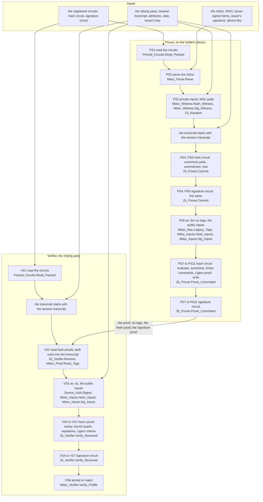

# The system map

The proof of age from end to end, step by step, with the units that implement each step. The prover's steps are PS1 to PS11 and the verifier's VS1 to VS8. They are the rows of the performance matrix ([performance page](performance.md)) and the names the chapters' diagrams use. They are not rows of the [trusted base register](trusted-base.md), whose identifiers (P1, V1 and the others) name trusted items.

The same flow in short, without the units, is the figure of [A11.2](00-primer-cryptography.md#a112-the-two-circuits-of-the-proof-of-age).

## D1, the proof of age from end to end

*D1. What it simplifies: the steps PS4 and PS5, and PS7 to PS11, are drawn once per circuit and listed in full in D6 and D7 ([performance page](performance.md)); the checks that refuse an input before any work (the supported profile, the witness builder's statuses, the lengths) are not drawn; on the path from the witness files, PS2 does not run and PS3 reads the private inputs from the files. The protocol is Section 5 of draft-irtf-cfrg-longfellow-00 for each circuit; the binding of the two circuits by the tags is upstream's `applications/mdoc_zk` ([chapter 9, Section 1.3](09-mdoc.md#13-the-tags-that-bind-the-two-proofs)). The units named are the generic units; the programs use their instances over GF(2^128) for the hash circuit and over the base field of P-256 for the signature circuit.*

### Where it is in the code

| Box | Units | Key subprograms | Assurance | Harnesses and vectors | Draft and records | Upstream |
|---|---|---|---|---|---|---|
| PS1, VS1 | [`Pinned_Circuits`](../../cli/src/pinned_circuits.ads), [`Circuit_Reader`](../../src/circuit_reader.ads), [`Packed_Circuits`](../../src/packed_circuits.ads), [`Uleb128`](../../src/uleb128.ads), [`Circuit_Status`](../../src/circuit_status.ads), [`Mdoc_Cli`](../../cli/src/mdoc_cli.ads) | `Read_Packed`, `Load_Circuits` | `Read_Packed` proved on the expansion: well formed, the identifier; `Pinned_Circuits` outside the proofs; partition `circuits` | `circuit_kat`; the `cli` step | Section 7.2; ADR 0074, ADR 0080 | `mdoc_zk_artifacts::load_circuit_v2` |
| PS2 | [`Mdoc_Parse`](../../src/mdoc_parse.ads), [`Cbor_Parse`](../../src/cbor_parse.ads) | `Parse`, `Parse_Exact` | Silver on any bytes, Gold on the invariants of the table; partition `mdoc-parse` | `mdoc_parse_kat`, the 38 test documents | ADR 0086; [chapter 9, Section 3.6](09-mdoc.md#36-the-parse-of-the-document-and-the-sha-256-trace) | `mdoc_zk_circuits::cbor::mdoc::parse_mdoc` |
| PS3 | [`Mdoc_Witness`](../../src/mdoc_witness.ads), [`Ecdsa_Witness`](../../src/ecdsa_witness.ads), [`Sha256.Trace`](../../src/sha256-trace.ads), [`P256_Curve`](../../src/p256_curve.ads), [`Q256_Field`](../../src/q256_field.ads), [`Cli_Random`](../../cli/src/cli_random.ads), [`Os_Random`](../../cli/src/os_random.ads) | `Hash_Witness`, `Sig_Witness`, `Push_Legacy` | Gold on the encoders and the pads at the end of the hash witness, Silver otherwise; the source of fresh bytes trusted; partitions `mdoc-parse`, `ecdsa` | `mdoc_witness_kat`, `ecdsa_kat`, `q256_kat` | ADR 0086, ADR 0050; [chapter 9, Section 3.7](09-mdoc.md#37-the-two-witnesses-and-the-proof-from-the-document) | `push_witness_hash`, `push_witness_sig`, `generate_mac_ap` |
| PS4 | [`Sumcheck_Prover`](../../src/sumcheck_prover.ads), [`Sampling`](../../src/sampling.ads), [`Simple_Rng`](../../src/simple_rng.ads) | `Sample_Pads` | Silver for any random byte stream; partition `prover` | `prover_kat` | Section 6.6; ADR 0050 | `runtime_zk::prover::new_pad` |
| PS5 | [`Zk_Prover`](../../src/zk_prover.ads), [`Ligero_Prover`](../../src/ligero_prover.ads), [`Additive_Fft`](../../src/additive_fft.ads), [`Rfft_P256`](../../src/rfft_p256.ads), [`Merkle`](../../src/merkle.ads), [`Ligero_Geometry`](../../src/ligero_geometry.ads) | `Commit`, `Encode_Row`, `Merkle.Build` | Silver; the systematic part of a row proved, its parity by the FFT tested (register row V2); `Merkle.Build` proved against the heap; partitions `ligero-prover`, `primitives` | `prover_kat`, `fft_kat`, `ligero_kat` | Sections 4.1, 4.2, 4.3; ADR 0057, ADR 0085 | `runtime_ligero::prover::LigeroProver::commit` |
| PS6 | [`Mdoc_Mac`](../../src/mdoc_mac.ads), [`Mdoc_Inputs`](../../src/mdoc_inputs.ads), [`Mdoc_Proof`](../../src/mdoc_proof.ads), [`Transcript`](../../src/transcript.ads) | `Legacy_Tags`, `Hash_Inputs`, `Sig_Inputs`, `Write_Tags`, `Get_Random_Bytes` | the six products proved; `Hash_Inputs` proved to fill exactly its elements, the tags and av last; `Sig_Inputs` proved for its first four elements, the rest tested; partition `mdoc` | `mdoc_kat` | ADR 0058; [chapter 9, Section 1.3](09-mdoc.md#13-the-tags-that-bind-the-two-proofs) | `push_macs`, `push_input_hash`, `push_input_sig` |
| PS7 | [`Packed_Eval`](../../src/packed_eval.ads) | `Eval_Circuit` | Gold on the expansion; partition `packed_hquad` | `prover_kat` | Section 6.3; ADR 0072, ADR 0080 | `runtime_sumcheck::eval_circuit` |
| PS8 | [`Sumcheck_Prover`](../../src/sumcheck_prover.ads), [`Sumcheck_Transcript`](../../src/sumcheck_transcript.ads), [`Packed_Hquad`](../../src/packed_hquad.ads), [`Sumcheck_Algebra`](../../src/sumcheck_algebra.ads) | `Prove`, `Write_Sumcheck_Statement`, `Bind_Merge`, `Bind_In_Place`, `Eq2_Table` | Silver; the bound quads Gold; `Bind_Merge` Gold, except without the eq2 table (Logv above 24), where it proves the run count only and its coefficients are tested; `Round_Evals` against a ghost transcription; partitions `prover`, `protocol`, `packed_hquad`, `sumcheck` | `prover_kat`, `sumcheck_kat`, `circuit_kat` | Section 6.6; ADR 0063, ADR 0080 | `runtime_sumcheck::prover::prove_core` |
| PS9 | [`Sumcheck_Verifier`](../../src/sumcheck_verifier.ads), [`Sumcheck_Expression`](../../src/sumcheck_expression.ads), [`Sumcheck_Prover`](../../src/sumcheck_prover.ads) | `Verifier_Core`, `Lqc_Triples` | Silver; `Lqc_Triples` equal to the core's layout; partition `protocol` | `prover_kat`, `sumcheck_kat` | Section 6.7; ADR 0022 | `symbolic_sumcheck_verifier_core` |
| PS10 | [`Ligero_Prover`](../../src/ligero_prover.ads), [`Merkle`](../../src/merkle.ads) | `Prove`, `Merkle.Open` | Silver; `Open` produces what `Verify` consumes; partitions `ligero-prover`, `primitives` | `prover_kat`, `ligero_kat` | Section 4.4 | `runtime_ligero::prover::LigeroProver::prove` |
| PS11 | [`Proof_Writer`](../../src/proof_writer.ads), [`Mdoc_Proof`](../../src/mdoc_proof.ads) | `Write_Proof` | exactly `Proof_Len` bytes, `Well_Coded` at the reader's offset; partition `prover` | `writer_kat`; the `cli` step, byte identity | Sections 7.3, 7.4, 7.5 | `MdocProof::write` |
| VS2 | [`Zk_Verifier`](../../src/zk_verifier.ads), [`Ligero_Proof`](../../src/ligero_proof.ads), [`Mdoc_Proof`](../../src/mdoc_proof.ads) | `Receive`, `Read_Proof_Prefix`, `Read_Tags` | statuses proved as stated; the reader's rules of Section 7.4; partitions `verifier`, `ligero`, `mdoc` | `ligero_kat`, `mdoc_kat` | Sections 7.3, 7.4, 7.5; ADR 0085 | `MdocProof::read` |
| VS3 | [`Device_Auth`](../../src/device_auth.ads), [`Mdoc_Inputs`](../../src/mdoc_inputs.ads), [`Mdoc_Mac`](../../src/mdoc_mac.ads) | `Digest`, `Hash_Inputs`, `Sig_Inputs` | Silver, tested; partition `mdoc` | `mdoc_kat` | ADR 0058 | `run_mdoc_verifier_inner` |
| VS4 | [`Sumcheck_Transcript`](../../src/sumcheck_transcript.ads) | `Replay_From_Statement` | the statement proved on the ghost sequence of the absorbed bytes; partition `protocol` | `sumcheck_kat` | Sections 3, 6.5 | `write_sumcheck_statement` |
| VS5 | [`Zk_Verifier`](../../src/zk_verifier.ads), [`Packed_Hquad`](../../src/packed_hquad.ads) | `Bound_Quads`, `Bind_Merge` | Gold against `BQ_Ref` on the expansion; partitions `verifier`, `packed_hquad` | `circuit_kat`, `sumcheck_kat` | Section 6.7; ADR 0073, ADR 0080 | inside `symbolic_sumcheck_verifier_core` |
| VS6 | [`Sumcheck_Verifier`](../../src/sumcheck_verifier.ads) | `Verifier_Core` | Silver; emits only terms below `Witness_Count`; partition `protocol` | `sumcheck_kat` | Section 6.7; ADR 0073 | `symbolic_sumcheck_verifier_core` |
| VS7 | [`Ligero_Verifier`](../../src/ligero_verifier.ads), [`Lagrange`](../../src/lagrange.ads), [`Merkle`](../../src/merkle.ads), [`Fisher_Yates`](../../src/fisher_yates.ads) | `Verify`, `Verify_Merkle`, `Verify_LDT`, `Build_A_Full`, `Verify_Dot`, `Verify_Quad` | the three tests proved against Sections 4.4 and 4.5; `Merkle.Verify` and `Lagrange` proved; partitions `verifier`, `ligero`, `primitives` | `ligero_kat` | Section 4.5; ADR 0036 | `runtime_ligero::verifier::verify` |
| VS8 | [`Mdoc_Verifier`](../../src/mdoc_verifier.ads), [`Mdoc_Spec`](../../src/mdoc_spec.ads), [`Mdoc_Status`](../../src/mdoc_status.ads), [`Verifier_Status`](../../src/verifier_status.ads) | `Verify_Profile`, `Select_Profile` | Silver, statuses proved as stated; partition `mdoc` | `mdoc_kat`; the `cli` step | ADR 0089 | `run_mdoc_verifier` |
| PS1 to PS11 | [`Mdoc_Prover`](../../src/mdoc_prover.ads), [`Mdoc_Prover_Lib`](../../src/mdoc_prover_lib.ads), [`Mdoc_Prover_Cli`](../../cli/src/mdoc_prover_cli.ads), [`Prover_Status`](../../src/prover_status.ads) | `Prove_Profile`, `Prove_Mdoc`, `Prove` | Silver with the ownership checks; statuses proved as stated; partition `mdoc` | `mdoc_kat`; the `cli` step | ADR 0085, ADR 0089 | `run_mdoc_prover_inner` |

### Under every step

The units every step uses. They take the step of the subprogram that calls them, in the performance matrix as here.

| Box | Units | What | Assurance |
|---|---|---|---|
| Under every step | [`GF2_128`](../../src/gf2_128.ads), [`Clmul64`](../../src/clmul64.ads), [`Field_GF2_128`](../../src/field_gf2_128.ads), [`Field_GF2_128.Laws`](../../src/field_gf2_128-laws.ads) | GF(2^128) | Gold on the field operations |
| Under every step | [`P256_Field`](../../src/p256_field.ads), [`Field_P256`](../../src/field_p256.ads), [`Field_P256.Laws`](../../src/field_p256-laws.ads) | the base field of P-256 | Gold against the integer model |
| Under every step | [`Field_Signature`](../../src/field_signature.ads), [`Ring_Laws`](../../src/ring_laws.ads) | what a field provides to the generic units | by definition |
| Under every step | [`Sha256`](../../src/sha256.ads), [`Aes256`](../../src/aes256.ads), [`Transcript`](../../src/transcript.ads) | the hash and the transcript's generator | Silver, tested against the standards' vectors |
| Under every step | [`Bytes`](../../src/bytes.ads), [`Cbor_Encode`](../../src/cbor_encode.ads), [`Proof_Levels`](../../src/proof_levels.ads) | bytes, CBOR heads, the assertion level | Gold or by definition |

### The programs

| Box | Units | What | Assurance |
|---|---|---|---|
| The programs | [`Longfellow_Prove_Mdoc`](../../cli/src/longfellow_prove_mdoc.adb), [`Longfellow_Verify_Mdoc`](../../cli/src/longfellow_verify_mdoc.adb) | the proof of age, the two programs of D1 | outside the proofs; the `cli` step of `make check` |
| The programs | [`Longfellow_Prove`](../../cli/src/longfellow_prove.adb), [`Longfellow_Verify`](../../cli/src/longfellow_verify.adb) | one circuit, one proof: PS4, PS5 and PS7 to PS11 for one circuit, with its own witness file | outside the proofs; the `cli` step |
| The programs | [`Interop_Kat`](../../cli/src/interop_kat.adb), [`First_Step_Bench`](../../cli/src/first_step_bench.adb) | harnesses on the release build: upstream's proofs accepted; the first step of the sumcheck compared and timed | outside the proofs; the `cli` step |
